# Vedic Heritage Platform — Database Architecture & Schema Specification
**Version:** 2.1.0  
**Status:** Approved Specification (Phase 10 Tripartite TranslationView & Scholarly Certification)  
**ORM Implementation:** SQLAlchemy 2.0 (`database/models.py`)  
**Validation Schemas:** Pydantic V2 (`database/schemas.py`)  

---

## 1. Entity-Relationship (ER) Diagram

```mermaid
erDiagram
    SOURCES ||--o{ SOURCE_EDITIONS : publishes
    SOURCES ||--o{ CONTENT_RIGHTS : provides
    CATEGORIES ||--o{ CATEGORIES : "parent / subcategory"
    CATEGORIES ||--o{ TEXTS : classifies
    DEITIES ||--o{ TEXTS : dedicated_to
    TEXTS ||--o{ SOURCE_EDITIONS : based_on
    TEXTS ||--o{ TEXT_VERSIONS : preserves
    TEXTS ||--o{ VERSES : contains
    TEXTS ||--|| CONTENT_RIGHTS : governed_by
    TEXTS ||--o{ RIGHTS_GRANTS : cleared_by
    TEXTS ||--o{ MEDIA_ASSETS : accompanied_by
    TEXTS ||--o{ VERIFICATION_AUDIT_LOGS : audits
    TEXTS ||--o{ DUPLICATE_CANDIDATES : compares
    VERSES ||--o{ TRANSLITERATIONS : rendered_in
    VERSES ||--o{ TRANSLATIONS : translated_into
    VERSES ||--o{ TRANSLATION_VIEWS : expressed_in
    TRANSLATIONS ||--o{ TRANSLATION_VIEWS : decomposes_into
    CONTRIBUTORS ||--o{ TRANSLATIONS : translates
    CONTRIBUTORS ||--o{ TRANSLATIONS : reviews

    TEXTS {
        int id PK
        string content_id UK "e.g. VEDA-TXT-00001"
        string uuid UK
        string canonical_title
        string devanagari_title
        string raw_source_script
        text raw_source_text "Immutable"
        text canonical_scholarly_text
        int deity_id FK
        int primary_category_id FK
        string original_language "sa, awa"
        string composer
        string rishi
        string chandas
        string devata
        string content_hash "SHA-256"
        int verse_count
    }

    SOURCE_EDITIONS {
        int id PK
        int text_id FK
        int source_id FK
        string edition_title
        string publisher
        string editor_name
        int publication_year
        string isbn_or_call_number
        boolean is_primary_critical_edition
    }

    RIGHTS_GRANTS {
        int id PK
        int text_id FK
        string ip_layer "COMPOSITION, EDITION, TRANSLATION, AUDIO"
        string jurisdiction "IN, US, EU, GB, GLOBAL"
        string license_type
        boolean commercial_reuse_authorized
        string contract_reference
        boolean is_legally_approved
        string legal_reviewer
        string status "GREEN, AMBER, RED"
    }

    MEDIA_ASSETS {
        int id PK
        int text_id FK
        string media_type "AUDIO_CHANT, JAPA_LOOP, VIDEO_LONG"
        string title
        string file_path
        float duration_seconds
        int repetition_count "108"
        string license_type
        boolean commercial_release_cleared
    }

    CONTENT_RIGHTS {
        int id PK
        int text_id FK, UK
        string original_author_attribution
        string primary_source
        string specific_edition
        string license_type "PUBLIC_DOMAIN, PARTNER"
        boolean commercial_reuse_permitted
        string territory_restriction "GLOBAL, IN"
        boolean is_legally_approved
        string legal_reviewer
        string release_status "GREEN, AMBER, RED"
    }

    VERSES {
        int id PK
        int text_id FK
        string verse_id UK "e.g. VEDA-TXT-00001-V001"
        int verse_number
        string verse_type "VERSE, DOHA, MANTRA"
        text raw_source_text
        text devanagari_text
        text iast_text
        boolean vedic_accents_present
        json vedic_accent_annotations
    }

    TRANSLITERATIONS {
        int id PK
        int verse_id FK
        string target_script "telugu, tamil, kannada, malayalam"
        text script_text
        boolean is_lossless
    }

    TRANSLATIONS {
        int id PK
        int verse_id FK
        string target_language "en, hi, te, ta, kn"
        string translation_type "BHAVARTHA, PADACHHEDA"
        text translated_text
        json word_by_word_json
        string review_status "DRAFT, APPROVED"
    }

    TRANSLATION_VIEWS {
        int id PK
        string view_id UK "e.g. VIEW-TR-00001-BHAVARTHA-v1"
        int translation_id FK
        int verse_id FK
        string target_language "en, hi, te, ta, kn, mr, bn, gu, ml, or"
        string view_type "BHAVARTHA, LITERAL, TATPARYA"
        text view_text
        int version "1"
        string source_reference
        string translator_provenance
        string review_status "DRAFT, SCHOLAR_REVIEWED, APPROVED"
        string reviewer
        string reviewer_affiliation
        datetime reviewed_at
        text approval_notes
        json approval_history_json
    }

    REVIEWER_PROFILES {
        int id PK
        string reviewer_id UK "e.g. REV-SCH-001"
        string full_name
        string email
        string primary_role "SANSKRIT_TEXTUAL, VEDIC_RECENSION, etc."
        json secondary_roles
        json areas_of_expertise
        json language_proficiency
        string sanskrit_proficiency
        string vedic_specialization
        string academic_qualifications
        string institutional_affiliation
        boolean is_credentials_verified
        string verification_method
        datetime verification_date
        json permissions
        boolean is_active
        string password_hash "Argon2id (m=64MB, t=3, p=4) with legacy PBKDF2 migration"
        boolean is_demonstration "True for test harness fixtures, False for production scholars"
        string verification_status "DEMO, PENDING_VERIFICATION, VERIFIED, REJECTED, DEACTIVATED"
        string account_category "REAL_HUMAN_SCHOLAR, SYNTHETIC_TEST_PERSONA, DEMONSTRATION_HARNESS"
        boolean is_human_verified "True only for verified living human scholars"
        string verification_doc_hash "SHA-256 hash of credential documents"
        string verification_authority
        string verified_by_admin
        text verification_notes
        datetime last_login_at
        int failed_login_attempts
        boolean is_locked
    }

    REVIEWER_SESSIONS {
        int id PK
        string session_token UK "32-byte cryptographic random token (256-bit entropy)"
        int reviewer_id FK
        datetime created_at
        datetime expires_at
        datetime last_activity_at "Server-side 30-min idle inactivity timeout"
        datetime absolute_expires_at "Absolute 12-hour expiration limit"
        boolean is_revoked
        string client_ip
        string user_agent
    }

    AUTH_AUDIT_LOGS {
        int id PK
        int reviewer_id
        string event_type "LOGIN_SUCCESS, LOGIN_FAILED, ACCOUNT_LOCKED, SESSION_ROTATED, CREDENTIALS_VERIFIED"
        string ip_address
        text details
        datetime created_at
    }

    REVIEW_ASSIGNMENTS {
        int id PK
        string assignment_id UK "e.g. ASGN-20261105-001"
        int reviewer_id FK
        int text_id FK
        int verse_id FK
        string target_language
        string view_type
        string priority "LOW, NORMAL, HIGH, URGENT"
        string status "PENDING, IN_PROGRESS, COMPLETED, REASSIGNED, DISPUTED"
        datetime deadline
        text notes
        string assigned_by
        datetime assigned_at
        datetime completed_at
        int reassigned_to_id FK
    }

    REVIEW_ACTION_LOGS {
        int id PK
        string action_id UK "e.g. ACT-20261105-001"
        int assignment_id FK
        int translation_id FK
        int translation_view_id FK
        int verse_id FK
        int reviewer_id FK
        string action_type "APPROVE, APPROVE_WITH_CORRECTIONS, REQUEST_REVISION, REJECT, ESCALATE"
        string previous_status
        string new_status
        text previous_text
        text proposed_text
        string feedback_category "ORIGINAL_TEXT_CONCERN, SANSKRIT_GRAMMAR_ISSUE, etc."
        text scholarly_commentary
        json traditional_references
        json alternative_readings
        datetime created_at
    }

    TEXTUAL_DISPUTES {
        int id PK
        string dispute_id UK "e.g. DSP-20261105-001"
        int verse_id FK
        int translation_id FK
        int translation_view_id FK
        string dispute_nature
        json opinion_a_json
        json opinion_b_json
        string status "OPEN, UNDER_SECONDARY_REVIEW, REFERRED_TO_EDITORIAL_BOARD, RESOLVED_PRESERVED_BOTH"
        text editorial_resolution_notes
        string resolved_by
        datetime resolved_at
        datetime created_at
    }

    AI_ANNOTATION_PROVENANCES {
        int id PK
        string annotation_id UK "e.g. AI-ANN-20261105-001"
        int verse_id FK
        string annotation_type "PADACHHEDA, ANVAYA, GRAMMAR, WORD_MEANING, CHANDAS, PRONUNCIATION, SOURCE_CITATION"
        string provider_name
        string model_version
        string prompt_template_version
        string prompt_hash
        json output_payload_json
        float confidence_score
        boolean is_suggestion_only "True"
        boolean is_human_reviewed "False"
        int human_reviewer_id FK
        text human_correction_notes
        float estimated_cost_usd
        datetime created_at
    }
```

---

## 8. Phase 10.1 Test Isolation & Production Immutability Governance

Phase 10.1 established complete test database isolation without requiring database schema alterations or Alembic migrations:
- **Alembic Head Revision:** Remains identical at `9f3c8a1b2d4e (head)`.
- **Database Safety Guard:** Implemented in `automation/database/safety.py`, enforcing that all automated test executions operate against disposable temporary SQLite clones.
- **Production Immutability:** The production database `database/vedam.db` is strictly locked against test connections, guaranteeing that TranslationView version counters and review histories are never altered during test runs.

