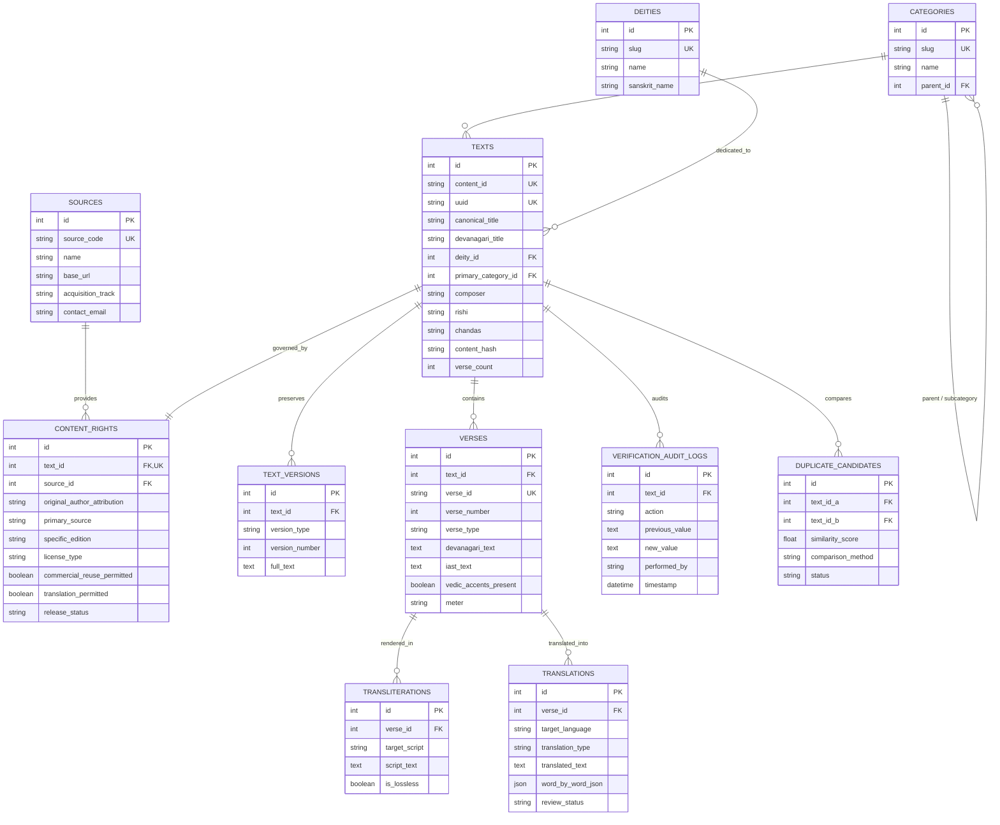

# Vedic Heritage Platform — Database Architecture & Schema Specification
**Version:** 1.0.0  
**Status:** Approved Specification (Phase 1, Step 6)  
**ORM Implementation:** SQLAlchemy 2.0 (`database/models.py`)  
**Validation Schemas:** Pydantic V2 (`database/schemas.py`)  

---

## 1. Entity-Relationship (ER) Diagram

---

## 2. Table Specifications & Cardinalities

### 2.1 `texts` (Master Sacred Text Entity)
- **Primary Key:** `id` (Integer autoincrement).
- **Unique Indexes:** `content_id` (`VEDA-TXT-XXXXX`), `uuid` (UUIDv4).
- **Secondary Indexes:** `canonical_title`, `content_hash`, `primary_category_id`, `deity_id`.
- **Purpose:** Acts as the single immutable anchor for all versions, verses, translations, and downstream publication handoffs.

### 2.2 `verses` (Granular Stanza Entity)
- **Primary Key:** `id` (Integer autoincrement).
- **Unique Index:** `verse_id` (`VEDA-TXT-XXXXX-VXXX`).
- **Composite Index:** `(text_id, verse_number)`.
- **Fields:**
  - `devanagari_text`: Canonical Sanskrit text in UTF-8.
  - `vedic_accents_present`: Flag indicating presence of combining characters (U+0951 Svarita, U+0952 Anudatta).
  - `verse_type`: `INVOCATION`, `VERSE`, `DOHA`, `CHAUPAI`, `MANTRA`, `PHALASRUTI`, `COLOPHON`.

### 2.3 `transliterations` (Multi-Script Projections)
- **Foreign Key:** `verse_id` references `verses.id` (ON DELETE CASCADE).
- **Unique Constraint:** `(verse_id, target_script)`.
- **Supported Scripts:** Telugu, Tamil, Kannada, Malayalam, Bengali, Gujarati, Odia, Assamese, Punjabi, Devanagari, Roman IAST.

### 2.4 `translations` (Multilingual Interpretations & Padachheda)
- **Foreign Key:** `verse_id` references `verses.id` (ON DELETE CASCADE).
- **Unique Constraint:** `(verse_id, target_language, translation_type)`.
- **Fields:**
  - `translation_type`: `LITERAL`, `BHAVARTHA`, `PADACHHEDA`, `TATPARYA`.
  - `word_by_word_json`: Structured array of grammatical tokens: `[{"word": "...", "padachheda": "...", "meaning": "..."}]`.
  - `review_status`: `DRAFT`, `SCHOLAR_REVIEWED`, `APPROVED`.

### 2.5 `content_rights` (Rights & Provenance Enforcement)
- **Foreign Key:** `text_id` references `texts.id` (1-to-1 relationship, UNIQUE).
- **Foreign Key:** `source_id` references `sources.id`.
- **Release Status Enum:**
  - `GREEN`: Approved for commercial publishing and public mobile distribution.
  - `AMBER`: Pending legal verification or partner contract signature.
  - `RED`: Prohibited for commercial publication.

---

## 3. Database Migration Strategy (Alembic)

- For development, SQLite (`database/vedam.db`) provides instant zero-dependency testing.
- For production, Alembic handles transactional DDL migrations against PostgreSQL.
- Migration scripts will reside in `database/migrations/versions/`.
