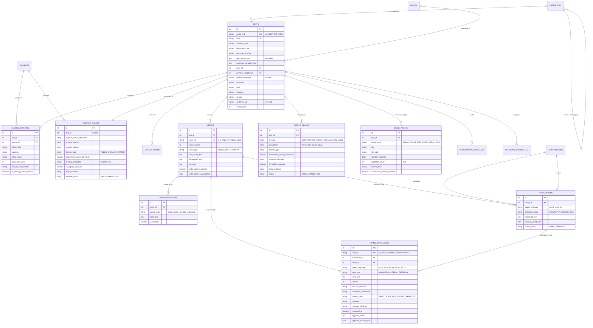

# Vedic Heritage Platform — Database Architecture & Schema Specification
**Version:** 2.0.0  
**Status:** Approved Specification (Phase 2 Authorization)  
**ORM Implementation:** SQLAlchemy 2.0 (`database/models.py`)  
**Validation Schemas:** Pydantic V2 (`database/schemas.py`)  

---

## 1. Entity-Relationship (ER) Diagram

