# Vedic Heritage Platform — Multilingual Localization Architecture
**Document Version:** 6.0.0  
**Phase:** Phase 6A Foundation  
**Scope:** Architecture specification for the 22 Scheduled Languages of India + English, Script Decoupling, Sanskrit Terminology Standardization, Transliteration Models, Translation Workflow, and Quality Assurance.

---

## 1. Architectural Philosophy: Sacred Preservation in a Multilingual Federation

India's spiritual literature originated in Sanskrit, yet over millennia it was transmitted, recited, and commented upon through diverse regional scripts and mother tongues. A singular text (such as the *Gayatri Mantra* or *Sri Suktam*) can be chanted in Devanagari by a scholar in Varanasi, in Telugu script by an Archaka in Tirumala, in Grantha or Tamil by an Odhuvar in Chidambaram, or in Kannada by a priest in Sringeri — while carrying identical sacred phonetic vibratory value.

Our architectural mandate enforces four core principles:
1. **Decoupling of Language from Script:** Language identifiers (ISO 639-1 / ISO 639-3) and Script identifiers (ISO 15924) are strictly decoupled. One language may be written in several scripts (e.g. Sanskrit in Devanagari, Telugu, Grantha, Malayalam, Kannada, IAST); one script may serve multiple languages.
2. **Translation Layer Independence:** Translations are strictly separated into *Literal (Word-for-Word)*, *Devotional (Bhavartha)*, *Syntactical (Anvaya)*, and *Philosophical (Tatparya)*. A translation is NEVER conflated with a phonetic transliteration.
3. **Scholarly Governance & Non-Automation of Approval:** AI may assist in preliminary drafting, but **no translation may be released for commercial publication or public mobile distribution without documented sign-off from an accredited native-language scholar**.
4. **Vedic Phonetic Fidelity:** Indic scripts lacking separate plosive voicing distinctions (e.g., standard Tamil) are augmented with Grantha script and Scholarly Phonetic subscript conventions (e.g., $க_1, க_2, க_3, க_4$).

---

## 2. Language and Script Matrix

The platform supports the **22 Scheduled Languages of the Eighth Schedule of the Constitution of India**, with **English** as an additional global bridge language (23 total). Sanskrit is listed once as one of the 22.

```mermaid
flowchart TD
    subgraph Scheduled22 ["Eighth Schedule Languages (22)"]
        direction TB
        L1["Sanskrit (sa / san) - Root Liturgical"]
        L2["Hindi (hi / hin)"]
        L3["Telugu (te / tel)"]
        L4["Tamil (ta / tam)"]
        L5["Kannada (kn / kan)"]
        L6["Malayalam (ml / mal)"]
        L7["Bengali (bn / ben)"]
        L8["Gujarati (gu / guj)"]
        L9["Marathi (mr / mar)"]
        L10["Odia (or / ori)"]
        L11["Punjabi (pa / pan)"]
        L12["Assamese (as / asm)"]
        L13["Maithili (mai)"]
        L14["Nepali (ne / nep)"]
        L15["Konkani (kok)"]
        L16["Dogri (doi)"]
        L17["Bodo (brx)"]
        L18["Santali (sat)"]
        L19["Kashmiri (ks / kas)"]
        L20["Sindhi (sd / snd)"]
        L21["Manipuri (mni)"]
        L22["Urdu (ur / urd)"]
    end
    subgraph Bridge ["Global Bridge Language"]
        L23["English (en / eng)"]
    end
```



### Script Support & Font Stacks

| Script Code (ISO 15924) | Script Name | Autonym | Vedic Swaras | OpenType Shaping | Recommended System Font Stack |
| :--- | :--- | :--- | :---: | :---: | :--- |
| `Deva` | Devanagari | देवनागरी | **YES** | YES | `Nirmala UI`, `Noto Sans Devanagari`, `Siddhanta` |
| `Telu` | Telugu | తెలుగు | **YES** | YES | `Nirmala UI`, `Gautami`, `Noto Sans Telugu` |
| `Taml` | Tamil | தமிழ் | No (Traditional) | YES | `Nirmala UI`, `Latha`, `Noto Sans Tamil` |
| `Gran` | Grantha | 𑌗𑍍𑌰𑌨𑍍𑌥 | **YES** | YES | `Noto Sans Grantha`, `e-Grantha` |
| `Knda` | Kannada | ಕನ್ನಡ | **YES** | YES | `Nirmala UI`, `Tunga`, `Noto Sans Kannada` |
| `Mlym` | Malayalam | മലയാളം | **YES** | YES | `Nirmala UI`, `Kartika`, `Noto Sans Malayalam` |
| `Beng` | Bengali-Assamese | বাংলা-অসমীয়া | No | YES | `Nirmala UI`, `Vrinda`, `Noto Sans Bengali` |
| `Gujr` | Gujarati | ગુજરાતી | No | YES | `Nirmala UI`, `Shruti`, `Noto Sans Gujarati` |
| `Guru` | Gurmukhi | ਗੁਰਮੁਖੀ | No | YES | `Nirmala UI`, `Raavi`, `Noto Sans Gurmukhi` |
| `Orya` | Odia | ଓଡ଼ିଆ | No | YES | `Nirmala UI`, `Kalinga`, `Noto Sans Oriya` |
| `Latn` | Latin (IAST / ISO 15919) | IAST | **YES** | No | `Calibri`, `Gentium Plus`, `Noto Serif` |

---

## 3. Specialized Tamil Transliteration Architecture

Classical Tamil orthography has 18 consonants and does not differentiate between unvoiced and voiced plosives ($k, g$) or unaspirated and aspirated consonants ($k, kh$). To represent sacred Sanskrit verses authentically for Tamil-speaking devotees without distorting phonetic vibration, the platform provides three clearly separated modes:

1. **Standard Tamil (`TamilTransliterationMode.STANDARD`):** Traditional Tamil assimilation for general devotional reading.
2. **Grantha-Extended Tamil (`TamilTransliterationMode.GRANTHA_EXTENDED`):** Uses Tamil characters combined with recognized Grantha consonants (`ஶ` śa, `ஜ` ja, `ஷ` ṣa, `ஸ` sa, `ஹ` ha, `க்ஷ` kṣa).
3. **Scholarly Phonetic Tamil (`TamilTransliterationMode.SCHOLARLY_PHONETIC`):** Incorporates subscript numbers ($₁, ₂, ₃, ₄$) after base Tamil consonants to specify the exact varga position:
   - $க_1$ ($ka$), $க_2$ ($kha$), $க_3$ ($ga$), $க_4$ ($gha$), $ங$ ($ṅa$)
   - $ச_1$ ($ca$), $ச_2$ ($cha$), $ஜ$ ($ja$), $ஜ_2$ ($jha$), $ஞ$ ($ña$)
   - $ட_1$ ($ṭa$), $ட_2$ ($ṭha$), $ட_3$ ($ḍa$), $ட_4$ ($ḍha$), $ண$ ($ṇa$)
   - $த_1$ ($ta$), $த_2$ ($tha$), $த_3$ ($da$), $த_4$ ($dha$), $ந$ ($na$)
   - $ப_1$ ($pa$), $ப_2$ ($pha$), $ப_3$ ($ba$), $ப_4$ ($bha$), $ம$ ($ma$)

---

## 4. Multilingual Translation Workflow & Governance

```
[Original Sanskrit Text]
          │
          ▼
   [Draft Generation] (AI Assistance / Draft Translation)
          │
          ▼
   [ReviewStatus.DRAFT] ◄── Initial State (Allowed ONLY for internal scholarly typesetting)
          │
          ▼
   [Native Language Scholar Review] (Grammar, Idiom, Bhakti sentiment)
          │
          ▼
   [Theological Consistency Check] (SanskritTerminologyGlossary validation)
          │
          ▼
   [ReviewStatus.SCHOLAR_APPROVED] (Requires reviewer credentials & review date)
          │
          ▼
   [Publication Release Gate] ──► Release to Mobile App & Commercial Books
```

---

## 5. Ten-Rule Language Quality Assurance Engine (`LanguageQualityAssuranceEngine`)

Every localized text is audited against 10 strict automated criteria before release:
1. `LANG-QA-001` **Translation Completeness:** Every verse must possess a translation in the requested language.
2. `LANG-QA-002` **Missing Verse Detection:** No gaps in verse sequence.
3. `LANG-QA-003` **Repeated Translation Detection:** No copy-pasting of identical text across distinct verses.
4. `LANG-QA-004` **Terminology Glossary Consistency Check:** Cross-references key theological terms against `SanskritTerminologyGlossary`.
5. `LANG-QA-005` **Unicode & Script Integrity Check:** Enforces Unicode NFC standard and blocks replacement characters (U+FFFD).
6. `LANG-QA-006` **OpenType Indic Shaping Check:** Asserts font compatibility and HarfBuzz OpenType complex shaping.
7. `LANG-QA-007` **Verse-by-Verse Alignment Check:** Validates substantial content length per verse.
8. `LANG-QA-008` **Transliteration Coverage Check:** Verifies presence of all primary regional script projections.
9. `LANG-QA-009` **Original Text Preservation Check:** Confirms original Sanskrit SHA-256 content hash matches raw source text.
10. `LANG-QA-010` **Review Provenance Check:** Asserts that approved status is accompanied by verified reviewer credentials.

---

## 6. Language Coverage Tiers & Dedicated Translation Views

### A. 22 Scheduled Indian Languages vs 9 Active Regional Workflows
The platform formally architected support for all **22 Scheduled Languages of the Eighth Schedule of the Constitution of India** (plus English as global bridge language).
The active production pipeline is organized in phases:
- **Active Operational Tier (9 Regional Languages + English):**
  - Hindi (`hi`), Telugu (`te`), Tamil (`ta`), Kannada (`kn`), Marathi (`mr`), Bengali (`bn`), Gujarati (`gu`), Malayalam (`ml`), Odia (`or`), and English (`en`).
  - 100% draft coverage across all 18 canonical compositions (307 source verses $\times$ 9 languages = 2,763 regional translations + 307 English = 3,070 total active translations).
- **Expansion Tier (Remaining 13 Scheduled Languages):**
  - Assamese (`as`), Punjabi (`pa`), Maithili (`mai`), Nepali (`ne`), Konkani (`kok`), Dogri (`doi`), Bodo (`brx`), Santali (`sat`), Kashmiri (`ks`), Sindhi (`sd`), Manipuri (`mni`), Urdu (`ur`), Sanskrit (`sa` as root).
  - Slated for staged ingestion with dedicated academic institution partnerships.

### B. Dedicated Translation View Architecture (`TranslationView`)
To eliminate ambiguous monolithic translations, each translation record decomposes into three independently versioned and reviewable granular views:
1. **Devotional Bhavartha (`BHAVARTHA`):**
   - Poetic, devotional rendering capturing the emotional essence and spiritual sentiment for prayer and liturgical chanting.
2. **Literal / Padachheda Dissection (`LITERAL`):**
   - Direct, word-by-word grammatical dissection reflecting the exact syntactical structure and root etymologies of the Sanskrit text.
3. **Traditional Exegesis (`TATPARYA`):**
   - Contextual commentary aligning with historical Sampradaya exegesis (e.g. Adi Shankaracharya, Sayana, Ramanuja, Raghavendra Swami).

Each `TranslationView` is tracked in the `translation_views` database entity with:
- Unique deterministic `view_id`
- Discrete `version` number
- Granular `review_status` (`DRAFT`, `SCHOLAR_REVIEWED`, `APPROVED`)
- Dedicated `translator_provenance` and accredited `reviewer` credentials
- Append-only `approval_history_json` forensic audit log.
