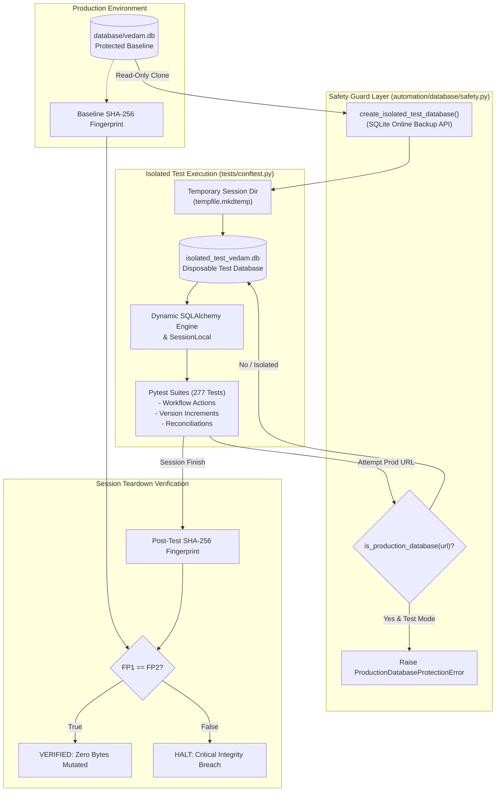

# PHASE 10.1 TEST DATABASE ISOLATION & DATA PROTECTION ARCHITECTURE

## 1. ARCHITECTURAL OVERVIEW

The Vedic Heritage Platform requires strict immutability of its sacred textual database (`database/vedam.db`). Prior to Phase 10.1, automated test suites and workflows shared the live SQLite database file, creating a vulnerability where legitimate review action tests incremented version counters on four live TranslationViews.

Phase 10.1 implements an end-to-end, multi-layered isolation architecture that guarantees:
1. **Zero Production Mutation:** Automated tests never connect to or modify `database/vedam.db`.
2. **Realistic End-to-End Persistence:** Tests continue to execute real SQL transactions, foreign keys, and rollbacks against point-in-time disposable clones created via SQLite's online backup API.
3. **Fail-Safe Defense in Depth:** Programmatic safety guards reject any test execution targeting production URLs with immediate exceptions.

---

## 2. CORE ARCHITECTURAL COMPONENTS

### 2.1 Safety Guard (`automation/database/safety.py`)
- **`ProductionDatabaseProtectionError`**: Custom runtime exception raised whenever test code or an unauthorized harness attempts to connect to production.
- **`is_production_database(path_or_url: str) -> bool`**: Normalizes path schemes (`sqlite:///`, relative `./`, absolute forward/backslashes), resolves symlinks, and performs case-insensitive comparisons against the canonical production path.
- **`assert_not_production_database(path_or_url: str, context: str)`**: Enforces the non-production boundary. If running in a test context (`VEDAM_TEST_MODE=1`, `PYTEST_CURRENT_TEST`, or `pytest` active in sys.modules), any match triggers an immediate hard failure.
- **`create_isolated_test_database(source_db_path, target_dir, filename)`**: Uses SQLite's native C-level backup API (`src_conn.backup(dst_conn)`) to produce a completely atomic, uncorrupted disposable test database containing all production fixtures.
- **`compute_database_fingerprint(db_path)`**: Calculates SHA-256 hashes for the file and for all individual records across critical tables (`texts`, `verses`, `translations`, `translation_views`, `reviewer_profiles`, `review_action_logs`, `sources`).
- **`verify_database_unmodified(baseline_fp, current_db_path)`**: Compares table counts and record hashes, reporting exact discrepancies if any byte is altered.

### 2.2 Dynamic Engine & Session Management (`database/connection.py`)
- Decouples engine instantiation from static module-level loading.
- If `is_test_environment()` and `is_production_database(DATABASE_URL)` evaluate to true at import time, engine binding to production is deferred.
- Provides `set_test_database_url(test_url: str)`, which asserts the target URL is not production, updates `os.environ["DATABASE_URL"]`, and reconfigures `engine` and `SessionLocal` singletons.
- In `get_db_session()`, evaluates `assert_not_production_database(active_url)` prior to yielding any session.

### 2.3 Centralized Pytest Harness (`tests/conftest.py`)
- Sets `os.environ["VEDAM_TEST_MODE"] = "1"` immediately upon import.
- Creates a session-wide isolated temporary directory and database clone.
- Reconfigures the database engine before test collection begins.
- Runs an `autouse=True` fixture before every individual test function to ensure no test altered the active connection to point to production.
- Executes `pytest_sessionfinish` to verify that `database/vedam.db` has remained 100% byte-for-byte identical to the pre-session fingerprint.

### 2.4 Alembic Environment Override Safeguard (`database/migrations/env.py`)
- Protects Alembic from environment variable collisions.
- When tests programmatically set `cfg.set_main_option("sqlalchemy.url", temp_target)`, `env.py` respects the explicit programmatic configuration rather than overriding it with `os.getenv("DATABASE_URL")`.

---

## 3. DEFENSE-IN-DEPTH MATRIX

| Threat / Failure Mode | Pre-Phase 10.1 Vulnerability | Phase 10.1 Defense Layer | Outcome |
| :--- | :--- | :--- | :--- |
| **Review Workflow Test Execution** | Tests run `APPROVE_WITH_CORRECTIONS` and call `db.commit()` on live DB | Cloned database in `tempfile.mkdtemp` handles all commits | Live production DB completely untouched |
| **Accidental Production URL in Test** | Test passes `"database/vedam.db"` to connection engine | `assert_not_production_database` halts execution | `ProductionDatabaseProtectionError` raised |
| **Global Singleton Retention** | `engine` bound at import time retained production pointer | `conftest.py` reconfigures singletons dynamically | All imported modules route to test DB |
| **Missing Environment Variable** | Code silently falls back to default `./database/vedam.db` | Fallback is caught by `assert_not_production_database` | Execution refused in test mode |
| **Silent Mutation Leakage** | Tests mutate data without assertion failures | `pytest_sessionfinish` runs table SHA-256 fingerprint check | Test suite fails if any byte in production changes |
| **Alembic Test Collisions** | Migration tests target active session DB | Explicit target URL respected in `env.py` | Migration tests isolate in independent temp files |

---

## 4. VERIFICATION RESULTS

- **Existing Tests Retained:** All 266 tests passed with zero assertion weakening.
- **New Isolation Tests:** 11 new tests in `tests/test_database_isolation_and_protection.py` passed.
- **Total Test Suite:** **277 passed in 26.04s (100% Green)**.
- **Production Non-Mutation:** Verified 100% byte-for-byte identical via SHA-256 cryptographic comparison.
