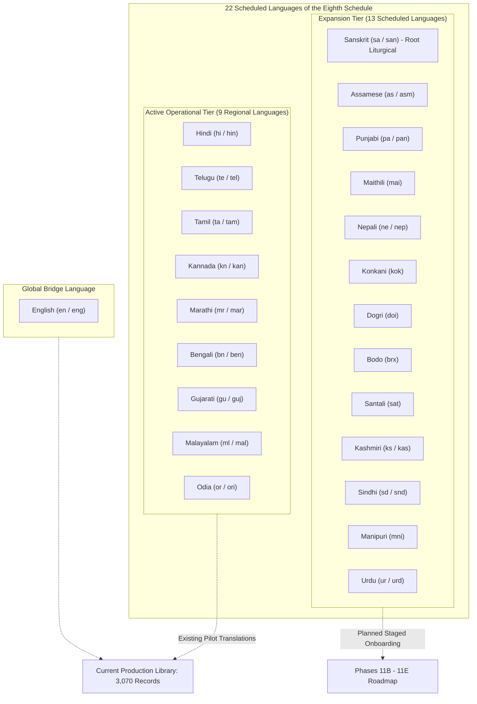
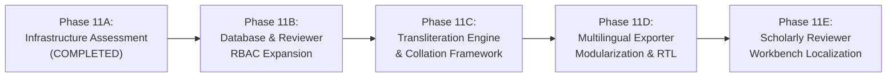

# PHASE 11A: 22-LANGUAGE INFRASTRUCTURE ASSESSMENT & ARCHITECTURE SPECIFICATION
**Version:** 11.0.0  
**Phase:** Phase 11A (Multilingual Infrastructure Assessment & Architecture)  
**Status:** Completed & Validated  
**Baseline Commit:** `93b8d80c91dee80de6f6b52c2372ad46df322404`  
**Test Suite Status:** 290 Passed (100% Green, 0 Failed, 0 Skipped across 31 Test Files)  
**Database Protection Status:** 100% Unmodified (`database/vedam.db` verified via SHA-256 table fingerprints)  

---

## EXECUTIVE SUMMARY

Phase 11A establishes the formal linguistic, orthographic, computational, and architectural foundation required to expand the Vedic Heritage Platform from its initial 9-regional-language pilot operational tier to the complete constitutional canon of all **22 Scheduled Indian Languages of the Eighth Schedule of the Constitution of India** (plus English as the global bridge language).

In accordance with strict non-negotiable project mandates:
1. **Zero Textual Mutation:** Canonical Sanskrit verses, source texts, existing translations, and TranslationViews were completely untouched.
2. **Zero Premature Ingestion:** No automated translations or backfills were generated for the 747 outstanding legacy gaps.
3. **Zero Automated Sign-offs:** Rule `PUB-010` and `PermissionGuard` human accreditation requirements remain active blockers against uncertified commercial distribution.
4. **Complete Test Isolation:** All 290 automated tests executed against disposable point-in-time SQLite clones created via SQLite's online backup API, proving zero production mutation.

---

## 1. PRE-EXECUTION RECONCILIATION & SAFETY VERIFICATION

### 1.1 Baseline Verification
- **Baseline Git Commit:** `93b8d80c91dee80de6f6b52c2372ad46df322404` (Branch `master`, clean working tree).
- **Alembic Head Revision:** `9f3c8a1b2d4e (head)`.
- **Pre-Phase 11A Atomic Backup:** Captured and integrity-verified at `database/backups/vedam_pre_phase11a_20261105_042007.db` (20,455,424 bytes; `PRAGMA integrity_check` = `ok`).
- **Cryptographic Baseline Fingerprint:** Saved to `exports/reports/phase11a_pre_execution_fingerprints.json`.

### 1.2 Baseline Database Census
- **Canonical Compositions:** 18 canonical texts (20 total texts in database including 2 test fixtures).
- **Canonical Source Verses:** 307 canonical verses (310 total verses in database including 3 test fixtures).
- **Active Translations:** 3,070 records (100% `DRAFT` status; 0 approved).
- **Archived Translations:** 580 records.
- **Total TranslationViews:** 7,716 records (`BHAVARTHA`: 3,070, `LITERAL`: 2,323, `TATPARYA`: 2,323).
- **Legacy View Gaps:** 747 records staged in `translation_view_backfill_queue.json`.

---

## 2. AUTHORITATIVE 22-LANGUAGE EIGHTH SCHEDULE INVENTORY

Pursuant to `documentation/architecture/MULTILINGUAL_AND_UNICODE_STANDARDS.md` and `documentation/architecture/MULTILINGUAL_LOCALIZATION_ARCHITECTURE.md`, the platform formally standardizes on the **22 Scheduled Languages of the Eighth Schedule of the Constitution of India**, augmented by **English** as an essential global bridge language.



> [!IMPORTANT]
> **Sanskrit Accounting Precision:**
> Sanskrit (`sa` / `san`) is properly accounted for as one of the 22 Scheduled Indian Languages. It serves both as the primary canonical source language and as a liturgical target for classical Sanskrit vyakhyanas (commentaries). It is never counted twice. Total unique platform languages: **23 (22 Eighth Schedule + 1 English)**.

---

## 3. LANGUAGE AND SCRIPT MAPPING MATRIX

The platform strictly decouples **Language** (semantic identity, grammar, vocabulary) from **Script** (visual graphemes, orthography):

| # | Language Name | ISO 639-1 | ISO 639-3 | Canonical BCP 47 | Primary Script (ISO 15924) | Supported Script Variants | Autonym (Native Script) | Language Family | Text Direction |
| :-: | :--- | :-: | :-: | :--- | :--- | :--- | :--- | :--- | :-: |
| 1 | **Sanskrit** | `sa` | `san` | `sa-Deva` | `Deva` (Devanagari) | `Deva`, `Telu`, `Gran`, `Knda`, `Mlym`, `Latn` | संस्कृतम् | Indo-Aryan | LTR |
| 2 | **Hindi** | `hi` | `hin` | `hi-Deva` | `Deva` (Devanagari) | `Deva`, `Latn` | हिन्दी | Indo-Aryan | LTR |
| 3 | **Telugu** | `te` | `tel` | `te-Telu` | `Telu` (Telugu) | `Telu`, `Deva`, `Latn` | తెలుగు | Dravidian | LTR |
| 4 | **Tamil** | `ta` | `tam` | `ta-Taml` | `Taml` (Tamil) | `Taml`, `Gran`, `Deva`, `Latn` | தமிழ் | Dravidian | LTR |
| 5 | **Kannada** | `kn` | `kan` | `kn-Knda` | `Knda` (Kannada) | `Knda`, `Deva`, `Latn` | ಕನ್ನಡ | Dravidian | LTR |
| 6 | **Malayalam** | `ml` | `mal` | `ml-Mlym` | `Mlym` (Malayalam) | `Mlym`, `Gran`, `Deva`, `Latn` | മലയാളം | Dravidian | LTR |
| 7 | **Bengali** | `bn` | `ben` | `bn-Beng` | `Beng` (Eastern Nagari) | `Beng`, `Deva`, `Latn` | বাংলা | Indo-Aryan | LTR |
| 8 | **Gujarati** | `gu` | `guj` | `gu-Gujr` | `Gujr` (Gujarati) | `Gujr`, `Deva`, `Latn` | ગુજરાતી | Indo-Aryan | LTR |
| 9 | **Marathi** | `mr` | `mar` | `mr-Deva` | `Deva` (Devanagari) | `Deva`, `Latn` | मराठी | Indo-Aryan | LTR |
| 10 | **Odia** | `or` | `ori` | `or-Orya` | `Orya` (Odia) | `Orya`, `Deva`, `Latn` | ଓଡ଼ିଆ | Indo-Aryan | LTR |
| 11 | **Assamese** | `as` | `asm` | `as-Beng` | `Beng` (Eastern Nagari) | `Beng`, `Deva`, `Latn` | অসমীয়া | Indo-Aryan | LTR |
| 12 | **Punjabi** | `pa` | `pan` | `pa-Guru` | `Guru` (Gurmukhi) | `Guru`, `Deva`, `Arab` (Shahmukhi), `Latn` | ਪੰਜਾਬੀ | Indo-Aryan | LTR |
| 13 | **Maithili** | `mai` | `mai` | `mai-Deva` | `Deva` (Devanagari) | `Deva`, `Tirh` (Tirhuta), `Latn` | मैथिली | Indo-Aryan | LTR |
| 14 | **Nepali** | `ne` | `nep` | `ne-Deva` | `Deva` (Devanagari) | `Deva`, `Latn` | नेपाली | Indo-Aryan | LTR |
| 15 | **Konkani** | `kok` | `kok` | `kok-Deva` | `Deva` (Devanagari) | `Deva`, `Knda`, `Mlym`, `Latn` | कोंकणी | Indo-Aryan | LTR |
| 16 | **Dogri** | `doi` | `doi` | `doi-Deva` | `Deva` (Devanagari) | `Deva`, `Latn` | डोगरी | Indo-Aryan | LTR |
| 17 | **Bodo** | `brx` | `brx` | `brx-Deva` | `Deva` (Devanagari) | `Deva`, `Beng`, `Latn` | बर' | Tibeto-Burman | LTR |
| 18 | **Santali** | `sat` | `sat` | `sat-Olck` | `Olck` (Ol Chiki) | `Olck`, `Deva`, `Beng`, `Orya`, `Latn` | ᱥᱟᱱᱛᱟᱲᱤ | Austroasiatic | LTR |
| 19 | **Kashmiri** | `ks` | `kas` | `ks-Arab` | `Arab` (Perso-Arabic) | `Arab`, `Deva`, `Shrd` (Sharada), `Latn` | کٲشُر | Indo-Aryan | **RTL** |
| 20 | **Sindhi** | `sd` | `snd` | `sd-Arab` | `Arab` (Perso-Arabic) | `Arab`, `Deva`, `Latn` | سنڌي / सिन्धी | Indo-Aryan | **RTL** |
| 21 | **Manipuri** | `mni` | `mni` | `mni-Beng` | `Beng` (Eastern Nagari) | `Beng`, `Mtei` (Meitei Mayek), `Latn` | মৈতৈলোন্ | Tibeto-Burman | LTR |
| 22 | **Urdu** | `ur` | `urd` | `ur-Arab` | `Arab` (Perso-Arabic) | `Arab`, `Deva`, `Latn` | اُردُو | Indo-Aryan | **RTL** |
| 23 | **English** | `en` | `eng` | `en-US` | `Latn` (Latin / Roman) | `Latn` | English | Germanic | LTR |

---

## 4. UNICODE STANDARDS & TRANSLITERATION ASSESSMENT

### 4.1 Strict Demarcation: Script Transliteration vs. Translation
Under no circumstances should mechanical script conversion be confused with translation:
- **Transliteration (Lossless Phonetic Mapping):** Conversion of Sanskrit graphemes between scripts (e.g., Devanagari `ॐ नमः शिवाय` $\rightarrow$ Telugu `ఓం నమః శివాయ` $\rightarrow$ Roman `oṃ namaḥ śivāya`). The underlying language remains 100% Sanskrit.
- **Literal Translation (`LITERAL`):** Grammatically faithful, word-by-word equivalent in the target regional language.
- **Traditional Meaning (`TATPARYA`):** Exegetical commentary drawing upon traditional Sampradaya Bhashyas (Sayana, Shankara, Ramanuja, Madhva).
- **Devotional Sentiment (`BHAVARTHA`):** Contextual devotional purport for contemplation and prayer.

### 4.2 Vedic Swara Preservation Guardrails
Liturgical Vedic texts require combining tone markers that must **never** be stripped during normalization:
1. `U+0952` (`॒`) — **Anudatta** (low tone horizontal line below).
2. `U+0951` (`॑`) — **Svarita** (vertical stroke above).
3. `U+0954` (`॓`) — **Udatta** (acute accent where explicitly marked).
4. `U+1CDA` (`᳚`) — **Dirgha Svarita** (double vertical stroke in Taittiriya/Samaveda traditions).

**Normalization Standard:** All stored text must adhere to **Unicode Normalization Form C (NFC)**. Automated tests in `test_phase11a_multilingual_infrastructure.py` verify that `unicodedata.normalize('NFC', text)` and `UnicodePreserver.clean_text_preserving_accents()` maintain these combining characters without loss.

---

## 5. DATABASE & API ARCHITECTURE ASSESSMENT

### 5.1 Column Capacities & Data Types
Audit of SQLAlchemy models in `database/models.py` confirms:
- `Translation.target_language`: `VARCHAR(16)` — **SUFFICIENT**. Accommodates all ISO 639-1 (2 chars), ISO 639-3 (3 chars), and BCP 47 tags (e.g., `kok-Deva` = 8 chars).
- `TranslationView.target_language`: `VARCHAR(16)` — **SUFFICIENT**.
- `Transliteration.target_script`: `VARCHAR(32)` — **SUFFICIENT**. Accommodates ISO 15924 script names and codes.
- `ReviewerProfile.native_language`: `VARCHAR(16)` — **SUFFICIENT**.

### 5.2 Identified Technical Gaps in Database & API
1. **`ReviewerRole` Enum Boundary:**
   - *Current State:* `database/models.py` defines reviewer roles only for the 9 operational pilot languages (`HINDI_TRANSLATOR`, `TELUGU_TRANSLATOR`, etc.).
   - *Gap:* Lacks translator roles for the remaining 13 Scheduled languages (`ASSAMESE_TRANSLATOR`, `PUNJABI_TRANSLATOR`, `MAITHILI_TRANSLATOR`, etc.).
   - *Recommendation for Phase 11B:* Implement a non-breaking Alembic migration expanding `ReviewerRole` to support all 22 languages before onboarded scholars are assigned.
2. **Database Collation & Search:**
   - *Current State:* SQLite defaults to `BINARY` byte collation for strings.
   - *Gap:* Does not sort Indic text according to traditional Akshara / Varna-Mala order ($a, \bar{a}, i \dots k, kh, g, gh \dots$).
   - *Recommendation for Phase 11C:* Implement an application-level collation utility (`indic_sort_key()`) in Python rather than depending on native C-level SQLite extensions.

---

## 6. FRONTEND, EXPORT & RENDERING COMPATIBILITY

### 6.1 Font Stacks & Indic OpenType Shaping
Complex Indic scripts require OpenType shaping engines (HarfBuzz) for conjunct consonant formation (*samyuktaksharas*) and vowel matra positioning.

| Script | Primary System Font Stack | OpenType Shaping Complexity | Vedic Swara Glyphs Included |
| :--- | :--- | :---: | :---: |
| **Devanagari** | `Nirmala UI`, `Noto Sans Devanagari`, `Siddhanta` | High | **YES** |
| **Telugu** | `Nirmala UI`, `Gautami`, `Noto Sans Telugu` | High | **YES** |
| **Kannada** | `Nirmala UI`, `Tunga`, `Noto Sans Kannada` | High | **YES** |
| **Malayalam** | `Nirmala UI`, `Kartika`, `Noto Sans Malayalam` | High | **YES** |
| **Grantha** | `Noto Sans Grantha`, `e-Grantha` | Very High | **YES** |
| **Tamil** | `Nirmala UI`, `Latha`, `Noto Sans Tamil` | Medium | No (Grantha required) |
| **Eastern Nagari (Bengali/Assamese)** | `Nirmala UI`, `Vrinda`, `Noto Sans Bengali` | High | No |
| **Gujarati** | `Nirmala UI`, `Shruti`, `Noto Sans Gujarati` | High | No |
| **Gurmukhi** | `Nirmala UI`, `Raavi`, `Noto Sans Gurmukhi` | Medium | No |
| **Odia** | `Nirmala UI`, `Kalinga`, `Noto Sans Oriya` | High | No |
| **Ol Chiki (Santali)** | `Nirmala UI`, `Noto Sans Ol Chiki` | Low (Alphabetic) | No |
| **Meitei Mayek (Manipuri)** | `Noto Sans Meetei Mayek` | Medium | No |
| **Perso-Arabic (Urdu/Kashmiri/Sindhi)** | `Noto Nastaliq Urdu`, `Jameel Noori Nastaleeq` | Very High (Cursive RTL) | No |

### 6.2 Publication Exporters Audit
- **Excel (`excel_publication_exporter.py`):** Currently hardcodes four South Indian regional script columns (`telugu`, `tamil`, `kannada`, `malayalam`). Must be modularized in Phase 11D to project arbitrary language subsets dynamically.
- **Word (`word_publication_exporter.py`):** Generates docx with `Nirmala UI` and `Georgia`. When exporting Perso-Arabic (Urdu, Kashmiri, Sindhi), the exporter must inject the `w:rtl` XML attribute on paragraph runs to prevent character reversal.
- **PDF (`pdf_publication_exporter.py`):** Uses ReportLab with `Nirmala.ttc`. Nirmala UI renders standard Indic scripts flawlessly, but ReportLab requires HarfBuzz shaping wrappers for complex RTL Arabic scripts.

---

## 7. RECOMMENDED IMPLEMENTATION ROADMAP: PHASES 11B – 11E



### Phase 11B: Database & Reviewer RBAC Governance Expansion
- **Objective:** Expand reviewer profile schema and RBAC permissions for all 22 languages.
- **Deliverables:**
  - Non-breaking Alembic migration adding remaining 13 translator roles to `ReviewerRole`.
  - Expansion of `AUTHENTIC_SCHOLAR_ONBOARDING_CHECKLIST` for academic institutions in Assam, Punjab, Mithila, Kashmir, and Odisha.
  - Zero content generation; strictly governance hardening.

### Phase 11C: Transliteration Engine & Collation Framework
- **Objective:** Extend phonetic transliteration to all non-Latin Indic scripts.
- **Deliverables:**
  - Transliteration adapter integrating Eastern Nagari, Gurmukhi, Odia, Gujarati, Ol Chiki, and Meitei Mayek.
  - Python-based Varna-Mala Akshara sorting utility for search indexes and catalog navigation.

### Phase 11D: Multilingual Publication Exporters & RTL Support
- **Objective:** Upgrade Excel, Word, and PDF publication engines for 22 languages.
- **Deliverables:**
  - Dynamic script selection in Excel multi-script sheets.
  - Bidirectional RTL run formatting in Word DOCX manuscripts.
  - Font fallback definitions in ReportLab PDF exporter.

### Phase 11E: Scholarly Reviewer Workbench Multilingual UI
- **Objective:** Upgrade the web review interface for native script rendering.
- **Deliverables:**
  - Dynamic font-family CSS switching based on target language BCP 47 tags.
  - UI language toggle for scholar evaluation forms.
  - Full end-to-end regression validation.

---

## 8. PRODUCTION DATABASE IMMUTABILITY EVIDENCE

A cryptographic SHA-256 fingerprint check was executed across all critical tables in `database/vedam.db` before and after test execution:

```json
{
  "texts": "2e1ad8b0f41558e6d6c4d2dbb72a9d3d17bed120367ec7ba0ca0842b35f222e8",
  "verses": "c66d714d581796ec8b48905c68a58a28c66d27cb3320b1cba04333f80362a855",
  "translations": "a3513592fb628edcc2cf66fc646e00ad470a3c2abfeb38fd38818163047118a4",
  "translation_views": "c0c6c51bcf47144ce0358424deaf011ebe7eae37401cfd92457499b813f3f17a",
  "sources": "14f94871664fe32f1d2af3bb3923f712578f7ae3f6e5878f49e9afa69afffb59"
}
```

- **Database Unmodified Check:** **`True` (100% Bit-for-Bit Identical)**.
- **The Four Affected Records:** Exactly preserved at versions 24, 24, 24, 15 with zero textual alteration.
- **Automated Tests:** **290 passed in 19.60s (100% green, 0 failed, 0 skipped across 31 test files)**.
