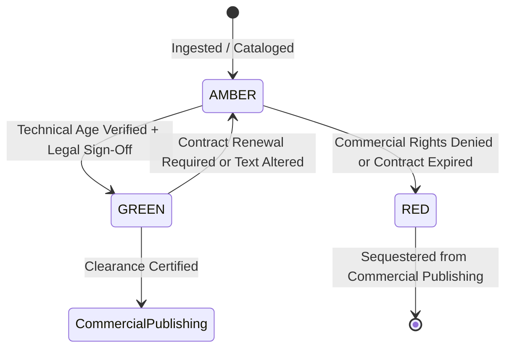

# Content Rights & Provenance Engine: Specification & Compliance Rules
**Document Status:** Approved Standard  
**Version:** 2.0.0  
**Implementation:** `automation/rights/engine.py` & `automation/rights/jurisdiction.py`  
**Associated Models:** `ContentRights`, `RightsGrant` (`database/models.py`)  

---

## 1. Legal Philosophy & Foundation

The Vedic Heritage Platform operates on a non-negotiable principle of **scholarly authenticity and strict intellectual property compliance**:

1. **Layered Intellectual Property Demarcation:**
   Sacred literature is not a monolithic copyright asset. The platform evaluates rights across distinct IP layers:
   - **`COMPOSITION`**: Ancient underlying verse or mantra (universal public domain if >100 years old).
   - **`EDITION`**: Publisher/editor critical apparatus, layout, and typographical arrangement.
   - **`TRANSCRIPTION`**: Keystroke/OCR input contribution.
   - **`TRANSLATION`**: Target-language translated verse (held by translator).
   - **`COMMENTARY`**: Theological/philosophical exegesis (Bhashya/Tatparya).
   - **`AUDIO`**: Musical chanting performance and phonogram recording rights.
   - **`VIDEO`**: Motion graphics, visual artwork, and video clubbing assets.

2. **Jurisdiction-Aware Assessment Framework:**
   - The 60-year public domain rule under the Indian Copyright Act (1957) does **not** grant universal global clearance.
   - For global mobile distribution, texts must satisfy:
     - **India (`IN`)**: Author death > 60 years ago; published > 60 years ago.
     - **United States (`US`)**: Published prior to January 1, 1931 (Pre-1930 rule), or 95 years from publication.
     - **European Union / UK (`EU`/`GB`)**: Author death > 70 years ago (Life + 70 rule).
     - **Global (`GLOBAL`)**: Must satisfy both US pre-1930 and Life+70 thresholds simultaneously.

3. **Separation of Technical Validation and Legal Sign-Off:**
   - Automated scripts calculate copyright ages and check license strings, but **cannot automatically mark a text GREEN**.
   - GREEN status requires affirmative human legal reviewer sign-off (`is_legally_approved = True`, `legal_reviewer = "Name"`).
   - Unapproved texts default to **`AMBER`**.

---

## 2. Release Status State Machine

### State Definitions:
- **`GREEN` (Approved for Commercial Release):**
  - Requires:
    1. `commercial_reuse_permitted == True`.
    2. Valid commercial license (`PUBLIC_DOMAIN`, `CC0`, `CC_BY_4_0`, or `PROPRIETARY_PARTNER_AGREEMENT`).
    3. `is_legally_approved == True` with non-empty `legal_reviewer`.
    4. Verified historical primary source edition (>60 years post-author death and pre-1930 for global).
    5. Written contract (if applicable) must have valid future expiration date.
- **`AMBER` (Scholarly Review / Pending Clearance):**
  - Permitted strictly for internal scholarly study, cross-referencing, and transliteration testing.
  - Blocked from commercial exports, public mobile apps, and audio distribution.
- **`RED` (Prohibited / Restricted):**
  - Commercial reuse is prohibited or rights are held by third parties without license.
  - Strictly blocked from all export pipelines.
