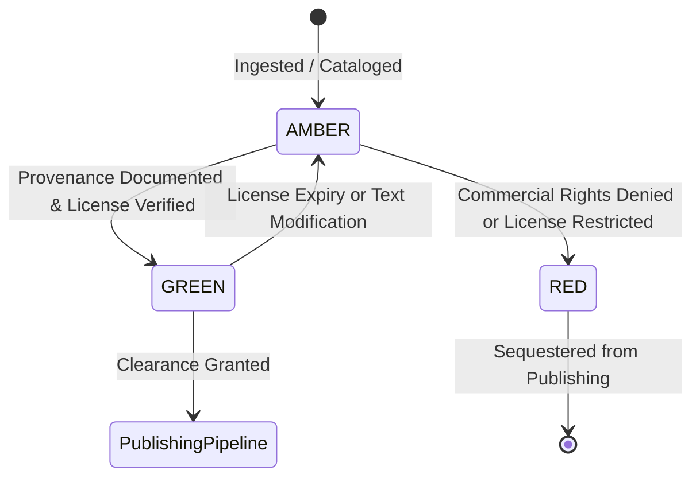

# Content Rights & Provenance Engine: Specification & Compliance Rules
**Document Status:** Approved Standard  
**Version:** 1.0.0  
**Implementation:** `automation/rights/engine.py`  
**Associated Model:** `ContentRights` (`database/models.py`)  

---

## 1. Legal Philosophy & Foundation

The Vedic Heritage Platform operates on a non-negotiable principle of **scholarly authenticity and strict intellectual property compliance**:

1. **Ancient Compositions vs. Modern Editions:**
   - The ancient Sanskrit verses, mantras, and stotras composed centuries or millennia ago are universal public domain.
   - However, modern 20th and 21st-century translations, critical commentaries, word-by-word breakdowns, and website database arrangements are protected by copyright.
2. **Zero Commercial Infringement:**
   - No content may enter commercial channels (mobile applications with in-app subscriptions, audio production, print exports) unless its commercial reusability is rigorously documented and verified.
3. **The GREEN Status Mandate:**
   - Every individual text record is attached to a mandatory `ContentRights` entity.
   - The publishing and export pipeline asserts that `release_status == ReleaseStatus.GREEN`. If not GREEN, export is immediately terminated with a `RightsComplianceError`.

---

## 2. Release Status State Machine



### State Definitions:
- **`GREEN` (Approved for Commercial Release):**
  - Requires all criteria:
    1. `commercial_reuse_permitted == True`.
    2. Valid commercial license type (`PUBLIC_DOMAIN`, `CC0`, `CC_BY_4_0`, `CC_BY_SA_4_0`, or `PROPRIETARY_PARTNER_AGREEMENT`).
    3. If `PROPRIETARY_PARTNER_AGREEMENT`, formal `written_permission_reference` and `supporting_evidence` must be recorded.
    4. If `PUBLIC_DOMAIN`, verified historical primary source edition (>60 years post-author/editor death) must be documented.
    5. Written permission, if time-bounded, must not be expired.
- **`AMBER` (Scholarly Review / Pending Clearance):**
  - Text is permitted only for internal scholarly study, cross-referencing, and transliteration testing.
  - Blocked from public app release, commercial audio production, and external distribution.
- **`RED` (Prohibited / Restricted):**
  - Text is governed by restrictive proprietary copyright (e.g. `ALL_RIGHTS_RESERVED`, unauthorized scrapings).
  - Strictly blocked from all export pipelines.

---

## 3. License Classification Matrix

| License Category | Valid for GREEN? | Conditions / Requirements |
| :--- | :---: | :--- |
| **`PUBLIC_DOMAIN`** | **YES** | Ancient composition + Source edition published >60 years ago (e.g., Nirnaya Sagar Press 1912, Vaidika Samsodhana Mandala 1890). |
| **`PROPRIETARY_PARTNER_AGREEMENT`** | **YES** | Signed bilateral agreement with partner (Track A). Requires agreement ID and valid expiration date. |
| **`CC0` / `CC_BY_4_0` / `CC_BY_SA_4_0`** | **YES** | Open culture licenses permitting commercial redistribution with attribution. |
| **`CC_BY_NC_4_0` / `CC_BY_NC_SA_4_0`** | **NO (RED)** | Explicitly prohibits commercial use. Incompatible with commercial mobile platform. |
| **`ALL_RIGHTS_RESERVED`** | **NO (RED)** | Strictly proprietary. May not be reproduced or distributed without formal agreement. |
| **`SCRAPED_UNAUTHORIZED`** | **NO (RED)** | Zero tolerance. Never admitted into database. |

---

## 4. Gatekeeper Enforcement in Code

Any attempt to call an exporter without clearance triggers an immediate security exception:

```python
from automation.rights.engine import RightsProvenanceEngine, RightsComplianceError

try:
    RightsProvenanceEngine.assert_export_clearance(text.rights, target_channel="commercial_release")
    # Proceed to generate export bundle...
except RightsComplianceError as e:
    # Export halts immediately with full audit trail
    logger.error(f"Export blocked by compliance engine: {e}")
```
