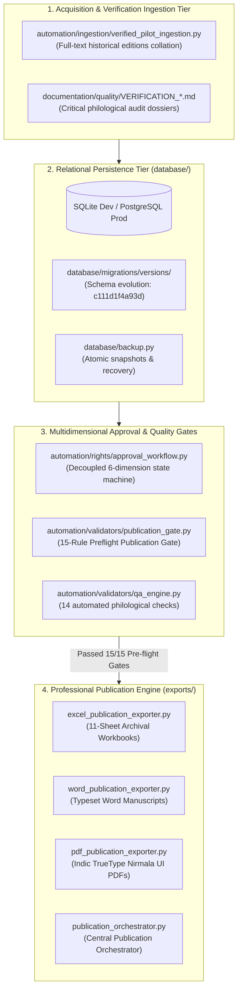

# Vedic Heritage Platform — System Architecture & Modular Design
**Version:** 4.0.0  
**Status:** Approved Architectural Specification (Phase 4 Complete)  

---

## 1. High-Level Architectural Overview

The platform is designed as an enterprise-grade, asynchronous, modular data processing and knowledge distribution ecosystem. It cleanly separates:
- **Acquisition & Ingestion**: Dual-track (Track A: Partnership; Track B: Independent Public Domain).
- **Core Persistence**: Multi-version relational schema supporting multi-edition provenance, version history, media assets, granular rights grants, atomic backups, and Alembic migrations.
- **Multidimensional Approval Governance**: 6 decoupled governance dimensions (`AcquisitionStatus`, `TextualVerificationStatus`, `RightsClearanceStatus`, `TranslationStatus`, `EditorialApprovalStatus`, `PublicationStatus`).
- **Pre-Flight Publication Quality Gate**: 15 rigorous criteria checking title presence, classification, editions, legal reviewer sign-off, verse continuity, swara accents, and cryptographic integrity.
- **Publication Engine**: 
  - 11-sheet archival Excel workbooks (`.xlsx`)
  - Typeset Word manuscripts (`.docx`)
  - High-resolution Indic PDF manuscripts (`.pdf`) using Windows native `Nirmala UI` fonts and two-pass `NumberedCanvas`
  - Mobile JSON bundles



---

## 2. Python Module Architecture

```text
c:\Vedam\
├── automation/
│   ├── cleaners/
│   │   └── unicode_preserver.py         # Unicode NFC & Vedic Swara Preservation
│   ├── connectors/                      # Rate-limited HTTP adapters
│   ├── duplicate_detection/             # SHA-256 and Levenshtein distance detectors
│   ├── exporters/                       # Publication engines
│   │   ├── excel_publication_exporter.py # 11-Sheet Excel Workbooks
│   │   ├── word_publication_exporter.py  # Typeset Word Manuscripts
│   │   ├── pdf_publication_exporter.py   # High-resolution Indic PDF Engine
│   │   └── publication_orchestrator.py  # Central Publication Orchestrator
│   ├── identity/
│   │   └── generator.py                 # VEDA-TXT IDs & SHA-256 hashes
│   ├── ingestion/
│   │   └── verified_pilot_ingestion.py  # Full-text verified pilot ingestion
│   ├── rights/
│   │   ├── approval_workflow.py         # 6 decoupled approval dimensions
│   │   └── jurisdiction.py              # International copyright evaluation
│   └── validators/
│       ├── publication_gate.py          # 15-Rule Preflight Publication Gatekeeper
│       └── qa_engine.py                 # Content QA audit engine
├── database/
│   ├── backups/                         # Atomic database snapshots
│   ├── migrations/versions/             # Alembic versioned migrations
│   ├── models.py                        # SQLAlchemy 2.0 ORM domain entities
│   └── vedam.db                         # Production/Pilot relational database
├── documentation/                       # Architecture, quality, and legal registers
├── exports/                             # Publication deliverables
│   ├── excel/                           # Generated .xlsx publications
│   ├── word/                            # Generated .docx publications
│   └── pdf/                             # Generated .pdf publications
└── tests/                               # 64 Automated Pytest verification tests
```
