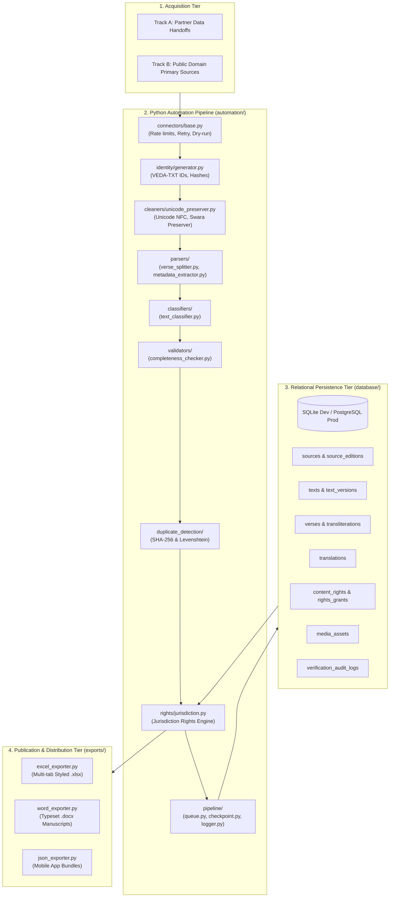

# Vedic Heritage Platform — System Architecture & Modular Design
**Version:** 2.0.0  
**Status:** Approved Architectural Specification (Phase 2 Authorization)  

---

## 1. High-Level Architectural Overview

The platform is designed as an enterprise-grade, asynchronous, modular data processing and knowledge distribution ecosystem. It cleanly separates:
- **Acquisition & Ingestion**: Dual-track (Track A: Partnership; Track B: Independent Public Domain).
- **Core Persistence**: Multi-version relational schema supporting multi-edition provenance, version history, media assets, and granular rights grants.
- **Compliance & Rights**: Mandatory Content Rights & Provenance Engine with a Jurisdiction-Aware Copyright Assessment Framework.
- **Export & Delivery**: Typeset Word manuscripts, structured Excel datasets, and mobile JSON bundles.



---

## 2. Python Module Architecture

```text
automation/
├── connectors/
│   └── base.py                 # Abstract Source Connector with rate limits, retries, dry-run, and permission verification
├── identity/
│   └── generator.py            # Canonical Content ID (VEDA-TXT-XXXXX), Verse ID, and SHA-256 hash generation
├── cleaners/
│   └── unicode_preserver.py    # Unicode NFC normalizer, Vedic Swara analyzer, and multi-script transliteration engine
├── parsers/
│   ├── verse_splitter.py       # Verse and stanza demarcation (Sanskrit stotras, Awadhi dohas & chaupais)
│   └── metadata_extractor.py   # Liturgical metadata extractor (Rishi, Chandas, Devata, Viniyoga)
├── classifiers/
│   └── text_classifier.py      # Category classifier, Awadhi/Sanskrit language detector, and deity identifier
├── validators/
│   └── completeness_checker.py # Missing verse, duplicate number, and truncation detector
├── duplicate_detection/
│   └── engine.py               # Exact SHA-256 and RapidFuzz fuzzy recension similarity scoring
├── rights/
│   ├── engine.py               # Mandatory Content Rights & Provenance Engine gatekeeper
│   └── jurisdiction.py         # Multi-jurisdiction copyright evaluation framework (IN, US, EU, GB, GLOBAL)
├── pipeline/
│   ├── queue.py                # End-to-end ingestion orchestrator (normalization -> splitting -> validation -> DB)
│   ├── checkpoint.py           # Resumable job state engine saving progress to disk
│   └── logger.py               # Structured JSON and console audit logging
├── exporters/
│   ├── excel_exporter.py       # OpenPyXL multi-tab styled workbooks
│   ├── word_exporter.py        # Python-docx typeset printable manuscripts
│   └── json_exporter.py        # Mobile-app-ready JSON serializer
└── pilot/
    └── seed_pilot_data.py      # Seed script for the 8 authorized candidate compositions
```
