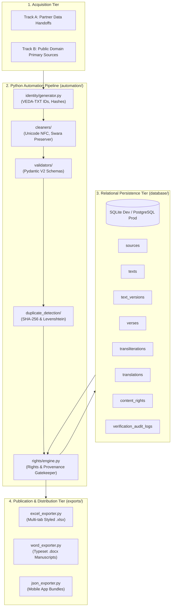

# Vedic Heritage Platform — System Architecture & Modular Design
**Version:** 1.0.0  
**Status:** Approved Architectural Specification (Phase 1, Step 5)  

---

## 1. High-Level Architectural Overview

The platform is designed as an enterprise-grade, asynchronous, modular data processing and knowledge distribution ecosystem. It cleanly separates:
- **Acquisition & Ingestion**: Dual-track (Track A: Partnership; Track B: Independent Public Domain).
- **Core Persistence**: Multi-version relational schema with granular verse, transliteration, and translation entities.
- **Compliance & Rights**: The mandatory Content Rights & Provenance Engine.
- **Export & Delivery**: Typeset Word manuscripts, structured Excel datasets, and mobile JSON bundles.



---

## 2. Python Module Architecture

The `automation/` package is structured into decoupled, single-responsibility modules:

```text
automation/
├── identity/
│   └── generator.py            # Canonical Content ID (VEDA-TXT-XXXXX), Verse ID, and SHA-256 hash generation
├── rights/
│   └── engine.py               # Mandatory Rights & Provenance Engine (GREEN / AMBER / RED gatekeeping)
├── duplicate_detection/
│   └── engine.py               # Exact hash matching & RapidFuzz token-sort similarity scoring
├── collectors/                 # Dedicated extractors per source (Phase 2 - Inactive)
├── parsers/                    # BeautifulSoup/lxml structural parsers (Phase 2 - Inactive)
├── cleaners/                   # Indic Unicode NFC normalizer & accent preserver
├── validators/                 # Script, meter, and liturgical integrity checkers
├── translation/                # 22-Language glossaries and localization pipeline (Phase 6)
├── exporters/
│   ├── excel_exporter.py       # OpenPyXL multi-tab styled workbooks
│   ├── word_exporter.py        # Python-docx typeset printable manuscripts
│   └── json_exporter.py        # Mobile-app-ready JSON serializer
└── pilot/
    └── seed_pilot_data.py      # Seed data generator for pilot candidate compositions
```

---

## 3. Core Engine Responsibilities

### 3.1 Content Identity Engine (`automation/identity/`)
- Assigns sequential canonical IDs (`VEDA-TXT-00001` through `VEDA-TXT-99999`).
- Assigns verse IDs (`VEDA-TXT-00001-V001`).
- Computes cryptographic SHA-256 content hashes of the NFC-normalized Devanagari text, ensuring tampering and accidental edits are immediately detected.

### 3.2 Rights & Provenance Engine (`automation/rights/`)
- Acts as an impenetrable firewall between the database and downstream distribution.
- Evaluates whether a text has achieved **`GREEN`** status based on explicit commercial licensing, verified public-domain provenance, or written agreements.
- Automatically blocks any unreleased (`AMBER` or `RED`) text from entering commercial exports, audio production, or mobile endpoints.

### 3.3 Multi-Version Text Preservation
- Master text records never overwrite extracted content.
- Version tiers:
  1. `RAW_EXTRACTED`: Verbatim unedited source text.
  2. `CLEANED`: Normalization of whitespace and typography without altering characters.
  3. `VERIFIED_ORIGINAL`: Scholarly verified Sanskrit text checked against critical editions.
  4. `CHANTING_READY`: Punctuation, breathing pauses, and repetition markers formatted for recitation.
  5. `SCHOLAR_CORRECTED`: Formal corrections approved with audit log records.
