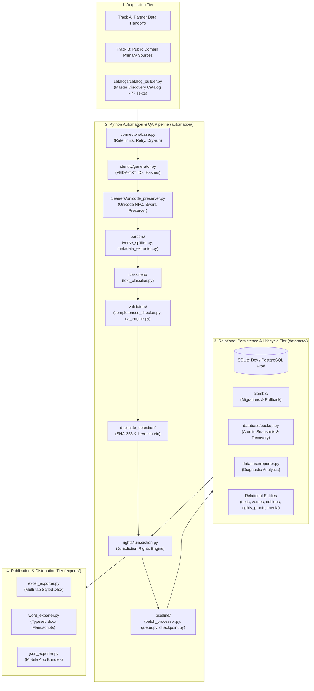

# Vedic Heritage Platform — System Architecture & Modular Design
**Version:** 3.0.0  
**Status:** Approved Architectural Specification (Phase 3 Complete)  

---

## 1. High-Level Architectural Overview

The platform is designed as an enterprise-grade, asynchronous, modular data processing and knowledge distribution ecosystem. It cleanly separates:
- **Acquisition & Ingestion**: Dual-track (Track A: Partnership; Track B: Independent Public Domain).
- **Core Persistence**: Multi-version relational schema supporting multi-edition provenance, version history, media assets, granular rights grants, atomic backups, and Alembic migrations.
- **Compliance & Rights**: Mandatory Content Rights & Provenance Engine with a Jurisdiction-Aware Copyright Assessment Framework.
- **Quality Assurance**: 12-stage lifecycle quality gates with 14 automated integrity checks.
- **Export & Delivery**: Typeset Word manuscripts, structured Excel datasets, and mobile JSON bundles.



---

## 2. Python Module Architecture

```text
Vedam/
├── alembic.ini                 # Alembic migration configuration
├── database/
│   ├── connection.py           # Database connection and session manager
│   ├── models.py               # SQLAlchemy 2.0 ORM Declarative Models
│   ├── schemas.py              # Pydantic V2 validation schemas
│   ├── backup.py               # Atomic snapshot backup & recovery utility
│   ├── reporter.py             # Database diagnostic reporting & integrity analytics
│   ├── backups/                # Timestamped SQLite database snapshots
│   └── migrations/             # Alembic migration environment and versions
├── automation/
│   ├── catalogs/
│   │   └── catalog_builder.py  # Master Devotional Text Catalog builder (77 compositions)
│   ├── connectors/
│   │   └── base.py             # Abstract Source Connector with rate limits, retries, dry-run
│   ├── identity/
│   │   └── generator.py        # Canonical Content ID (VEDA-TXT-XXXXX), Verse ID, SHA-256
│   ├── cleaners/
│   │   └── unicode_preserver.py# Unicode NFC normalizer, Vedic Swara analyzer, transliteration
│   ├── parsers/
│   │   ├── verse_splitter.py   # Verse demarcation (Sanskrit stotras, Awadhi dohas & chaupais)
│   │   └── metadata_extractor.py# Liturgical metadata extractor (Rishi, Chandas, Devata, Viniyoga)
│   ├── classifiers/
│   │   └── text_classifier.py  # Category classifier, Awadhi/Sanskrit language detector
│   ├── validators/
│   │   ├── completeness_checker.py # Missing verse, duplicate number, truncation detector
│   │   └── qa_engine.py        # 12-stage lifecycle quality gates and 14 validation checks
│   ├── duplicate_detection/
│   │   └── engine.py           # Exact SHA-256 and RapidFuzz fuzzy recension similarity
│   ├── rights/
│   │   ├── engine.py           # Content Rights & Provenance Engine gatekeeper
│   │   └── jurisdiction.py     # Multi-jurisdiction copyright evaluation (IN, US, EU, GLOBAL)
│   ├── pipeline/
│   │   ├── batch_processor.py  # Controlled batch ingestion engine with checkpoints & error queues
│   │   ├── queue.py            # Single-item ingestion orchestrator
│   │   ├── checkpoint.py       # Resumable job state engine saving progress to disk
│   │   └── logger.py           # Structured JSON and console audit logging
│   ├── exporters/
│   │   ├── excel_exporter.py   # OpenPyXL multi-tab styled workbooks
│   │   ├── word_exporter.py    # Python-docx typeset printable manuscripts
│   │   └── json_exporter.py    # Mobile-app-ready JSON serializer
│   └── pilot/
│       └── seed_pilot_data.py  # Seed script for the 8 authorized pilot compositions
├── data/
│   └── catalogs/
│       └── master_devotional_catalog.json # 77 curated candidate compositions
├── exports/
│   ├── catalogs/               # Candidate Classification Master Catalog (.xlsx)
│   ├── excel/                  # Generated .xlsx publications
│   ├── word/                   # Generated .docx publications
│   └── json/                   # Generated .json mobile bundles
└── tests/                      # 45 automated pytest tests (100% pass rate)
```
