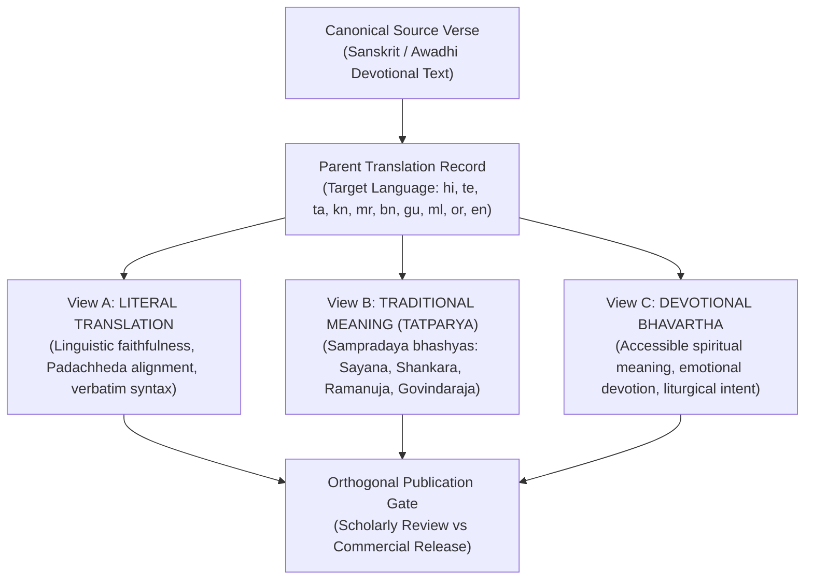
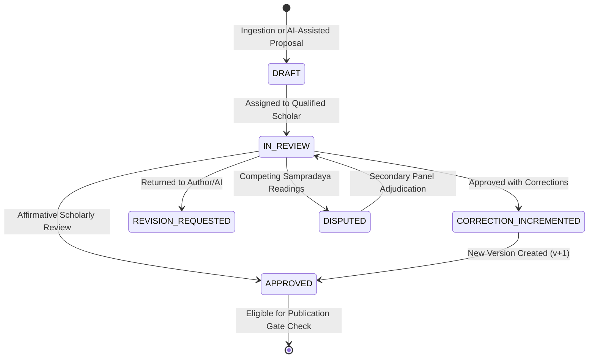

# TranslationView Architecture & Governance Specification
**Document Version:** 1.0.0  
**Phase:** Phase 10  
**Status:** Canonical Architectural Standard  
**Workspace:** `C:\Vedam`  

---

## 1. Architectural Philosophy: The Tripartite Translation Model

The Vedic Heritage Platform rejects monolithic or single-field translations of sacred Sanskrit, Vedic, and devotional texts. A single translation field inevitably conflates linguistic literalism, theological commentary, and devotional accessibility, confusing scholarly readers and devotees alike.

To maintain uncompromising scholarly integrity while ensuring universal devotional access, the platform permanently enforces a **Tripartite Translation View Architecture**:

---

## 2. Definitional Boundaries of the Three Views

### A. Literal Translation (`view_type = 'LITERAL'`)
- **Definition:** A close, grammatically faithful representation of the original verse, preserving Padachheda, Anvaya (syntactic order), and morphological case endings (Vibhakti).
- **Style Guidelines:** Minimal interpretive interpolation. Where English or regional syntax requires auxiliary particles, they are bracketed or kept strictly secondary.
- **Source Dependencies:** Paninian grammar (*Ashtadhyayi*), classical Sanskrit lexicography (*Apte*, *Monier-Williams*, *Amarakosha*), or Awadhi etymological equivalents.
- **Audience:** Sanskrit students, linguists, academic researchers, and serious practitioners analyzing the exact words spoken.

### B. Traditional Meaning / Tatparya (`view_type = 'TATPARYA'`)
- **Definition:** The theological, cosmological, and philosophical significance of the verse as expounded by recognized traditional commentary (*Bhashya* / *Tika* / *Vyakhyana*).
- **Style Guidelines:** Explicit attribution to commentators (e.g. Sayanacharya for Rigvedic suktams, Adi Shankaracharya for Advaitic stotras, Govindaraja for Valmiki Ramayana passages, Bhatta Bhaskara for Taittiriya texts). Competing sectarian interpretations (Advaita, Vishishtadvaita, Dvaita) are preserved through `TextualDispute` records rather than erased.
- **Source Dependencies:** Critical printed historical editions published prior to 1964 or authorized academic critical apparatuses.
- **Audience:** Vedantins, traditional scholars (*pandits*), and students of Indian philosophy.

### C. Devotional Bhavartha (`view_type = 'BHAVARTHA'`)
- **Definition:** An accessible, devotional explanation communicating the emotional and spiritual essence (*rasa* and *bhava*) to practitioners and devotees.
- **Style Guidelines:** Inspiring, clear, culturally authentic prose free of dense academic jargon, suited for daily contemplation, prayer, and recitation.
- **Source Dependencies:** Living liturgical usage, traditional prayer manuals, and temple traditions.
- **Audience:** Global devotees, temple congregations, spiritual seekers, and families.

---

## 3. Entity Specification & Schema Model

Every view is an independent, versioned row in `translation_views` linked via foreign keys to `translations` and `verses`.

| Attribute | SQL Type | Description |
| :--- | :--- | :--- |
| `id` | `INTEGER PRIMARY KEY` | Auto-incrementing internal surrogate key |
| `view_id` | `VARCHAR(64) UNIQUE` | Deterministic business key: `TV-{translation_id}-{view_type}-v{version}` |
| `translation_id` | `INTEGER FK(translations.id)` | Parent translation record (specifies target language) |
| `verse_id` | `INTEGER FK(verses.id)` | Parent source verse (specifies text, verse number, original text) |
| `target_language` | `VARCHAR(16)` | ISO 639-1 / 639-3 language code (`en`, `hi`, `te`, `ta`, etc.) |
| `view_type` | `ENUM(TranslationType)` | `'LITERAL'`, `'TATPARYA'`, or `'BHAVARTHA'` |
| `view_text` | `TEXT` | Full translation text for this specific view |
| `version` | `INTEGER DEFAULT 1` | Incremental version counter; increments on scholarly correction |
| `source_reference` | `VARCHAR(255)` | Traceable commentary citation, edition, or grammar reference |
| `translator_provenance`| `VARCHAR(255)` | Identifies human scholar, translation team, or AI engine |
| `review_status` | `ENUM(ReviewStatus)` | `'DRAFT'`, `'IN_REVIEW'`, `'APPROVED'`, `'REJECTED'`, `'DISPUTED'` |
| `reviewer` | `VARCHAR(255)` | Accredited human reviewer ID (sanitized in public outputs) |
| `reviewer_affiliation` | `VARCHAR(255)` | Reviewer's university, matha, or institutional affiliation |
| `reviewed_at` | `DATETIME` | UTC timestamp of the review decision |
| `approval_notes` | `TEXT` | Scholarly rationale, corrections applied, or notes |
| `approval_history_json`| `JSON` | Complete immutable audit trail of all previous review actions |

---

## 4. Lifecycle & Independent Approval Governance

### Governance Rules:
1. **Zero View Bleed:** An approval granted to a Devotional Bhavartha view does **not** approve the Literal or Tatparya view. Each view must receive individual scholarly review.
2. **Verse-Level Granularity:** Approval of verse 1 does **not** approve verse 2 or the composition as a whole.
3. **No Synthetic Production Approvals:** Synthetic personas (`account_category = 'SYNTHETIC_TEST_PERSONA'`) and demonstration accounts (`is_demonstration = True`) are programmatically barred from transitioning views to `APPROVED` in production. Only verified living scholars (`account_category = 'REAL_HUMAN_SCHOLAR'`, `is_human_verified = True`) possess production sign-off authority.
4. **Immutable Versioning:** Any modification to `view_text` triggers an increment of `version` ($v \rightarrow v+1$) and records the prior state in `approval_history_json`.
