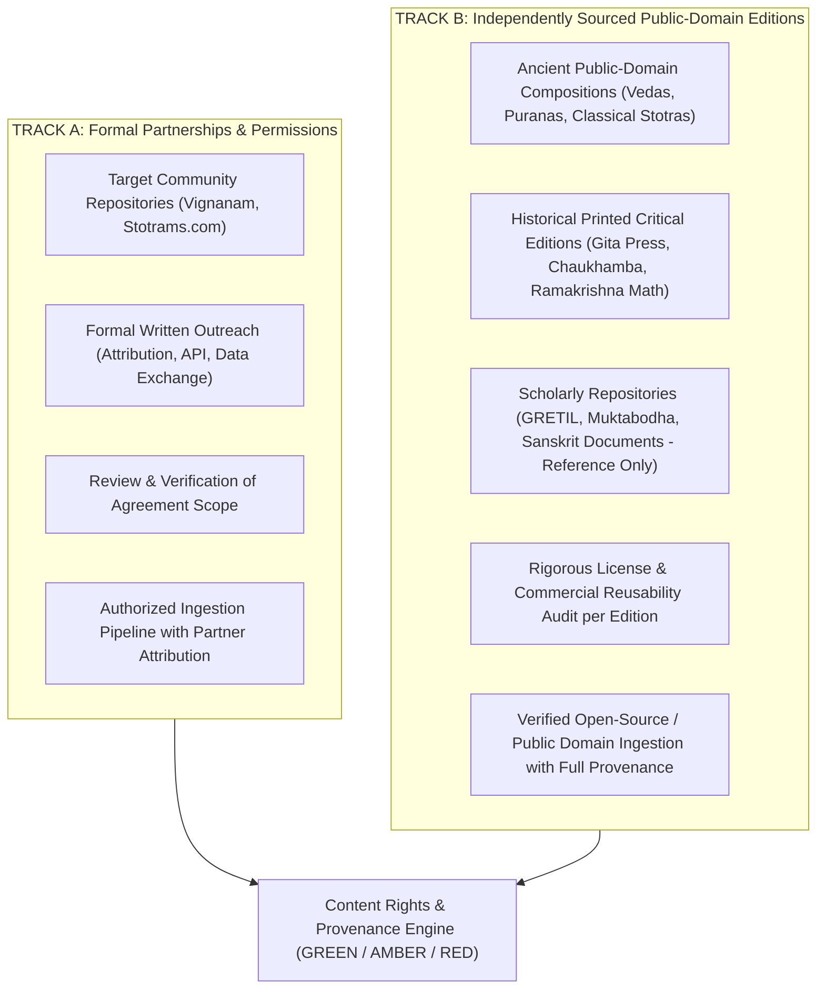

# Dual-Track Content Acquisition Strategy: Track A & Track B
**Document Status:** Approved Architecture Standard  
**Last Updated:** 2026-11-04  

---

## 1. Core Operating Principle

To build an authentic, permanent digital library while maintaining strict legal and ethical compliance, the Vedic Heritage Platform operates under two parallel acquisition tracks:

---

## 2. Track A: Partnership and Permissions Strategy

### 2.1 Scope & Purpose
Track A establishes formal, mutually beneficial partnerships with established devotional digital initiatives, specifically:
- **Vaidika Vignanam** (`vignanam.org`, Founder: Srinivas Vadrevu)
- **Stotrams.com** (`stotrams.com`, Independent Editorial Team)

### 2.2 Formal Negotiation Points
For each partner, the partnership proposal addresses:
1. **Authorized Bulk Content Access:** Pre-packaged JSON or database exports rather than web scraping.
2. **Commercial Reuse Authorization:** Explicit written permission for app monetization, print publishing, and media generation.
3. **Translation & Derivative Rights:** Permission to translate, adapt for audio (Japa repetitions, Suno AI), and build mobile features.
4. **Attribution & Recognition:** Dedicated partner badge, inbound backlinks, and credit in all apps, publications, and exports.
5. **Bidirectional Corrections:** A feedback loop where textual corrections, verse discoveries, and scholarship from our platform are shared back with the partner.
6. **API / Structured Data Exchange:** Exploration of shared schemas and sync webhooks.

### 2.3 Ready-to-Send Outreach Documentation
- **Vaidika Vignanam Outreach:** [`documentation/permissions/PARTNERSHIP_OUTREACH_VIGNANAM.md`](file:///c:/Vedam/documentation/permissions/PARTNERSHIP_OUTREACH_VIGNANAM.md)
- **Stotrams.com Outreach:** [`documentation/permissions/PARTNERSHIP_OUTREACH_STOTRAMS.md`](file:///c:/Vedam/documentation/permissions/PARTNERSHIP_OUTREACH_STOTRAMS.md)

---

## 3. Track B: Independently Sourced Public-Domain Texts

### 3.1 Principle of Independent Sourcing
When a third-party website’s editorial layer or database is proprietary, we independently reconstruct the text from authentic, undisputed public-domain printed sources.

### 3.2 Public Domain Criteria for Indian Sacred Texts
Under Indian Copyright Law (Copyright Act, 1957) and International Copyright Conventions (Berne Convention):
- Ancient Vedic Samhitas, Upanishads, Epics (Ramayana, Mahabharata), Puranas, and classical stotras composed centuries ago are **in the public domain**.
- The term of copyright for an author’s work expires **60 years** after the calendar year following the author’s death.
- Critical editions, commentaries, translations, and editorial notes published within the last 60 years remain protected under copyright.

### 3.3 Strict Guidelines for Scholarly Repositories
- **GRETIL (Göttingen Register of Electronic Texts in Indian Languages):**
  - Use for scholarly comparison, meter identification, and variant analysis.
  - *Constraint:* Check individual text header files; many GRETIL texts are digitized from copyrighted 20th-century critical editions or restricted to non-commercial academic research. Do not assume universal commercial reusability.
- **Sanskrit Documents (`sanskritdocuments.org`):**
  - Volunteer community archive. Useful for discovering traditional readings and alternative recensions.
  - *Constraint:* Verify the underlying print provenance for each text; do not copy modern transliterations or translations blindly without checking the source edition cited.
- **Muktabodha Indological Research Institute:**
  - Invaluable for Agama, Tantra, and Kashmir Shaivism manuscripts.
  - *Constraint:* Manuscript facsimiles and e-texts are licensed under specific non-commercial or research terms. Use for paleographic reference only, unless open redistribution is documented.

### 3.4 Authorized Primary Source Strategy for Track B
For our production library, texts under Track B must trace their provenance to:
1. Historical printed editions whose copyright has expired (>60 years post-author/editor death).
2. Direct transcriptions from undisputed traditional recitations verified against authoritative Sanskrit editions (e.g., Nirnaya Sagar Press, Venkateshwara Steam Press, early Chaukhamba Sanskrit Sansthan editions).
3. Commissioned, scholarly in-house translations and word-by-word padachhedas created exclusively for this platform.
