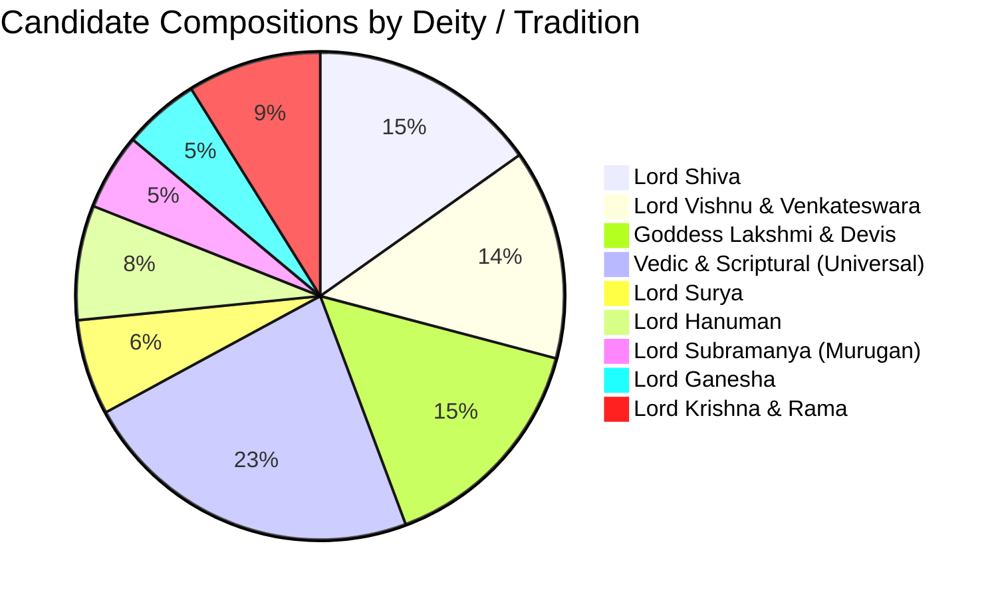

# Vedic Heritage Platform — Master Devotional Discovery Catalog
**Version:** 3.0.0  
**Last Updated:** 2026-11-04  
**Scope:** Canonical discovery catalog of 77 prioritized traditional compositions across Vedic, Puranic, and Devotional traditions.  
**Classification Workbook:** [`candidate_classification_master_catalog.xlsx`](file:///c:/Vedam/exports/catalogs/candidate_classification_master_catalog.xlsx)  
**Structured JSON:** [`master_devotional_catalog.json`](file:///c:/Vedam/data/catalogs/master_devotional_catalog.json)  

---

> [!IMPORTANT]
> **Discovery Gate Notice:**
> Inclusion in this catalog constitutes discovery and priority ranking for critical-edition identification. It is **not** an authorization for uncontrolled bulk downloading or commercial release without verified public-domain edition audits and legal sign-off.

---

## 1. Summary Statistics

| Dimension | Count / Metric | Notes |
| :--- | :---: | :--- |
| **Total Registered Compositions** | **77** | Authentic traditional compositions across all major traditions |
| **Priority 1 (Core Liturgy & Pilot)** | 62 | Essential daily, festival, and temple liturgy |
| **Priority 2 (Extended Canon)** | 15 | Specialized Upanishads, Sahasranamas, and regional works |
| **Vedic Compositions with Swara Accents** | 16 | Rigvedic and Yajurvedic Samhitas, Aranyakas, and Upanishads |
| **Classical Sanskrit Stotras & Hymns** | 56 | Compositions by Shankaracharya, Valmiki, Vyasa, and Puranas |
| **Awadhi & Regional Devotional Works** | 5 | Awadhi (Tulsidas) and Tamil (Devaraya Swamigal) |

---

## 2. Deity & Tradition Breakdown

---

## 3. Master Inventory Table (77 Compositions)

| Candidate ID | Traditional Title | Devanagari Title | Deity | Category | Original Lang | Attribution | Historical Scripture / Reference | Verses | Accents? | Priority |
| :--- | :--- | :--- | :--- | :--- | :---: | :--- | :--- | :---: | :---: | :---: |
| `CAND-001` | Gayatri Vedic Mantra | गायत्री मन्त्रः | Savitr / Gayatri | Vedic Mantra | `sa` | Rishi Vishvamitra | Rigveda 3.62.10 | 1 | YES | P1 |
| `CAND-002` | Mahamrityunjaya Mantra | महामृत्युञ्जय मन्त्रः | Lord Shiva | Vedic Mantra | `sa` | Rishi Vasishtha | Rigveda 7.59.12 | 1 | YES | P1 |
| `CAND-003` | Purusha Suktam | पुरुष सूक्तम् | Purusha Narayana | Vedic Suktam | `sa` | Rishi Narayana | Rigveda 10.90 / Shukla Yajurveda 31 | 16 | YES | P1 |
| `CAND-004` | Sri Suktam | श्री सूक्तम् | Goddess Lakshmi | Vedic Suktam | `sa` | Rishis Ananda, Chiklita | Rigveda Khilani 5.87 | 15 | YES | P1 |
| `CAND-005` | Narayana Suktam | नारायण सूक्तम् | Lord Narayana | Vedic Suktam | `sa` | Taittiriya Tradition | Taittiriya Aranyaka 10.13 | 12 | YES | P1 |
| `CAND-006` | Sri Rudram - Namakam | श्री रुद्रम् - चमकम् | Lord Shiva | Vedic Suktam | `sa` | Krishna Yajurveda | Taittiriya Samhita 4.5 | 160 | YES | P1 |
| `CAND-007` | Sri Rudram - Chamakam | श्री रुद्रम् - चमकम् | Lord Shiva / Agni | Vedic Suktam | `sa` | Krishna Yajurveda | Taittiriya Samhita 4.7 | 11 | YES | P1 |
| `CAND-008` | Durga Suktam | दुर्गा सूक्तम् | Goddess Durga / Agni | Vedic Suktam | `sa` | Taittiriya Tradition | Taittiriya Aranyaka 10.1 | 7 | YES | P1 |
| `CAND-009` | Manyu Suktam | मन्यु सूक्तम् | Manyu / Narasimha | Vedic Suktam | `sa` | Rishi Manyu Tapasa | Rigveda 10.83-84 | 14 | YES | P2 |
| `CAND-010` | Medha Suktam | मेधा सूक्तम् | Medha / Saraswati | Vedic Suktam | `sa` | Taittiriya Tradition | Taittiriya Aranyaka 10.41-44 | 6 | YES | P2 |
| `CAND-011` | Nasadiya Suktam | नासदीय सूक्तम् | Cosmic Creation | Vedic Suktam | `sa` | Prajapati Parameshthin | Rigveda 10.129 | 7 | YES | P2 |
| `CAND-012` | Bhumi Suktam | भूमि सूक्तम् | Bhumi Devi | Vedic Suktam | `sa` | Rishi Atharvan | Atharvaveda 12.1 | 63 | YES | P2 |
| `CAND-013` | Ganapati Atharvashirsha | गणपति अथर्वशीर्षम् | Lord Ganesha | Upanishad | `sa` | Rishi Atharvan | Atharvaveda Minor Upanishads | 14 | YES | P1 |
| `CAND-014` | Surya Upanishad | सूर्योपनिषत् | Lord Surya | Upanishad | `sa` | Rishi Brahma | Atharvaveda Minor Upanishads | 5 | YES | P2 |
| `CAND-015` | Shanti Mantra - Saha Navavatu | शान्ति मन्त्रः | Parabrahman | Shanti Patha | `sa` | Upanishadic Tradition | Taittiriya Upanishad 2.1 | 1 | YES | P1 |
| `CAND-016` | Shanti Mantra - Purnamada | शान्ति मन्त्रः | Parabrahman | Shanti Patha | `sa` | Shukla Yajurveda | Isha / Brihadaranyaka Upanishad | 1 | YES | P1 |
| `CAND-017` | Shanti Mantra - Bhadram Karnebhih | शान्ति मन्त्रः | All Devas | Shanti Patha | `sa` | Rigveda 1.89.8 | Prashna / Mundaka Upanishad | 2 | YES | P1 |
| `CAND-018` | Shanti Mantra - Asato Ma Sadgamaya | शान्ति मन्त्रः | Supreme Reality | Aranyaka Mantra | `sa` | Sage Yajnavalkya | Brihadaranyaka Upanishad 1.3.28 | 1 | NO | P1 |
| `CAND-019` | Ganesha Pancharatnam | गणेश पञ्चरत्नम् | Lord Ganesha | Stotra | `sa` | Adi Shankaracharya | Smartha Stotra Samgraha | 6 | NO | P1 |
| `CAND-020` | Sankata Nashana Ganesha Stotram | सङ्कटनाशन गणेश स्तोत्रम् | Lord Ganesha | Stotra | `sa` | Deva Rishi Narada | Narada Purana | 9 | NO | P1 |
| `CAND-021` | Ganesha Ashtottara Shatanamavali | गणेश अष्टोत्तरशतनामावलिः | Lord Ganesha | Namavali | `sa` | Puranic Traditional | Bhavishyottara Purana | 108 | NO | P1 |
| `CAND-022` | Ganesha Kavacham | गणेश कवचम् | Lord Ganesha | Kavacham | `sa` | Sage Kashyapa | Mudgala / Ganesha Purana | 18 | NO | P2 |
| `CAND-023` | Shiva Tandava Stotram | शिवताण्डवस्तोत्रम् | Lord Shiva | Stotra | `sa` | Lankadhipati Ravana | Traditional Puranic Itihasa | 16 | NO | P1 |
| `CAND-024` | Shiva Panchakshara Stotram | शिव पञ्चाक्षर स्तोत्रम् | Lord Shiva | Stotra | `sa` | Adi Shankaracharya | Smartha Stotra Samgraha | 6 | NO | P1 |
| `CAND-025` | Lingashtakam | लिङ्गाष्टकम् | Shivalinga | Ashtakam | `sa` | Brahmanda Purana | Brahmanda Purana Liturgy | 9 | NO | P1 |
| `CAND-026` | Rudrashtakam | रुद्राष्टकम् | Lord Shiva | Ashtakam | `sa` | Goswami Tulsidas | Ramcharitmanas Uttara Kanda | 9 | NO | P1 |
| `CAND-027` | Bilvashtakam | बिल्वाष्टकम् | Lord Shiva | Ashtakam | `sa` | Padma Purana | Padma Purana Liturgy | 9 | NO | P1 |
| `CAND-028` | Shiva Mahimna Stotram | शिवमहिम्नः स्तोत्रम् | Lord Shiva | Stotra | `sa` | Pushpadanta Gandharva | Traditional Shaiva Canon | 43 | NO | P1 |
| `CAND-029` | Dakshinamurthy Stotram | दक्षिणामूर्तिस्तोत्रम् | Dakshinamurthy | Stotra | `sa` | Adi Shankaracharya | Advaita Vedanta Canon | 10 | NO | P1 |
| `CAND-030` | Shiva Ashtottara Shatanamavali | शिव अष्टोत्तरशतनामावलिः | Lord Shiva | Namavali | `sa` | Shiva Purana | Vidyeshvara Samhita | 108 | NO | P1 |
| `CAND-031` | Shiva Kavacham | शिवकवचम् | Lord Shiva | Kavacham | `sa` | Sage Rishabha | Skanda Purana | 32 | NO | P2 |
| `CAND-032` | Daridrya Dahana Shiva Stotram | दारिद्र्यदहन शिवस्तोत्रम् | Lord Shiva | Stotra | `sa` | Maharishi Vasishtha | Linga Purana | 9 | NO | P2 |
| `CAND-033` | Vishnu Sahasranamam | विष्णुसहस्रनामस्तोत्रम् | Lord Vishnu | Sahasranama | `sa` | Bhishma Pitamaha | Mahabharata Anushasana Parva 149 | 142 | NO | P1 |
| `CAND-034` | Vishnu Ashtottara Shatanamavali | विष्णु अष्टोत्तरशतनामावलिः | Lord Vishnu | Namavali | `sa` | Vishnu Purana | Vishnu Purana Liturgy | 108 | NO | P1 |
| `CAND-035` | Narayana Kavacham | नारायणकवचम् | Lord Narayana | Kavacham | `sa` | Sage Vishvarupa | Srimad Bhagavatam 6.8 | 42 | NO | P1 |
| `CAND-036` | Venkateswara Suprabhatam | वेङ्कटेश्वर सुप्रभातम् | Lord Venkateswara | Suprabhatam | `sa` | P.B. Annan (c. 1430 CE) | Tirumala Temple Epigraphy | 29 | NO | P1 |
| `CAND-037` | Venkateswara Stotram | वेङ्कटेश्वर स्तोत्रम् | Lord Venkateswara | Stotra | `sa` | P.B. Annan | Tirumala Temple Tradition | 16 | NO | P1 |
| `CAND-038` | Venkateswara Prapatti | वेङ्कटेश्वर प्रपत्तिः | Lord Venkateswara | Stotra | `sa` | P.B. Annan | Tirumala Temple Tradition | 16 | NO | P1 |
| `CAND-039` | Venkateswara Mangalashasanam | वेङ्कटेश्वर मङ्गलाशासनम् | Lord Venkateswara | Mangalam | `sa` | P.B. Annan | Tirumala Temple Tradition | 14 | NO | P1 |
| `CAND-040` | Venkateswara Ashtottara | वेङ्कटेश्वर अष्टोत्तरशतनामावलिः | Lord Venkateswara | Namavali | `sa` | Varaha Purana | Venkatachala Mahatmya | 108 | NO | P1 |
| `CAND-041` | Venkateswara Sahasranamam | वेङ्कटेश्वर सहस्रनामस्तोत्रम् | Lord Venkateswara | Sahasranama | `sa` | Brahmanda Purana | Venkatachala Mahatmya | 165 | NO | P2 |
| `CAND-042` | Govinda Namavali | गोविन्द नामावलिः | Lord Govinda | Namavali | `sa` | Vaishnava Traditional | Bhajana Sampradaya | 70 | NO | P1 |
| `CAND-043` | Mukundamala Stotram | मुकुन्दमालास्तोत्रम् | Lord Krishna | Stotra | `sa` | Kulasekhara Alwar | Classical Vaishnava Canon | 40 | NO | P2 |
| `CAND-044` | Kanakadhara Stotram | कनकधारास्तोत्रम् | Goddess Mahalakshmi | Stotra | `sa` | Adi Shankaracharya | Advaita Smartha Canon | 21 | NO | P1 |
| `CAND-045` | Mahalakshmi Ashtakam | महालक्ष्म्यष्टकम् | Goddess Mahalakshmi | Ashtakam | `sa` | Devendra | Padma Purana Uttara Khanda | 9 | NO | P1 |
| `CAND-046` | Lalitha Sahasranamam | ललितासहस्रनामस्तोत्रम् | Sri Lalitha Tripura Sundari | Sahasranama | `sa` | Vagdevatas (Hayagriva) | Brahmanda Purana | 320 | NO | P1 |
| `CAND-047` | Lalitha Trishati | ललितात्रिशतीस्तोत्रम् | Sri Lalitha | Namavali | `sa` | Hayagriva to Agastya | Brahmanda Purana | 100 | NO | P1 |
| `CAND-048` | Devi Mahatmyam | देवीमाहात्म्यम् | Goddess Durga / Chandi | Scripture | `sa` | Sage Markandeya | Markandeya Purana 81-93 | 700 | NO | P1 |
| `CAND-049` | Argala Stotram | अर्गलास्तोत्रम् | Goddess Durga | Stotra | `sa` | Sage Markandeya | Devi Mahatmyam Preliminaries | 24 | NO | P1 |
| `CAND-050` | Kilaka Stotram | कीलकस्तोत्रम् | Goddess Chandi | Stotra | `sa` | Sage Markandeya | Devi Mahatmyam Preliminaries | 14 | NO | P1 |
| `CAND-051` | Devi Kavacham | देवीकवचम् | Navadurga | Kavacham | `sa` | Lord Brahma | Varaha Purana | 61 | NO | P1 |
| `CAND-052` | Mahishasura Mardini Stotram | महिषासुरमर्दिनि स्तोत्रम् | Mahishasuramardini | Stotra | `sa` | Traditional Shakta | Traditional Stotra Canon | 21 | NO | P1 |
| `CAND-053` | Annapurna Stotram | अन्नपूर्णास्तोत्रम् | Goddess Annapurna | Stotra | `sa` | Adi Shankaracharya | Smartha Stotra Canon | 12 | NO | P1 |
| `CAND-054` | Saraswati Stotram | सरस्वतीस्तोत्रम् | Goddess Saraswati | Stotra | `sa` | Sage Agastya | Padma Purana | 11 | NO | P1 |
| `CAND-055` | Lakshmi Ashtottara | लक्ष्मी अष्टोत्तरशतनामावलिः | Goddess Lakshmi | Namavali | `sa` | Markandeya Purana | Markandeya Purana | 108 | NO | P1 |
| `CAND-056` | Aditya Hrudayam | आदित्यहृदयम् | Lord Surya | Itihasa Hymn | `sa` | Sage Agastya | Valmiki Ramayana Yuddha 105 | 31 | NO | P1 |
| `CAND-057` | Surya Ashtakam | सूर्याष्टकम् | Lord Surya | Ashtakam | `sa` | Samba Purana | Samba / Bhavishya Purana | 9 | NO | P1 |
| `CAND-058` | Surya Namaskara Mantras | सूर्यनमस्कार मन्त्राः | 12 Adityas | Vedic Liturgy | `sa` | Taittiriya Aranyaka 1 | Aruna Prashna | 12 | YES | P1 |
| `CAND-059` | Surya Sahasranamam | सूर्यसहस्रनामस्तोत्रम् | Lord Surya | Sahasranama | `sa` | Bhavishya Purana | Bhavishya / Mahabharata | 160 | NO | P2 |
| `CAND-060` | Surya Mandala Stotram | सूर्य मण्डल स्तोत्रम् | Lord Surya | Stotra | `sa` | Bhavishya Purana | Bhavishya Purana | 10 | NO | P2 |
| `CAND-061` | Hanuman Chalisa | हनुमान चालीसा | Lord Hanuman | Chalisa | `awa` | Goswami Tulsidas | Awadhi Bhakti Canon | 43 | NO | P1 |
| `CAND-062` | Sankat Mochan Hanuman Ashtakam | सङ्कटमोचन हनुमानाष्टकम् | Lord Hanuman | Ashtakam | `awa` | Goswami Tulsidas | Awadhi Bhakti Canon | 9 | NO | P1 |
| `CAND-063` | Bajrang Baan | बजरङ्ग बाण | Lord Hanuman | Stotra / Raksha | `awa` | Goswami Tulsidas | Awadhi Bhakti Canon | 35 | NO | P1 |
| `CAND-064` | Hanuman Bahuk | हनुमान बाहुक | Lord Hanuman | Bhakti Kavya | `awa` | Goswami Tulsidas | Awadhi Bhakti Canon | 44 | NO | P2 |
| `CAND-065` | Panchamukha Hanuman Kavacham | पञ्चमुख हनुमान कवचम् | Panchamukha Hanuman | Kavacham | `sa` | Sage Garuda | Sudarshana Samhita | 36 | NO | P1 |
| `CAND-066` | Sundarakanda Parayanam | सुन्दरकाण्ड पारायणम् | Hanuman / Sita-Rama | Scripture | `sa` | Maharishi Valmiki | Valmiki Ramayana Kanda 5 | 2855 | NO | P1 |
| `CAND-067` | Subramanya Bhujangam | सुब्रह्मण्यभुजङ्गप्रयातस्तोत्रम् | Lord Subramanya | Stotra | `sa` | Adi Shankaracharya | Smartha Stotra Canon | 33 | NO | P1 |
| `CAND-068` | Kanda Shashti Kavacham | कन्द षष्ठी कवचम् | Lord Murugan | Kavacham | `ta` | Devaraya Swamigal | Tamil Saiva Bhakti Canon | 238 | NO | P1 |
| `CAND-069` | Subramanya Ashtottara | सुब्रह्मण्य अष्टोत्तरशतनामावलिः | Lord Subramanya | Namavali | `sa` | Skanda Purana | Skanda Purana | 108 | NO | P1 |
| `CAND-070` | Subramanya Gadyam | सुब्रह्मण्यगद्यम् | Lord Subramanya | Gadyam | `sa` | Agamic Tradition | Temple Agamas | 1 | NO | P2 |
| `CAND-071` | Madhurashtakam | मधुराष्टकम् | Lord Sri Krishna | Ashtakam | `sa` | Vallabhacharya | Pushtimarga Canon | 9 | NO | P1 |
| `CAND-072` | Krishna Ashtakam | कृष्णाष्टकम् | Lord Sri Krishna | Ashtakam | `sa` | Adi Shankaracharya | Smartha Stotra Canon | 9 | NO | P1 |
| `CAND-073` | Govinda Ashtakam | गोविन्दाष्टकम् | Lord Govinda | Ashtakam | `sa` | Adi Shankaracharya | Advaita Stotra Canon | 9 | NO | P1 |
| `CAND-074` | Achyutashtakam | अच्युताष्टकम् | Lord Achyuta | Ashtakam | `sa` | Adi Shankaracharya | Smartha Stotra Canon | 9 | NO | P1 |
| `CAND-075` | Rama Raksha Stotram | रामरक्षास्तोत्रम् | Lord Sri Rama | Stotra / Raksha | `sa` | Budhakaushika Rishi | Padma Purana Itihasa Canon | 38 | NO | P1 |
| `CAND-076` | Rama Ashtottara | राम अष्टोत्तरशतनामावलिः | Lord Sri Rama | Namavali | `sa` | Padma Purana | Padma Purana | 108 | NO | P1 |
| `CAND-077` | Nama Ramayanam | नामरामायणम् | Lord Sri Rama | Namavali | `sa` | Lakshmanacharya | Bhajana Sampradaya | 108 | NO | P1 |
