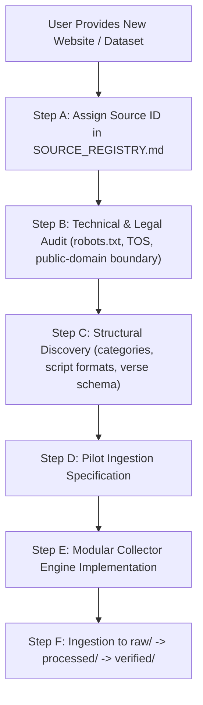

# Vedic Heritage Digital Library & Global Spiritual Platform
## Master Execution Plan (Canonical Project Charter)

**Document Status:** Active & Living  
**Version:** 1.1.0  
**Current Phase:** Phase 1 — Research, Content Source Discovery & Technical Foundation  
**Workspace:** `C:\Vedam`  

---

## 1. Executive Summary & Ultimate Vision

The mission of this project is to build an enduring, scholarly, technologically robust, and beautifully designed digital ecosystem for preserving, organizing, verifying, translating, and distributing authentic Indian Vedic and devotional literature worldwide.

### Scope of Content Preserved:
1. Vedic Mantras (Samhita, Brahmana, Aranyaka, Upanishad recitations).
2. Puranic Mantras.
3. Stotras, Stutis, and Vandanas.
4. Ashtakams and devotional octets.
5. Sahasranamas (1,000 names).
6. Ashtottara Shatanamavalis (108 names).
7. Kavachams (spiritual shields).
8. Suktams (Rigvedic and Yajurvedic hymns).
9. Chalisas.
10. Aartis and Bhajans.
11. Puja Vidhi, Panchopachara / Shodashopachara rituals, and full liturgical scripts.
12. Vrat procedures and Kathas.
13. Dhyana, Nyasa, and meditation verses.
14. Daily and situational Sankalpams.
15. Parayanam texts and Saptashati / Ramayana recitation manuals.
16. Classical regional devotional literature (Tamil Divya Prabandham, Thevaram, Telugu Kritis, Marathi Abhangs, etc.).

---

## 2. Dynamic Source & Data Expansion Protocol

> [!IMPORTANT]
> **Policy on Incoming Data and Websites:**
> The user will periodically supply new websites, manuscript scans, CSVs, or APIs. 
> To prevent confusion or scope regression, the system follows this strict ingestion protocol:

1. **Zero Confusion Rule**: Every new website is cataloged in `documentation/project_roadmap/SOURCE_REGISTRY.md` with an assigned `SRC-xxx` identifier before any parsing or ingestion begins.
2. **Provenance Preservation**: Every verse extracted or ingested retains its `source_id`, `source_url`, and `collection_timestamp`.
3. **Additive Architecture**: New sources feed into modular collectors without altering or destabilizing existing collectors or database schemas.

---

## 3. Phased Roadmap Overview

```mermaid
flowchart LR
    P1["Phase 1: Research & Discovery (IN PROGRESS)"] --> P2["Phase 2: Python Automation Engine"]
    P2 --> P3["Phase 3: Relational Content DB"]
    P3 --> P4["Phase 4: Word & Excel Exporters"]
    P4 --> P5["Phase 5: Scholarly Text Verification"]
    P5 --> P6["Phase 6: 22-Language Localization"]
    P6 --> P7["Phase 7: Controlled AI Integration"]
    P7 --> P8["Phase 8: Audio & Video Handoff"]
    P8 --> P9["Phase 9: Mobile App (Flutter)"]
    P9 --> P10["Phase 10: Vedic Calculators & Panchangam"]
```

---

## 4. Current Active Sprint: Phase 1 Action Steps

| Step | Action Item | Status | Deliverable Document |
| :--- | :--- | :---: | :--- |
| **Step 1** | Inspect 4 target websites (Vignanam, Drik Panchang, Stotrams.com, Temples.bio) | **COMPLETED** | `documentation/source_research/SRC-001_vaidika_vignanam.md` through `SRC-004_temples_bio.md` |
| **Step 2** | Identify content structure, taxonomy, and available scripts | **COMPLETED** | `documentation/source_research/CONSOLIDATED_SOURCE_COMPARISON.md` |
| **Step 3** | Examine content permissions, copyright statements, and robots.txt | **COMPLETED** | Individual reports + Consolidated Comparison (Assigned AMBER / RED) |
| **Step 4** | Determine public-domain boundaries vs. restricted editorial content | **COMPLETED** | Demarcation established: Ancient Sanskrit is Public Domain; editorial/translations/databases are protected. |
| **Step 5** | Design modular Python collection architecture | **Next** | `documentation/architecture/COLLECTION_ARCHITECTURE.md` |
| **Step 6** | Design complete Relational Database Schema (SQLAlchemy + Pydantic) | **Next** | `documentation/architecture/DATABASE_SCHEMA.md` & `database/schemas/` |
| **Step 7** | Propose Excel and Word export layouts | **Next** | `documentation/architecture/EXPORT_SPECIFICATIONS.md` |
| **Step 8** | Finalize detailed milestone roadmap | **Next** | `documentation/project_roadmap/MASTER_PLAN.md` |
| **Step 9** | Formulate First Small Pilot Collection recommendation (7 Core Stotras) | **Proposed** | Included in Consolidated Comparison Section 7 |
| **Step 10** | Present Phase 1 Research Report for User Review and Approval | **Current Turn** | Complete Progress Briefing |

---

## 5. Acceptance & Quality Standards

- **Authenticity Gate**: No Sanskrit text is modified without scholarly or critical-edition proof.
- **Provenance Gate**: Every record has a permanent unique ID, original URL, and extraction timestamp.
- **Legal Gate**: Bulk scraping is never performed without robots.txt compliance and legal confirmation.
- **Unicode Gate**: All Indic texts conform strictly to Unicode Indic standards without corrupted font-glyphs.
- **Verification Gate**: Only texts with status `Approved for Publication` or `Approved for Audio` can be exported to downstream pipelines.
