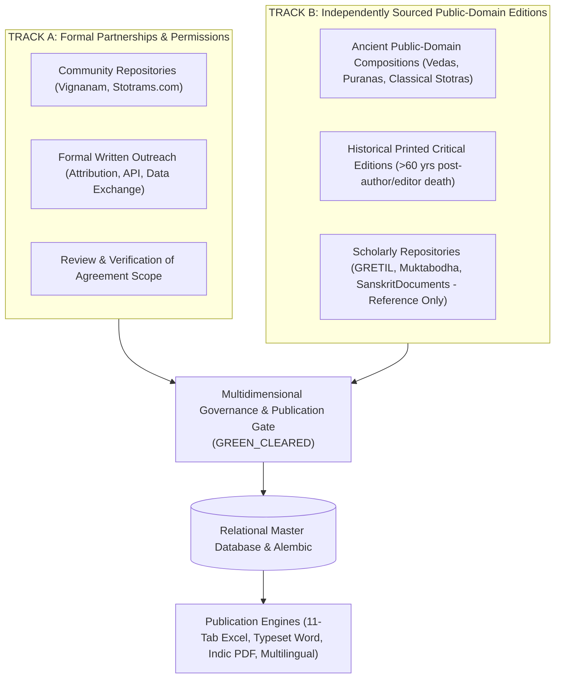

# Vedic Heritage Digital Library & Global Spiritual Platform
## Master Execution Plan (Canonical Project Charter)

**Document Status:** Active & Living  
**Version:** 6.0.0  
**Current Phase:** Phase 5 (Batch 1 & 2) Complete | Phase 6A (Multilingual Foundation) Complete  
**Workspace:** `C:\Vedam`  

---

## 1. Executive Summary & Ultimate Vision

The mission of this project is to build an enduring, scholarly, technologically robust, and beautifully designed digital ecosystem for preserving, organizing, verifying, translating, and distributing authentic Indian Vedic and devotional literature worldwide.

### Scope of Content Preserved:
1. Vedic Mantras (Samhita, Brahmana, Aranyaka, Upanishad recitations).
2. Puranic Mantras.
3. Stotras, Stutis, and Vandanas.
4. Ashtakams and devotional octets.
5. Sahasranamas (1,000 names).
6. Ashtottara Shatanamavalis (108 names).
7. Kavachams (spiritual shields).
8. Suktams (Rigvedic and Yajurvedic hymns).
9. Chalisas (e.g. Awadhi Hanuman Chalisa).
10. Aartis and Bhajans.
11. Puja Vidhi, Panchopachara / Shodashopachara rituals, and full liturgical scripts.
12. Vrat procedures and Kathas.
13. Dhyana, Nyasa, and meditation verses.
14. Daily and situational Sankalpams.
15. Parayanam texts and Saptashati / Ramayana recitation manuals.
16. Classical regional devotional literature (Tamil Divya Prabandham, Thevaram, Telugu Kritis, Marathi Abhangs, etc.).

---

## 2. Dual-Track Acquisition Strategy & Dynamic Intake Protocol

---

## 3. Phased Roadmap Overview

---

## 4. Phase Milestone Trackers

### Phase 1: Research, Source Discovery & Architecture Foundation (COMPLETED)
- Technical inspection of sources, copyright assessment, modular architecture.

### Phase 2: Content Collection & Processing Engine (COMPLETED)
- Connectors, Unicode preservation, deduplication, batch processor.

### Phase 3: Database Maturity & Master Devotional Text Catalog (COMPLETED)
- Alembic migrations, database integrity, 77-composition catalog, QA engine.

### Phase 4: Full-Text Pilot Ingestion & Professional Publication Engine (COMPLETED)
- Verified and ingested 8 pilot compositions.
- Built 11-sheet Excel, Word manuscript, and Indic PDF exporters.
- Implemented 15-rule publication preflight gate (`PublicationPreflightGate`).

### Phase 5: Systematic Multi-Text Corpus Expansion (COMPLETED)
- **Part 1 — Final Reconciliation & Discrepancy Resolution**:
  - Reconciled all 11 active compositions individually.
  - Mathematically resolved the 153 vs 150 verse count: 123 pilot units + 27 Batch 1 units = exactly 150 verified units; the +3 units arose from 2 unverified prototype records. Updated `library_analytics.py` to filter strictly for verified texts.
  - Confirmed edition-specific legal clearance across all compositions. Documented in `documentation/quality/PHASE5_FINAL_RECONCILIATION_REPORT.md`.
- **Part 2 — Shortlist Audit & Batch 2 Selection**:
  - Audited the remaining 7 shortlisted compositions in `documentation/quality/PHASE5_BATCH2_AUDIT_REPORT.md`.
  - Authorized first 3 eligible compositions: Venkateswara Suprabhatam (29 verses), Purusha Suktam (16 verses with swaras), Durga Suktam (7 verses with swaras).
- **Part 3 — Batch 2 Ingestion & Publication**:
  - Ingested all 3 compositions via `automation/ingestion/expansion_batch_2_ingestion.py`.
  - Generated all publication formats (Excel 11-sheet, Word, Indic PDF).
  - Total verified compositions: **14**; total verified verses: **202**; total publication files: **42**.

### Phase 6A: Multilingual Localization Architecture Foundation (COMPLETED)
- **1. Language and Script Architecture**:
  - Created `automation/localization/registry.py` formalizing all **22 Scheduled Indian Languages of the Eighth Schedule** + **English** (23 total). Sanskrit properly included as one of the 22.
  - Decoupled Language (ISO 639-1/3) and Script (ISO 15924) identifiers. Registered font stacks and OpenType HarfBuzz shaping requirements.
- **2. Sanskrit Terminology Glossary**:
  - Built `automation/localization/glossary.py` across 8 theological/liturgical categories (Deity names, Vedic terms, Ritual terms, Philosophical concepts, Grammatical terms, Mantra terms, Puja terms, Calendar terms) with standardized translations in Hindi, Telugu, Tamil, Kannada, and English.
- **3. Specialized Transliteration Engine**:
  - Built `automation/localization/transliteration.py` with multi-script projections (IAST, Telugu, Kannada, Malayalam, Grantha) and three distinct Tamil modes: Standard, Grantha-Extended, and Scholarly Phonetic ($க_1, க_2, க_3, க_4$).
- **4. First Localization Pilot (4 Languages, 5 Compositions)**:
  - Built `automation/localization/pilot_localizer.py` localizing Gayatri Mantra, Mahamrityunjaya Mantra, Ganesha Pancharatnam, Mahalakshmi Ashtakam, and Lingashtakam into **Hindi, Telugu, Tamil, and Kannada** (108 translated records).
  - Strictly enforced `ReviewStatus.DRAFT` awaiting external scholarly panel evaluation.
- **5. Ten-Rule Language Quality Assurance Engine**:
  - Built `automation/localization/qa_framework.py` validating completeness, missing verses, repeated translations, terminology glossary adherence, Unicode integrity, OpenType shaping, verse alignment, transliterations, Sanskrit immutability, and review provenance.
- **6. Multilingual Exporters**:
  - Built `automation/localization/exporters.py` generating comparative all-language workbooks in Excel, typeset Word manuscripts, and structured JSON payloads under `exports/multilingual/`.
- **7. Test Suite Status**:
  - Expanded automated test suite to **113 tests passing with 100% pass rate in 5.58 seconds**.
