# Vedic Heritage Digital Library & Global Spiritual Platform
## Master Execution Plan (Canonical Project Charter)

**Document Status:** Active & Living  
**Version:** 2.0.0  
**Current Phase:** Phase 2 Complete — Ready for Phase 3 Authorization  
**Workspace:** `C:\Vedam`  

---

## 1. Executive Summary & Ultimate Vision

The mission of this project is to build an enduring, scholarly, technologically robust, and beautifully designed digital ecosystem for preserving, organizing, verifying, translating, and distributing authentic Indian Vedic and devotional literature worldwide.

### Scope of Content Preserved:
1. Vedic Mantras (Samhita, Brahmana, Aranyaka, Upanishad recitations).
2. Puranic Mantras.
3. Stotras, Stutis, and Vandanas.
4. Ashtakams and devotional octets.
5. Sahasranamas (1,000 names).
6. Ashtottara Shatanamavalis (108 names).
7. Kavachams (spiritual shields).
8. Suktams (Rigvedic and Yajurvedic hymns).
9. Chalisas (e.g. Awadhi Hanuman Chalisa).
10. Aartis and Bhajans.
11. Puja Vidhi, Panchopachara / Shodashopachara rituals, and full liturgical scripts.
12. Vrat procedures and Kathas.
13. Dhyana, Nyasa, and meditation verses.
14. Daily and situational Sankalpams.
15. Parayanam texts and Saptashati / Ramayana recitation manuals.
16. Classical regional devotional literature (Tamil Divya Prabandham, Thevaram, Telugu Kritis, Marathi Abhangs, etc.).

---

## 2. Dual-Track Acquisition Strategy & Dynamic Intake Protocol

1. **Zero Confusion Rule**: Every new website or dataset is cataloged in `documentation/project_roadmap/SOURCE_REGISTRY.md` with an assigned `SRC-xxx` identifier before parsing or ingestion begins.
2. **Provenance Preservation**: Every verse retains its `source_id`, `source_url`, and `collection_timestamp`.
3. **Mandatory Rights Clearance**: No text can enter commercial publishing, mobile apps, or audio distribution without **`release_status == ReleaseStatus.GREEN`** signed off by human legal review.

---

## 3. Phased Roadmap Overview

```mermaid
flowchart LR
    P1["Phase 1: Research & Discovery (COMPLETE)"] --> P2["Phase 2: Collection & Processing Engine (COMPLETE)"]
    P2 --> P3["Phase 3: Relational Content DB Expansion"]
    P3 --> P4["Phase 4: Publication Engine (Excel/Word/PDF)"]
    P4 --> P5["Phase 5: Scholarly Text Verification"]
    P5 --> P6["Phase 6: 22-Language Localization"]
    P6 --> P7["Phase 7: Controlled AI Integration"]
    P7 --> P8["Phase 8: Audio & Video Production Handoff"]
    P8 --> P9["Phase 9: Mobile App (Flutter)"]
    P9 --> P10["Phase 10: Vedic Calculators & Panchangam"]
```

---

## 4. Phase Milestone Trackers

### Phase 1: Research, Source Discovery & Architecture Foundation (COMPLETED)

| Step | Action Item | Status | Deliverable Document / Code |
| :--- | :--- | :---: | :--- |
| **Step 1** | Inspect 4 target websites (Vignanam, Drik Panchang, Stotrams.com, Temples.bio) | **COMPLETED** | `documentation/source_research/SRC-001_vaidika_vignanam.md` through `SRC-004_temples_bio.md` |
| **Step 2** | Identify content structure, taxonomy, and available scripts | **COMPLETED** | `documentation/source_research/CONSOLIDATED_SOURCE_COMPARISON.md` |
| **Step 3** | Examine content permissions, copyright statements, and robots.txt | **COMPLETED** | Assigned AMBER / RED statuses based on terms of service |
| **Step 4** | Determine public-domain boundaries vs. restricted editorial content | **COMPLETED** | Demarcated ancient public-domain verses from modern protected editions |
| **Step 5** | Design modular Python collection architecture | **COMPLETED** | `documentation/architecture/SYSTEM_ARCHITECTURE.md` & `automation/` modules |
| **Step 6** | Design complete Relational Database Schema (SQLAlchemy + Pydantic) | **COMPLETED** | `database/models.py`, `database/schemas.py`, `documentation/architecture/DATABASE_SCHEMA.md` |
| **Step 7** | Propose Excel, Word, and JSON export specifications | **COMPLETED** | `automation/exporters/`, `documentation/architecture/EXPORT_SPECIFICATIONS.md` |
| **Step 8** | Finalize detailed milestone roadmap & dual-track strategies | **COMPLETED** | `documentation/permissions/ACQUISITION_STRATEGY_TRACKS.md` |
| **Step 9** | Implement First Small Pilot Collection & Working Prototype Exports | **COMPLETED** | `automation/pilot/seed_pilot_data.py`, prototype files in `exports/` |
| **Step 10** | Present Phase 1 Research & Architecture Report | **COMPLETED** | Formal presentation and user sign-off |

---

### Phase 2: Vedic Content Collection & Processing Engine (COMPLETED)

| Step | Component | Status | Key Deliverables & Technical Enhancements |
| :--- | :--- | :---: | :--- |
| **Step 2.1** | **Jurisdiction-Aware Rights Framework** | **COMPLETED** | `automation/rights/jurisdiction.py`: Separates IP layers (composition, edition, transcription, commentary, audio, video). Supports India (60 yrs), US (pre-1930), EU/UK (Life+70), and Global rules. Enforces human legal sign-off. |
| **Step 2.2** | **Unicode Preservation & Transliteration** | **COMPLETED** | `automation/cleaners/unicode_preserver.py`: Vedic accent detector (Anudatta `U+0952`, Svarita `U+0951`, Deergha Svarita `U+0954`, Prachaya `U+1CDA`). Verified round-trip transliteration across Devanagari, Telugu, Tamil, Kannada, Malayalam, and IAST. |
| **Step 2.3** | **Enhanced Database Schema** | **COMPLETED** | `database/models.py` updated with `SourceEdition`, `RightsGrant`, `MediaAsset`, `Contributor`, `raw_source_script`, `raw_source_text`, `canonical_scholarly_text`, and `vedic_accent_annotations`. |
| **Step 2.4** | **Modular Pipeline Engine (Phase 2A)** | **COMPLETED** | Connectors (`base.py`), Parsers (`verse_splitter.py`, `metadata_extractor.py`), Classifiers (`text_classifier.py` for Awadhi vs Sanskrit), Validators (`completeness_checker.py`), and Queue (`queue.py`, `checkpoint.py`). |
| **Step 2.5** | **Expanded Pilot Collection (Phase 2B)** | **COMPLETED** | Seeded all 8 pilot compositions (Ganesha Pancharatnam, Shiva Tandava, Aditya Hrudayam, Madhurashtakam, Mahamrityunjaya, Gayatri Mantra, Sri Suktam, Hanuman Chalisa) with complete Excel, Word, and JSON exports. |
| **Step 2.6** | **Automated Verification Suite** | **COMPLETED** | 33 automated tests passing 100% across rights, pipeline, Unicode preservation, exporters, and duplicate detection. |

---

### Pilot Compositions Registry (Phase 2B)

| Content ID | Canonical Title | Category | Primary Deity | Tradition / Source | Script / Language |
| :--- | :--- | :--- | :--- | :--- | :--- |
| `TX-GAN-STO-001` | Ganesha Pancharatnam | Stotra | Ganesha | Adi Shankaracharya | Sanskrit (Devanagari + 4 Regional + IAST) |
| `TX-SHI-STO-002` | Shiva Tandava Stotram | Stotra | Shiva | Ravana Kruta | Sanskrit (Devanagari + 4 Regional + IAST) |
| `TX-SUR-STO-003` | Aditya Hrudayam | Stotra | Surya | Valmiki Ramayana (Yuddha Kanda) | Sanskrit (Devanagari + 4 Regional + IAST) |
| `TX-KRI-STO-004` | Madhurashtakam | Ashtakam | Krishna | Vallabhacharya | Sanskrit (Devanagari + 4 Regional + IAST) |
| `TX-SHI-MAN-005` | Mahamrityunjaya Mantra | Vedic Mantra | Shiva | Rigveda Mandala 7.59.12 | Vedic Sanskrit with Swara Accents |
| `TX-GAY-MAN-006` | Gayatri Vedic Mantra | Vedic Mantra | Savitr / Gayatri | Rigveda Mandala 3.62.10 | Vedic Sanskrit with Swara Accents |
| `TX-LAK-SUK-007` | Sri Suktam | Suktam | Lakshmi / Sri | Rigvedic Parishishta / Khila Suktam | Vedic Sanskrit with Swara Accents |
| `TX-HAN-CHA-008` | Hanuman Chalisa | Chalisa | Hanuman | Goswami Tulsidas | Awadhi (`awa`) / Devanagari (Dohas & Chaupais) |

---

## 5. Technical Acceptance Standards

- **Authenticity Gate**: No Sanskrit text is modified without scholarly or critical-edition proof. Raw source text is stored immutably.
- **Rights Gate**: Mandatory `ContentRights` and `RightsGrant` entities enforce `release_status == ReleaseStatus.GREEN` with documented jurisdiction clearance and legal sign-off.
- **Unicode Gate**: Indic texts conform strictly to Unicode Indic standards with Vedic combining characters (Anudatta `U+0952`, Svarita `U+0951`, Deergha Svarita `U+0954`).
- **Linguistic Gate**: Awadhi devotional works (`awa`) are distinguished from classical Sanskrit (`sa`) with custom verse segmentation (Dohas and Chaupais).
- **Test Integrity Gate**: 100% test pass rate across unit and compliance test suites (`pytest tests/`). Currently 33 tests passing.
