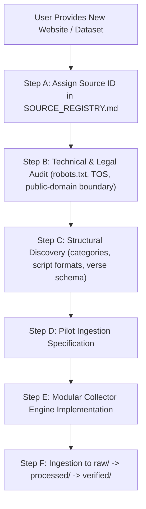

# Vedic Heritage Digital Library & Global Spiritual Platform
## Master Execution Plan (Canonical Project Charter)

**Document Status:** Active & Living  
**Version:** 1.0.0  
**Current Phase:** Phase 1 — Research, Content Source Discovery & Technical Foundation  
**Workspace:** `C:\Vedam`  

---

## 1. Executive Summary & Ultimate Vision

The mission of this project is to build an enduring, scholarly, technologically robust, and beautifully designed digital ecosystem for preserving, organizing, verifying, translating, and distributing authentic Indian Vedic and devotional literature worldwide.

### Scope of Content Preserved:
1. Vedic Mantras (Samhita, Brahmana, Aranyaka, Upanishad recitations).
2. Puranic Mantras.
3. Stotras, Stutis, and Vandanas.
4. Ashtakams and devotional octets.
5. Sahasranamas (1,000 names).
6. Ashtottara Shatanamavalis (108 names).
7. Kavachams (spiritual shields).
8. Suktams (Rigvedic and Yajurvedic hymns).
9. Chalisas.
10. Aartis and Bhajans.
11. Puja Vidhi, Panchopachara / Shodashopachara rituals, and full liturgical scripts.
12. Vrat procedures and Kathas.
13. Dhyana, Nyasa, and meditation verses.
14. Daily and situational Sankalpams.
15. Parayanam texts and Saptashati / Ramayana recitation manuals.
16. Classical regional devotional literature (Tamil Divya Prabandham, Thevaram, Telugu Kritis, Marathi Abhangs, etc.).

---

## 2. Dynamic Source & Data Expansion Protocol

> [!IMPORTANT]
> **Policy on Incoming Data and Websites:**
> The user will periodically supply new websites, manuscript scans, CSVs, or APIs. 
> To prevent confusion or scope regression, the system follows this strict ingestion protocol:

1. **Zero Confusion Rule**: Every new website is cataloged in `documentation/project_roadmap/SOURCE_REGISTRY.md` with an assigned `SRC-xxx` identifier before any parsing or ingestion begins.
2. **Provenance Preservation**: Every verse extracted or ingested retains its `source_id`, `source_url`, and `collection_timestamp`.
3. **Additive Architecture**: New sources feed into modular collectors without altering or destabilizing existing collectors or database schemas.

---

## 3. Phased Roadmap Overview

---

## 4. Phase-by-Phase Technical Blueprint

### Phase 1: Research, Content Source Discovery & Legal Audit
- **Objective**: Complete structural and legal audits of target sources before extracting any data.
- **Initial Sources**:
  - `SRC-001`: Vaidika Vignanam (`https://vignanam.org/`)
  - `SRC-002`: Drik Panchang Vedic Mantras (`https://www.drikpanchang.com/vedic-mantra/mantra-collection.html`)
  - `SRC-003`: Stotrams (`https://stotrams.com/`)
  - `SRC-004`: Temples.bio (`https://www.temples.bio/stotrams`)
- **Key Deliverables**:
  1. Source inventory and copyright/rights matrix.
  2. Content category hierarchy mapping.
  3. Technical assessment of site rendering (Static HTML vs. Client JS).
  4. Permitted collection methodology and rate-limiting policies.
  5. Recommendation for the first small pilot collection.

### Phase 2: Python Automation & Extraction Engine
- **Objective**: Build an enterprise-grade, modular, resumable Python collection pipeline.
- **Key Modules in `automation/`**:
  - `permission_checker`: Programmatic verification of robots.txt and HTTP headers.
  - `collectors`: Rate-limited, resilient HTTP clients with exponential backoff and session caching.
  - `parsers`: BeautifulSoup/lxml parsers separating titles, prefaces, dhyana, verses, phalasruti, and colophons.
  - `cleaners`: Unicode normalization (NFC/NFKD), Devanagari vowel ligature correction, and whitespace pruning.
  - `validators`: Verse numbering checks, syllable counts, and diacritics integrity checks.
  - `duplicate_detection`: Text hashing and fuzzy string matching across sources.

### Phase 3: Content Database Architecture & Schema Specification
- **Storage Strategy**: SQLite for development and prototyping; PostgreSQL for production.
- **Core Entities**:
  - `sources`: Source metadata, terms of service, and access parameters.
  - `categories` & `deities`: Hierarchical taxonomy (Deity -> Category -> Subcategory).
  - `texts`: Master text record (Unique Content ID, canonical Sanskrit title, authorship, Rishi, Chandas, Devata).
  - `text_versions`: Raw extracted text, cleaned text, verified original text, chanting-ready text.
  - `verses`: Granular verse-by-verse breakdown with stanza numbering, Vedic accents, and meter.
  - `transliterations`: Roman IAST, Telugu, Tamil, Kannada, Bengali, Gujarati, Malayalam, Odia, etc.
  - `translations`: Multi-language translations with word-by-word meanings and philosophical commentaries.
  - `verification_audit_log`: History of all scholarly reviews, corrections, and approvals.

### Phase 4: Professional Excel & Word Exporters
- **Excel Export (`exports/excel/`)**:
  - Multi-tab professional workbook (`All Texts`, `Mantras`, `Stotras`, `Sahasranamas`, `Verification Status`, etc.).
  - Auto-fitted columns, frozen headers, Unicode Indic rendering, and data validation dropdowns.
- **Word Export (`exports/word/`)**:
  - Beautifully formatted printable manuscripts.
  - Dual-script layouts (e.g., Devanagari + Telugu / Tamil + English IAST).
  - Verse boundaries, traditional floral breaks, invocation and phalasruti formatting.

### Phase 5: Text Correction & Authenticity Verification
- **Principle**: Zero silent AI rewriting. Sanskrit texts are sacred and exact.
- **Pipeline**:
  1. Multi-source cross-reference (compare Vignanam vs. Drik Panchang vs. SanskritDocuments vs. Critical Editions).
  2. Identification of missing verses, incorrect sandhi, broken ligatures, and shifted anusvaras/visargas.
  3. Variant preservation: When traditional versions diverge (e.g. Shaiva vs. Vaishnava recensions), store both as named variants (`Variant A`, `Variant B`) rather than declaring one "wrong".
  4. Multi-level status: `Collected` -> `Parsed` -> `Needs Verification` -> `Under Review` -> `Verified` -> `Approved for Translation` -> `Approved for Audio` -> `Approved for Publication`.

### Phase 6: 22-Language Localization Engine (Eighth Schedule + English)
- **Languages Supported**:
  1. Assamese, 2. Bengali, 3. Bodo, 4. Dogri, 5. Gujarati, 6. Hindi, 7. Kannada, 8. Kashmiri, 9. Konkani, 10. Maithili, 11. Malayalam, 12. Manipuri (Meitei), 13. Marathi, 14. Nepali, 15. Odia, 16. Punjabi, 17. Sanskrit, 18. Santali, 19. Sindhi, 20. Tamil, 21. Telugu, 22. Urdu, plus English.
- **Layers of Localization**:
  - Script Transliteration (lossless phonetic transliteration).
  - Word-by-Word Sanskrit Morphological Breakdown (Padachheda & Anvaya).
  - Contextual Devotional Meaning (Bhavartha).
  - Traditional Philosophical Commentary (Tatparya).
- **Pilot Languages**: Telugu, Hindi, Tamil, Kannada.

### Phase 7: Controlled AI Integration & Research Assistant
- **Role of Gemini & LLMs**: Assistive, never authoritative.
- **Allowed Uses**:
  - Metadata suggestions (identifying Chandas, probable Rishi, related festival).
  - Drafting initial translation glossaries.
  - Code generation, unit testing, and pipeline optimization.
- **Strict Guardrails**:
  - Raw source texts are immutable.
  - Every AI suggestion is tagged with `is_ai_generated=True` and requires human scholar sign-off.
  - Scriptural citations or authorship must never be fabricated.

### Phase 8: Devotional Audio & Video Production Handoff
- **Integration**: Clean, structured handoff format designed to feed external workflows (Suno AI, DAWs, Adobe Premiere / DaVinci Resolve, social publishing).
- **Chanting Audio Packages**:
  - Chanting-ready text formatted with exact line breaks, breathing pauses, and repetition markers.
  - Presets: 1, 3, 11, 21, 27, 54, 108 repetitions, and unbroken Japa loops.
- **Social Media Packaging**:
  - YouTube, Shorts, Instagram Reels, Facebook, and X.
  - Platform-tailored titles, hashtags, bilingual descriptions, and thumbnail captions.

### Phase 9: Global Mobile Application (Flutter)
- **Architecture**: Flutter cross-platform app (Android & iOS) with offline SQLite/Isar cache and FastAPI backend.
- **Core Modules**:
  1. **Spiritual Library**: Deity browsing, script switching, offline download, verse bookmarking.
  2. **Japa Mala & Audio Chanting Player**: Count tracking (108 repetitions), background audio playback, lock-screen controls, pause/resume persistence.
  3. **Global Vedic Calendar & Panchangam**: Location-aware daily Panchangam (Tithi, Nakshatra, Yoga, Karana, Rahu Kalam, Yamagandam, Gulika, Abhijit Muhurta) with Amanta and Purnimanta toggle.
  4. **Dynamic Sankalpam Generator**: Real-time generation of traditional Sankalpam based on current GPS location, date, time, and sampradaya preference.
  5. **Festival & Vrat Push Notifications**: Personalized notifications for Ekadashi, Pradosham, Shivaratri, Navaratri, Sankatahara Chaturthi, etc.

### Phase 10: Vedic Utilities & Astronomical Calculators
- **Engine**: Precise astronomical calculation engine (integrating Swiss Ephemeris / PyEphem / Surya Siddhanta algorithms).
- **Calculators**:
  - Tithi & Nakshatra timings with end moments.
  - Rahu Kalam, Yamagandam, Gulika Kalam, Durmuhurtham.
  - Abhijit Muhurta and Brahma Muhurta finder.
  - Ekadashi fast beginning and Parana timing calculator.
  - Hindu Lunar month and Ayana calculator.

---

## 5. Current Active Sprint: Phase 1 Action Steps

The immediate goal is completing the research, source audit, legal validation, and system design before writing large extractors.

| Step | Action Item | Status | Deliverable Document |
| :--- | :--- | :---: | :--- |
| **Step 1** | Inspect 4 target websites (Vignanam, Drik Panchang, Stotrams.com, Temples.bio) | **In Progress** | `documentation/source_research/INSPECTION_AUDIT.md` |
| **Step 2** | Identify content structure, taxonomy, and available scripts | **In Progress** | `documentation/source_research/CONTENT_TAXONOMY.md` |
| **Step 3** | Examine content permissions, copyright statements, and robots.txt | **In Progress** | `documentation/source_research/LEGAL_PERMISSIONS_ASSESSMENT.md` |
| **Step 4** | Determine public-domain boundaries vs. restricted editorial content | **In Progress** | `documentation/source_research/RIGHTS_REGISTER.md` |
| **Step 5** | Design modular Python collection architecture | **Planned** | `documentation/architecture/COLLECTION_ARCHITECTURE.md` |
| **Step 6** | Design complete Relational Database Schema (SQLAlchemy + Pydantic) | **Planned** | `documentation/architecture/DATABASE_SCHEMA.md` & `database/schemas/` |
| **Step 7** | Propose Excel and Word export layouts | **Planned** | `documentation/architecture/EXPORT_SPECIFICATIONS.md` |
| **Step 8** | Finalize detailed milestone roadmap | **Planned** | `documentation/project_roadmap/MASTER_PLAN.md` (Self-updating) |
| **Step 9** | Formulate First Small Pilot Collection recommendation (e.g., 5-10 core Stotras) | **Planned** | `documentation/project_roadmap/PILOT_PROPOSAL.md` |
| **Step 10** | Present Phase 1 Research Report for User Review and Approval | **Queued** | Phase 1 Checkpoint Summary |

---

## 6. Acceptance & Quality Standards

- **Authenticity Gate**: No Sanskrit text is modified without scholarly or critical-edition proof.
- **Provenance Gate**: Every record has a permanent unique ID, original URL, and extraction timestamp.
- **Legal Gate**: Bulk scraping is never performed without robots.txt compliance and legal confirmation.
- **Unicode Gate**: All Indic texts conform strictly to Unicode 15.0 Indic standards without corrupted font-glyphs.
- **Verification Gate**: Only texts with status `Approved for Publication` or `Approved for Audio` can be exported to downstream pipelines.
