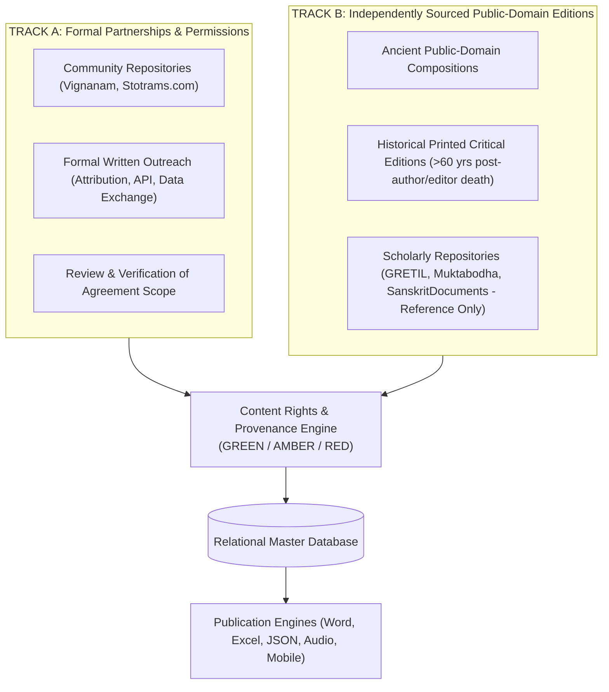

# Vedic Heritage Digital Library & Global Spiritual Platform
## Master Execution Plan (Canonical Project Charter)

**Document Status:** Active & Living  
**Version:** 1.2.0  
**Current Phase:** Phase 1 — Research, Content Source Discovery & Technical Foundation  
**Workspace:** `C:\Vedam`  

---

## 1. Executive Summary & Ultimate Vision

The mission of this project is to build an enduring, scholarly, technologically robust, and beautifully designed digital ecosystem for preserving, organizing, verifying, translating, and distributing authentic Indian Vedic and devotional literature worldwide.

### Scope of Content Preserved:
1. Vedic Mantras (Samhita, Brahmana, Aranyaka, Upanishad recitations).
2. Puranic Mantras.
3. Stotras, Stutis, and Vandanas.
4. Ashtakams and devotional octets.
5. Sahasranamas (1,000 names).
6. Ashtottara Shatanamavalis (108 names).
7. Kavachams (spiritual shields).
8. Suktams (Rigvedic and Yajurvedic hymns).
9. Chalisas (e.g. Awadhi Hanuman Chalisa).
10. Aartis and Bhajans.
11. Puja Vidhi, Panchopachara / Shodashopachara rituals, and full liturgical scripts.
12. Vrat procedures and Kathas.
13. Dhyana, Nyasa, and meditation verses.
14. Daily and situational Sankalpams.
15. Parayanam texts and Saptashati / Ramayana recitation manuals.
16. Classical regional devotional literature (Tamil Divya Prabandham, Thevaram, Telugu Kritis, Marathi Abhangs, etc.).

---

## 2. Dual-Track Acquisition Strategy & Dynamic Intake Protocol

1. **Zero Confusion Rule**: Every new website or dataset is cataloged in `documentation/project_roadmap/SOURCE_REGISTRY.md` with an assigned `SRC-xxx` identifier before parsing or ingestion begins.
2. **Provenance Preservation**: Every verse retains its `source_id`, `source_url`, and `collection_timestamp`.
3. **Mandatory Rights Clearance**: No text can enter commercial publishing, mobile apps, or audio distribution without **`release_status == ReleaseStatus.GREEN`**.

---

## 3. Phased Roadmap Overview

```mermaid
flowchart LR
    P1["Phase 1: Research & Discovery (STEPS 1-10 COMPLETE)"] --> P2["Phase 2: Python Automation Engine"]
    P2 --> P3["Phase 3: Relational Content DB"]
    P3 --> P4["Phase 4: Word & Excel Exporters"]
    P4 --> P5["Phase 5: Scholarly Text Verification"]
    P5 --> P6["Phase 6: 22-Language Localization"]
    P6 --> P7["Phase 7: Controlled AI Integration"]
    P7 --> P8["Phase 8: Audio & Video Handoff"]
    P8 --> P9["Phase 9: Mobile App (Flutter)"]
    P9 --> P10["Phase 10: Vedic Calculators & Panchangam"]
```

---

## 4. Phase 1 Sprint Tracker (Steps 1 to 10)

| Step | Action Item | Status | Deliverable Document / Code |
| :--- | :--- | :---: | :--- |
| **Step 1** | Inspect 4 target websites (Vignanam, Drik Panchang, Stotrams.com, Temples.bio) | **COMPLETED** | `documentation/source_research/SRC-001_vaidika_vignanam.md` through `SRC-004_temples_bio.md` |
| **Step 2** | Identify content structure, taxonomy, and available scripts | **COMPLETED** | `documentation/source_research/CONSOLIDATED_SOURCE_COMPARISON.md` |
| **Step 3** | Examine content permissions, copyright statements, and robots.txt | **COMPLETED** | Assigned AMBER / RED statuses based on terms of service |
| **Step 4** | Determine public-domain boundaries vs. restricted editorial content | **COMPLETED** | Demarcated ancient public-domain verses from modern protected editions |
| **Step 5** | Design modular Python collection architecture | **COMPLETED** | `documentation/architecture/SYSTEM_ARCHITECTURE.md` & `automation/` modules |
| **Step 6** | Design complete Relational Database Schema (SQLAlchemy + Pydantic) | **COMPLETED** | `database/models.py`, `database/schemas.py`, `documentation/architecture/DATABASE_SCHEMA.md` |
| **Step 7** | Propose Excel, Word, and JSON export specifications | **COMPLETED** | `automation/exporters/`, `documentation/architecture/EXPORT_SPECIFICATIONS.md` |
| **Step 8** | Finalize detailed milestone roadmap & dual-track strategies | **COMPLETED** | `documentation/permissions/ACQUISITION_STRATEGY_TRACKS.md` |
| **Step 9** | Implement First Small Pilot Collection & Working Prototype Exports | **COMPLETED** | `automation/pilot/seed_pilot_data.py`, prototype files in `exports/` |
| **Step 10** | Present Phase 1 Research & Architecture Report for User Review and Approval | **COMPLETED** | Active turn deliverables presentation |

---

## 5. Technical Acceptance Standards

- **Authenticity Gate**: No Sanskrit text is modified without scholarly or critical-edition proof.
- **Rights Gate**: Mandatory `ContentRights` entity enforces `release_status == ReleaseStatus.GREEN` for commercial release.
- **Unicode Gate**: All Indic texts conform strictly to Unicode Indic standards with Vedic combining characters (Anudatta `U+0952`, Svarita `U+0951`).
- **Test Integrity Gate**: 100% test pass rate across unit and compliance test suites (`pytest tests/`).
