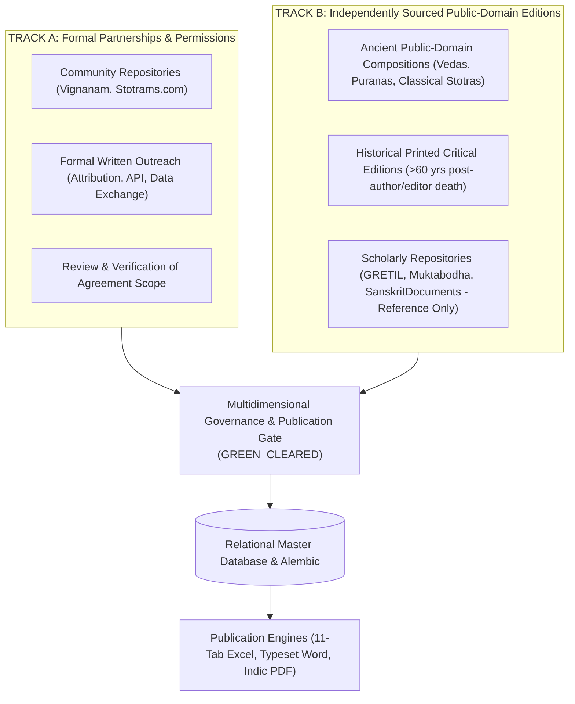

# Vedic Heritage Digital Library & Global Spiritual Platform
## Master Execution Plan (Canonical Project Charter)

**Document Status:** Active & Living  
**Version:** 4.0.0  
**Current Phase:** Phase 4 Complete — Ready for Phase 5 Authorization  
**Workspace:** `C:\Vedam`  

---

## 1. Executive Summary & Ultimate Vision

The mission of this project is to build an enduring, scholarly, technologically robust, and beautifully designed digital ecosystem for preserving, organizing, verifying, translating, and distributing authentic Indian Vedic and devotional literature worldwide.

### Scope of Content Preserved:
1. Vedic Mantras (Samhita, Brahmana, Aranyaka, Upanishad recitations).
2. Puranic Mantras.
3. Stotras, Stutis, and Vandanas.
4. Ashtakams and devotional octets.
5. Sahasranamas (1,000 names).
6. Ashtottara Shatanamavalis (108 names).
7. Kavachams (spiritual shields).
8. Suktams (Rigvedic and Yajurvedic hymns).
9. Chalisas (e.g. Awadhi Hanuman Chalisa).
10. Aartis and Bhajans.
11. Puja Vidhi, Panchopachara / Shodashopachara rituals, and full liturgical scripts.
12. Vrat procedures and Kathas.
13. Dhyana, Nyasa, and meditation verses.
14. Daily and situational Sankalpams.
15. Parayanam texts and Saptashati / Ramayana recitation manuals.
16. Classical regional devotional literature (Tamil Divya Prabandham, Thevaram, Telugu Kritis, Marathi Abhangs, etc.).

---

## 2. Dual-Track Acquisition Strategy & Dynamic Intake Protocol

1. **Zero Confusion Rule**: Every new website or dataset is cataloged in `documentation/project_roadmap/SOURCE_REGISTRY.md` with an assigned `SRC-xxx` identifier before parsing or ingestion begins.
2. **Provenance Preservation**: Every verse retains its `source_id`, `source_url`, and `collection_timestamp`.
3. **Mandatory Rights Clearance**: No text can enter commercial publishing, mobile apps, or audio distribution without **`rights_clearance_status == RightsClearanceStatus.GREEN_CLEARED`** signed off by human legal review.

---

## 3. Phased Roadmap Overview

```mermaid
flowchart LR
    P1["Phase 1: Research & Discovery (COMPLETE)"] --> P2["Phase 2: Collection Engine (COMPLETE)"]
    P2 --> P3["Phase 3: DB Maturity & Master Catalog (COMPLETE)"]
    P3 --> P4["Phase 4: Full-Text Ingestion & Publication (COMPLETE)"]
    P4 --> P5["Phase 5: Systematic Multi-Text Corpus Expansion"]
    P5 --> P6["Phase 6: Multilingual Localization (22 Languages)"]
    P6 --> P7["Phase 7: Controlled AI Integration"]
    P7 --> P8["Phase 8: Audio & Video Production Handoff"]
    P8 --> P9["Phase 9: Mobile App (Flutter)"]
    P9 --> P10["Phase 10: Vedic Calculators & Panchangam"]
```

---

## 4. Phase Milestone Trackers

### Phase 1: Research, Source Discovery & Architecture Foundation (COMPLETED)
- Technical inspection of sources, copyright assessment, modular architecture.

### Phase 2: Content Collection & Processing Engine (COMPLETED)
- Connectors, Unicode preservation, deduplication, batch processor.

### Phase 3: Database Maturity & Master Catalog Expansion (COMPLETED)
- Alembic migrations, database integrity, 77-composition catalog, QA engine.

### Phase 4: Full-Text Pilot Ingestion & Professional Publication Engine (COMPLETED)
- **Phase 4A: Pilot Text Verification Dossiers**:
  - Researched and established historical critical editions and verse counts for all 6 sample records.
  - Authored 6 individual philological verification reports under `documentation/quality/`.
- **Phase 4B: Unabridged Full-Text Pilot Ingestion**:
  - Ingested 100% complete, authentic verse payloads for all 8 pilot compositions into `vedam.db`.
  - Preserved raw source text immutably, verified Vedic swaras, generated multi-script transliterations (Telugu, Tamil, Kannada, Malayalam, IAST), and populated approved English Bhavartha translations.
  - Ingestion verse counts:
    - `VEDA-TXT-00001` Ganesha Pancharatnam: 6 verses (5 Vasantatilaka + 1 Phalasruti)
    - `VEDA-TXT-00002` Shiva Tandava Stotram: 16 verses (14 Panchachamara + 2 Phalasruti)
    - `VEDA-TXT-00003` Aditya Hrudayam: 31 verses (Valmiki Ramayana Yuddha Kanda 105)
    - `VEDA-TXT-00004` Madhurashtakam: 9 units (8 Totaka + 1 Phalasruti)
    - `VEDA-TXT-00005` Mahamrityunjaya Vedic Mantra: 1 verse (Rigveda 7.59.12 with swaras)
    - `VEDA-TXT-00006` Gayatri Vedic Mantra: 1 verse (Rigveda 3.62.10 with swaras)
    - `VEDA-TXT-00007` Sri Suktam: 16 units (15 Vedic Riks + 1 Phalasruti with swaras)
    - `VEDA-TXT-00008` Hanuman Chalisa: 43 units (2 Dohas, 40 Chaupais, 1 Doha in Awadhi)
  - All 8 compositions achieved `VERIFIED_FULL_TEXT` status with 0 QA issues.
- **Phase 4C: Professional Publication Engine**:
  - **Excel Exporter** (`automation/exporters/excel_publication_exporter.py`): Built 11-sheet archival workbook generator with royal maroon/gold styling, auto-filters, frozen panes, and auto-fit columns.
  - **Word Exporter** (`automation/exporters/word_publication_exporter.py`): Built typeset manuscript generator with formal cover page, running headers/footers ("Page X of Y"), dual-view typography, and editorial colophon.
  - **PDF Exporter** (`automation/exporters/pdf_publication_exporter.py`): Built ReportLab document builder registering native Indic TrueType font (`Nirmala UI` and `Nirmala UI Bold` from Windows Fonts) with custom two-pass `NumberedCanvas` and verified searchability via PyMuPDF.
  - **Publication Orchestrator** (`automation/exporters/publication_orchestrator.py`): Produced 24 publication deliverables in `exports/excel/`, `exports/word/`, and `exports/pdf/`.
- **Phase 4D: Governance & Preflight Publication Gate**:
  - Decoupled 6 independent approval dimensions (`AcquisitionStatus`, `TextualVerificationStatus`, `RightsClearanceStatus`, `TranslationStatus`, `EditorialApprovalStatus`, `PublicationStatus`).
  - Added Alembic migration `c111d1f4a93d` to `vedam.db`.
  - Implemented 15-rule preflight gate (`automation/validators/publication_gate.py`) blocking publication if any approval dimension or data criterion is unmet.
  - Suite of 64 automated tests passing (100% pass rate).
