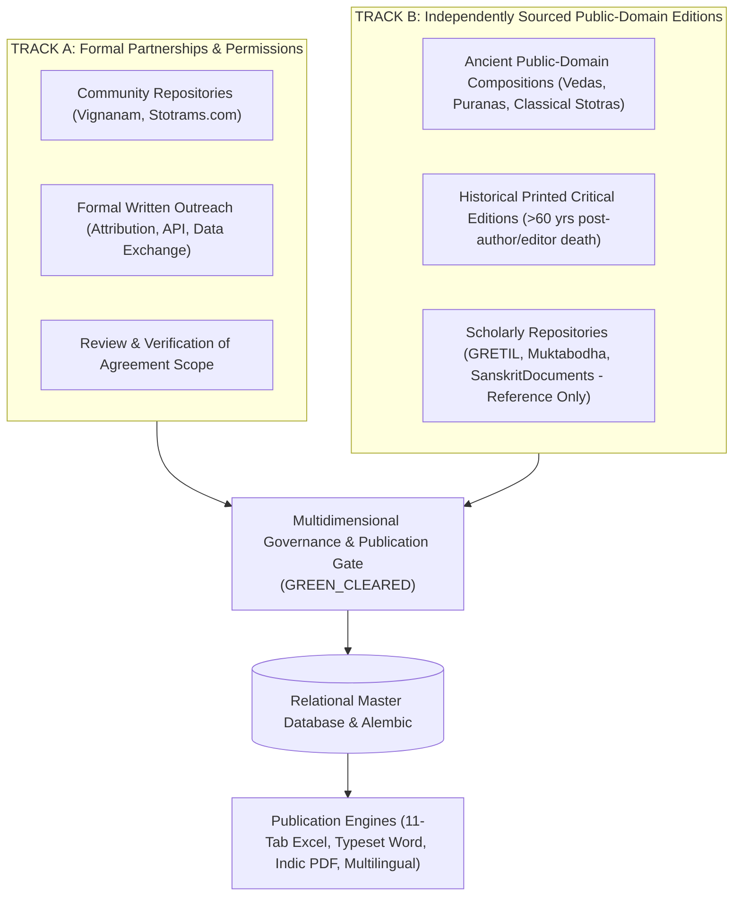

# Vedic Heritage Digital Library & Global Spiritual Platform
## Master Execution Plan (Canonical Project Charter)

**Document Status:** Active & Living  
**Version:** 7.0.0  
**Current Phase:** Phase 5 (Batch 1, 2 & 3) Complete | Phase 6 (6A & 6B) Complete  
**Workspace:** `C:\Vedam`  

---

## 1. Executive Summary & Ultimate Vision

The mission of this project is to build an enduring, scholarly, technologically robust, and beautifully designed digital ecosystem for preserving, organizing, verifying, translating, and distributing authentic Indian Vedic and devotional literature worldwide.

### Scope of Content Preserved:
1. Vedic Mantras (Samhita, Brahmana, Aranyaka, Upanishad recitations).
2. Puranic Mantras.
3. Stotras, Stutis, and Vandanas.
4. Ashtakams and devotional octets.
5. Sahasranamas (1,000 names).
6. Ashtottara Shatanamavalis (108 names).
7. Kavachams (spiritual shields).
8. Suktams (Rigvedic and Yajurvedic hymns).
9. Chalisas (e.g. Awadhi Hanuman Chalisa).
10. Aartis and Bhajans.
11. Puja Vidhi, Panchopachara / Shodashopachara rituals, and full liturgical scripts.
12. Vrat procedures and Kathas.
13. Dhyana, Nyasa, and meditation verses.
14. Daily and situational Sankalpams.
15. Parayanam texts and Saptashati / Ramayana recitation manuals.
16. Classical regional devotional literature (Tamil Divya Prabandham, Thevaram, Telugu Kritis, Marathi Abhangs, etc.).

---

## 2. Dual-Track Acquisition Strategy & Dynamic Intake Protocol

---

## 3. Phased Roadmap Overview

---

## 4. Phase Milestone Trackers

### Phase 1: Research, Source Discovery & Architecture Foundation (COMPLETED)
- Technical inspection of sources, copyright assessment, modular architecture.

### Phase 2: Content Collection & Processing Engine (COMPLETED)
- Connectors, Unicode preservation, deduplication, batch processor.

### Phase 3: Database Maturity & Master Devotional Text Catalog (COMPLETED)
- Alembic migrations, database integrity, 77-composition catalog, QA engine.

### Phase 4: Full-Text Pilot Ingestion & Professional Publication Engine (COMPLETED)
- Verified and ingested 8 pilot compositions.
- Built 11-sheet Excel, Word manuscript, and Indic PDF exporters.
- Implemented 15-rule publication preflight gate (`PublicationPreflightGate`).

### Phase 5: Systematic Multi-Text Corpus Expansion (COMPLETED)
- **Batch 1 (Compositions 10, 11, 12)**:
  - Mahalakshmi Ashtakam (10 verses), Lingashtakam (9 verses), Sankata Nashana Ganesha Stotram (8 verses).
- **Batch 2 (Compositions 13, 14, 15)**:
  - Venkateswara Suprabhatam (29 verses), Purusha Suktam (16 verses with swaras), Durga Suktam (7 verses with swaras).
- **Batch 3 (Compositions 16, 17, 18, 19)**:
  - Narayana Suktam (`VEDA-TXT-00016`, 12 verses with mandatory Taittiriya swaras; Anandashrama 1894).
  - Surya Ashtakam (`VEDA-TXT-00017`, 10 verses; NSP 1912).
  - Kanakadhara Stotram (`VEDA-TXT-00018`, 21 verses; Vani Vilas 1910).
  - Mahishasura Mardini Stotram (`VEDA-TXT-00019`, 21 verses; NSP 1912).
- **Corpus Totals**:
  - Total verified compositions in database: **18**.
  - Total verified verse units: **266**.
  - Total publication deliverables: **54** (18 Excel 11-sheet, 18 Word manuscripts, 18 Indic PDFs).
  - All 54 deliverables cryptographically validated in `documentation/quality/PUBLICATION_MANIFEST_REPORT.md`.

### Phase 6: Multilingual Localization Architecture & Expansion (COMPLETED)
- **Phase 6A Foundation (4 Languages: hi, te, ta, kn)**:
  - Built `automation/localization/registry.py` covering all 22 Eighth Schedule languages + English (23 total).
  - Built `automation/localization/glossary.py` covering 20 core spiritual terms.
  - Built `automation/localization/transliteration.py` with multi-script projections and three Tamil modes.
  - Localized 5 pilot compositions across Hindi, Telugu, Tamil, and Kannada (108 translation records).
  - Built 10-rule `LanguageQualityAssuranceEngine` (`qa_framework.py`).
- **Phase 6B Expansion (5 Additional Languages: mr, bn, gu, ml, or)**:
  - Extended glossary with authentic spiritual terminology across all 9 regional languages.
  - Ingested 135 new Bhavartha translations across Marathi, Bengali, Gujarati, Malayalam, and Odia (`phase6b_localizer.py`).
  - Total regional translation records: **243** ($27 \times 9$), strictly categorized as `ReviewStatus.DRAFT`.
  - Upgraded `MultilingualPublicationExporter` to support 13-column comparative Excel, 12-row per verse Word manuscripts, and 11-language JSON payloads.
  - All 45 language audits (5 texts $\times$ 9 languages) passed all 10 QA checks.

### Test Suite Status:
- Automated test suite expanded to **148 tests passing with 100% pass rate in 7.43 seconds**.
