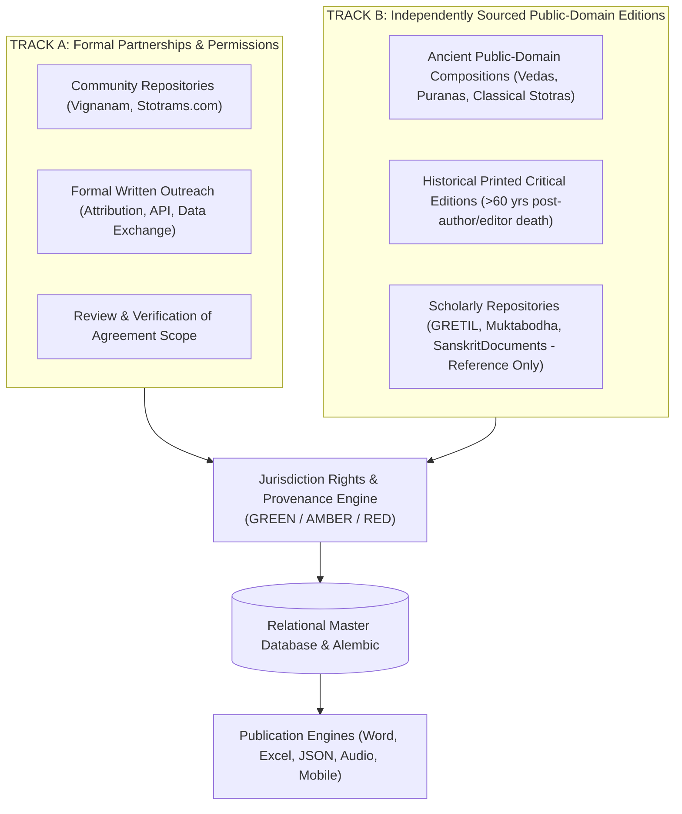

# Vedic Heritage Digital Library & Global Spiritual Platform
## Master Execution Plan (Canonical Project Charter)

**Document Status:** Active & Living  
**Version:** 3.0.0  
**Current Phase:** Phase 3 Complete — Ready for Phase 4 Authorization  
**Workspace:** `C:\Vedam`  

---

## 1. Executive Summary & Ultimate Vision

The mission of this project is to build an enduring, scholarly, technologically robust, and beautifully designed digital ecosystem for preserving, organizing, verifying, translating, and distributing authentic Indian Vedic and devotional literature worldwide.

### Scope of Content Preserved:
1. Vedic Mantras (Samhita, Brahmana, Aranyaka, Upanishad recitations).
2. Puranic Mantras.
3. Stotras, Stutis, and Vandanas.
4. Ashtakams and devotional octets.
5. Sahasranamas (1,000 names).
6. Ashtottara Shatanamavalis (108 names).
7. Kavachams (spiritual shields).
8. Suktams (Rigvedic and Yajurvedic hymns).
9. Chalisas (e.g. Awadhi Hanuman Chalisa).
10. Aartis and Bhajans.
11. Puja Vidhi, Panchopachara / Shodashopachara rituals, and full liturgical scripts.
12. Vrat procedures and Kathas.
13. Dhyana, Nyasa, and meditation verses.
14. Daily and situational Sankalpams.
15. Parayanam texts and Saptashati / Ramayana recitation manuals.
16. Classical regional devotional literature (Tamil Divya Prabandham, Thevaram, Telugu Kritis, Marathi Abhangs, etc.).

---

## 2. Dual-Track Acquisition Strategy & Dynamic Intake Protocol

1. **Zero Confusion Rule**: Every new website or dataset is cataloged in `documentation/project_roadmap/SOURCE_REGISTRY.md` with an assigned `SRC-xxx` identifier before parsing or ingestion begins.
2. **Provenance Preservation**: Every verse retains its `source_id`, `source_url`, and `collection_timestamp`.
3. **Mandatory Rights Clearance**: No text can enter commercial publishing, mobile apps, or audio distribution without **`release_status == ReleaseStatus.GREEN`** signed off by human legal review.

---

## 3. Phased Roadmap Overview

```mermaid
flowchart LR
    P1["Phase 1: Research & Discovery (COMPLETE)"] --> P2["Phase 2: Collection Engine (COMPLETE)"]
    P2 --> P3["Phase 3: DB Maturity & Master Catalog (COMPLETE)"]
    P3 --> P4["Phase 4: Publication Engine (Excel/Word/PDF)"]
    P4 --> P5["Phase 5: Scholarly Text Verification"]
    P5 --> P6["Phase 6: 22-Language Localization"]
    P6 --> P7["Phase 7: Controlled AI Integration"]
    P7 --> P8["Phase 8: Audio & Video Production Handoff"]
    P8 --> P9["Phase 9: Mobile App (Flutter)"]
    P9 --> P10["Phase 10: Vedic Calculators & Panchangam"]
```

---

## 4. Phase Milestone Trackers

### Phase 1: Research, Source Discovery & Architecture Foundation (COMPLETED)
- Steps 1 to 10 completed: Technical audits of 4 websites, legal demarcation, initial ORM models, export prototypes, dual-track strategies.

### Phase 2: Vedic Content Collection & Processing Engine (COMPLETED)
- Steps 2.1 to 2.6 completed: Jurisdiction-aware rights (`jurisdiction.py`), Unicode Vedic swara preserver (`unicode_preserver.py`), expanded ORM schema (`SourceEdition`, `RightsGrant`, `MediaAsset`), modular pipeline engine, 8 pilot compositions seeded, 33 automated tests.

### Phase 3: Database Maturity & Master Devotional Text Catalog (COMPLETED)

| Step | Component | Status | Key Deliverables & Technical Enhancements |
| :--- | :--- | :---: | :--- |
| **Step 3A** | **Database Maturity & Alembic** | **COMPLETED** | Initialized Alembic (`alembic.ini`, `database/migrations/`). Generated full initial migration (`d6e0af35f812_...`). Built atomic snapshot backup and recovery engine (`database/backup.py`). Built diagnostic reporter (`database/reporter.py`). Verified clean DB upgrades and rollbacks. |
| **Step 3B** | **Master Devotional Discovery Catalog** | **COMPLETED** | Curated 77 authentic traditional compositions across Vedic hymns, Ganesha, Shiva, Vishnu, Devis, Surya, Hanuman, Subramanya, Krishna, Rama. Generated structured JSON (`data/catalogs/master_devotional_catalog.json`), styled Excel classification workbook (`exports/catalogs/candidate_classification_master_catalog.xlsx`), and markdown catalog (`documentation/project_roadmap/MASTER_DEVOTIONAL_CATALOG.md`). |
| **Step 3C** | **Verified Source & Edition Registers** | **COMPLETED** | Established 7-layer IP framework in `documentation/provenance/EDITION_AND_PROVENANCE_REGISTER.md`. Documented multi-jurisdiction copyright thresholds (IN 60 yrs, US pre-1930, EU/UK Life+70) in `documentation/permissions/RIGHTS_ASSESSMENT_REGISTER.md`. |
| **Step 3D** | **Pilot Texts Audit & Quality Classification** | **COMPLETED** | Audited all 8 pilot texts. Categorized completeness: Gayatri & Mahamrityunjaya as `VERIFIED_FULL_TEXT` (1/1 with Vedic accents); remaining 6 compositions explicitly marked as `SAMPLE_RECORD` awaiting full ingestion. Published `documentation/quality/PILOT_TEXTS_VERIFICATION_REPORT.md`. |
| **Step 3E** | **Content Quality Assurance Engine** | **COMPLETED** | Built `automation/validators/qa_engine.py` supporting 12 lifecycle quality stages (`DISCOVERED` to `APPROVED_FOR_PUBLICATION`) and 14 automated validation checks (versification, duplicate numbering, sequence gaps, danda syntax, accents, ligatures, corruption, metadata completeness). |
| **Step 3F** | **Multilingual & Tamil Preparation** | **COMPLETED** | Formulated 24-language support framework. Analyzed Tamil consonant representation (lack of aspirated/voiced letters, Grantha glyph support, and dual-view superscript notation). Verified accent round-trip preservation. Published `documentation/quality/MULTILINGUAL_UNICODE_TEST_REPORT.md`. |
| **Step 3G** | **Controlled Batch Ingestion Engine** | **COMPLETED** | Implemented `automation/pipeline/batch_processor.py` supporting bounded batch sizes, dry-run simulation, source permission validation, atomic checkpointing, error queues, duplicate checks, and manual human legal approval transitions. |
| **Step 3H** | **Comprehensive Test Suite Expansion** | **COMPLETED** | Expanded automated test suite to **45 tests passing 100% in 2.92 seconds** (`tests/test_database_maturity.py`, `tests/test_qa_engine.py`, `tests/test_batch_processor.py`, and existing suites). |

---

## 5. Technical Acceptance Standards

- **Authenticity Gate**: No Sanskrit text is modified without scholarly or critical-edition proof. Raw source text is stored immutably.
- **Completeness Gate**: Every text is explicitly classified (`METADATA_ONLY`, `SAMPLE_RECORD`, `INCOMPLETE_TEXT`, `FULL_UNVERIFIED_TEXT`, `VERIFIED_FULL_TEXT`). Exported prototypes are not treated as full verified texts.
- **Rights Gate**: Mandatory `ContentRights` and `RightsGrant` entities enforce `release_status == ReleaseStatus.GREEN` with documented jurisdiction clearance and human legal review sign-off.
- **Unicode Gate**: Indic texts conform strictly to Unicode Indic standards with Vedic combining characters (Anudatta `U+0952`, Svarita `U+0951`, Deergha Svarita `U+0954`).
- **Test Integrity Gate**: 100% test pass rate across unit and compliance test suites (`pytest tests/`). Currently 45 tests passing.
