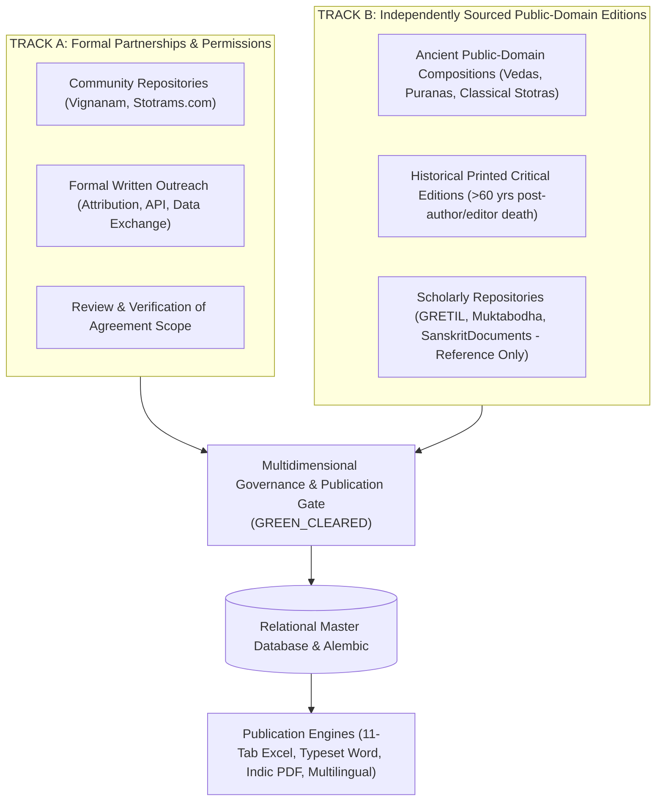

# Vedic Heritage Digital Library & Global Spiritual Platform
## Master Execution Plan (Canonical Project Charter)

**Document Status:** Active & Living  
**Version:** 7.4.0  
**Current Phase:** Phase 6C Complete (18 of 18 Compositions Fully Localized across 9 Regional Languages — 100.0% Coverage Milestone Achieved!)  
**Workspace:** `C:\Vedam`  

---

## 1. Executive Summary & Ultimate Vision

The mission of this project is to build an enduring, scholarly, technologically robust, and beautifully designed digital ecosystem for preserving, organizing, verifying, translating, and distributing authentic Indian Vedic and devotional literature worldwide.

### Scope of Content Preserved:
1. Vedic Mantras (Samhita, Brahmana, Aranyaka, Upanishad recitations).
2. Puranic Mantras.
3. Stotras, Stutis, and Vandanas.
4. Ashtakams and devotional octets.
5. Sahasranamas (1,000 names).
6. Ashtottara Shatanamavalis (108 names).
7. Kavachams (spiritual shields).
8. Suktams (Rigvedic and Yajurvedic hymns).
9. Chalisas (e.g. Awadhi Hanuman Chalisa).
10. Aartis and Bhajans.
11. Puja Vidhi, Panchopachara / Shodashopachara rituals, and full liturgical scripts.
12. Vrat procedures and Kathas.
13. Dhyana, Nyasa, and meditation verses.
14. Daily and situational Sankalpams.
15. Parayanam texts and Saptashati / Ramayana recitation manuals.
16. Classical regional devotional literature (Tamil Divya Prabandham, Thevaram, Telugu Kritis, Marathi Abhangs, etc.).

---

## 2. Dual-Track Acquisition Strategy & Dynamic Intake Protocol

---

## 3. Phased Roadmap Overview

---

## 4. Phase Milestone Trackers

### Phase 1: Research, Source Discovery & Architecture Foundation (COMPLETED)
- Technical inspection of sources, copyright assessment, modular architecture.

### Phase 2: Content Collection & Processing Engine (COMPLETED)
- Connectors, Unicode preservation, deduplication, batch processor.

### Phase 3: Database Maturity & Master Devotional Text Catalog (COMPLETED)
- Alembic migrations, database integrity, 77-composition catalog, QA engine.

### Phase 4: Full-Text Pilot Ingestion & Professional Publication Engine (COMPLETED)
- Verified and ingested 8 pilot compositions.
- Built 11-sheet Excel, Word manuscript, and Indic PDF exporters.
- Implemented 15-rule publication preflight gate (`PublicationPreflightGate`).

### Phase 5: Systematic Multi-Text Corpus Expansion (COMPLETED)
- **Batch 1 (Compositions 10, 11, 12)**:
  - Mahalakshmi Ashtakam (10 verses), Lingashtakam (9 verses), Sankata Nashana Ganesha Stotram (8 verses).
- **Batch 2 (Compositions 13, 14, 15)**:
  - Venkateswara Suprabhatam (29 verses), Purusha Suktam (16 verses with swaras), Durga Suktam (7 verses with swaras).
- **Batch 3 (Compositions 16, 17, 18, 19)**:
  - Narayana Suktam (`VEDA-TXT-00016`, 12 verses with mandatory Taittiriya swaras; Anandashrama 1894).
  - Surya Ashtakam (`VEDA-TXT-00017`, 10 verses; NSP 1912).
  - Kanakadhara Stotram (`VEDA-TXT-00018`, 21 verses; Vani Vilas 1910).
  - Mahishasura Mardini Stotram (`VEDA-TXT-00019`, 21 verses; NSP 1912).
- **Corpus Totals**:
  - Total verified compositions in database: **18**.
  - Total verified verse units: **266**.
  - Total publication deliverables: **54** (18 Excel 11-sheet, 18 Word manuscripts, 18 Indic PDFs).
  - All 54 deliverables cryptographically validated in `documentation/quality/PUBLICATION_MANIFEST_REPORT.md`.

### Phase 6: Multilingual Localization Architecture & Corpus Coverage
- **Phase 6A Foundation (4 Languages: hi, te, ta, kn) (COMPLETED)**:
  - Built `automation/localization/registry.py` covering all 22 Eighth Schedule languages + English (23 total).
  - Built `automation/localization/glossary.py` covering 20 core spiritual terms.
  - Built `automation/localization/transliteration.py` with multi-script projections and three Tamil modes.
  - Localized 5 pilot compositions across Hindi, Telugu, Tamil, and Kannada (108 translation records).
  - Built 10-rule `LanguageQualityAssuranceEngine` (`qa_framework.py`).
- **Phase 6B Expansion (5 Additional Languages: mr, bn, gu, ml, or) (COMPLETED)**:
  - Extended glossary with authentic spiritual terminology across all 9 regional languages.
  - Ingested 135 new Bhavartha translations across Marathi, Bengali, Gujarati, Malayalam, and Odia (`phase6b_localizer.py`).
  - Total regional translation records: **243** ($27 \times 9$), strictly categorized as `ReviewStatus.DRAFT`.
  - Upgraded `MultilingualPublicationExporter` to support 13-column comparative Excel, 12-row per verse Word manuscripts, and 11-language JSON payloads.
  - All 45 language audits (5 texts $\times$ 9 languages) passed all 10 QA checks.
- **Phase 6C Complete Library Localization (IN PROGRESS — Batch 1 Complete)**:
  - **Database Pre-Reconciliation**: Audited and reconciled the historical 1,089 translations figure. Isolated 509 active records ($266 \text{ English} + 243 \text{ Regional}$) and safely migrated 580 orphaned previous-run English duplicate records into a new schema-backed `archived_translations` table (`migrate_orphan_translations.py`) with zero data loss.
  - **Human Review & Governance Framework**: Added `CULTURAL_NOTES` translation type, `TranslationReviewFeedback` model, and `HumanReviewWorkflowEngine` (`review_workflow.py`) requiring accredited scholar credentials before approval.
  - **Spiritual Glossary Expansion**: Extended `automation/localization/glossary.py` from 20 to 28 terms across 8 liturgical categories with human-review metadata and regional definitions.
  - **QA Engine Enhancement**: Added Rule 11 (Mechanical vs Scholarly Review Distinction) and Rule 12 (Source Language Specificity Check - Awadhi vs Sanskrit) in `qa_framework.py`.
  - **Audio Recording Preparation**: Built `AudioPreparationEngine` (`audio_preparation.py`) generating timing cues, pronunciation guides, and text-translation separation manifests for audio recording teams.
  - **Batch 1 Ingestion (3 Compositions, 27 Verses, 243 Translations) (COMPLETED)**:
    - `VEDA-TXT-00012`: Sankata Nashana Ganesha Stotram (8 verses $\times$ 9 languages = 72 translations)
    - `VEDA-TXT-00004`: Madhurashtakam (9 verses $\times$ 9 languages = 81 translations)
    - `VEDA-TXT-00017`: Surya Ashtakam (10 verses $\times$ 9 languages = 90 translations)
    - All 243 translations ingested strictly as `ReviewStatus.DRAFT`.
  - **Batch 2 Ingestion (4 Vedic Suktams, 51 Verses, 459 Translations) (COMPLETED)**:
    - `VEDA-TXT-00007`: Sri Suktam (16 verses $\times$ 9 languages = 144 translations; Rigveda Khilani / Scheftelowitz 1906)
    - `VEDA-TXT-00014`: Purusha Suktam (16 verses $\times$ 9 languages = 144 translations; Rigveda 10.90 / Sayana Bhashya)
    - `VEDA-TXT-00015`: Durga Suktam (7 verses $\times$ 9 languages = 63 translations; Taittiriya Aranyaka 10.1-2 / Anandashrama 1894)
    - `VEDA-TXT-00016`: Narayana Suktam (12 verses $\times$ 9 languages = 108 translations; Taittiriya Aranyaka 10.13 / Anandashrama 1894)
    - Provided **Three Distinct Translation Views**: Literal translation, Traditional meaning (citing Sayanacharya, Bhatta Bhaskara Mishra, Vidyaranya), and Devotional Bhavartha, plus separate Padachheda in `word_by_word_json`.
    - All 459 translations ingested strictly as `ReviewStatus.DRAFT`.
  - **Terminology Glossary Expansion**: Extended `automation/localization/glossary.py` to **40 terms** across 8 categories with 12 new canonical Vedic concepts (*Purusha*, *Narayana*, *Sri*, *Agni*, *Jatavedas*, *Hiranyavarna*, *Bhumi*, *Yajna*, *Rishi*, *Chandas*, *Devata*, *Havih*).
  - **QA Engine Enhancement**: Added Rule 13 (`VEDIC_ACCENT_ISOLATION_AND_ALIGNMENT`) and Rule 14 (`VEDIC_COSMOLOGY_AND_DEITY_CHECK`). All 36 text-language audits passed with 100% compliance.
  - **Publication & Audio Outputs**: Exported 4 Excel comparison workbooks (13-col), 4 Word manuscripts (12-row), 4 structured JSON bundles, and 4 audio production handoff manifests.
  - **Batch 3 Ingestion (4 Major Classical Stotras, 89 Verses, 801 Translations) (COMPLETED)**:
    - **Group A (47 Verses, 423 Translations)**:
      - `VEDA-TXT-00002`: Shiva Tandava Stotram (16 verses $\times$ 9 languages = 144 translations; Traditional Shaiva Sampradaya)
      - `VEDA-TXT-00003`: Aditya Hrudayam (31 verses $\times$ 9 languages = 279 translations; Valmiki Ramayana Yuddha Kanda 105 / Govindaraja & Tilaka Bhashya)
    - **Group B (42 Verses, 378 Translations)**:
      - `VEDA-TXT-00018`: Kanakadhara Stotram (21 verses $\times$ 9 languages = 189 translations; Sri Adi Shankaracharya / Vani Vilas 1910)
      - `VEDA-TXT-00019`: Mahishasura Mardini Stotram (21 verses $\times$ 9 languages = 189 translations; Devi Mahatmya / Shakta Tradition / NSP 1912)
    - Provided **Three Distinct Translation Views**: Literal translation, Traditional meaning (Shaiva, Vaishnava/Ramayana, Sankarite, Shakta), and Devotional Bhavartha, plus separate Padachheda in `word_by_word_json`.
    - Preserved rhythmic refrain in Mahishasura Mardini across all 21 verses in all 9 languages.
    - All 801 translations ingested strictly as `ReviewStatus.DRAFT`.
  - **Terminology Glossary Expansion**: Extended `automation/localization/glossary.py` to **46 terms** across 9 categories with 6 new classical Stotra concepts (*Tandavam*, *Damaru*, *Aditya-hrudayam*, *Kataksha*, *Kanakadhara*, *Mahishasuramardini*).
  - **QA Audits**: All 36 text-language audits (4 texts $\times$ 9 languages) passed with 100% compliance across all 14 QA checks.
  - **Publication & Audio Outputs**: Exported 4 Excel comparison workbooks (13-col), 4 Word manuscripts (12-row), 4 structured JSON bundles, and 4 audio production handoff manifests.
  - **Batch 4 Ingestion (Hanuman Chalisa & Sri Venkateswara Suprabhatam 4-Section Collection, 113 Verses, 1,017 Translations) (COMPLETED)**:
    - `VEDA-TXT-00008`: Hanuman Chalisa (43 verses $\times$ 9 languages = 387 translations; Awadhi source / Goswami Tulsidas c. 1600 CE / Gita Press 1938; distinct standard modern Hindi translation, 2 opening Dohas, 40 Chaupais, 1 closing Doha).
    - `VEDA-TXT-00013`: Sri Venkateswara Suprabhatam Complete 4-Section Collection (70 verses $\times$ 9 languages = 630 translations; Prativadi Bhayankaram Annan c. 1400 CE / Vavilla 1918 / TTD Archival 1928):
      - Section 1: *Suprabhatam* (`SEC-SV-01`, 29 verses: Verses 1–29; morning awakening).
      - Section 2: *Stotram* (`SEC-SV-02`, 11 verses: Verses 30–40; eulogy of divine beauty, Krishna and Rama identity).
      - Section 3: *Prapatti* (`SEC-SV-03`, 16 verses: Verses 41–56; Sri Mahalakshmi Purushakara intercession and absolute Sharanagati at lotus feet).
      - Section 4: *Mangalasasanam* (`SEC-SV-04`, 14 verses: Verses 57–70; auspicious benediction with eternal Mangalam refrain).
    - Ingested 41 new canonical verse units (V030 to V070) with 5-script transliterations and baseline English translations.
    - Provided **Three Distinct Translation Views**: Literal translation, Traditional meaning, and Devotional Bhavartha, plus separate Padachheda / Awadhi vocabulary analysis in `word_by_word_json`.
    - All 1,017 translations ingested strictly as `ReviewStatus.DRAFT`.
  - **Terminology Glossary Expansion**: Extended `automation/localization/glossary.py` to **53 terms** across 9 categories with 7 new concepts (*Chaupāī*, *Dohā*, *Prapatti*, *Maṅgalāśāsanam*, *Puruṣakāra*, *Vṛṣācala*, *Sannidhi*).
  - **QA Audits**: All 18 text-language audits (2 texts $\times$ 9 languages) passed with 100% compliance across all 14 QA checks.
  - **Publication & Audio Outputs**: Exported 2 Excel comparison workbooks (13-col), 2 Word manuscripts (12-row with TOC and section headings for Suprabhatam), 2 structured JSON bundles, 6 audio manifests (1 for HC + 4 discrete section manifests for Suprabhatam + 1 collection manifest), and SHA-256 publication integrity manifest.
  - **Phase 6C Library Localization Milestone**: **18 of 18 compositions** fully localized across all 9 regional Indian languages ($307 \text{ source verses} \times 9 = 2,763 \text{ active regional translations}$; $307 \text{ English translations}$; $3,070 \text{ total active DB translations}$; **100.0% completion rate**; **0 compositions awaiting localization**).
  - **Phase 6C Final Acceptance Audit (COMPLETED)**:
    - **Source Verse & Translation Reconciliation**: Reconciled the 306 vs 307 verse count. Discovered that Ganesha Pancharatnam (`VEDA-TXT-00001`) has 6 verses in DB (5 stanzas + 1 phalasruti), which yields $6 \times 9 = 54$ regional translations. A typographical error in the Batch 4 completion report table typed 5 verses and 45 translations. The database has always accurately contained 307 verses and 2,763 regional translations ($307 \times 9 = 2,763$) plus 307 English translations ($3,070$ total).
    - **Translation Governance & Downgrade of Pilot English Records**: Reassessed all 122 earlier pilot English translations (`VEDA-TXT-00001` to `VEDA-TXT-00008`) and downgraded their status from `ReviewStatus.APPROVED` to `ReviewStatus.DRAFT`. Injected Rule `PUB-010` into `PublicationPreflightGate` to strictly block commercial release for internal editorial synthesis lacking accredited human scholar credentials.
    - **Dedicated `TranslationView` Architecture**: Created `TranslationView` SQLAlchemy model and Alembic migration (`8a95ab32600e_add_translation_views_table.py`), and populated 7,706 granular views (3,070 Devotional Bhavartha, 2,318 Literal, 2,318 Traditional Tatparya) with unique view IDs, versioning, provenance, and approval histories.
    - **Dashboard Metrics Distinction**: Updated `LibraryAnalyticsEngine` to clearly distinguish the 22 Scheduled Languages of India from the 9 active regional workflows, and provide separate metrics for draft localization coverage ($100.0\%$), awaiting scholarly review ($3,070$), scholar-approved ($0$), rights-cleared ($3,070$), and commercial publication-ready ($0$).
    - **Database Backup & Recovery Suite**: Verified atomic snapshot backups and restoration safety via `tests/test_database_backup_and_recovery.py`.

#### Phase 7: Vedic Scholarly Review Workbench & AI-Assisted Sanskrit Intelligence Engine (COMPLETED)
- **Phase 7A: Scholarly Review Workbench**:
  - **Reviewer Profile Architecture**: Built `ReviewerProfile` model and `ReviewerManager` (`automation/workbench/reviewer_manager.py`) supporting 16 distinct specialization roles, credential verification, and sanitized public profiles protecting private reviewer info.
  - **Review Assignment Engine**: Built `ReviewAssignment` model and `AssignmentEngine` (`automation/workbench/assignment_engine.py`) supporting individual and batch verse assignment, priority tracking, deadlines, and task reassignment.
  - **Review Actions & Versioned Corrections**: Built `ReviewActionLog` model and `ReviewActionEngine` (`automation/workbench/review_action_engine.py`) enabling `APPROVE`, `APPROVE_WITH_CORRECTIONS` (generating incremented view versions), `REQUEST_REVISION`, `REJECT`, `FLAG_UNCERTAINTY`, and `ESCALATE` with immutable audit logging.
  - **Textual Dispute Resolution Engine**: Built `TextualDispute` model and `ConflictResolutionEngine` (`automation/workbench/conflict_engine.py`) preserving competing traditional readings with citations without erasing variants.
  - **Web-Based 6-Column Workbench Interface**: Built `WorkbenchComparisonEngine` (`automation/workbench/api.py`) and generated interactive responsive HTML dashboard (`automation/workbench/dashboard_view.py` -> `exports/reports/scholarly_review_workbench.html`).
- **Phase 7B: AI-Assisted Sanskrit Intelligence Engine**:
  - **AI Provider Abstraction Layer**: Built `AIProviderInterface`, `MockAIProvider`, and `AIProvenanceRecorder` (`automation/ai_sanskrit_engine/provider.py`) enforcing `is_suggestion_only=True` and cost/prompt tracking.
  - **Padachheda Engine**: Implemented `PadachhedaEngine` (`automation/ai_sanskrit_engine/padachheda.py`) with Paninian Sandhi rule detection (Savarnadirgha, Guna, Vriddhi, Yan, Purvarupa) and specialized non-Paninian Awadhi word separation.
  - **Anvaya Engine**: Implemented `AnvayaEngine` (`automation/ai_sanskrit_engine/anvaya.py`) reconstructing natural prose sequence and mapping syntactical dependencies (Karta, Karma, Karana, Kriya).
  - **Sanskrit Grammar Engine**: Implemented `GrammarEngine` (`automation/ai_sanskrit_engine/grammar.py`) parsing Vibhakti, Linga, Vacana, Lakara, Dhatu, and referencing classical Paninian Sutras.
  - **Word Meaning Engine**: Implemented `WordMeaningEngine` (`automation/ai_sanskrit_engine/word_meaning.py`) providing Devanagari, IAST, Dhatu, literal, contextual, and traditional dictionary citations (Apte, Amarakosha, Monier-Williams).
  - **Chandas Prosody Engine**: Implemented `ChandasEngine` (`automation/ai_sanskrit_engine/chandas.py`) scansion for Vedic Gayatri, Classical Panchachamara, Anushtubh, and Awadhi Chaupai/Doha.
  - **Pronunciation Guidance Engine**: Implemented `PronunciationEngine` (`automation/ai_sanskrit_engine/pronunciation.py`) articulating Paninian Sthanas, Vedic Swaras (Udatta, Anudatta, Svarita), and Awadhi recitation.
  - **Traceable Source Research Engine**: Implemented `SourceResearchEngine` (`automation/ai_sanskrit_engine/source_research.py`) linking verified citations from Sayanacharya, Bhatta Bhaskara, Shankaracharya, Govindaraja, and Tulsidas tradition.
  - **Working Multi-Lingual Demonstrations**: Validated across Gayatri Mantra (`VEDA-TXT-00006`, Vedic), Shiva Tandava Stotram (`VEDA-TXT-00002`, Classical Sanskrit), and Hanuman Chalisa (`VEDA-TXT-00008`, Awadhi).
  - **TranslationView Backfill Engine**: Built `TranslationViewBackfillEngine` (`automation/workbench/translation_view_backfill.py`) managing the 752 legacy records and enabling independent view approval.
  - **Expanded Analytics Dashboard**: Updated `LibraryAnalyticsEngine` reporting review assignments, pending actions, approved views by type, AI annotations, and unresolved disputes.

### Test Suite Status:
- Automated test suite expanded to **215 tests passing with 100% pass rate in 13.39 seconds**.
