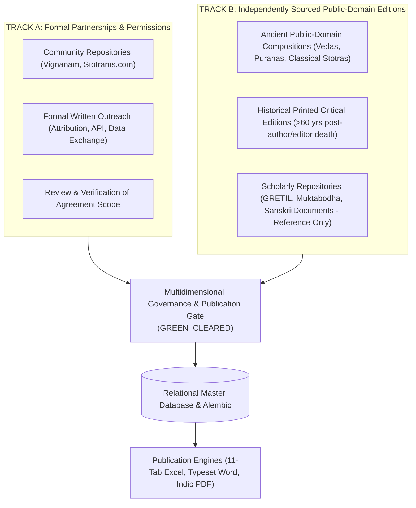

# Vedic Heritage Digital Library & Global Spiritual Platform
## Master Execution Plan (Canonical Project Charter)

**Document Status:** Active & Living  
**Version:** 5.0.0  
**Current Phase:** Phase 5 Complete — Ready for Phase 6 Authorization  
**Workspace:** `C:\Vedam`  

---

## 1. Executive Summary & Ultimate Vision

The mission of this project is to build an enduring, scholarly, technologically robust, and beautifully designed digital ecosystem for preserving, organizing, verifying, translating, and distributing authentic Indian Vedic and devotional literature worldwide.

### Scope of Content Preserved:
1. Vedic Mantras (Samhita, Brahmana, Aranyaka, Upanishad recitations).
2. Puranic Mantras.
3. Stotras, Stutis, and Vandanas.
4. Ashtakams and devotional octets.
5. Sahasranamas (1,000 names).
6. Ashtottara Shatanamavalis (108 names).
7. Kavachams (spiritual shields).
8. Suktams (Rigvedic and Yajurvedic hymns).
9. Chalisas (e.g. Awadhi Hanuman Chalisa).
10. Aartis and Bhajans.
11. Puja Vidhi, Panchopachara / Shodashopachara rituals, and full liturgical scripts.
12. Vrat procedures and Kathas.
13. Dhyana, Nyasa, and meditation verses.
14. Daily and situational Sankalpams.
15. Parayanam texts and Saptashati / Ramayana recitation manuals.
16. Classical regional devotional literature (Tamil Divya Prabandham, Thevaram, Telugu Kritis, Marathi Abhangs, etc.).

---

## 2. Dual-Track Acquisition Strategy & Dynamic Intake Protocol

1. **Zero Confusion Rule**: Every new website or dataset is cataloged in `documentation/project_roadmap/SOURCE_REGISTRY.md` with an assigned `SRC-xxx` identifier before parsing or ingestion begins.
2. **Provenance Preservation**: Every verse retains its `source_id`, `source_url`, and `collection_timestamp`.
3. **Mandatory Rights Clearance**: No text can enter commercial publishing, mobile apps, or audio distribution without **`rights_clearance_status == RightsClearanceStatus.GREEN_CLEARED`** signed off by human legal review.

---

## 3. Phased Roadmap Overview

---

## 4. Phase Milestone Trackers

### Phase 1: Research, Source Discovery & Architecture Foundation (COMPLETED)
- Technical inspection of sources, copyright assessment, modular architecture.

### Phase 2: Content Collection & Processing Engine (COMPLETED)
- Connectors, Unicode preservation, deduplication, batch processor.

### Phase 3: Database Maturity & Master Catalog Expansion (COMPLETED)
- Alembic migrations, database integrity, 77-composition catalog, QA engine.

### Phase 4: Full-Text Pilot Ingestion & Professional Publication Engine (COMPLETED)
- Verified and ingested 8 pilot compositions (Ganesha Pancharatnam, Shiva Tandava Stotram, Aditya Hrudayam, Madhurashtakam, Mahamrityunjaya Mantra, Gayatri Mantra, Sri Suktam, Hanuman Chalisa).
- Built 11-sheet Excel, Word manuscript, and Indic PDF exporters.
- Implemented 15-rule publication preflight gate (`PublicationPreflightGate`).

### Phase 5: Systematic Multi-Text Corpus Expansion (COMPLETED)
- **Part 1 — Re-Audit Phase 4**:
  - *Rights & Edition Re-Audit*: Sequestered modern editorial apparatus for VSM 1933 and VSM 1946 to `AMBER_RESTRICTED`; anchored underlying public domain texts strictly to out-of-copyright editions (Max Müller 1890, Scheftelowitz 1906, Vani Vilas 1910, NSP 1912, Nawal Kishore 1874). Documented in `documentation/quality/PHASE4_RIGHTS_REAUDIT_REPORT.md`.
  - *Translation Audit*: Classified all internal Bhavartha translations as `ReviewStatus.DRAFT` (`TranslationStatus.DRAFT`) awaiting external scholarly panel review. Documented in `documentation/quality/TRANSLATION_PROVENANCE_AUDIT_REPORT.md`.
  - *Publication & PDF Typography Audit*: Integrated HarfBuzz OpenType shaping (`uharfbuzz`) and dual font loading (`Nirmala UI` + `Calibri` for IAST). Produced 24-file SHA-256 publication manifest in `documentation/quality/PUBLICATION_MANIFEST_REPORT.md` and visual report in `documentation/quality/PDF_VISUAL_VALIDATION_REPORT.md`.
- **Part 2 — Master Catalog Preservation**:
  - Preserved complete 77-candidate catalog (`CAND-001` to `CAND-077`).
- **Part 3 — Prioritized Top 10 Shortlist**:
  - Formulated prioritized expansion shortlist in `documentation/quality/SHORTLIST_FIRST_10_EXPANSION.md` covering Venkateswara, Vishnu, Shiva, Ganesha, Lakshmi, Durga, and Surya.
- **Part 4 — Controlled Expansion Batch 1 Ingestion**:
  - Ingested 3 prioritized compositions into `vedam.db` with full verse structures, raw immutability, multi-script transliterations, and rights grants:
    - `VEDA-TXT-00010`: **Mahalakshmi Ashtakam** (10 verses: 8 stanzas + 2 phalasruti)
    - `VEDA-TXT-00011`: **Lingashtakam** (9 verses: 8 stanzas + 1 phalasruti)
    - `VEDA-TXT-00012`: **Sankata Nashana Ganesha Stotram** (8 verses: 4 stuti + 4 phalasruti)
- **Part 5 — Publication Orchestration & Quality Gate**:
  - Enhanced `PublicationPreflightGate` to support dual-channel validation (`scholarly_review` vs `commercial_release`).
  - Generated all 9 publication files (3 Excel 11-sheet, 3 Word manuscripts, 3 Indic PDFs) for Batch 1.
  - Platform now maintains 33 verified publication artifacts across 11 master compositions.
- **Part 6 — Future Library Architecture & Analytics Dashboard**:
  - Implemented `automation/reporting/library_analytics.py` and exported dashboard metrics to `exports/reports/library_analytics_dashboard.json`.
- **Testing & Verification**:
  - Created `tests/test_expansion_batch_1.py` with 15 tests.
  - Full suite of 79 automated tests passing with 100% pass rate.
