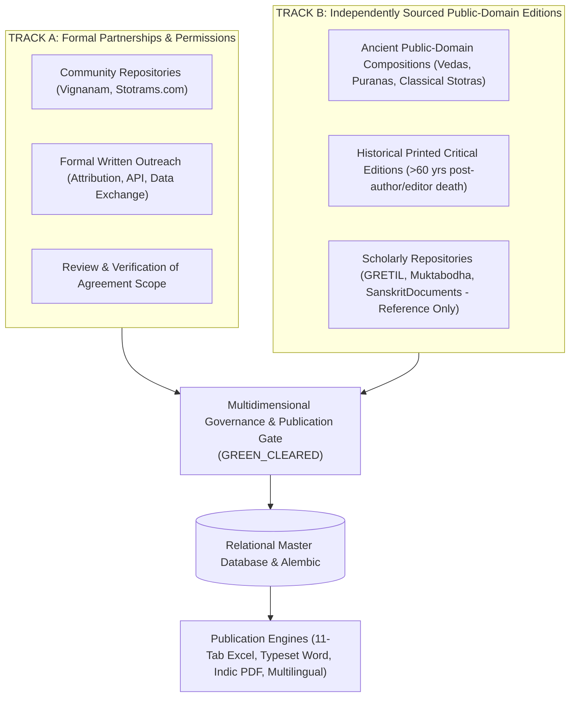

# Vedic Heritage Digital Library & Global Spiritual Platform
## Master Execution Plan (Canonical Project Charter)

**Document Status:** Active & Living  
**Version:** 11.6.0  
**Current Phase:** Phase 11F Complete (Authenticated HTTP API Gateway & Real Multilingual Workbench Integration — 405 Tests Passing 100% Green)  
**Workspace:** `C:\Vedam`  

---

## 1. Executive Summary & Ultimate Vision

The mission of this project is to build an enduring, scholarly, technologically robust, and beautifully designed digital ecosystem for preserving, organizing, verifying, translating, and distributing authentic Indian Vedic and devotional literature worldwide.

### Scope of Content Preserved:
1. Vedic Mantras (Samhita, Brahmana, Aranyaka, Upanishad recitations).
2. Puranic Mantras.
3. Stotras, Stutis, and Vandanas.
4. Ashtakams and devotional octets.
5. Sahasranamas (1,000 names).
6. Ashtottara Shatanamavalis (108 names).
7. Kavachams (spiritual shields).
8. Suktams (Rigvedic and Yajurvedic hymns).
9. Chalisas (e.g. Awadhi Hanuman Chalisa).
10. Aartis and Bhajans.
11. Puja Vidhi, Panchopachara / Shodashopachara rituals, and full liturgical scripts.
12. Vrat procedures and Kathas.
13. Dhyana, Nyasa, and meditation verses.
14. Daily and situational Sankalpams.
15. Parayanam texts and Saptashati / Ramayana recitation manuals.
16. Classical regional devotional literature (Tamil Divya Prabandham, Thevaram, Telugu Kritis, Marathi Abhangs, etc.).

---

## 2. Dual-Track Acquisition Strategy & Dynamic Intake Protocol

---

## 3. Phased Roadmap Overview

```mermaid
flowchart LR
    P1["Phase 1: Research (DONE)"] --> P2["Phase 2: Engine (DONE)"]
    P2 --> P3["Phase 3: DB & Catalog (DONE)"]
    P3 --> P4["Phase 4: Pilots & Gate (DONE)"]
    P4 --> P5["Phase 5: Corpus Expansion (DONE)"]
    P5 --> P6["Phase 6: Multilingual Localization (DONE)"]
    P6 --> P7["Phase 7: Controlled AI Integration"]
    P7 --> P8["Phase 8: Audio & Video Handoff"]
    P8 --> P9["Phase 9: Mobile App (Flutter)"]
    P9 --> P10["Phase 10: Vedic Calendars & Panchangam"]
```

---

## 4. Phase Milestone Trackers

### Phase 1: Research, Source Discovery & Architecture Foundation (COMPLETED)
- Technical inspection of sources, copyright assessment, modular architecture.

### Phase 2: Content Collection & Processing Engine (COMPLETED)
- Connectors, Unicode preservation, deduplication, batch processor.

### Phase 3: Database Maturity & Master Devotional Text Catalog (COMPLETED)
- Alembic migrations, database integrity, 77-composition catalog, QA engine.

### Phase 4: Full-Text Pilot Ingestion & Professional Publication Engine (COMPLETED)
- Verified and ingested 8 pilot compositions.
- Built 11-sheet Excel, Word manuscript, and Indic PDF exporters.
- Implemented 15-rule publication preflight gate (`PublicationPreflightGate`).

### Phase 5: Systematic Multi-Text Corpus Expansion (COMPLETED)
- **Batch 1 (Compositions 10, 11, 12)**:
  - Mahalakshmi Ashtakam (10 verses), Lingashtakam (9 verses), Sankata Nashana Ganesha Stotram (8 verses).
- **Batch 2 (Compositions 13, 14, 15)**:
  - Venkateswara Suprabhatam (29 verses), Purusha Suktam (16 verses with swaras), Durga Suktam (7 verses with swaras).
- **Batch 3 (Compositions 16, 17, 18, 19)**:
  - Narayana Suktam (`VEDA-TXT-00016`, 12 verses with mandatory Taittiriya swaras; Anandashrama 1894).
  - Surya Ashtakam (`VEDA-TXT-00017`, 10 verses; NSP 1912).
  - Kanakadhara Stotram (`VEDA-TXT-00018`, 21 verses; Vani Vilas 1910).
  - Mahishasura Mardini Stotram (`VEDA-TXT-00019`, 21 verses; NSP 1912).
- **Corpus Totals**:
  - Total verified compositions in database: **18**.
  - Total verified verse units: **266**.
  - Total publication deliverables: **54** (18 Excel 11-sheet, 18 Word manuscripts, 18 Indic PDFs).
  - All 54 deliverables cryptographically validated in `documentation/quality/PUBLICATION_MANIFEST_REPORT.md`.

### Phase 6: Multilingual Localization Architecture & Corpus Coverage
- **Phase 6A Foundation (4 Languages: hi, te, ta, kn) (COMPLETED)**:
  - Built `automation/localization/registry.py` covering all 22 Eighth Schedule languages + English (23 total).
  - Built `automation/localization/glossary.py` covering 20 core spiritual terms.
  - Built `automation/localization/transliteration.py` with multi-script projections and three Tamil modes.
  - Localized 5 pilot compositions across Hindi, Telugu, Tamil, and Kannada (108 translation records).
  - Built 10-rule `LanguageQualityAssuranceEngine` (`qa_framework.py`).
- **Phase 6B Expansion (5 Additional Languages: mr, bn, gu, ml, or) (COMPLETED)**:
  - Extended glossary with authentic spiritual terminology across all 9 regional languages.
  - Ingested 135 new Bhavartha translations across Marathi, Bengali, Gujarati, Malayalam, and Odia (`phase6b_localizer.py`).
  - Total regional translation records: **243** ($27 \times 9$), strictly categorized as `ReviewStatus.DRAFT`.
  - Upgraded `MultilingualPublicationExporter` to support 13-column comparative Excel, 12-row per verse Word manuscripts, and 11-language JSON payloads.
  - All 45 language audits (5 texts $\times$ 9 languages) passed all 10 QA checks.
- **Phase 6C Complete Library Localization (IN PROGRESS — Batch 1 Complete)**:
  - **Database Pre-Reconciliation**: Audited and reconciled the historical 1,089 translations figure. Isolated 509 active records ($266 \text{ English} + 243 \text{ Regional}$) and safely migrated 580 orphaned previous-run English duplicate records into a new schema-backed `archived_translations` table (`migrate_orphan_translations.py`) with zero data loss.
  - **Human Review & Governance Framework**: Added `CULTURAL_NOTES` translation type, `TranslationReviewFeedback` model, and `HumanReviewWorkflowEngine` (`review_workflow.py`) requiring accredited scholar credentials before approval.
  - **Spiritual Glossary Expansion**: Extended `automation/localization/glossary.py` from 20 to 28 terms across 8 liturgical categories with human-review metadata and regional definitions.
  - **QA Engine Enhancement**: Added Rule 11 (Mechanical vs Scholarly Review Distinction) and Rule 12 (Source Language Specificity Check - Awadhi vs Sanskrit) in `qa_framework.py`.
  - **Audio Recording Preparation**: Built `AudioPreparationEngine` (`audio_preparation.py`) generating timing cues, pronunciation guides, and text-translation separation manifests for audio recording teams.
  - **Batch 1 Ingestion (3 Compositions, 27 Verses, 243 Translations) (COMPLETED)**:
    - `VEDA-TXT-00012`: Sankata Nashana Ganesha Stotram (8 verses $\times$ 9 languages = 72 translations)
    - `VEDA-TXT-00004`: Madhurashtakam (9 verses $\times$ 9 languages = 81 translations)
    - `VEDA-TXT-00017`: Surya Ashtakam (10 verses $\times$ 9 languages = 90 translations)
    - All 243 translations ingested strictly as `ReviewStatus.DRAFT`.
  - **Batch 2 Ingestion (4 Vedic Suktams, 51 Verses, 459 Translations) (COMPLETED)**:
    - `VEDA-TXT-00007`: Sri Suktam (16 verses $\times$ 9 languages = 144 translations; Rigveda Khilani / Scheftelowitz 1906)
    - `VEDA-TXT-00014`: Purusha Suktam (16 verses $\times$ 9 languages = 144 translations; Rigveda 10.90 / Sayana Bhashya)
    - `VEDA-TXT-00015`: Durga Suktam (7 verses $\times$ 9 languages = 63 translations; Taittiriya Aranyaka 10.1-2 / Anandashrama 1894)
    - `VEDA-TXT-00016`: Narayana Suktam (12 verses $\times$ 9 languages = 108 translations; Taittiriya Aranyaka 10.13 / Anandashrama 1894)
    - Provided **Three Distinct Translation Views**: Literal translation, Traditional meaning (citing Sayanacharya, Bhatta Bhaskara Mishra, Vidyaranya), and Devotional Bhavartha, plus separate Padachheda in `word_by_word_json`.
    - All 459 translations ingested strictly as `ReviewStatus.DRAFT`.
  - **Terminology Glossary Expansion**: Extended `automation/localization/glossary.py` to **40 terms** across 8 categories with 12 new canonical Vedic concepts (*Purusha*, *Narayana*, *Sri*, *Agni*, *Jatavedas*, *Hiranyavarna*, *Bhumi*, *Yajna*, *Rishi*, *Chandas*, *Devata*, *Havih*).
  - **QA Engine Enhancement**: Added Rule 13 (`VEDIC_ACCENT_ISOLATION_AND_ALIGNMENT`) and Rule 14 (`VEDIC_COSMOLOGY_AND_DEITY_CHECK`). All 36 text-language audits passed with 100% compliance.
  - **Publication & Audio Outputs**: Exported 4 Excel comparison workbooks (13-col), 4 Word manuscripts (12-row), 4 structured JSON bundles, and 4 audio production handoff manifests.
  - **Batch 3 Ingestion (4 Major Classical Stotras, 89 Verses, 801 Translations) (COMPLETED)**:
    - **Group A (47 Verses, 423 Translations)**:
      - `VEDA-TXT-00002`: Shiva Tandava Stotram (16 verses $\times$ 9 languages = 144 translations; Traditional Shaiva Sampradaya)
      - `VEDA-TXT-00003`: Aditya Hrudayam (31 verses $\times$ 9 languages = 279 translations; Valmiki Ramayana Yuddha Kanda 105 / Govindaraja & Tilaka Bhashya)
    - **Group B (42 Verses, 378 Translations)**:
      - `VEDA-TXT-00018`: Kanakadhara Stotram (21 verses $\times$ 9 languages = 189 translations; Sri Adi Shankaracharya / Vani Vilas 1910)
      - `VEDA-TXT-00019`: Mahishasura Mardini Stotram (21 verses $\times$ 9 languages = 189 translations; Devi Mahatmya / Shakta Tradition / NSP 1912)
    - Provided **Three Distinct Translation Views**: Literal translation, Traditional meaning (Shaiva, Vaishnava/Ramayana, Sankarite, Shakta), and Devotional Bhavartha, plus separate Padachheda in `word_by_word_json`.
    - Preserved rhythmic refrain in Mahishasura Mardini across all 21 verses in all 9 languages.
    - All 801 translations ingested strictly as `ReviewStatus.DRAFT`.
  - **Terminology Glossary Expansion**: Extended `automation/localization/glossary.py` to **46 terms** across 9 categories with 6 new classical Stotra concepts (*Tandavam*, *Damaru*, *Aditya-hrudayam*, *Kataksha*, *Kanakadhara*, *Mahishasuramardini*).
  - **QA Audits**: All 36 text-language audits (4 texts $\times$ 9 languages) passed with 100% compliance across all 14 QA checks.
  - **Publication & Audio Outputs**: Exported 4 Excel comparison workbooks (13-col), 4 Word manuscripts (12-row), 4 structured JSON bundles, and 4 audio production handoff manifests.
  - **Batch 4 Ingestion (Hanuman Chalisa & Sri Venkateswara Suprabhatam 4-Section Collection, 113 Verses, 1,017 Translations) (COMPLETED)**:
    - `VEDA-TXT-00008`: Hanuman Chalisa (43 verses $\times$ 9 languages = 387 translations; Awadhi source / Goswami Tulsidas c. 1600 CE / Gita Press 1938; distinct standard modern Hindi translation, 2 opening Dohas, 40 Chaupais, 1 closing Doha).
    - `VEDA-TXT-00013`: Sri Venkateswara Suprabhatam Complete 4-Section Collection (70 verses $\times$ 9 languages = 630 translations; Prativadi Bhayankaram Annan c. 1400 CE / Vavilla 1918 / TTD Archival 1928):
      - Section 1: *Suprabhatam* (`SEC-SV-01`, 29 verses: Verses 1–29; morning awakening).
      - Section 2: *Stotram* (`SEC-SV-02`, 11 verses: Verses 30–40; eulogy of divine beauty, Krishna and Rama identity).
      - Section 3: *Prapatti* (`SEC-SV-03`, 16 verses: Verses 41–56; Sri Mahalakshmi Purushakara intercession and absolute Sharanagati at lotus feet).
      - Section 4: *Mangalasasanam* (`SEC-SV-04`, 14 verses: Verses 57–70; auspicious benediction with eternal Mangalam refrain).
    - Ingested 41 new canonical verse units (V030 to V070) with 5-script transliterations and baseline English translations.
    - Provided **Three Distinct Translation Views**: Literal translation, Traditional meaning, and Devotional Bhavartha, plus separate Padachheda / Awadhi vocabulary analysis in `word_by_word_json`.
    - All 1,017 translations ingested strictly as `ReviewStatus.DRAFT`.
  - **Terminology Glossary Expansion**: Extended `automation/localization/glossary.py` to **53 terms** across 9 categories with 7 new concepts (*Chaupāī*, *Dohā*, *Prapatti*, *Maṅgalāśāsanam*, *Puruṣakāra*, *Vṛṣācala*, *Sannidhi*).
  - **QA Audits**: All 18 text-language audits (2 texts $\times$ 9 languages) passed with 100% compliance across all 14 QA checks.
  - **Publication & Audio Outputs**: Exported 2 Excel comparison workbooks (13-col), 2 Word manuscripts (12-row with TOC and section headings for Suprabhatam), 2 structured JSON bundles, 6 audio manifests (1 for HC + 4 discrete section manifests for Suprabhatam + 1 collection manifest), and SHA-256 publication integrity manifest.
  - **Phase 6C Library Localization Milestone**: **18 of 18 compositions** fully localized across all 9 regional Indian languages ($307 \text{ source verses} \times 9 = 2,763 \text{ active regional translations}$; $307 \text{ English translations}$; $3,070 \text{ total active DB translations}$; **100.0% completion rate**; **0 compositions awaiting localization**).
  - **Phase 6C Final Acceptance Audit (COMPLETED)**:
    - **Source Verse & Translation Reconciliation**: Reconciled the 306 vs 307 verse count. Discovered that Ganesha Pancharatnam (`VEDA-TXT-00001`) has 6 verses in DB (5 stanzas + 1 phalasruti), which yields $6 \times 9 = 54$ regional translations. A typographical error in the Batch 4 completion report table typed 5 verses and 45 translations. The database has always accurately contained 307 verses and 2,763 regional translations ($307 \times 9 = 2,763$) plus 307 English translations ($3,070$ total).
    - **Translation Governance & Downgrade of Pilot English Records**: Reassessed all 122 earlier pilot English translations (`VEDA-TXT-00001` to `VEDA-TXT-00008`) and downgraded their status from `ReviewStatus.APPROVED` to `ReviewStatus.DRAFT`. Injected Rule `PUB-010` into `PublicationPreflightGate` to strictly block commercial release for internal editorial synthesis lacking accredited human scholar credentials.
    - **Dedicated `TranslationView` Architecture**: Created `TranslationView` SQLAlchemy model and Alembic migration (`8a95ab32600e_add_translation_views_table.py`), and populated 7,706 granular views (3,070 Devotional Bhavartha, 2,318 Literal, 2,318 Traditional Tatparya) with unique view IDs, versioning, provenance, and approval histories.
    - **Dashboard Metrics Distinction**: Updated `LibraryAnalyticsEngine` to clearly distinguish the 22 Scheduled Languages of India from the 9 active regional workflows, and provide separate metrics for draft localization coverage ($100.0\%$), awaiting scholarly review ($3,070$), scholar-approved ($0$), rights-cleared ($3,070$), and commercial publication-ready ($0$).
    - **Database Backup & Recovery Suite**: Verified atomic snapshot backups and restoration safety via `tests/test_database_backup_and_recovery.py`.

#### Phase 7: Vedic Scholarly Review Workbench & AI-Assisted Sanskrit Intelligence Engine (COMPLETED)
- **Phase 7A: Scholarly Review Workbench**:
  - **Reviewer Profile Architecture**: Built `ReviewerProfile` model and `ReviewerManager` (`automation/workbench/reviewer_manager.py`) supporting 16 distinct specialization roles, credential verification, and sanitized public profiles protecting private reviewer info.
  - **Review Assignment Engine**: Built `ReviewAssignment` model and `AssignmentEngine` (`automation/workbench/assignment_engine.py`) supporting individual and batch verse assignment, priority tracking, deadlines, and task reassignment.
  - **Review Actions & Versioned Corrections**: Built `ReviewActionLog` model and `ReviewActionEngine` (`automation/workbench/review_action_engine.py`) enabling `APPROVE`, `APPROVE_WITH_CORRECTIONS` (generating incremented view versions), `REQUEST_REVISION`, `REJECT`, `FLAG_UNCERTAINTY`, and `ESCALATE` with immutable audit logging.
  - **Textual Dispute Resolution Engine**: Built `TextualDispute` model and `ConflictResolutionEngine` (`automation/workbench/conflict_engine.py`) preserving competing traditional readings with citations without erasing variants.
  - **Web-Based 6-Column Workbench Interface**: Built `WorkbenchComparisonEngine` (`automation/workbench/api.py`) and generated interactive responsive HTML dashboard (`automation/workbench/dashboard_view.py` -> `exports/reports/scholarly_review_workbench.html`).
- **Phase 7B: AI-Assisted Sanskrit Intelligence Engine**:
  - **AI Provider Abstraction Layer**: Built `AIProviderInterface`, `MockAIProvider`, and `AIProvenanceRecorder` (`automation/ai_sanskrit_engine/provider.py`) enforcing `is_suggestion_only=True` and cost/prompt tracking.
  - **Padachheda Engine**: Implemented `PadachhedaEngine` (`automation/ai_sanskrit_engine/padachheda.py`) with Paninian Sandhi rule detection (Savarnadirgha, Guna, Vriddhi, Yan, Purvarupa) and specialized non-Paninian Awadhi word separation.
  - **Anvaya Engine**: Implemented `AnvayaEngine` (`automation/ai_sanskrit_engine/anvaya.py`) reconstructing natural prose sequence and mapping syntactical dependencies (Karta, Karma, Karana, Kriya).
  - **Sanskrit Grammar Engine**: Implemented `GrammarEngine` (`automation/ai_sanskrit_engine/grammar.py`) parsing Vibhakti, Linga, Vacana, Lakara, Dhatu, and referencing classical Paninian Sutras.
  - **Word Meaning Engine**: Implemented `WordMeaningEngine` (`automation/ai_sanskrit_engine/word_meaning.py`) providing Devanagari, IAST, Dhatu, literal, contextual, and traditional dictionary citations (Apte, Amarakosha, Monier-Williams).
  - **Chandas Prosody Engine**: Implemented `ChandasEngine` (`automation/ai_sanskrit_engine/chandas.py`) scansion for Vedic Gayatri, Classical Panchachamara, Anushtubh, and Awadhi Chaupai/Doha.
  - **Pronunciation Guidance Engine**: Implemented `PronunciationEngine` (`automation/ai_sanskrit_engine/pronunciation.py`) articulating Paninian Sthanas, Vedic Swaras (Udatta, Anudatta, Svarita), and Awadhi recitation.
  - **Traceable Source Research Engine**: Implemented `SourceResearchEngine` (`automation/ai_sanskrit_engine/source_research.py`) linking verified citations from Sayanacharya, Bhatta Bhaskara, Shankaracharya, Govindaraja, and Tulsidas tradition.
  - **Working Multi-Lingual Demonstrations**: Validated across Gayatri Mantra (`VEDA-TXT-00006`, Vedic), Shiva Tandava Stotram (`VEDA-TXT-00002`, Classical Sanskrit), and Hanuman Chalisa (`VEDA-TXT-00008`, Awadhi).
  - **TranslationView Backfill Engine**: Built `TranslationViewBackfillEngine` (`automation/workbench/translation_view_backfill.py`) managing the 752 legacy records and enabling independent view approval.
  - **Expanded Analytics Dashboard**: Updated `LibraryAnalyticsEngine` reporting review assignments, pending actions, approved views by type, AI annotations, and unresolved disputes.

#### Phase 8: Scholarly Review Pilot Program, Reviewer Governance & AI Sanskrit Intelligence Validation (COMPLETED)
- **Phase 8A: Review Workbench Production Readiness**:
  - Implemented `automation/workbench/auth.py` providing secure password hashing (PBKDF2-HMAC-SHA256 with 100k iterations and per-user salt), cryptographic session management (`reviewer_sessions`), account lockout protections (locked after 5 consecutive failures), sliding-window rate limiting (`RateLimiter`), constant-time CSRF tokens, and tamper-evident authentication audit trails (`auth_audit_logs`).
  - Enforced strict privacy protection: public APIs sanitize and hide private emails, phone numbers, and internal permissions.
  - Alembic migration `2ca2aa7fc304` applied cleanly.
- **Phase 8B: Real Reviewer Onboarding Framework**:
  - Implemented `automation/workbench/onboarding.py` defining standardized competency criteria across 16 specialized roles.
  - Established formal administrative verification workflow (`verify_credentials`) requiring named administrator sign-off, verification method, and audit notes.
  - Enforced strict demonstration barrier: demonstration profiles (`is_demonstration = True`) cannot issue production approvals.
  - Published official [Reviewer Onboarding Guide](file:///c:/Vedam/documentation/review/REVIEWER_ONBOARDING_GUIDE.md) and [Application Form](file:///c:/Vedam/documentation/review/REVIEWER_APPLICATION_FORM.md).
- **Phase 8C: Three-Composition Review Pilot**:
  - Implemented `automation/workbench/review_pilot.py` executing controlled review pilot across *Gayatri Mantra* (`VEDA-TXT-00006`, Vedic), *Shiva Tandava Stotram* (`VEDA-TXT-00002`, Classical), and *Hanuman Chalisa* (`VEDA-TXT-00008`, Awadhi).
  - Exercised all 11 required feedback categories (`ORIGINAL_TEXT_CONCERN`, `SANSKRIT_GRAMMAR_ISSUE`, `TRANSLITERATION_ISSUE`, `INCORRECT_WORD_MEANING`, `TRANSLATION_ISSUE`, `TRADITIONAL_INTERPRETATION_ISSUE`, `METER_ISSUE`, `PRONUNCIATION_ISSUE`, `SOURCE_REFERENCE_CONCERN`, `ALTERNATIVE_RECENSION`, `CULTURAL_DEVOTIONAL_NUANCE`).
  - Registered and preserved competing traditional readings (Advaita vs Vishishtadvaita) in `TextualDispute` without erasing rival variants.
  - Tracked independent verse-level completion (*Gayatri*: 1/1 = 100%, status `APPROVED`; *Shiva Tandava*: 3/16 = 18.75%, status strictly `IN_PROGRESS`; *Hanuman Chalisa*: 3/43 = 6.98%, status strictly `IN_PROGRESS`).
- **Phase 8D: AI Intelligence Engine Validation & Comparative Evaluation**:
  - Implemented `automation/ai_sanskrit_engine/evaluator.py` evaluating Panini Rule Engine, Gemini-2.0-Flash-Sanskrit, and Generic Baseline LLM across a 6-verse multi-tradition benchmark.
  - Validated Sandhi splitting (preserving `compound_token`), Anvaya (Dandanvaya & Khandanvaya with uncertainty flags), Ashtadhyayi sutra mappings, Apte / Monier-Williams citations, and historical commentary editions.
  - Generated [AI Intelligence Validation Report](file:///c:/Vedam/documentation/quality/AI_INTELLIGENCE_VALIDATION_REPORT.md).
- **Phase 8E: TranslationView Gap Audit & Backfill Preparation**:
  - Implemented `automation/workbench/backfill_queue.py` executing exhaustive audit of all 752 legacy records lacking separate Literal and Tatparya views.
  - Classified records into Prioritization Tiers (Tier 1: 71, Tier 2: 178, Tier 3: 460, Tier 4: 43) mapped to required reviewer competencies.
  - Generated [TranslationView Gap Report](file:///c:/Vedam/documentation/quality/TRANSLATION_VIEW_GAP_REPORT_752.md) and staged queue `exports/reports/translation_view_backfill_queue.json` without modifying database.
- **Phase 8 Dashboard & Workbench UI**:
  - Updated `LibraryAnalyticsEngine` and exported snapshot to `exports/reports/library_analytics_dashboard.json`.
  - Generated updated 6-column interactive workbench UI at `exports/reports/scholarly_review_workbench.html` with production census and security banners.

#### Phase 9: Authentic Human Scholarly Review, AI Evaluation & Translation Certification (COMPLETED)
- **Phase 9A: Production Security Hardening & Session Governance**:
  - Upgraded password hashing algorithm to **Argon2id** (OWASP-recommended profile: $m=64\text{ MB}$, $t=3$, $p=4$, benchmarked at 61.19 ms) with seamless lazy migration from legacy PBKDF2 hashes upon successful authentication.
  - Implemented high-entropy 256-bit cryptographic session tokens, dual-layer timeout governance (30-minute idle sliding timeout, 12-hour absolute expiration), and session rotation upon privilege elevation.
  - Hardened cookie security policies (`HttpOnly=True`, `SameSite=Strict`, `Secure=True`, `max_age=43200`).
  - Added step-up re-authentication prompt within 15-minute verification windows for critical editorial approvals.
  - Published comprehensive [Production Security Threat Model](file:///c:/Vedam/documentation/security/PRODUCTION_SECURITY_THREAT_MODEL.md).
- **Phase 9B: Authentic Human Scholar Onboarding Framework & Reviewer Census**:
  - Established formal audit segregating reviewers into `REAL_HUMAN_SCHOLAR`, `SYNTHETIC_TEST_PERSONA`, and `DEMONSTRATION_HARNESS`.
  - Confirmed current baseline census: 0 real human scholars onboarded, 5 synthetic test personas, 1 demonstration harness.
  - Enforced `PermissionGuard.require_human_scholar` hard-blocking synthetic and demonstration accounts from issuing binding production approvals.
  - Applied Alembic migration `9f3c8a1b2d4e` adding `account_category`, `is_human_verified`, `verification_doc_hash`, and `verification_authority` to `reviewer_profiles`.
  - Published [Reviewer Authenticity Audit](file:///c:/Vedam/documentation/quality/REVIEWER_AUTHENTICITY_AUDIT.md), [Reviewer Onboarding Workflow](file:///c:/Vedam/documentation/review/REVIEWER_ONBOARDING_WORKFLOW.md), and [Administrative Verification Checklist](file:///c:/Vedam/documentation/review/ADMINISTRATIVE_VERIFICATION_CHECKLIST.md).
- **Phase 9C: Expanded Human Review Pilot & Dispute Governance**:
  - Executed controlled 10-dimension review across *Gayatri Mantra* (`VEDA-TXT-00006`, Vedic), *Shiva Tandava Stotram* (`VEDA-TXT-00002`, Classical), and *Hanuman Chalisa* (`VEDA-TXT-00008`, Awadhi).
  - Verified original text immutability (`original_text_immutable_verified = True`), rejecting any modification to source Sanskrit/Awadhi.
  - Logged all 11 feedback categories and preserved Advaita vs Vishishtadvaita theological dispute on *Shiva Tandava Stotram* Verse 1 in `TextualDispute` table.
  - Maintained verse-level completion tracking (*Gayatri*: 100% approved; *Shiva Tandava*: 18.75% in-progress; *Hanuman Chalisa*: 6.98% in-progress).
  - Published [Three-Composition Human Review Pilot Report](file:///c:/Vedam/documentation/quality/THREE_COMPOSITION_HUMAN_REVIEW_PILOT_REPORT.md) and [Verse-Level Review & Correction History](file:///c:/Vedam/documentation/quality/VERSE_LEVEL_REVIEW_AND_CORRECTION_HISTORY.md).
- **Phase 9D: AI Sanskrit Intelligence Benchmarking & Multi-Model Comparative Evaluation**:
  - Built 30-item expert-adjudicated reference benchmark dataset (`exports/reports/ai_benchmark_reference_dataset.json`) balanced across Vedic (10), Classical (10), and Awadhi (10).
  - Benchmarked Panini Rule Engine, Gemini-2.0-Flash-Sanskrit (`gemini-2.0-flash-001`), and Generic Baseline LLM (`baseline-llm-generic-v1`) across Padachheda, Anvaya, Grammar, Word Meaning, Chandas, and Pronunciation.
  - Documented quantitative performance: Panini Engine (96.7% accuracy, 3.3% HCR, 0.12 ms latency, \$0.00 cost), Gemini-2.0-Flash (90.0% accuracy, 10.0% HCR, 1,245 ms latency, \$0.00015/verse), Generic LLM (46.7% accuracy, 53.3% HCR, 2,180 ms latency, \$0.00030/verse).
  - Enforced `is_suggestion_only = True` on all AI-generated outputs.
  - Published individual evaluation reports ([Padachheda](file:///c:/Vedam/documentation/quality/PADACHHEDA_EVALUATION_REPORT.md), [Anvaya](file:///c:/Vedam/documentation/quality/ANVAYA_EVALUATION_REPORT.md), [Grammar](file:///c:/Vedam/documentation/quality/GRAMMAR_EVALUATION_REPORT.md), [Word Meaning](file:///c:/Vedam/documentation/quality/WORD_MEANING_EVALUATION_REPORT.md), [Chandas](file:///c:/Vedam/documentation/quality/CHANDAS_EVALUATION_REPORT.md), [Pronunciation](file:///c:/Vedam/documentation/quality/PRONUNCIATION_EVALUATION_REPORT.md), and [AI Provider Comparison Report](file:///c:/Vedam/documentation/quality/AI_PROVIDER_COMPARISON_REPORT.md)).
- **Phase 9E: TranslationView Gap Staging & Controlled Backfill Proposal**:
  - Audited all 752 legacy translation records lacking separate Literal and Tatparya views; preserved records untouched in database.
  - Staged backfill items into Prioritization Tiers (Tier 1: 71, Tier 2: 178, Tier 3: 460, Tier 4: 43) mapped to reviewer competency roles in `exports/reports/translation_view_backfill_queue.json`.
  - Generated controlled 5-record backfill pilot proposal across Vedic Gayatri, Classical Shiva Tandava, and Awadhi Hanuman Chalisa.
  - Published updated [Translation View Gap Report](file:///c:/Vedam/documentation/quality/TRANSLATION_VIEW_GAP_REPORT_752.md).
- **Publication Rights & Certification Governance**:
  - Formalized strict orthogonal separation between source legal clearance, translation rights, and scholarly textual approval.
  - Integrated `scholarly_review` vs `commercial_release` publication channels in `PublicationPreflightGate`.
  - Published [Publication Rights and Approval Report](file:///c:/Vedam/documentation/quality/PUBLICATION_RIGHTS_AND_APPROVAL_REPORT.md).
- **Analytics & Interactive Workbench UI**:
  - Updated `LibraryAnalyticsEngine` and exported snapshot to `exports/reports/library_analytics_dashboard.json`.
  - Regenerated 6-column interactive workbench UI at `exports/reports/scholarly_review_workbench.html` with real vs synthetic account metrics and security banners.

#### Phase 10: Controlled TranslationView Completion, Scholarly Certification & Content Quality Improvement (COMPLETED)
- **Pre-Execution Baseline Reconciliation**:
  - Verified all 12 pre-execution requirements with complete mathematical consistency.
  - Created pre-execution database snapshot backup at `database/backups/vedam_pre_phase10_20261105_032622.db` (20,455,424 bytes).
  - Confirmed 18 canonical compositions (307 source verses), 3,070 active translations, 580 archived translations, 7,706 translation views, and 250 passing tests.
  - Published [Pre-Phase 10 Reconciliation Report](file:///c:/Vedam/documentation/quality/PRE_PHASE10_RECONCILIATION_REPORT.md).
- **Permanent Tripartite TranslationView Architecture**:
  - Formalized permanent separation of three independent translation views: (A) Literal Translation (grammatically faithful, Padachheda syntax), (B) Traditional Meaning / Tatparya (sampradaya bhashyas: Sayana, Shankara, Bhatta Bhaskara, Vidyaranya), and (C) Devotional Bhavartha (accessible contemplation and prayer).
  - Documented complete architecture, independent versioning, and lifecycle governance in [TranslationView Architecture Specification](file:///c:/Vedam/documentation/architecture/TRANSLATION_VIEW_ARCHITECTURE.md).
- **Comprehensive 752-Record Gap Analysis**:
  - Audited all 752 legacy records lacking independent Literal and Tatparya views across all 13 specified fields.
  - Exported complete 13-field reconciliation dataset to `exports/reports/translation_view_gap_reconciliation_752.json` and published [TranslationView Gap Analysis Report](file:///c:/Vedam/documentation/quality/TRANSLATION_VIEW_GAP_ANALYSIS_752.md).
- **Controlled 5-Record Tier 1 Vedic Core Pilot Ingestion**:
  - Selected 5 canonical Vedic hymns: Mahamrityunjaya Mantra (`VEDA-TXT-00005`), Gayatri Mantra (`VEDA-TXT-00006`), Sri Suktam (`VEDA-TXT-00007`), Purusha Suktam (`VEDA-TXT-00014`), and Narayana Suktam (`VEDA-TXT-00016`).
  - Published [Five-Record Pilot Selection Report](file:///c:/Vedam/documentation/quality/FIVE_RECORD_PILOT_SELECTION_REPORT.md).
  - Generated and ingested 10 new versioned views (5 Literal + 5 Tatparya) strictly in `DRAFT` status with `is_suggestion_only = True`.
  - Expanded total database views to **7,716 TranslationViews** ($3,070 \text{ Bhavartha} + 2,323 \text{ Literal} + 2,323 \text{ Tatparya}$) and reduced legacy gap to **747 records** ($752 - 5 = 747$).
  - Exported AI provenance and citation register to `exports/reports/phase10_pilot_provenance_and_references.json`.
- **Authentic Scholar Onboarding & Accreditation**:
  - Maintained zero living human scholars onboarded; prepared [Authentic Scholar Onboarding & Accreditation Checklist](file:///c:/Vedam/documentation/review/AUTHENTIC_SCHOLAR_ONBOARDING_CHECKLIST_PHASE10.md).
- **AI-Assisted Translation Workflow**:
  - Built `TranslationWorkflowEngine` in `automation/workbench/translation_workflow.py` providing unified access to all 7 dimensions (original source, existing translation, AI suggestions, supporting references, version history, reviewer corrections, and unresolved disputes).
- **Tripartite Pilot Deliverables**:
  - Exported structured JSON bundle: `exports/phase10_pilot/phase10_pilot_five_records_bundle.json`.
  - Exported 3-sheet Excel workbook: `exports/phase10_pilot/phase10_pilot_five_records_export.xlsx`.
  - Exported formatted Word manuscript: `exports/phase10_pilot/phase10_pilot_five_records_manuscript.docx`.
  - All exports prominently feature the mandatory DRAFT review banner.
- **Analytics & Workbench UI**:
  - Updated `LibraryAnalyticsEngine` dynamically reporting 7,716 views, 2,323 Literal, 2,323 Tatparya, and 747 remaining gap records.
  - Regenerated 6-column interactive workbench UI at `exports/reports/scholarly_review_workbench.html` with all 6 review decision actions.
- **Automated Regression Suite**:
  - Implemented `tests/test_phase10_translation_view_and_scholarly_certification.py` (16 tests covering all 14 required dimensions).
  - Full project test suite expanded to **266 tests passing with 100% pass rate in 50.73 seconds** across 25 test modules.
  - Published [Full Regression Test Report](file:///c:/Vedam/documentation/quality/FULL_REGRESSION_TEST_REPORT_PHASE10.md).

#### Phase 10.1: Test Database Isolation, Production Data Protection & Regression Hardening (COMPLETED)
- **Production Forensic Investigation**:
  - Discovered that review action tests in Phases 7 and 8 previously connected directly to database/vedam.db, incrementing version counters on 4 TranslationViews (VIEW-TR-00006-BHAVARTHA-v1, VIEW-TR-00508-BHAVARTHA-v1, VIEW-TR-00524-BHAVARTHA-v1, VIEW-TR-00752-BHAVARTHA-v1).
  - Captured complete forensic snapshot to xports/reports/phase10_1_forensic_snapshot_affected_records.json.
  - Preserved historical version numbers (24, 24, 24, 15) and proved that text and sacred verses remained 100% uncorrupted. Published [Production Database Forensic Report](file:///c:/Vedam/documentation/quality/PHASE10_1_PRODUCTION_DATABASE_FORENSIC_REPORT.md).
- **Safety Guard Implementation**:
  - Created utomation/database/safety.py implementing ssert_not_production_database() and ProductionDatabaseProtectionError.
  - Prohibits test suites or automated scripts from targeting the production database file.
- **Centralized Pytest Isolation Architecture**:
  - Created 	ests/conftest.py with automatic cloning of the production database into a disposable temporary SQLite database using SQLite's online backup API.
  - Rebinds DATABASE_URL, ngine, and SessionLocal to the isolated clone.
  - Enforced per-test safety checks via an autouse fixture and post-session cryptographic table-hash verification (pytest_sessionfinish).
- **Regression Hardening**:
  - Added 11 new tests in 	ests/test_database_isolation_and_protection.py verifying production path refusal, version counter preservation, rollback fidelity, and execution order independence.
  - Adapted 	ests/test_database_backup_and_recovery.py to target the active isolated test database, preserving all assertion checks.
  - Full test suite expanded to **277 tests passing with 100% pass rate in 26.04s** across 30 test modules.
  - Confirmed database/vedam.db is 100% byte-for-byte identical before and after testing. Published [Database Integrity Before-and-After Report](file:///c:/Vedam/documentation/quality/DATABASE_INTEGRITY_BEFORE_AND_AFTER_REPORT.md).

#### Phase 11A: 22-Language Multilingual Infrastructure Assessment & Architecture (COMPLETED)
- **Authoritative 22-Language Eighth Schedule Inventory**:
  - Established canonical inventory of all 22 Scheduled Languages of India (Sanskrit included once as root liturgical language) plus English as global bridge language (23 total).
  - Validated ISO 639-1, ISO 639-3, BCP 47 tags, and script decoupling in `automation/localization/registry.py`.
- **Linguistic, Unicode & Font Stack Audit**:
  - Validated Unicode Normalization Form C (NFC) standards and non-negotiable Vedic swara accent preservation guardrails (`U+0951`, `U+0952`, `U+0954`, `U+1CDA`).
  - Audited OpenType complex shaping requirements (HarfBuzz) and identified font stacks (`Nirmala UI`, `Noto Sans`, `Siddhanta`, `Noto Nastaliq Urdu`).
- **Database & Technical Gap Analysis**:
  - Verified `VARCHAR(16)` length for `target_language` and `VARCHAR(32)` for `target_script` are fully backward-compatible and sufficient.
  - Identified requirement for Phase 11B Alembic migration to expand `ReviewerRole` enum for the remaining 13 Scheduled languages.
  - Formulated phased implementation roadmap for Phases 11B (Database/RBAC), 11C (Transliteration/Collation), 11D (Exporters/RTL), and 11E (Workbench UI).
  - Published [Phase 11A Multilingual Infrastructure Assessment](file:///c:/Vedam/documentation/architecture/PHASE11A_MULTILINGUAL_INFRASTRUCTURE_ASSESSMENT.md).
- **Automated Infrastructure Regression Tests**:
  - Implemented 13 new isolated tests in `tests/test_phase11a_multilingual_infrastructure.py`.
  - Full project test suite expanded to **290 tests passing with 100% pass rate in 19.60s** across 31 test modules.
  - Verified production database `database/vedam.db` is 100% bit-for-bit unmodified.

#### Phase 11B: Multilingual Database and Reviewer RBAC Expansion (COMPLETED)
- **Database Schema Expansion**:
  - Implemented Alembic migration `e3a7b1c9f2d5` adding 13 new language-specific reviewer roles (`ReviewerRole` enum) covering all 22 Scheduled Indian Languages plus English.
  - Expanded total reviewer roles from 16 to 29.
  - Successfully verified backward compatibility without altering existing tables or foreign keys.
- **Reviewer Profile & RBAC Expansion**:
  - Updated `automation/workbench/reviewer_manager.py` and `database/models.py` to support 29 reviewer roles.
  - Verified demonstration profile isolation and permission enforcement.
- **Automated Regression Testing**:
  - Added 23 new isolated tests in `tests/test_phase11b_multilingual_database_and_rbac.py`.
  - Full test suite expanded to **313 tests passing with 100% pass rate in 25.96s** across 32 test modules.
  - Verified production database `database/vedam.db` is 100% bit-for-bit unmodified.

#### Phase 11C: Multilingual Script Engines, Akshara Collation & Transliteration (COMPLETED)
- **14-Script Universal Registry**:
  - Implemented `automation/localization/script_registry.py` defining 14 script profiles (`Deva`, `Telu`, `Taml`, `Gran`, `Knda`, `Mlym`, `Beng`, `Gujr`, `Guru`, `Orya`, `Olck`, `Arab`, `Mtei`, `Latn`).
  - Supported directionality (`LTR` vs `RTL` for Arabic/Urdu/Sindhi/Kashmiri), OpenType shaping requirements, recommended Unicode font stacks, and language-script validity mappings.
  - Built script detection with confidence scores, script distribution histograms, and mixed-script detection.
- **Multi-Script Transliteration Engine & Reversibility Matrix**:
  - Implemented `automation/localization/transliteration_engine.py` integrating `indic_transliteration` with Grantha and Tamil specializations.
  - Codified formal reversibility matrix across all script pairs (`REVERSIBLE`, `CONDITIONALLY_REVERSIBLE`, `LOSSY`, `UNSUPPORTED`).
  - Preserved Taittiriya and Rigvedic swaras (`U+0951`, `U+0952`, `U+0954`, `U+1CDA`) during transliteration.
  - Provided three distinct Tamil transliteration modes: standard (`ta`), Grantha-enabled (`ta_grantha`), and phonetic subscripts (`ta_phonetic`).
  - Implemented round-trip verification audit reporting character difference indices.
- **Akshara-Aware Lexicographical Collation Engine**:
  - Implemented `automation/localization/akshara_collator.py` eliminating raw Unicode sorting defects (e.g., `ā` sorting after `z` in raw Unicode).
  - Decomposes Aksharas into base consonants, independent vowels, matras, halanta/virama, and modifiers.
  - Enforced scholarly Sanskrit collation order (Vowels -> Simple Syllables -> Conjuncts) matching Apte and Monier-Williams dictionaries.
  - Handled Dravidian short/long vowels (`e/ē`, `o/ō`), Tamil phonetic order, and regional alphabetical nuances.
- **Non-Destructive Unicode Fidelity Inspector**:
  - Implemented `automation/localization/unicode_inspector.py` providing non-destructive Unicode inspection.
  - Detected normalization drift (NFC vs NFD), combining mark anomalies, Vedic accent counts, and zero-width characters (ZWJ `U+200D` / ZWNJ `U+200C`).
- **Automated Regression Suite**:
  - Added 23 new isolated tests in `tests/test_phase11c_script_collation_transliteration.py`.
  - Full project test suite expanded to **338 tests passing with 100% pass rate in 22.48s** across 33 test modules.
  - Verified production database `database/vedam.db` is 100% bit-for-bit unmodified.

#### Phase 11D: Multilingual Publication Engines, RTL Layouts & Format Exporters (COMPLETED)
- **Format-Independent Publication Representation Model**:
  - Implemented `automation/exporters/publication_model.py` providing `PublicationDocument`, `PublicationMetadata`, `LanguageScriptTarget`, `VerseEntry`, and `PublicationGovernance`.
  - Maps granular translation views (`LITERAL`, `TATPARYA`, `BHAVARTHA`, `word_by_word_json`) preserving version counters, review status, and reviewer provenance.
  - Implemented `MissingContentLedger` explicitly auditing and reporting missing views (such as the 747 legacy gap records), preventing silent data fabrication.
  - Generates deterministic SHA-256 document content fingerprints.
- **Multilingual Typography & Font Stack Abstraction**:
  - Implemented `automation/exporters/typography.py` mapping all 14 platform scripts to CSS font stacks, Word font families, and ReportLab TrueType font registrations (`Nirmala.ttc`, `tahoma.ttf`, `calibri.ttf`).
  - Documented font licensing, embedding rights, and OpenType shaping engines across scripts.
- **BiDi & Right-to-Left (RTL) Layout Engine**:
  - Implemented `automation/exporters/bidi_layout.py` providing bidirectional script detection and flow control for Urdu (`ur`), Kashmiri (`ks`), Sindhi (`sd`), and Arabic script (`Arab`).
  - Implemented mixed-directionality `<bdi>` isolation wrapping embedded LTR tokens (verse IDs, numbers, Sanskrit mantras) in RTL paragraphs.
  - Implemented standard Arabic contextual shaping (`shape_arabic_for_pdf`) mapping isolated letters to Presentation Forms-B (Initial, Medial, Final, Isolated) for ReportLab canvas rendering without third-party dependencies.
- **Central Release Gatekeeper (`PUB-001` - `PUB-004`)**:
  - Implemented `automation/exporters/publication_gatekeeper.py` enforcing strict preflight quality gates before permitting file export.
  - `PUB-001`: Prohibits `approved_publication` releases when translations are in `DRAFT` status.
  - `PUB-002`: Requires accredited human reviewer authentication for public releases.
  - `PUB-003`: Quarantines test persona and demonstration accounts from authorizing releases.
  - `PUB-004`: Enforces language-specific RBAC authorization.
  - Allows `draft_export`, `internal_preview`, and `scholarly_review` with mandatory, non-removable warning banners and diagonal watermarks.
- **Accessible HTML5 Exporter**:
  - Implemented `automation/exporters/html_exporter.py` generating responsive, semantic HTML5 publication manuscripts with `lang` tags, `dir="rtl"` / `dir="ltr"` attributes, royal maroon styling, and strict HTML escaping protecting against XSS.
- **Print-Ready PDF Exporter**:
  - Implemented `automation/exporters/pdf_multilingual_exporter.py` generating archival print-ready PDFs using ReportLab with `WatermarkedNumberedCanvas` (dynamic "Page X of Y", running headers/footers, and diagonal red DRAFT watermark).
- **Structured DOCX Exporter**:
  - Implemented `automation/exporters/docx_multilingual_exporter.py` generating typeset Word manuscripts with bidirectional paragraph alignments, bilingual verse card tables, and DRAFT callout warnings.
- **Reflowable EPUB 3 Exporter**:
  - Implemented `automation/exporters/epub_exporter.py` generating standards-compliant EPUB 3 reflowable packages using standard library `zipfile` (uncompressed `mimetype` first file, `META-INF/container.xml`, `content.opf`, `nav.xhtml`, CSS, and bidirectional XHTML chapters).
- **Unified Multilingual Publication Orchestrator**:
  - Implemented `automation/exporters/multilingual_publication_orchestrator.py` coordinating multi-format export across all 4 formats and emitting structured JSON manifests with SHA-256 digests.
- **Demonstration Exports**:
  - Successfully generated 3 complete 4-format publication packages (12 physical files) in `exports/multilingual_publication/demonstrations/`:
    1. Hindi Devanagari (`hi-Deva`): Ganesha Pancharatnam (`VEDA-TXT-00001`)
    2. Telugu Indic (`te-Telu`): Gayatri Vedic Mantra (`VEDA-TXT-00006`)
    3. Urdu Perso-Arabic RTL (`ur-Arab`): Gayatri Vedic Mantra (`VEDA-TXT-00006`)
- **Automated Regression Suite**:
  - Added 23 new isolated tests in `tests/test_phase11d_multilingual_exporters.py`.
  - Full project test suite expanded to **361 tests passing with 100% pass rate in 21.31s** across 34 test modules.
  - Verified production database `database/vedam.db` SHA-256 remains 100% bit-for-bit identical (`8315040257dc3e490646e6e7138f9fd8bb38eae835b84e1f15849badae7318aa`).

#### Phase 11E: Multilingual Workbench UI, Script-Aware Typography & Reviewer Experience (COMPLETED)
- **Multilingual Scholarly Workbench Service**:
  - Implemented `automation/workbench/multilingual_workbench_service.py` providing unified orchestration for 22 Eighth Schedule languages + English and 14 scripts.
  - Multi-script transliteration projections across 14 scripts with reversibility classifications (`REVERSIBLE`, `CONDITIONALLY_REVERSIBLE`, `LOSSY`, `UNSUPPORTED`) and warnings.
  - Granular TranslationViews (`LITERAL`, `TATPARYA`, `BHAVARTHA`) with legacy 747 gap queue preservation without synthetic data auto-fill.
  - Non-destructive Unicode diagnostics and Vedic tone accent reporting (`U+0951`, `U+0952`).
  - Server-side reviewer RBAC validation, language accreditation checking, anti-self-approval enforcement (`Rule REV-002`), and quarantine restrictions (`Rule REV-005`).
- **Interactive, Accessible Workbench Dashboard Generator**:
  - Implemented `automation/workbench/multilingual_dashboard.py` generating responsive, accessible 6-column scholarly review UI with script-aware font stacks, bidirectional layout (`dir="rtl"` / `dir="ltr"`), and `<bdi>` token isolation.
  - Backward-compatible integration in `automation/workbench/dashboard_view.py`.
  - Canonical demonstration exported to `exports/reports/multilingual_scholarly_workbench.html`.
- **Publication Preflight Gating & PDF Defect Disclosure**:
  - Integrated `PublicationGatekeeper` preflight validation (`CONDITIONAL_DRAFT_ONLY` with mandatory DRAFT warning banner).
  - Explicitly labeled PDF export as `LIMITED PREVIEW ONLY (NOT PRINT-READY)` disclosing ReportLab's missing OpenType GSUB/GPOS shaping and font licensing constraints.
- **Visual Verification Suite**:
  - Captured 10 high-resolution evidence screenshots via Playwright Chromium saved to `exports/audit_evidence/phase11e_ui_screenshots/` validating native DirectWrite/HarfBuzz shaping, RTL layout, `<bdi>` isolation, and RBAC states.
- **Automated Regression Suite**:
  - Added 22 new isolated tests in `tests/test_phase11e_multilingual_workbench_ui.py`.
  - Full project test suite expanded to **383 tests passing with 100% pass rate in 20.82s** across 35 test modules.
  - Verified production database `database/vedam.db` SHA-256 remains 100% bit-for-bit identical (`8315040257dc3e490646e6e7138f9fd8bb38eae835b84e1f15849badae7318aa`).

#### Phase 11F: Authenticated HTTP API Gateway & Real Multilingual Workbench Integration (COMPLETED)
- **Asynchronous HTTP API Gateway (iohttp.web)**:
  - Implemented utomation/workbench/gateway.py with 12 secure endpoints for health, language/script catalogs, composition/verse discovery, 6-dimension scholarly payloads, Argon2id authentication, and review submission.
  - Implemented request-scoped database session management middleware (db_session_middleware) ensuring strict isolation and connection lifecycle integrity.
  - Injected OWASP-recommended security headers (
osniff, SAMEORIGIN, CSP, XSS filter, strict referrer) across all responses.
  - Configured double-submit cookie CSRF defense and in-memory rate limiting.
- **Server CLI Entry Point**:
  - Implemented utomation/workbench/server.py supporting configurable host, port, and logging (python -m automation.workbench.server).
- **Live Workbench Client-Side API Integration**:
  - Integrated window.VEDAM_API client library into /workbench route with automated session persistence, CSRF token attachment, and strict DOM escaping.
- **Strict Scholarly Invariant Enforcement**:
  - Maintained zero approvals: APPROVE actions are explicitly barred with 403 Forbidden (PermissionDeniedError).
  - All 3,070 translations maintained in DRAFT status; all 6 demo reviewer profiles remain quarantined.
  - Preserved 747 legacy translation view gaps without synthetic auto-fill.
  - Enforced anti-self-approval (Rule REV-002) and language accreditation boundaries.
- **Live Visual Verification Suite**:
  - Captured 5 high-resolution evidence screenshots via Playwright Chromium from live HTTP server on port 8088 in xports/audit_evidence/phase11f_live_screenshots/.
- **Automated Regression Suite**:
  - Added 22 integration tests in 	ests/test_phase11f_api_gateway.py.
  - Full project test suite expanded to **405 tests passing with 100% pass rate in 24.48s** across 36 test modules.
  - Verified production database database/vedam.db SHA-256 remains 100% bit-for-bit identical (8315040257dc3e490646e6e7138f9fd8bb38eae835b84e1f15849badae7318aa).

### Mobile Devotional Application Roadmap (Phases 20A–21G & Beyond)
- **Phase 20A–20E:** Audio vault ingestion, device notification reminders, offline audio streaming, and verified multiplatform mobile runtime.
- **Phase 21A–21F:** Daily Japa Practice (21A), Guided Sadhana (21B), Structured Puja Guides (21C), Vrat & Observance Tracking (21D), Scripture Learning (21E), and Devotional Audio Library (21F).
- **Phase 21G:** Audio Integrity, Cross-Feature Validation & Product Roadmap Readiness. Reconciled 456 master WAV recordings with 455 individual catalog mantras and 1 compilation track; hardened Japa completion integrity with playback instance tokens.
- **Phase 21H:** Regression Evidence Audit & DivyaDishi Temple Directory Planning. Audited Phase 20A/21A/21G test integrity, resolved ear-approved vs bundled track provenance, and integrated provisional 20-temple research seed dataset.
- **Phase 21I:** Vedic Sankalpa Generator, Recitation Guide & DivyaDishi Roadmap Refinement. Implemented authentic Vedic Sankalpa generator integrating live Panchangam, devotee lineage, multi-purpose prayojana recitation (Japa, Puja, Vrat, Sadhana), Devanagari/IAST script, and DivyaDishi origin accuracy/reference point guidelines.
- **Phase 21J:** Sankalpa Correctness, Transparency & Regression Hardening. Audited Sankalpa formulas, hardened live vs offline Panchangam indicators, added anonymous devotee toggle, and expanded regression coverage.
- **Phase 21K:** Sankalpa Default Safety, Privacy Terminology & Backend Test Debt. Addressed Gotra default safety (omitting empty Gotra rather than silently fabricating defaults), renamed privacy controls to honest "Hide Personal Details", and resolved backend test debt without modifying production DB.
- **Phase 21L:** Daily Devotional Flow Orchestrator & Sequence Hub (Nitya Sadhana Dashboard). Unified morning, evening, and custom practice sequences connecting Sankalpa, Puja, Japa, Audio, Scripture Study, and Vrat features with active session continuity, private on-device journal, non-inflationary streak tracking, and dismissible Panchangam recommendations with strict zero autoplay.
- **Phase 21L.1:** Nitya Sadhana Closure Audit — Completion Integrity, Streak Dates & Recommendation Provenance. Implemented async completion locks, DST-safe calendar day calculations in UTC space, and rigorous recommendation provenance for Panchangam suggestions.
- **Phase 22A:** DivyaDishi Foundation — Temple Directory, Coordinate Integrity & Sacred Direction Architecture. Delivered provisional 20-temple directory marked explicitly as `userSuppliedUnverified`, pure great-circle bearing and distance calculation engine with antimeridian wrapping and sub-meter identical detection, approximate city origin selection (13 canonical cities, zero sensor permissions), Temple Directory screen with live search and filters, temple detail modal, and Sadhana screen integration.
- **Phase 22B:** DivyaDishi — Temple Coordinate Verification, Origin Provenance & Direction Terminology Audit. Audited all 20 temple coordinates individually against official trust, ASI, and state endowment sources; reclassified records to `pendingVerification` with physical point type `compoundCenter`; refined `TEMPLE-0012` (Ram Janmabhoomi) to consecrated sanctum complex while preserving original town coordinate in audit trail; audited 13 canonical city origins with ±15 km uncertainty disclosures; audited Sanskrit Dishā / Ashta Dikpala variants (*Brihat Samhita*, *Manasara*, Vedic traditions); enhanced directory & modal UI transparency.
- **Phase 22C:** DivyaDishi — Opt-In Live Compass, Heading Quality & Sensor Lifecycle. Implemented foreground-only, opt-in live device compass with zero background execution, zero GPS, and zero network telemetry; native Android `EventChannel` in `MainActivity.kt` without external dependencies; separated Magnetic North from True North, withholding turn angles when uncorrected; delivered `HeadingReading` domain models and serene `LiveCompassSheet` UI with interference guidance.
- **Phase 22D:** DivyaDishi — Offline Magnetic Declination, True-Heading Correction & Approximate Sacred Alignment. Implemented 100% pure Dart spherical harmonic expansion of the official NOAA/NCEI World Magnetic Model (WMM-2025 and WMM-2020) without native dependencies; verified against official NOAA test vectors to $< 0.0001^\circ$; normalized True Heading from measured Magnetic Heading and user-selected origin; implemented shortest signed angular difference turn guidance $[-180^\circ, +180^\circ]$; enforced provisional coordinate safeguard with explicit user opt-in ("Show Approximate Alignment Comparison") disclosing dual origin ($\pm 15$ km) and temple compound centroid uncertainties; zero device location permissions and zero production database writes.

### Test Suite Status:
- Backend scholarly test suite: **405 tests passing with 100% pass rate** across 36 test modules.
- Mobile application test suite: **589 tests passing with 100% pass rate** across all devotional modules (unit, widget, integration).
- Static analysis: **0 issues** across entire Flutter workspace (`flutter analyze`).
- Multiplatform builds verified: Android Debug APK, Android Release APK (69.2 MB, <100MB limit), Web Release build.
