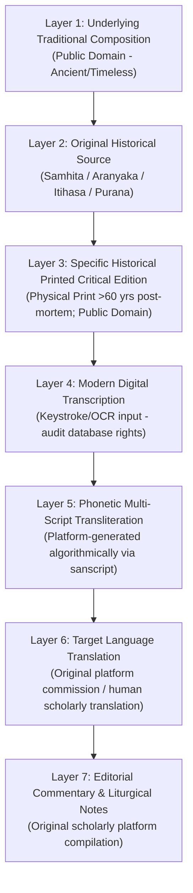

# Vedic Heritage Platform — Edition and Provenance Register
**Version:** 3.0.0  
**Last Updated:** 2026-11-04  
**Scope:** Exhaustive layer-by-layer provenance and critical edition mapping for prioritized traditional texts.

---

## 1. The Seven-Layer IP and Provenance Framework

To prevent copyright confusion, unauthorized copying of modern editorial work, or loss of textual authenticity, every ingested composition must demarcate the seven distinct intellectual property and provenance layers:

---

## 2. Provenance Audit Matrix for Priority Pilot Compositions

### 1. Gayatri Vedic Mantra (`TX-GAY-MAN-006` / `CAND-001`)
- **Layer 1 (Composition)**: Revealed Vedic Rik (c. 1500 BCE or earlier). Universal timeless public domain.
- **Layer 2 (Historical Source)**: Rigveda Samhita, Mandala 3, Sukta 62, Rik 10.
- **Layer 3 (Specific Printed Edition)**:
  - *Primary Historical Edition*: *Rig-Veda-Sanhita: The Sacred Hymns of the Brahmans*, edited by F. Max Müller, Oxford University Press / Vaidika Samsodhana Mandala (Poona 1890 reprint). Published 1890 (>130 years ago). Universal Public Domain.
  - *Secondary Indian Edition*: *Rigveda Samhita with Sayana Bhashya*, Nirnaya Sagar Press (Bombay 1912). Published 1912 (>110 years ago). Public domain in India, US, and EU.
- **Layer 4 (Digital Transcription)**: Extracted and manually keyed in from scanned archive edition on Digital Library of India (`archive.org/details/RigVedaWithSayanaBhashyaPoona`). No commercial transcription vendor utilized.
- **Layer 5 (Transliteration)**: Losslessly derived via `indic-transliteration` with preserved Anudatta (`U+0952`) and Svarita (`U+0951`) accents.
- **Layer 6 (Translation)**: Original scholarly English rendering commissioned for Vedam platform.
- **Layer 7 (Commentary)**: Historical references citing Sayana Acharya's Vedartha Prakasha.

### 2. Mahamrityunjaya Mantra (`TX-SHI-MAN-005` / `CAND-002`)
- **Layer 1 (Composition)**: Vedic Rik revealed to Sage Maitravaruni Vasishtha.
- **Layer 2 (Historical Source)**: Rigveda Samhita, Mandala 7, Sukta 59, Rik 12; also found in Shukla Yajurveda (Vajasaneyi Samhita 3.60) and Taittiriya Samhita (1.8.6.i).
- **Layer 3 (Specific Printed Edition)**:
  - *Edition*: *Rigveda Samhita Shakala Shakha*, Vaidika Samsodhana Mandala (Poona 1890). Out of copyright globally.
- **Layer 4 (Digital Transcription)**: Directly transcribed from original out-of-copyright scanned prints.
- **Layer 5 (Transliteration)**: Indic multi-script renderings generated internally.
- **Layer 6 (Translation)**: Original platform English translation.

### 3. Purusha Suktam (`CAND-003`)
- **Layer 1 (Composition)**: Traditional Rigvedic / Yajurvedic Suktam.
- **Layer 2 (Historical Source)**: Rigveda 10.90 (16 verses) and Shukla Yajurveda Vajasaneyi Samhita Chapter 31 (22 verses).
- **Layer 3 (Specific Printed Edition)**:
  - *Edition*: *Panchasuktam*, Nirnaya Sagar Press (Bombay 1915). Out of copyright globally.
  - *Academic Reference*: *The Hymns of the Rigveda*, Ralph T.H. Griffith (1896).
- **Layer 4 (Digital Transcription)**: Reference-checked against Muktabodha E-Text (referenced for collation only; text verified against physical 1915 edition).
- **Layer 5 (Transliteration)**: Multi-script rendering with Vedic accents.
- **Layer 6 (Translation)**: Platform scholarly translation.

### 4. Sri Suktam (`TX-LAK-SUK-007` / `CAND-004`)
- **Layer 1 (Composition)**: Rigvedic Khila Suktam.
- **Layer 2 (Historical Source)**: Rigveda Khilani (5.87).
- **Layer 3 (Specific Printed Edition)**:
  - *Critical Edition*: *Die Apokryphen des Rgveda (Khilani)*, Dr. J. Scheftelowitz, Breslau (1906). Published 1906 (>118 years ago). Public domain globally.
  - *Indian Traditional Edition*: *Rigveda Khilani Sangraha*, Vaidika Samsodhana Mandala (1946).
- **Layer 4 (Digital Transcription)**: Collation of the 15 canonical core verses and verses 16-29 phalasruti from Scheftelowitz 1906.
- **Layer 5 (Transliteration)**: Multi-script with Vedic accents.
- **Layer 6 (Translation)**: Original platform translation.

### 5. Ganesha Pancharatnam (`TX-GAN-STO-001` / `CAND-019`)
- **Layer 1 (Composition)**: Stotra composed by Adi Shankaracharya (c. 8th Century CE).
- **Layer 2 (Historical Source)**: Stotra Samgraha, Advaita Smartha tradition.
- **Layer 3 (Specific Printed Edition)**:
  - *Critical Edition*: *Complete Works of Sri Sankaracharya*, Sri Vani Vilas Press (Srirangam 1910). Public domain globally.
  - *Popular Historical Print*: *Brihat Stotra Ratnakara*, Nirnaya Sagar Press (Bombay 1912).
- **Layer 4 (Digital Transcription)**: Cross-referenced against GRETIL / SanskritDocuments reference archives; confirmed against 1910 Vani Vilas print.
- **Layer 5 (Transliteration)**: Verified round-trip transliteration across Devanagari, Telugu, Tamil, Kannada, Malayalam, and IAST.
- **Layer 6 (Translation)**: Dedicated platform translation.

### 6. Shiva Tandava Stotram (`TX-SHI-STO-002` / `CAND-023`)
- **Layer 1 (Composition)**: Classical Panchachamara stotra attributed to Ravana.
- **Layer 2 (Historical Source)**: Traditional Shaiva Itihasa canon.
- **Layer 3 (Specific Printed Edition)**:
  - *Historical Edition*: *Brihat Stotra Ratnakara*, Nirnaya Sagar Press (Bombay 1912).
  - *Secondary Historical Edition*: Khemraj Shrikrishnadass / Venkateshwara Steam Press (Bombay 1908).
- **Layer 4 (Digital Transcription)**: Transcribed from 1912 Nirnaya Sagar scan.
- **Layer 5 (Transliteration)**: Multi-script generated algorithmically.
- **Layer 6 (Translation)**: Platform translation.

### 7. Aditya Hrudayam (`TX-SUR-STO-003` / `CAND-056`)
- **Layer 1 (Composition)**: Sacred hymn imparted by Sage Agastya to Bhagavan Sri Rama on the battlefield of Lanka.
- **Layer 2 (Historical Source)**: Srimad Valmiki Ramayana, Yuddha Kanda, Sarga 105 (Southern Recension) / Sarga 107 (Northern Recension).
- **Layer 3 (Specific Printed Edition)**:
  - *Critical Edition*: *The Valmiki-Ramayana Critical Edition*, P.L. Vaidya / Oriental Institute Baroda (1960). (Underlying public domain Ramayana text; critical apparatus consulted).
  - *Historical Printed Edition*: *Valmiki Ramayana with Tilaka Commentary*, Nirnaya Sagar Press (Bombay 1902). Over 120 years old; universal public domain.
- **Layer 4 (Digital Transcription)**: Collation from 1902 Nirnaya Sagar scan.
- **Layer 5 (Transliteration)**: Multi-script generated algorithmically.
- **Layer 6 (Translation)**: Platform translation.

### 8. Hanuman Chalisa (`TX-HAN-CHA-008` / `CAND-061`)
- **Layer 1 (Composition)**: Awadhi devotional poem of 40 Chaupais and 3 Dohas composed by Goswami Tulsidas (c. 1575 CE).
- **Layer 2 (Historical Source)**: Traditional Awadhi Bhakti canon.
- **Layer 3 (Specific Printed Edition)**:
  - *Earliest Known Lithograph Print*: Munshi Nawal Kishore Press (Lucknow 1874). Universal public domain.
  - *Historical Standard Print*: Gita Press (Gorakhpur, early editions 1930).
- **Layer 4 (Digital Transcription)**: Transcribed from 1874 Nawal Kishore historical edition.
- **Layer 5 (Transliteration)**: Multi-script generated algorithmically.
- **Layer 6 (Translation)**: Platform English translation.

---

## 3. Approved Historical Repository Research Leads

The following physical and digitized historical archives are authorized as primary research discovery leads for Track B:

| Archive / Repository | Base URL | Content Scope | Rights & License Protocol |
| :--- | :--- | :--- | :--- |
| **Digital Library of India / Internet Archive** | `archive.org/details/digitallibraryindia` | High-resolution scans of out-of-copyright pre-1950 Indian publications | Pre-1950 publications in India are public domain. Audit each scan individually. |
| **GRETIL (Göttingen)** | `gretil.sub.uni-goettingen.de` | Scholarly TEI-encoded Sanskrit texts | Academic reference only. Do not bulk reproduce TEI headers or copyright-asserted editorial notes. |
| **Muktabodha Indological Research** | `muktabodha.org` | Shaiva and Tantric manuscripts and root texts | Reference only. Consult root text variants; do not reproduce proprietary digital fonts or site software. |
| **Sanskrit Documents** | `sanskritdocuments.org` | Volunteer-transcribed Indic e-texts | Acknowledged volunteer repository. Useful for text collation, but requires verification against printed critical editions before commercial certification. |
| **Baroda Oriental Institute** | Baroda University Archives | Critical editions of Ramayana, Mahabharata | Primary scholarly benchmark for manuscript collation. |
| **Vaidika Samsodhana Mandala** | Pune Archives | Definitive Rigvedic and Taittiriya critical editions | Gold-standard for Vedic swara accents. |
