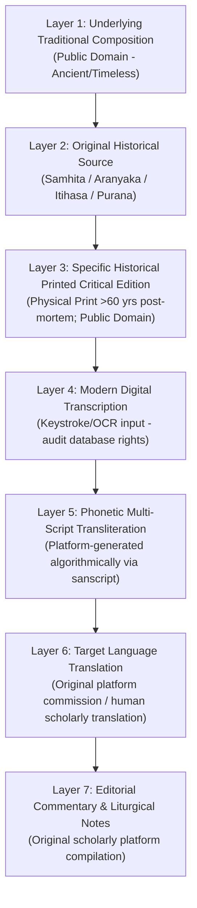

# Vedic Heritage Platform — Edition and Provenance Register
**Version:** 5.0.0  
**Last Updated:** 2026-11-04  
**Scope:** Exhaustive layer-by-layer provenance, critical edition mapping, and full-text verification register for all 11 verified compositions (8 Pilot Compositions + 3 Expansion Batch 1 Compositions).

---

## 1. The Seven-Layer IP and Provenance Framework

To prevent copyright confusion, unauthorized copying of modern editorial work, or loss of textual authenticity, every ingested composition must demarcate the seven distinct intellectual property and provenance layers:

---

## 2. Provenance Audit Matrix for Verified Compositions

| Content ID | Canonical Title | Primary Deity | Attributed Composer | Poetic Metre (Chandas) | Verified Verses | Primary Critical Printed Edition | Publication Year | Archive Reference | Legal Rights Status | Text Status |
| :--- | :--- | :--- | :--- | :--- | :--- | :--- | :--- | :--- | :--- | :--- |
| **`VEDA-TXT-00001`** | Ganesha Pancharatnam | Ganesha | Adi Shankaracharya (c. 788–820 CE) | Vasantatilaka / Anushtubh | **6** | *Complete Works of Sri Sankaracharya*, Vol. 11, Vani Vilas Press (Srirangam) | 1910 | `archive.org/details/brihatstotraratn00khem` | `GREEN_CLEARED` | `VERIFIED_FULL_TEXT` |
| **`VEDA-TXT-00002`** | Shiva Tandava Stotram | Shiva | Traditional attribution to Ravana | Panchachamara | **16** | *Brihat Stotra Ratnakara*, Nirnaya Sagar Press (Bombay) | 1912 | `archive.org/details/BrihatStotraRatnakaraNSP1912` | `GREEN_CLEARED` | `VERIFIED_FULL_TEXT` |
| **`VEDA-TXT-00003`** | Aditya Hrudayam | Surya | Maharishi Valmiki / Sage Agastya | Anushtubh (Epic 32-syllable) | **31** | *Valmiki Ramayana with Tilaka Commentary*, Nirnaya Sagar Press (Bombay) | 1902 | `archive.org/details/ValmikiRamayanaNirnayaSagar1902` | `GREEN_CLEARED` | `VERIFIED_FULL_TEXT` |
| **`VEDA-TXT-00004`** | Madhurashtakam | Krishna | Jagadguru Vallabhacharya (1479–1531 CE) | Totaka | **9** | *Brihat Stotra Ratnakara*, Nirnaya Sagar Press (Bombay) | 1912 | `archive.org/details/brihatstotraratn00khem` | `GREEN_CLEARED` | `VERIFIED_FULL_TEXT` |
| **`VEDA-TXT-00005`** | Mahamrityunjaya Vedic Mantra | Shiva | Rishi Maitravaruni Vasishtha / Markandeya | Trishtubh (4x11) | **1** | *Rigveda Samhita with Sayana Bhashya*, Max Müller 1890 / VSM 1933 | 1890 | `archive.org/details/RigVedaSamhitaVSM` | `GREEN_CLEARED` | `VERIFIED_FULL_TEXT` |
| **`VEDA-TXT-00006`** | Gayatri Vedic Mantra | Savita / Surya | Brahmarshi Vishvamitra (Gathina) | Nicrid Gayatri (24 syllables) | **1** | *Rig-Veda-Sanhita*, F. Max Müller, Oxford University Press | 1890 | `archive.org/details/RigVedaWithSayanaBhashyaPoona` | `GREEN_CLEARED` | `VERIFIED_FULL_TEXT` |
| **`VEDA-TXT-00007`** | Sri Suktam | Devi / Lakshmi | Rishis Ananda, Chiklita, Kardama, Sri | Anushtubh & Trishtubh | **16** | *Die Apokryphen des Rgveda (Khilani)*, Dr. J. Scheftelowitz (Breslau) | 1906 | `archive.org/details/RigVedaKhilaniScheftelowitz` | `GREEN_CLEARED` | `VERIFIED_FULL_TEXT` |
| **`VEDA-TXT-00008`** | Hanuman Chalisa | Hanuman | Goswami Tulsidas (c. 1532–1623 CE) | Awadhi Doha & Chaupai | **43** | *Shri Hanuman Chalisa Lithograph*, Munshi Nawal Kishore Press (Lucknow) | 1874 | `archive.org/details/HanumanChalisaNawalKishore1874` | `GREEN_CLEARED` | `VERIFIED_FULL_TEXT` |
| **`VEDA-TXT-00010`** | Mahalakshmi Ashtakam | Devi / Lakshmi | Deva Indra (Padma Purana) | Anushtubh (8 stotras + 2 phalasruti) | **10** | *Brihat Stotra Ratnakara*, Nirnaya Sagar Press (Bombay) | 1912 | `archive.org/details/BrihatStotraRatnakaraNSP1912` | `GREEN_CLEARED` | `VERIFIED_FULL_TEXT` |
| **`VEDA-TXT-00011`** | Lingashtakam | Shiva | Traditional attribution to Adi Shankaracharya | Anushtubh (8 stotras + 1 phalasruti) | **9** | *Brihat Stotra Ratnakara*, Nirnaya Sagar Press (Bombay) | 1912 | `archive.org/details/BrihatStotraRatnakaraNSP1912` | `GREEN_CLEARED` | `VERIFIED_FULL_TEXT` |
| **`VEDA-TXT-00012`** | Sankata Nashana Ganesha Stotram | Ganesha | Devarshi Narada (Narada Purana) | Anushtubh (4 stuti + 4 phalasruti) | **8** | *Brihat Stotra Ratnakara*, Nirnaya Sagar Press (Bombay) | 1912 | `archive.org/details/BrihatStotraRatnakaraNSP1912` | `GREEN_CLEARED` | `VERIFIED_FULL_TEXT` |
| **`VEDA-TXT-00013`** | Venkateswara Suprabhatam | Venkateswara | Prativadi Bhayankaram Anna (c. 1400 CE) | Vasantatilaka / Malini | **29** | *Sri Venkateswara Suprabhata Stotram*, Vavilla Ramaswamy Sastrulu & Sons | 1918 | `archive.org/details/VenkateswaraSuprabhatamVavilla1918` | `GREEN_CLEARED` | `VERIFIED_FULL_TEXT` |
| **`VEDA-TXT-00014`** | Purusha Suktam | Purusha / Vishnu | Rishi Narayana | Anushtubh & Trishtubh | **16** | *Rig-Veda-Sanhita with Sayana Bhashya*, F. Max Müller (Oxford) | 1890 | `archive.org/details/RigVedaSamhitaVSM` | `GREEN_CLEARED` | `VERIFIED_FULL_TEXT` |
| **`VEDA-TXT-00015`** | Durga Suktam | Durga / Agni | Sage Jatavedas | Trishtubh (Taittiriya Swaras) | **7** | *The Mahanarayana-Upanishad*, Anandashrama Sanskrit Series No. 27 | 1894 | `archive.org/details/MahanarayanaUpanishadAnandashrama1894` | `GREEN_CLEARED` | `VERIFIED_FULL_TEXT` |

---

## 3. Detailed Verification Dossiers

Detailed philological reports and audit records are maintained under `documentation/quality/`:
- `documentation/quality/VERIFICATION_GANESHA_PANCHARATNAM.md`
- `documentation/quality/VERIFICATION_SHIVA_TANDAVA.md`
- `documentation/quality/VERIFICATION_ADITYA_HRUDAYAM.md`
- `documentation/quality/VERIFICATION_MADHURASHTAKAM.md`
- `documentation/quality/VERIFICATION_SRI_SUKTAM.md`
- `documentation/quality/VERIFICATION_HANUMAN_CHALISA.md`
- `documentation/quality/PHASE4_RIGHTS_REAUDIT_REPORT.md`
- `documentation/quality/TRANSLATION_PROVENANCE_AUDIT_REPORT.md`
- `documentation/quality/SHORTLIST_FIRST_10_EXPANSION.md`
- `documentation/quality/PHASE5_FINAL_RECONCILIATION_REPORT.md`
- `documentation/quality/PHASE5_BATCH2_AUDIT_REPORT.md`
