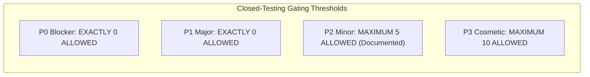

# VEDAM CLOSED TESTING ACCEPTANCE CRITERIA
## Quality Benchmarks, Gating Thresholds & Play Console Readiness Protocol

**Document ID:** VEDAM-CRIT-CT-001  
**Version:** 1.0.0-RC  
**Date:** 2026-11-10  
**Target Application:** Vedam (Mobile & Web)  
**Package ID:** `org.vedam.vedam_app`  
**Status:** CANONICAL ACCEPTANCE CRITERIA  

---

## 1. Objective & Governance Boundaries

This document defines the explicit, measurable criteria required to accept the Vedam application at the conclusion of closed testing. 

The application will **NOT** be declared ready for closed-cohort beta or Play Console submission until every gating criterion in this document is fully satisfied and backed by verifiable evidence.

> [!IMPORTANT]
> **Scope Distinction:**
> Closed-testing acceptance certifies *application runtime fidelity, usability, offline durability, and rendering accuracy*. It does **not** constitute authoritative scholarly certification of Sanskrit translations or theological commentary, which remains governed under Section 8.

---

## 2. Scripture & Sacred Content Acceptance Criteria

Every scripture, mantra, stotram, and puja guide bundled in Vedam must satisfy the following benchmarks:

| Criterion ID | Dimension | Required Benchmark | Verification Method | Gating Impact |
| :--- | :--- | :--- | :--- | :--- |
| **AC-CNT-01** | **Scripture Inventory Completeness** | All 20 scriptures and all 310 verses in `kAuthenticScriptures` render without missing or empty verses. | Manual execution of `TC-CNT-TXT01` through `TC-CNT-TXT20`. | **P0 Blocker** |
| **AC-CNT-02** | **Vedic Svara Preservation** | High-resolution Unicode accents (Udatta `॑`, Anudatta `॒`, Svarita) render accurately without font clipping in the 4 Vedic texts (`VEDA-TXT-00005`, `00006`, `00014`, `00015`). | Visual inspection under Devanagari script at 1.0x and 1.5x font scale. | **P0 Blocker** |
| **AC-CNT-03** | **Script Transliteration** | All supported transliteration scripts (IAST, Telugu, Tamil, Kannada, Malayalam) render appropriate phonetic glyphs without square substitution boxes ("tofu"). | Script toggle verification across diverse Indic scripts. | **P0 Blocker** |
| **AC-CNT-04** | **10-Language Draft Fidelity** | Draft translations across all 10 languages display accurately formatted text without unescaped JSON, null strings, or truncated sentences. | Verse reader sample verification across regional language settings. | **P1 Major** |
| **AC-CNT-05** | **Audio Chanting Synchronization** | All 31 bundled offline `.mp3` audio recordings play smoothly, loop seamlessly, and correctly trigger bead increments during audio-assisted Japa. | Audio player execution and headphone/speaker audition. | **P0 Blocker** |
| **AC-CNT-06** | **Puja Guide Completeness** | All 6 puja guides step sequentially through all 16 Shodashopachara rituals with accurate dhyana slokas and completion persistence. | Step-by-step traversal of each puja guide. | **P1 Major** |
| **AC-CNT-07** | **Mantra Catalog Integrity** | All 455 mantras in the master catalog display valid titles, deities, significance notes, and correct bundled/unbundled state indicators. | Browse and search filtering in Mantras screen. | **P1 Major** |

---

## 3. Application Feature & Option Acceptance Criteria

Every user-accessible feature and interactive option must satisfy the following benchmarks:

| Criterion ID | Feature Domain | Required Benchmark | Verification Method | Gating Impact |
| :--- | :--- | :--- | :--- | :--- |
| **AC-FEAT-01** | **Japa Presets & Custom** | Japa counter functions flawlessly across all 7 traditional presets (11, 21, 27, 54, 108, 111, 1008) and custom targets up to 100,000. Rejects negative/decimal values. | Execute `TC-FEAT-JAPA-01` through `TC-FEAT-JAPA-08`. | **P0 Blocker** |
| **AC-FEAT-02** | **Japa Counting Mechanics** | Bead increments respond to screen tap, volume up button, and audio loop completion. Haptic feedback fires cleanly without UI stutter. | Count 108 beads continuously; verify haptic pulse. | **P1 Major** |
| **AC-FEAT-03** | **Data Persistence Resilience** | Completed Japa counts, Sadhana history, custom Gotra inputs, and bookmarks survive app termination, device reboot, and memory clearance. | Force-stop app in Android Settings, relaunch, verify state. | **P0 Blocker** |
| **AC-FEAT-04** | **100% Offline Autonomy** | Complete app launches and functions without internet connection. Zero network permissions exist in Android release manifest. | Enable Airplane Mode; verify all screens, audio, and calculations. | **P0 Blocker** |
| **AC-FEAT-05** | **Panchangam Engine Accuracy** | Offline astronomical engine calculates Tithi, Nakshatra, Rahu Kalam, and Yamaganda accurately for any chosen calendar date and city origin. | Cross-check output against astronomical ephemeris. | **P1 Major** |
| **AC-FEAT-06** | **DivyaDishi Compass & Declination** | Live compass dial tracks device orientation in foreground; True North toggle accurately applies NOAA WMM magnetic declination offset. | Execute 360-degree rotation test in `TC-FEAT-DIVYA-01`. | **P1 Major** |
| **AC-FEAT-07** | **Background Audio & Service** | Audio playback continues playing when screen is locked or user switches to another app. Notification controls (Play/Pause/Stop) respond immediately. | Lock screen test; notification drawer media control test. | **P0 Blocker** |
| **AC-FEAT-08** | **Accessibility & Dynamic Scaling** | UI layouts maintain integrity at 1.5x and 2.0x accessibility text scale. Zero yellow/black layout overflow warnings occur on 320dp to 412dp widths. | Enable Largest Font Size in Android Accessibility Settings. | **P1 Major** |

---

## 4. Defect Gating Thresholds for Release Candidate Acceptance

The closed-testing cycle cannot be marked complete, and a build cannot be promoted to closed beta, unless the active defect count satisfies:

- **P0 Defects:** **0 Open.** Any crash, sacred text corruption, missing verse, or data loss immediately halts release candidate promotion.
- **P1 Defects:** **0 Open.** Any blocked workflow, compass inaccuracy, or persistent notification failure must be resolved.
- **P2 Defects:** **$\le 5$ Open.** Minor layout quirks or secondary phrasing ambiguities may be carried into closed beta only with an approved remediation timeline.
- **P3 Defects:** **$\le 10$ Open.** Minor aesthetic nuances are acceptable.

---

## 5. Google Play Console Readiness Checklist

Before uploading the release candidate to Google Play Console's Closed Testing Track, the following administrative and cryptographic assets must be in place:

- [ ] **1. Production Signing Keystore:**
  - Generate a dedicated, password-protected Java Keystore (`release.jks`).
  - Store keystore and passwords in an encrypted, cold-storage secrets vault.
  - Update `android/app/build.gradle.kts` to reference keystore via environment variables (never committed to Git).
- [ ] **2. Android App Bundle (`.aab`):**
  - Compile reproducible release bundle: `flutter build appbundle --release`.
  - Verify size $\le 100\text{ MB}$ (current bundle: ~53.2 MB).
- [ ] **3. Google Play Console Account & Track Setup:**
  - Create Application entry: Title: "Vedam", Default language: "English (en-US) / Hindi (hi-IN)".
  - Setup **Closed Testing Track** (Alpha / Internal).
  - Add tester email list (minimum 20 testers for personal Play accounts under Google's 14-day closed testing requirement).
- [ ] **4. Privacy Policy & Store Disclosures:**
  - Host privacy policy at a public, SSL-encrypted URL stating: *Zero personal data collected, zero tracking, all devotional practice data stored 100% on-device*.
  - Declare App Permissions in Play Console (foreground service, notifications, exact alarms; zero location or internet permissions).
  - Target Audience: Ages 13+ (Devotional / Lifestyle).
- [ ] **5. Store Graphics & Metadata:**
  - High-res app icon ($512 \times 512\text{ px}$, 32-bit PNG).
  - Feature Graphic ($1024 \times 500\text{ px}$, PNG/JPEG).
  - At least 4 phone screenshots ($1080 \times 1920\text{ px}$ or higher) illustrating Home, Scripture Reader, Japa Mala, and DivyaDishi.

---
*Vedam Engineering & Quality Assurance Group*
