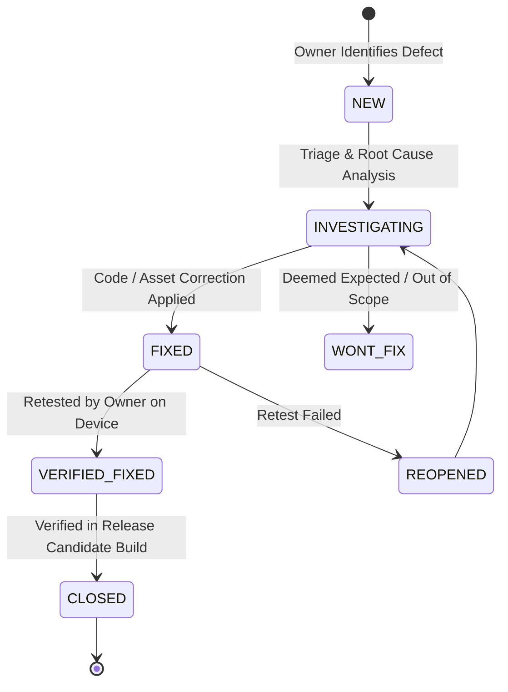

# VEDAM CLOSED TESTING DEFECT LOG
## Issue Tracking, Triage Register & Resolution Verification

**Document ID:** VEDAM-LOG-CT-001  
**Version:** 1.0.0-RC  
**Date:** 2026-11-10  
**Target Application:** Vedam (Mobile & Web)  
**Package ID:** `org.vedam.vedam_app`  
**Status:** ACTIVE DEFECT REGISTER  

---

## 1. Defect Lifecycle & Resolution Workflow

Every discrepancy, failure, or unexpected behavior identified during closed testing must be logged in this register and tracked through the following lifecycle:



### Defect States:
1. **`NEW`**: Defect logged by tester with reproduction steps and evidence.
2. **`INVESTIGATING`**: Engineering is analyzing root cause in code or asset bundles.
3. **`FIXED`**: Code patch or asset update committed on branch `master`.
4. **`VERIFIED_FIXED`**: Owner has retested on a fresh build and confirmed the fix.
5. **`CLOSED`**: Resolution finalized and verified across all target platforms.
6. **`REOPENED`**: Fix did not completely resolve the defect upon retesting.

---

## 2. Active Defect & Discrepancy Register

| Defect ID | Date Logged | Sev | Component | Summary / Discrepancy | Related Test ID | Status | Resolution / Target |
| :--- | :--- | :--- | :--- | :--- | :--- | :--- | :--- |
| **DEF-001** | 2026-11-10 | **P2** | Web / PWA | Service worker in Web build calls `skipWaiting` and clears caches, preventing offline launch from cold browser cache. | `TC-FEAT-OFFLINE-02` | **INVESTIGATING** | Documented as Web SPA; caching service worker planned for v1.1. |
| **DEF-002** | 2026-11-10 | **P1** | Build / Signing | Release APK and App Bundle are signed with default Android debug key in `build.gradle.kts`. Sideloadable for beta, but Play Console requires official production keystore. | `TC-FEAT-BUILD-01` | **OPEN (POLICY)** | Pending owner authorization of production keystore generation. |
| **DEF-003** | 2026-11-10 | **P2** | Database / Text | `VEDA-TXT-00005` (Mahamrityunjaya Mantra) lists `Trishtubh (4x11)` in `texts.chandas` but `Anushtubh` in `verses.meter`. | `TC-CNT-TXT05-01` | **OPEN (SCHOLARLY)**| Logged in Phase 24 scholar review packet for academic arbiter sign-off. |
| **DEF-004** | 2026-11-10 | **P2** | Database / Padartha| Word-by-word Padartha JSON is unpopulated (0/10) for Gayatri (`TXT-006`), Mahamrityunjaya (`TXT-005`), Ganesha Pancharatnam (`TXT-001`), Sankata Nashana (`TXT-012`), and Lingashtakam (`TXT-011`). | `TC-CNT-TXT06-03` | **OPEN (CONTENT)** | Padartha entries queued for Phase 24 scholar review ingestion. |

---

## 3. Owner Defect Submission Template

To log a new defect during your testing session, copy and paste this template below Section 4:

```markdown
### [DEF-XXX] Short, Descriptive Defect Title
- **Date Logged:** YYYY-MM-DD
- **Severity:** [P0 - Blocker | P1 - Major | P2 - Minor | P3 - Cosmetic]
- **Component:** [Scripture Reader | Japa Counter | Audio Player | Puja Guide | Panchangam | DivyaDishi | Vrat | Settings | Shell]
- **Related Test ID:** [e.g., TC-FEAT-JAPA-03]
- **Device & Environment:**
  - Device Model: [e.g., Samsung Galaxy S23 / Pixel 7 / Redmi Note 12]
  - OS Version: [e.g., Android 14 / API 34]
  - App Version / Build: [e.g., 1.0.0+1 (Build SHA: 0c1249a)]
  - Display Scale: [e.g., Normal 1.0x / Accessibility 1.5x]
  - App Theme: [Light Theme / Dark Theme]
- **Preconditions:**
  - [e.g., User is logged in, audio playback active in background, offline mode enabled]
- **Steps to Reproduce:**
  1. Navigate to ...
  2. Tap on ...
  3. Select ...
  4. Observe behavior ...
- **Expected Behavior:**
  - [Describe clearly what should have happened]
- **Actual Behavior:**
  - [Describe exactly what failed, including error text, glitch, or frozen UI]
- **Evidence / Attachments:**
  - Screenshot / Video: `evidence/screenshots/def_xxx_error.png`
  - Logcat / Terminal Output: [Paste relevant error snippet]
- **Initial Triage Notes:**
  - [Any observations on frequency: 100% reproducible vs intermittent]
```

---

## 4. Detailed Defect Dossiers

### DEF-001: Web Build Service Worker Purges Cache Instead of Offline PWA Caching
- **Severity:** P2 (Minor)
- **Component:** Web Build / Service Worker
- **Related Test ID:** `TC-FEAT-OFFLINE-02`
- **Description:** In `build/web/flutter_service_worker.js`, the activate listener explicitly deletes all cache keys upon startup:
  ```javascript
  self.addEventListener("activate", (event) => {
    event.waitUntil(
      caches.keys().then(function(names) {
        for (let name of names) caches.delete(name);
      }).then(() => self.clients.claim())
    );
  });
  ```
- **Impact:** Once loaded in a browser tab, the web app executes client-side without network requests. However, opening the app in a browser while offline fails if static assets are not cached by the service worker.
- **Mitigation:** The mobile Android release APK is 100% offline-autonomous. The web version is classified as an online-loaded private SPA.

---

### DEF-002: Android Release Artifacts Signed With Debug Keystore
- **Severity:** P1 (Major for Store Release; P2 for Internal Testing)
- **Component:** Android Build Configuration (`build.gradle.kts`)
- **Related Test ID:** `TC-FEAT-BUILD-01`
- **Description:** `android/app/build.gradle.kts` specifies:
  `signingConfig = signingConfigs.getByName("debug")`
- **Impact:** The release APK and App Bundle can be sideloaded directly onto physical test devices, but Google Play Console will reject the artifact upon upload with error: *"You uploaded an APK or Android App Bundle that is signed with a debug key."*
- **Resolution Plan:** Generate a formal Java Keystore (`vedam-release.jks`) in Phase 28 prior to store publishing, managed via secure CI/local environment variables.

---

### DEF-003: Metrical Classification Discrepancy in VEDA-TXT-00005
- **Severity:** P2 (Minor / Scholarly Apparatus)
- **Component:** Database Schema / Texts & Verses
- **Related Test ID:** `TC-CNT-TXT05-01`
- **Description:** The header record in `texts.chandas` lists `Trishtubh (4x11)`, while the verse record in `verses.meter` lists `Anushtubh`.
- **Impact:** Rigveda 7.59.12 is an irregular Vedic Anushtubh variation (scanned as 8-8-8-8 with Vedic sandhi expansion). 
- **Resolution Plan:** Submitted in the Phase 24 Scholar Review Packet for authoritative academic resolution.

---

### DEF-004: Incomplete Word-by-Word Padartha for Select Core Compositions
- **Severity:** P2 (Minor / Content)
- **Component:** Database / Translations Table
- **Related Test ID:** `TC-CNT-TXT06-03`
- **Description:** While Hanuman Chalisa (387 entries), Purusha Suktam (144 entries), Durga Suktam (63 entries), Shiva Tandava (144 entries), and Venkateswara Suprabhatam (671 entries) have rich Padartha JSON, five compositions (`VEDA-TXT-00001`, `00005`, `00006`, `00011`, `00012`) have `word_by_word_json = null` in the database.
- **Impact:** The Scripture Reader displays verse text and draft translations smoothly, but word-by-word tap breakdown is unavailable for these 5 texts.
- **Resolution Plan:** Ingest verified Padartha structures during Phase 24 scholar review.

---
*Vedam Quality Assurance Log*
