# VEDAM CLOSED TESTING MASTER PLAN
## Comprehensive User-Led Release Candidate Verification & Execution Protocol

**Document ID:** VEDAM-PLAN-CT-001  
**Version:** 1.0.0-RC  
**Date:** 2026-11-10  
**Target Application:** Vedam (Mobile & Web)  
**Package ID:** `org.vedam.vedam_app`  
**Execution Lead:** Product Owner / Principal Reviewer  
**Status:** ACTIVE TESTING PLAN  

---

## 1. Executive Summary & Purpose

The purpose of this Master Plan is to establish a rigorous, disciplined, and 100% traceable testing framework for the user-led closed-testing cycle of the Vedam application. 

Before Vedam is released to external beta cohorts or published to the public on Google Play, the product owner will personally test:
1. **Every scripture, mantra, stotram, and puja composition** currently bundled or registered in the application and database.
2. **Every user-accessible screen, control, setting, toggle, and option** exposed across the platform.

This phase is specifically designed to prepare a validated **Release Candidate (RC)** through systematic personal verification. It explicitly rejects premature declarations of release-readiness.

---

## 2. Mandatory Safety & Governance Invariants

Closed testing operates under strict non-negotiable safety and governance boundaries:

1. **Production Database Immutability:**
   - The production canonical database (`database/vedam.db`, SHA-256: `0B3500F36434217D...`, 20,455,424 bytes) must remain strictly unmodified.
   - All translation review statuses remain `DRAFT`.
   - Testing activities never alter Section 8 approval permissions or bypass reviewer authenticity requirements.
2. **User Testing vs. Scholarly Certification:**
   - User testing evaluates application rendering, usability, audio synchronization, typography, layout, and control mechanics.
   - **User testing is NOT scholarly certification.** Approving a test item in this register verifies application fidelity, not doctrinal or Vedic canon authority.
3. **Zero Data Destruction:**
   - The tester's on-device practices (Japa logs, Sadhana history, custom Gotra inputs) must be tested for persistence and export resilience without destructive manual resets of unrelated state.
4. **No Secrets or Production Key Exposure:**
   - Release candidate artifacts are compiled using debug/test signing configurations. No production private keystores or credentials shall be generated or exposed until formal Play Console deployment.
5. **Zero External Submissions:**
   - No builds are uploaded to public Google Play tracks or third-party servers during this phase.

---

## 3. Scope of Closed Testing

```mermaid
graph TD
    CT[Vedam Closed Testing Cycle] --> CR[Track A: Content Verification]
    CT --> FR[Track B: Feature & Option Verification]
    CT --> BR[Track C: Build & Release Readiness]

    CR --> C1[20 Scripture Texts / 310 Verses]
    CR --> C2[455 Mantras / 31 Bundled Audio Tracks]
    CR --> C3[6 Shodashopachara Puja Guides]
    CR --> C4[3 Daily Sadhana Plans]
    CR --> C5[20 Sacred Temple Coordinates]

    FR --> F1[Shell, Navigation & 5 Core Tabs]
    FR --> F2[Scripture Reader, Learning & Scripts]
    FR --> F3[Japa Counter & 7 Presets + Custom]
    FR --> F4[Audio Player, Notification & Lockscreen]
    FR --> F5[Panchangam Astronomical Engine]
    FR --> F6[DivyaDishi Live Compass & WMM Declination]
    FR --> F7[Vrat, Observances & Alarm Notifications]

    BR --> B1[Android Release APK & App Bundle AAB]
    BR --> B2[Permissions & Zero Network Audit]
    BR --> B3[Web Local SPA vs PWA Offline Boundary]
```

### 3.1 Content Verification Inventory (Track A)
- **20 Scripture Compositions:** Complete verification of Devanagari text, Vedic Svaras (where applicable), IAST romanization, regional scripts (Telugu, Tamil, Kannada, Malayalam), verse sequencing, verse numbering, and translations across 10 languages (English, Hindi, Telugu, Tamil, Kannada, Marathi, Bengali, Gujarati, Malayalam, Odia).
- **455 Devotional Mantras:** Verification of Sanskrit titles, deities, significance, text, and 31 high-fidelity bundled audio recordings.
- **6 Shodashopachara Puja Guides:** Step-by-step verification of all 16 upacharas, dhyana verses, offerings, audio, and completion dialogs.
- **3 Daily Sadhana Plans:** Verification of morning, evening, and sankata-nashana multi-step sequences.
- **20 Temple Coordinate Profiles:** Verification of compound center coordinates, scriptural direction terminology, and uncertainty disclosures.

### 3.2 Feature & Control Inventory (Track B)
- Every single interactive button, slider, dialog, dropdown, tab, toggle, and text input across all 12 functional domains of the application.

---

## 4. Testing System Architecture & Artifacts

The closed-testing system consists of five interlocking documents:

| Document | File Path | Function |
| :--- | :--- | :--- |
| **Master Testing Plan** | `documentation/quality/CLOSED_TESTING_MASTER_PLAN.md` | Strategic framework, governance rules, and testing instructions. |
| **Content Register** | `documentation/quality/CLOSED_TESTING_CONTENT_REGISTER.md` | Granular test catalog for every scripture, verse, mantra, and puja. |
| **Feature Register** | `documentation/quality/CLOSED_TESTING_FEATURE_REGISTER.md` | Granular test catalog for every screen, control, preset, and setting. |
| **Defect Log** | `documentation/quality/CLOSED_TESTING_DEFECT_LOG.md` | Formal bug tracking register with reproduction steps and resolution status. |
| **Acceptance Criteria** | `documentation/quality/CLOSED_TESTING_ACCEPTANCE_CRITERIA.md` | Quantitative thresholds and gating criteria for release candidate acceptance. |

---

## 5. Owner Quick-Start & Testing Instructions

As the principal reviewer, follow this systematic workflow for every test item:

```mermaid
sequenceDiagram
    autonumber
    actor Owner as Product Owner (Tester)
    participant Reg as Content / Feature Register
    participant App as Vedam App (Device / Web)
    participant Log as Defect Log

    Owner->>Reg: Select next unexecuted Test ID (Status: NOT_TESTED)
    Owner->>App: Perform Exact Test Steps on device
    App-->>Owner: Observe visual display, audio playback, haptics, navigation
    alt Observed behavior matches Expected Result exactly
        Owner->>Reg: Record Actual Result, mark status PASS, note date/version
    else Discrepancy, error, layout overflow, or crash observed
        Owner->>Log: Create new Defect ID (DEF-xxx) with steps, severity, evidence
        Owner->>Reg: Mark status FAIL or BLOCKED, link Defect ID
    end
```

### Step 1: Pre-Testing Setup
1. Install the Release Candidate build (`app-release.apk` on physical Android device, or serve `build/web/` locally).
2. Ensure device has display set to normal font scale (1.0x) initially, with a secondary test run at largest accessibility font scale (1.5x–2.0x).
3. Test in both Light Theme and Dark Theme.

### Step 2: Executing a Test Case
1. Locate the test item in `CLOSED_TESTING_CONTENT_REGISTER.md` or `CLOSED_TESTING_FEATURE_REGISTER.md`.
2. Follow the exact numbered instructions in **Test Steps**.
3. Compare the application's actual behavior with the **Expected Result**.
4. Update the test record:
   - `Actual Result`: Brief description of what occurred (e.g., *"Rendered cleanly in Devanagari and Telugu with smooth audio sync"*).
   - `Status`: Change `NOT_TESTED` to `PASS`, `FAIL`, or `BLOCKED`.
   - `Evidence Reference`: Note screenshot filename or video recording (e.g., `evidence/tc_cnt_001_telugu.png`).

### Step 3: Logging a Defect
If any behavior fails to meet the expected result:
1. Open `CLOSED_TESTING_DEFECT_LOG.md`.
2. Assign the next sequential Defect ID (e.g., `DEF-001`).
3. Fill in Title, Severity (P0, P1, P2, P3), Component, Steps to Reproduce, Expected vs Actual, and attach logs/screenshots.
4. Update the corresponding Register row with the Defect ID and mark status `FAIL`.

### Step 4: Verifying a Fix
When a code correction is applied:
1. Re-install the updated build.
2. Re-execute the exact test steps.
3. If resolved, update the Defect Log status to `VERIFIED_FIXED` and change the Register status from `FAIL` to `PASS`.

---

## 6. Defect Severity & Triage Hierarchy

All defects discovered during closed testing must be classified according to the following strict hierarchy:

| Severity Level | Definition | Examples | Release Impact |
| :--- | :--- | :--- | :--- |
| **P0 — Blocker** | Application crash, freeze, fatal exception, corruption of sacred text, missing verse, user data loss, incorrect Vedic Svara accent, background audio failure. | App crashes on tapping a mantra; verse 4 of Purusha Suktam missing; Japa history wiped after restart. | **Absolute Release Blocker.** Zero P0 defects permitted. |
| **P1 — Major** | Core user journey blocked; calculation error in astronomical Panchangam; compass pointing opposite direction; battery drain $>8\%/\text{hr}$; unresponsive control. | Rahu Kalam time calculation off by 45 mins; Japa count fails to increment past 108; custom target dialog rejects valid input. | **Release Blocker.** Must be resolved before candidate sign-off. |
| **P2 — Minor** | Visual layout overflow on small screens; minor typography clipping; missing translation in 1 of 10 languages; notification text truncated. | Bottom overflow by 4 pixels on 320dp screen; Kannada transliteration has minor glyph overlap; subtitle text wraps awkwardly. | **Target Resolution.** Up to 5 allowed if documented and non-blocking. |
| **P3 — Cosmetic** | Minor styling inconsistency; animation micro-stutter; subtle color contrast variance in dark mode. | Mala bead glow slightly off-center; transition delay of 50ms when switching tabs. | **Non-blocking.** Deferred to post-launch polish. |

---

## 7. Progress Tracking & Completion Integrity

To preserve honesty and accountability:
- **Never report 100% completion while any required item remains untested or blocked.**
- The master summary table must record exact counts:
  $$\text{Progress} = \frac{\text{Passed Tests}}{\text{Total Tests}} \times 100\%$$
- A test suite cannot be declared accepted if any P0 or P1 defect remains unresolved.

---
*Vedam Engineering & Quality Assurance Group*
