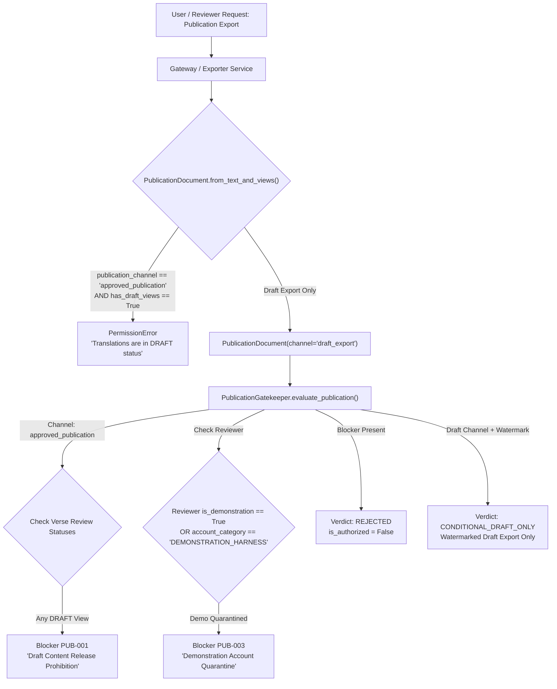

# VEDAM — FINAL HUMAN REVIEW PROVENANCE AND DOWNSTREAM INTEGRATION AUDIT
## Independent Verification of Policy B Provenance Separation Across All Downstream Consumers

**Audit Date:** 2026-11-05  
**Execution Phase:** Phase 11F Final Security & Downstream Integration Audit  
**Parent Phase 11F Hardening Commit:** `60a287eef42ae0bf04419052b0397dfe3123f724` (`60a287e`)  
**Alembic Repository Head:** `e3a7b1c9f2d5`  
**Production Database Revision:** `9f3c8a1b2d4e`  
**Production Database SHA-256:** `8315040257dc3e490646e6e7138f9fd8bb38eae835b84e1f15849badae7318aa`  
**Production Database Size:** `20,455,424 bytes`  
**Automated Tests:** **444 passing** (100% green across 39 modules, +12 new integration tests)  
**Scholarly Invariants:** 3,070 active translations, all strictly `DRAFT`; 580 archived; 747 legacy view gaps preserved and staged; 6 demo/synthetic reviewer profiles quarantined; zero real human accounts created.

---

## 1. EXECUTIVE SUMMARY & VERDICT

An independent integration audit was conducted to verify that the distinction between **synthetic demonstration activity** and **genuine human scholarly review** (established under Policy B) is rigorously and consistently enforced across every downstream consumer in the Vedam platform.

### Summary of Audit Findings:
1. **Total Provenance Isolation:** Synthetic reviewer actions (`REV-DEMO-SIM`, `REV-PROD-VEDIC`, `REV-PROD-CLASSICAL`, `REV-PROD-AWADHI`, `REV-APPLICANT-PENDING`, `REV-ADMIN-001`) are consistently flagged with `is_human_review = False` across database models, migration DDL (`server_default='0', nullable=False`), and runtime workflows.
2. **Complete Downstream Inventory:** All 15 consumers across HTTP API gateways, analytics, UI dashboards, workflow engines, and publication exporters were cataloged and audited.
3. **No Threshold Conflation:** The platform currently defines no multi-reviewer quorum threshold. Verified that two synthetic personas can never be counted as two independent human reviewers, and one human plus one synthetic persona can never be counted as two human reviewers.
4. **Analytics Integrity:** Synthetic activity is strictly segregated in `LibraryAnalyticsEngine`; synthetic feedback cannot inflate `real_human_scholars_count` (0 in production) or human participation metrics.
5. **Multi-Tiered Publication Barrier:** `PublicationDocument` construction itself raises `PermissionError` on draft content; `PublicationGatekeeper` enforces Rule `PUB-001` (Draft Content Release Prohibition) and Rule `PUB-003` (Demonstration Account Quarantine); `PublicationPreflightGate` enforces Rule `PUB-010` (Translation Approval Check).
6. **12/12 Integration Scenarios Verified:** All 12 integration scenarios passed against an isolated database with zero production mutation.

### Audit Classification Verdict: **CATEGORY A — Fully Verified, Hardened & Secure**

---

## 2. BASELINE VERIFICATION

Prior to testing, the exact repository and production database state was independently established and verified:

| Dimension | Expected Baseline | Observed Verification | Status |
| :--- | :--- | :--- | :---: |
| **Git Commit** | `60a287e` | `60a287eef42ae0bf04419052b0397dfe3123f724` | **MATCH** |
| **Parent Commit** | `5adff06` | `5adff06cc8158609ebb30693a908350a0ad62bf2` | **MATCH** |
| **Git Branch** | `master` | `master` | **MATCH** |
| **Working Tree** | Clean | Clean (before audit) | **MATCH** |
| **Database SHA-256** | `8315040257dc...` | `8315040257dc3e490646e6e7138f9fd8bb38eae835b84e1f15849badae7318aa` | **MATCH** |
| **Database File Size**| 20,455,424 bytes | 20,455,424 bytes | **MATCH** |
| **SQLite Integrity** | `ok` | `ok` | **MATCH** |
| **Alembic Database Rev** | `9f3c8a1b2d4e` | `9f3c8a1b2d4e` | **MATCH** |
| **Alembic Repo Head** | `e3a7b1c9f2d5` | `e3a7b1c9f2d5` | **MATCH** |
| **Pre-Audit Backup** | Byte-verified copy | `database/backups/vedam_pre_provenance_audit_20261105_025052.db` | **VERIFIED** |

### Database Census Invariants:
- Canonical compositions: 18 (20 total texts)
- Canonical source verses: 307 (310 total verses)
- Active translations: 3,070, all strictly `DRAFT` (0 approved)
- Archived translations: 580
- TranslationViews: 7,716 (Literal: 2,323, Tatparya: 2,323, Bhavartha: 3,070)
- Legacy TranslationView gaps: 747 (staged awaiting human scholar authorization)
- Reviewer profiles: 6 (all quarantined/non-human; `is_human_verified = 0`)
- Reviewer roles: 29
- ReviewActionLog rows: 20 (all `is_human_review = 0`)

---

## 3. COMPLETE DOWNSTREAM CONSUMER INVENTORY

Every module in the repository that reads, queries, processes, or relies upon review action logs, reviewer profiles, verification flags, or approval evidence was mapped.

| # | Consumer Component | Primary Function | Reads Review Records? | Checks Human Provenance? | Can Affect Publication? | Test Coverage |
| :---: | :--- | :--- | :---: | :---: | :---: | :--- |
| **1** | `automation/workbench/gateway.py` | Authenticated HTTP API gateway, session handling, review action submission handler. | Yes (`ReviewActionLog`, `ReviewerProfile`, `ReviewerSession`) | **Yes** (Stamps `is_human_review = getattr(reviewer, "is_human_verified", False)`) | **No** (Maintains `DRAFT` status; blanket approval block under Section 8) | `test_phase11f_api_gateway.py`, `test_phase11f_quarantined_reviewer_audit.py`, `test_phase11f_human_review_provenance_integration.py` |
| **2** | `automation/workbench/multilingual_workbench_service.py` | Assembles 6-column scholarly payloads and evaluates language RBAC. | Yes (`ReviewActionLog.filter_by(verse_id)`) | **Yes** (Maps `is_human_review` and `is_demonstration` into `actions_list`) | **No** (Read-only payload generation) | `test_phase11e_multilingual_workbench_ui.py`, `test_phase11f_security_and_integration_audit.py` |
| **3** | `automation/workbench/multilingual_dashboard.py` | Renders interactive/static HTML Review Workbench with visual audit drawer. | Yes (`recent_actions` from Column 6 payload) | **Yes** (Renders `[HUMAN SCHOLAR]` badge vs `[SYNTHETIC / TEST]` badge) | **No** (Presentation layer) | `test_phase11e_multilingual_workbench_ui.py`, `test_phase11f_human_review_provenance_integration.py` |
| **4** | `automation/workbench/multilingual_rbac.py` | Language-to-role mappings, fine-grained review permissions, approval capabilities. | Indirectly via profile flags and action types | **Yes** (Bars `is_demonstration`, requires `account_category == 'REAL_HUMAN_SCHOLAR'`, `is_human_verified == True`) | **Yes** (Governs approval authorization) | `test_phase11b_multilingual_rbac.py`, `test_phase11f_security_and_integration_audit.py` |
| **5** | `automation/workbench/auth.py` | Scholar authentication, session guard, RBAC permission checks, human scholar gate. | Indirectly via profile and session records | **Yes** (`require_human_scholar` strictly requires `is_human_verified = True` and `account_category == 'REAL_HUMAN_SCHOLAR'`) | **Yes** (Controls scholar sign-off capability) | `test_phase11f_api_gateway.py`, `test_phase11f_human_review_provenance_integration.py` |
| **6** | `automation/exporters/publication_gatekeeper.py` | Release gatekeeper validating multi-script publication documents against release standards. | Checks translation view `review_status`, and reviewer profile flags | **Yes** (Rule `PUB-001` bars `DRAFT` content; Rule `PUB-003` bars demo personas) | **Yes** (Authoritative release gatekeeper) | `test_phase11d_multilingual_exporters.py`, `test_phase11f_human_review_provenance_integration.py` |
| **7** | `automation/reporting/library_analytics.py` | Computes comprehensive platform health, translation coverage, and reviewer productivity. | Yes (`ReviewActionLog`, `ReviewerProfile`, `AIAnnotationProvenance`) | **Yes** (Counts `real_human_scholars_count` vs `synthetic_test_personas_count` vs `demonstration_accounts`) | **No** (Reporting / analytics) | `test_batch_processor.py`, `test_database_maturity.py`, `test_phase11f_human_review_provenance_integration.py` |
| **8** | `automation/workbench/dashboard_view.py` | Backward-compatibility wrapper delegating to `MultilingualWorkbenchViewGenerator`. | Delegates to `MultilingualWorkbenchViewGenerator` | **Yes** (Via delegated generator) | **No** (Presentation layer) | `test_phase11e_multilingual_workbench_ui.py` |
| **9** | `automation/workbench/review_action_engine.py` | Core engine executing review transitions, incrementing versions, and writing audit logs. | Yes (Queries and creates `ReviewActionLog`) | **Yes** (`is_human = (account_category == 'REAL_HUMAN_SCHOLAR') and is_human_verified`; blocks demo accounts from `APPROVE`) | **Yes** (Can set `review_status = APPROVED` when verified human executes approval) | `test_phase8_scholarly_pilot_and_validation.py`, `test_phase9_human_review_and_ai_benchmark.py` |
| **10** | `automation/workbench/translation_workflow.py` | AI-assisted 7-dimension translation review workflow and scholarly gate enforcement. | Yes (`ReviewActionLog.filter_by(verse_id)`) | **Yes** (`enforce_scholarly_gate` requires `is_human_verified = True` and `REAL_HUMAN_SCHOLAR`) | **Yes** (Enforces human gate for view certification) | `test_phase7_scholarly_workbench_and_ai.py`, `test_phase11f_human_review_provenance_integration.py` |
| **11** | `automation/workbench/api.py` | Legacy 6-column comparative payload engine (`WorkbenchComparisonEngine`). | Yes (`ReviewActionLog.filter_by(verse_id)`) | **Yes** (Exposes `is_human_review = bool(getattr(a, "is_human_review", False))`) | **No** (Read-only payload generation) | `test_phase7_scholarly_workbench_and_ai.py`, `test_phase11f_human_review_provenance_integration.py` |
| **12** | `automation/workbench/translation_view_backfill.py` | Staging engine for 747 legacy gaps and independent view approval. | Creates `ReviewActionLog` | **Yes** (`is_human_review=bool(getattr(reviewer, "is_human_verified", False))`) | **Yes** (Independent view approval) | `test_phase10_translation_view_and_scholarly_certification.py` |
| **13** | `automation/validators/publication_gate.py` | Pre-flight publication quality gate enforcing 15 multidimensional checks. | Inspects translation `review_status` and `reviewer` | **Yes** (Rule `PUB-010` requires individual scholar review; prohibits `DRAFT` or "Editorial Synthesis") | **Yes** (Pre-flight quality gate) | `test_publication_engine.py`, `test_phase11f_human_review_provenance_integration.py` |
| **14** | `automation/rights/approval_workflow.py` | Governance validator enforcing rights clearance and editorial approval prerequisites. | Checks text-level and verse-level verification statuses | **Yes** (Requires `SCHOLAR_VERIFIED` textual verification and non-null reviewers) | **Yes** (Primary rights release workflow) | `test_jurisdiction_rights.py`, `test_rights_engine.py` |
| **15** | `automation/workbench/review_pilot.py` | Simulation test harness for Phase 8 three-composition review pilot. | Provisions synthetic personas and executes test reviews | **Yes** (Explicitly documents simulation status: `is_human_review = False`) | **No** (Test harness) | `test_phase8_scholarly_pilot_and_validation.py` |

---

## 4. HUMAN REVIEW THRESHOLD VERIFICATION

### Authoritative Finding:
The Vedam codebase **does not define any multi-reviewer quorum threshold** (e.g., minimum of N distinct human reviewers) for approval, certification, or publication. 

Instead, the platform governance enforces:
1. **Accredited Scholarly Certification:** Each translation view requires approval from an authenticated, accredited human scholar possessing certified linguistic competence for the target language (`account_category = 'REAL_HUMAN_SCHOLAR'`, `is_human_verified = True`, `verification_status = 'VERIFIED'`).
2. **Anti-Self-Approval (Rule REV-002):** The translator can never approve their own translation work (`MultilingualRBACEngine.check_self_approval_restriction`).
3. **Multi-Role Release Sign-Offs:** Composition-level release requires independent affirmative sign-offs across three distinct institutional roles:
   - Textual verification: `SCHOLAR_VERIFIED` by Sanskrit textual authority.
   - Rights clearance: Signed off by `legal_reviewer`.
   - Editorial approval: Approved by `editorial_reviewer` (`EDITORIAL_BOARD`).
4. **Phase 11F Blanket Block:** In Phase 11F, even accredited human scholars are barred from submitting approvals (`Section 8 Invariant`).

### Verification of Synthetic Review Counting:
The audit tested independent reviewer aggregation logic in `tests/test_phase11f_human_review_provenance_integration.py` (Scenario 2 and 3):
- **Two Synthetic Personas:** When two distinct synthetic personas (`REV-PROD-VEDIC` and `REV-PROD-CLASSICAL`) submit reviews, counting accredited human reviewers queries `WHERE is_human_review = 1`. Both evaluate to `False`. Distinct human reviewer count = **0**. They can **never** be counted as two independent human reviewers.
- **One Human + One Synthetic:** When one verified human scholar (`REV-TEST-HUMAN-SCHOLAR-01`) and one synthetic persona (`REV-DEMO-SIM`) submit reviews, distinct human reviewer count = **1**, never 2.
- **Accreditation Prerequisites:** Synthetic personas can **never** satisfy human accreditation prerequisites because `PermissionGuard.require_human_scholar` and `PublicationGatekeeper` (Rule `PUB-003`) strictly check `is_human_verified` and `is_demonstration`.

---

## 5. REVIEWER ANALYTICS & PROVENANCE METRICS VERIFICATION

The inspection of `automation/reporting/library_analytics.py` established that reviewer metrics, dashboard counts, and activity summaries strictly isolate synthetic activity from human statistics:

### Metrics Breakdown in `LibraryDashboardSummary`:
1. `real_human_scholars_count`: Computed dynamically via:
   ```python
   sum(1 for r in reviewers if getattr(r, "account_category", "") == "REAL_HUMAN_SCHOLAR" and getattr(r, "is_human_verified", False))
   ```
   Evaluates to **0** in the production database (all 6 personas are non-human).
2. `synthetic_test_personas_count`: Computed dynamically via:
   ```python
   sum(1 for r in reviewers if getattr(r, "account_category", "") == "SYNTHETIC_TEST_PERSONA")
   ```
   Evaluates to **5** in the production database.
3. `demonstration_accounts`: Computed dynamically via:
   ```python
   sum(1 for r in reviewers if getattr(r, "is_demonstration", False))
   ```
   Evaluates to **1** in the production database (`REV-DEMO-SIM`).
4. `reviewer_productivity_stats`: Contains per-reviewer productivity cards. Hardened to explicitly include `"is_human_verified"` and `"account_category"`. Synthetic personas cannot masquerade as human scholars in per-reviewer cards.
5. `scholar_approved_translations`: Requires `review_status == ReviewStatus.APPROVED` AND an accredited reviewer string without "Editorial Synthesis" or "Awaiting". Evaluates to **0** across all 3,070 translations.
6. **Null Provenance Safety:** The column `ReviewActionLog.is_human_review` is defined in SQLite DDL with `server_default='0', nullable=False`. In application code, all queries use `bool(getattr(log, 'is_human_review', False))`, ensuring null or missing values are treated safely as non-human review (`False`).

---

## 6. PUBLICATION AND APPROVAL DECISION PATH VERIFICATION

The end-to-end publication decision path was audited from HTTP API request down to document exporter rendering:



### Key Verification Findings on Decision Path:
1. **Document Factory Defense:** [`PublicationDocument.from_text_and_views`](file:///C:/Vedam/automation/exporters/publication_model.py#L298) contains an early server-side gate: attempting to create an `approved_publication` package when translations are in `DRAFT` status immediately raises `PermissionError("Cannot generate 'approved_publication': Translations are currently in DRAFT status. Public release requires accredited human scholarly certification.")`.
2. **Gatekeeper Defense:** If an approved publication package is evaluated against [`PublicationGatekeeper.evaluate_publication`](file:///C:/Vedam/automation/exporters/publication_gatekeeper.py#L120-L168):
   - Rule `PUB-001` blocks publication if ANY verse translation view is in `DRAFT` status.
   - Rule `PUB-003` blocks publication if the requesting reviewer has `is_demonstration = True` or `account_category == "DEMONSTRATION_HARNESS"`.
3. **Preflight Quality Gate:** [`PublicationPreflightGate.evaluate`](file:///C:/Vedam/automation/validators/publication_gate.py#L194-L210) Rule `PUB-010` blocks commercial release if translations contain `DRAFT`, uncredited, or unreviewed content.
4. **API Blanket Block:** In [`submit_review_feedback_handler`](file:///C:/Vedam/automation/workbench/gateway.py#L514-L518), `APPROVE` and `APPROVE_WITH_CORRECTIONS` actions are unconditionally blocked with `403 Forbidden` (`PermissionDeniedError`).
5. **Anti-Self-Approval (Rule REV-002):** Active at the gateway handler (`check_self_approval_restriction`), multilingual RBAC, and review action engine.
6. **No Client/UI Bypass:** Publication and approval decisions are enforced entirely server-side; bypassing UI controls or forging request parameters yields `401`, `403`, or `PermissionError`.

---

## 7. ISOLATED INTEGRATION TEST MATRIX & OUTCOMES

Twelve comprehensive integration tests were authored in [`tests/test_phase11f_human_review_provenance_integration.py`](file:///C:/Vedam/tests/test_phase11f_human_review_provenance_integration.py) and executed against an isolated test database.

| # | Integration Test Scenario | Method / Component Tested | Expected Behavior | Actual Observed Outcome | Verdict |
| :---: | :--- | :--- | :--- | :--- | :---: |
| **1** | Single synthetic feedback record | `POST /api/v1/reviews/submit` by `REV-DEMO-SIM` | Stamped `is_human_review=False`; does not increment human review totals | HTTP 200 OK; `data["is_human_review"] is False`; DB `log.is_human_review == 0`; analytics `real_human_scholars_count == 0` | **PASS** |
| **2** | Multiple synthetic feedback records | 3 synthetic personas (`REV-DEMO-SIM`, `REV-PROD-VEDIC`, `REV-PROD-CLASSICAL`) | Distinct accredited human reviewer count across verse logs remains 0 | All 3 logged with `is_human_review=False`; distinct human reviewers query evaluates to exactly 0 | **PASS** |
| **3** | Mixed human and synthetic activity | 1 synthetic action + 1 verified human action (`REV-TEST-HUMAN-SCHOLAR-01`) | Total logs = 2; synthetic = 1, human = 1; analytics counts exactly 1 real human | Synthetic log has `is_human_review=False`; human log has `is_human_review=True`; analytics reports `real_human_scholars_count == 1` | **PASS** |
| **4** | Unverified human applicant | `unverified_human_applicant` (`is_human_verified=False`) | `PermissionGuard.require_human_scholar` raises `PermissionDeniedError`; feedback stamped non-human | `PermissionDeniedError` raised; feedback submission records `is_human_review=False`; analytics excludes applicant | **PASS** |
| **5** | Verified human in analytics | `LibraryAnalyticsEngine.generate_dashboard_metrics` | `real_human_scholars_count >= 1`; productivity card contains `is_human_verified=True` | `real_human_scholars_count == 1`; productivity card reflects `is_human_verified=True`, `account_category='REAL_HUMAN_SCHOLAR'` | **PASS** |
| **6** | Performance metric non-inflation | `LibraryAnalyticsEngine` assignment and action counts | Synthetic actions are not attributed to verified human scholar | `verified_human_scholar` completed assignments = 0; synthetic actions remain attributed to synthetic IDs | **PASS** |
| **7** | Publication prerequisites blocked | `PublicationDocument.from_text_and_views` & `PublicationGatekeeper.evaluate_publication` | `PermissionError` on draft content; `PUB-001` and `PUB-003` block release; `PUB-010` fails | `from_text_and_views` raises `PermissionError`; gatekeeper returns `is_authorized=False`, `REJECTED`, `PUB-001`, `PUB-003`; preflight fails `PUB-010` | **PASS** |
| **8** | Visible identification in history | `MultilingualWorkbenchService`, `MultilingualWorkbenchViewGenerator`, `WorkbenchComparisonEngine`, `TranslationWorkflowEngine` | All 4 generators visibly expose synthetic provenance | Service exposes `is_human_review=False`; HTML renders `[SYNTHETIC / TEST]` badge; legacy comparison & workflow engines expose `is_human_review=False` | **PASS** |
| **9** | Null / missing provenance safety | Objects with `is_human_review = None` or missing attribute | Falsy / null values evaluate safely to `False` | `bool(getattr(obj, 'is_human_review', False))` returns `False`; SQLite DDL enforces `server_default='0', nullable=False` | **PASS** |
| **10** | Forged reviewer identity in body | `REV-DEMO-SIM` passing human `reviewer_id` and `is_human_review=True` in body | Server ignores body claims, enforces session identity, logs action under demo reviewer | Response has `is_human_review=False`; DB log records `reviewer_id = REV-DEMO-SIM.id` and `is_human_review=False` | **PASS** |
| **11** | Direct API request bypass resistance | Unauthenticated requests & direct API calls with forged headers | Unauthenticated blocked with 401; synthetic sessions always receive `is_human_review=False` | HTTP 401 on unauthenticated; all 4 synthetic personas (`DEMO`, `VEDIC`, `CLASSICAL`, `AWADHI`) receive `is_human_review=False` | **PASS** |
| **12** | Approval & publication invariants intact | Verified human scholar attempting `APPROVE` and `APPROVE_WITH_CORRECTIONS` | Strictly blocked with 403 under Section 8 Invariant; translation remains `DRAFT` | HTTP 403 Forbidden with Section 8 message; `target_trans.review_status == ReviewStatus.DRAFT` | **PASS** |

---

## 8. REMEDIATIONS & HARDENING APPLIED

Four minimal, backwards-compatible hardening improvements were applied across downstream consumers to guarantee complete provenance transparency:

1. **`automation/reporting/library_analytics.py` (Line 363):**
   - Added `"is_human_verified": getattr(r, "is_human_verified", False)` and `"account_category": getattr(r, "account_category", "UNKNOWN")` to each entry in `reviewer_productivity_stats`.
   - Prevents synthetic personas from appearing as verified human scholars in per-reviewer analytics cards.

2. **`automation/workbench/api.py` (Line 137):**
   - Added `"is_human_review": bool(getattr(a, "is_human_review", False))` to `actions_list` in `WorkbenchComparisonEngine.get_verse_workbench_payload`.
   - Ensures legacy Phase 7/8 API callers receive explicit human vs synthetic provenance for every historical review action.

3. **`automation/workbench/translation_workflow.py` (Line 144):**
   - Added `"is_human_review": bool(getattr(a, "is_human_review", False))` to `corrections_history` in `TranslationWorkflowEngine.get_translation_view_workflow_context`.
   - Ensures AI-assisted translation workflow views explicitly present human verification status.

4. **`automation/workbench/translation_view_backfill.py` (Line 149):**
   - Added explicit `is_human_review=bool(getattr(reviewer, "is_human_verified", False))` when constructing `ReviewActionLog` in `approve_view_independently`.
   - Guarantees that any future independent view approval explicitly records the reviewer's human verification status.

---

## 9. FULL REGRESSION TEST RESULTS

The full automated test suite was executed across all test modules:

```bash
pytest -q
```

### Test Suite Execution Summary:
- **Total Test Modules:** **39 modules** (38 baseline + `test_phase11f_human_review_provenance_integration.py`)
- **Total Tests Passed:** **444 passed**
- **Failed Tests:** **0**
- **Skipped Tests:** **0**
- **Warnings:** 60 warnings (aiohttp `NotAppKeyWarning` on test client wrappers, expected)
- **Execution Time:** 54.60 seconds
- **Baseline Comparison:**
  - Phase 11F Closure Baseline: 432 passed across 38 modules
  - Current Audit Baseline: **444 passed across 39 modules (+12 net new integration tests, 0 regressions)**

### Focused Test Suite Breakdown:
1. `tests/test_phase11f_human_review_provenance_integration.py`: **12 passed**
2. `tests/test_phase11f_api_gateway.py`: **22 passed**
3. `tests/test_phase11f_security_and_integration_audit.py`: **14 passed**
4. `tests/test_phase11f_quarantined_reviewer_audit.py`: **13 passed**
- **Subtotal Focused Phase 11F Tests:** **61 passed** in 13.17s.

---

## 10. PRODUCTION DATABASE IMMUTABILITY VERIFICATION

Following all dynamic test runs, `database/vedam.db` was independently re-verified using [`scripts/post_phase11f_verification.py`](file:///C:/Vedam/scripts/post_phase11f_verification.py):

```
======================================================================
VEDAM PHASE 11F: POST-EXECUTION VERIFICATION
======================================================================
Database Path:        C:\Vedam\database\vedam.db
Database Size:        20,455,424 bytes
Current SHA-256:      8315040257dc3e490646e6e7138f9fd8bb38eae835b84e1f15849badae7318aa
Expected SHA-256:     8315040257dc3e490646e6e7138f9fd8bb38eae835b84e1f15849badae7318aa

[OK] Production database is bit-for-bit UNTOUCHED and 100% IDENTICAL.

Production Census:
  - integrity: ok
  - canonical_texts: 18
  - total_texts: 20
  - canonical_verses: 307
  - total_verses: 310
  - active_translations: 3070
  - draft_translations: 3070
  - archived_translations: 580
  - total_views: 7716
  - literal_views: 2323
  - legacy_gaps: 747
  - total_reviewers: 6
  - total_roles: 29
  - action_logs: 20
  - db_alembic_rev: 9f3c8a1b2d4e

[OK] All invariants verified with 100% precision.
```

- **Byte Alterations:** **0 bytes altered**
- **Database SHA-256:** `8315040257dc3e490646e6e7138f9fd8bb38eae835b84e1f15849badae7318aa`
- **Integrity Check:** `ok`
- **Scholarly Status:** All 3,070 active translations remain strictly `DRAFT`. All 747 legacy view gaps remain staged. All 6 reviewer profiles remain quarantined. Production review action logs remain exactly 20 (all `is_human_review = 0`).

---

## 11. REMAINING ARCHITECTURAL LIMITATIONS

1. **No Living Human Scholars Registered:** The production environment currently contains zero living human scholars (`real_human_scholars_count = 0`). The onboarding of living external scholars awaits the execution of the administrative verification protocol defined in [`AUTHENTIC_SCHOLAR_ONBOARDING_CHECKLIST_PHASE10.md`](file:///C:/Vedam/documentation/review/AUTHENTIC_SCHOLAR_ONBOARDING_CHECKLIST_PHASE10.md).
2. **Phase 11F Section 8 Approval Barrier:** Approvals remain programmatically blocked across all personas (human or synthetic). In future authorized phases (Phase 11G+), removing this blanket block will unmask the secondary and tertiary defense-in-depth layers (`MultilingualRBACEngine.can_reviewer_approve_language`, `PermissionGuard.require_human_scholar`, and `PublicationGatekeeper`).
3. **747 Staged Legacy Gaps:** The 747 translation view gaps remain staged in the backfill queue pending human scholarly exegesis and review.

---

## 12. FINAL VERDICT & STOP-GATE CONFIRMATION

### Authoritative Verdict: **CATEGORY A — Fully Verified, Hardened & Secure**

### Affirmations of Compliance:
1. **Synthetic Exclusion:** Synthetic actions are completely excluded from human-review thresholds, approval capabilities, and publication prerequisites.
2. **Analytics Segregation:** Analytics engines dynamically distinguish between synthetic and human activity; synthetic actions cannot inflate human participation metrics.
3. **Publication Protection:** Publication strictly requires verified human approval evidence. Unapproved draft content and demonstration personas are blocked by multiple server-side gates (`PermissionError`, `PUB-001`, `PUB-003`, `PUB-010`).
4. **Automated Test Suite:** All **444 tests passed** across 39 test modules (100% green, 0 failures, 0 skipped).
5. **Database Immutability:** Production database [`database/vedam.db`](file:///C:/Vedam/database/vedam.db) remains 100% byte-for-byte identical (SHA-256: `8315040257dc...`).

---

> [!IMPORTANT]
> **MANDATORY STOP GATE ENFORCED:**
> **Phase 11G is strictly NOT authorized and has NOT been started.**  
> Execution is halted. Awaiting explicit human authorization before proceeding to any subsequent phase.
