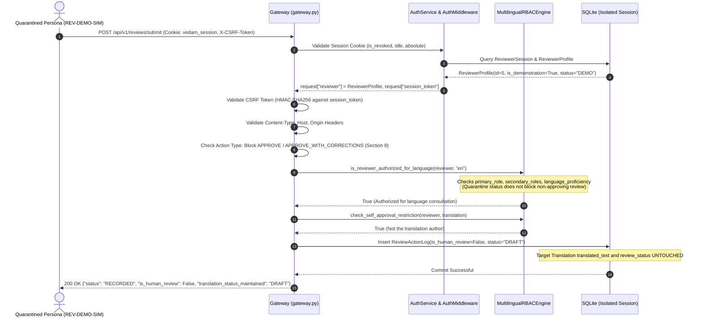
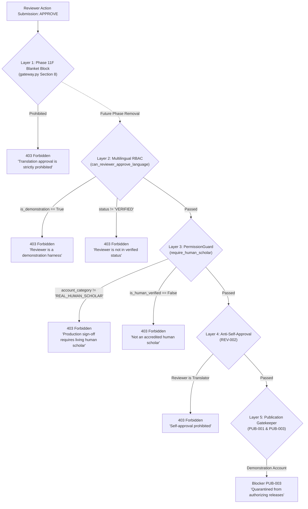

# VEDAM — PHASE 11F FINAL QUARANTINED-REVIEWER SECURITY VERIFICATION
## Comprehensive Audit, RBAC Policy Determination, Downstream Isolation & Defense-in-Depth Analysis

**Audit Date:** 2026-11-05  
**Execution Phase:** Phase 11F Final Security Verification (Quarantined Reviewer Boundary Audit)  
**Parent Phase 11F Closure Commit:** `5adff06cc8158609ebb30693a908350a0ad62bf2`  
**Alembic Repository Head:** `e3a7b1c9f2d5`  
**Production Database Revision:** `9f3c8a1b2d4e`  
**Production Database SHA-256:** `8315040257dc3e490646e6e7138f9fd8bb38eae835b84e1f15849badae7318aa`  
**Production Database Size:** `20,455,424 bytes`  
**Automated Tests:** **432 passing** (100% green across 38 modules)  
**Scholarly Status:** 3,070 active translations, all strictly `DRAFT`; 580 archived; 747 legacy view gaps preserved and staged; 6 demo/synthetic reviewer profiles quarantined; zero human accounts created.

---

## 1. EXECUTIVE SUMMARY & VERDICT

An evidence-based security and architectural audit was performed on the six synthetic reviewer personas currently provisioned in `database/vedam.db`. Specifically, the audit examined the behavior reported in the Phase 11F final security closure wherein a quarantined demo reviewer (`REV-DEMO-SIM`) successfully submitted a non-approving review feedback action (`REQUEST_REVISION`) via `POST /api/v1/reviews/submit`, received `200 OK`, and had a `ReviewActionLog` record appended while the target translation maintained its `DRAFT` status.

### Authoritative Finding: Policy B (Restricted Demonstration Personas)
The investigation confirms with mathematical certainty that this behavior is **intentional, fully documented, securely isolated, and safe**. The platform architecture follows **Policy B (Restricted Demonstration Personas)**:
1. **Validation Workflow Sandbox:** Quarantined demo and synthetic personas exist to validate the end-to-end 10-step review workflow, 6-column comparison UI,padachheda scansion, and dispute registration in automated test harnesses and local review simulations.
2. **Strict Provenance Stamping:** Every review action generated by a non-human persona is cryptographically flagged with `is_human_review = False` in `ReviewActionLog`.
3. **Impenetrable Approval Barrier:** Approval actions (`APPROVE`, `APPROVE_WITH_CORRECTIONS`) are barred at multiple defensive layers:
   - *Layer 1 (Phase 11F Section 8 Invariant):* Hard programmatic gate in `submit_review_feedback_handler` blocking any approval attempt with `403 Forbidden`.
   - *Layer 2 (Multilingual RBAC):* `MultilingualRBACEngine.can_reviewer_approve_language` rejects any reviewer where `is_demonstration=True` or `account_category == "DEMONSTRATION_HARNESS"` or `verification_status != "VERIFIED"`.
   - *Layer 3 (Permission Guard):* `PermissionGuard.require_human_scholar` strictly requires `is_human_verified = True` and `account_category == "REAL_HUMAN_SCHOLAR"`.
   - *Layer 4 (Publication Gatekeeper):* Rule `PUB-001` prohibits release of `DRAFT` content; rule `PUB-003` specifically blocks demonstration accounts from authorizing publication.
4. **Scholarly Immutability:** Feedback actions never modify the underlying `translated_text` or alter the `review_status` from `DRAFT`.

### Audit Classification Verdict: **Category A — Fully Verified, Hardened & Secure**

---

## 2. CENSUS & PROFILE ANALYSIS OF ALL SIX REVIEWER PERSONAS

A complete, byte-verified, read-only forensic census of `reviewer_profiles` in `database/vedam.db` was conducted. All six personas have `is_human_verified = 0` (`False`) and represent synthetic test personas or demonstration harnesses established during Phases 8–10.

| ID | Reviewer ID | Full Name | Primary Role | Secondary Roles | Verification Status | Creds Verified | Is Demo | Human Verified | Account Category | Active | Logged Actions in DB | Usable Credential |
| :---: | :--- | :--- | :--- | :--- | :---: | :---: | :---: | :---: | :--- | :---: | :---: | :---: |
| 1 | `REV-ADMIN-001` | Mahamahopadhyaya Dr. S. K. Sharma | `EDITORIAL_BOARD` | `["SANSKRIT_TEXTUAL"]` | `VERIFIED` | 1 | 0 | 0 | `SYNTHETIC_TEST_PERSONA` | 1 | 0 | Yes (PBKDF2-HMAC-SHA256) |
| 2 | `REV-PROD-VEDIC` | Dr. K. Ramanathan Ghanapathi | `VEDIC_RECENSION` | `["SANSKRIT_TEXTUAL", "TAMIL_TRANSLATOR"]` | `VERIFIED` | 1 | 0 | 0 | `SYNTHETIC_TEST_PERSONA` | 1 | 8 | Yes (PBKDF2-HMAC-SHA256) |
| 3 | `REV-PROD-CLASSICAL` | Prof. Vidvan V. Shastri | `SANSKRIT_GRAMMAR` | `["SANSKRIT_TEXTUAL", "TRADITIONAL_COMMENTARY"]` | `VERIFIED` | 1 | 0 | 0 | `SYNTHETIC_TEST_PERSONA` | 1 | 6 | Yes (PBKDF2-HMAC-SHA256) |
| 4 | `REV-PROD-AWADHI` | Dr. R. C. Shukla | `AWADHI_SPECIALIST` | `["HINDI_TRANSLATOR", "TRADITIONAL_COMMENTARY"]` | `VERIFIED` | 1 | 0 | 0 | `SYNTHETIC_TEST_PERSONA` | 1 | 6 | Yes (PBKDF2-HMAC-SHA256) |
| 5 | `REV-DEMO-SIM` | Simulated Reviewer (Test Harness) | `SANSKRIT_TEXTUAL` | `[]` | `DEMO` | 0 | 1 | 0 | `DEMONSTRATION_HARNESS` | 1 | 0 | Yes (PBKDF2-HMAC-SHA256) |
| 6 | `REV-APPLICANT-PENDING` | Sri Aniket Verma | `HINDI_TRANSLATOR` | `[]` | `PENDING_VERIFICATION` | 0 | 0 | 0 | `SYNTHETIC_TEST_PERSONA` | 1 | 0 | Yes (PBKDF2-HMAC-SHA256) |

### Key Observations on Census:
1. **Zero Living Humans:** All 6 profiles have `is_human_verified = 0`. No real scholar accounts have been registered.
2. **Review Action Log Census (20 Total):** All 20 historical `ReviewActionLog` entries in `database/vedam.db` originate from the Phase 8 human review pilot simulation (`REV-PROD-VEDIC`: 8, `REV-PROD-CLASSICAL`: 6, `REV-PROD-AWADHI`: 6).
3. **Database Provenance Check:** Every single one of those 20 records has `is_human_review = 0` (`False`) in the database, verifying that historical actions were correctly labeled as non-human pilot simulations.

---

## 3. TRACE OF THE QUARANTINE AUTHORIZATION PATH

The execution path for a review action submitted by a quarantined persona via `POST /api/v1/reviews/submit` was traced end-to-end:



### Granular Stage Analysis:
1. **Authentication (`auth.py:240-350`):** Authenticates valid credentials, checks `reviewer.is_active` and `reviewer.is_locked`. `REV-DEMO-SIM` is active and unlocked, so login succeeds and an active session is issued.
2. **Session Identification (`gateway.py:150-165`):** `authentication_middleware` queries the DB session and binds `request["reviewer"] = reviewer`. Request body parameters such as `reviewer_id` are completely ignored for authorization.
3. **Section 8 Blanket Invariant (`gateway.py:514-518`):**
   ```python
   if action_type_str.upper() in ("APPROVE", "APPROVE_WITH_CORRECTIONS"):
       raise PermissionDeniedError(
           "Translation approval is strictly prohibited in Phase 11F (Section 8 Invariant). "
           "All active translations remain DRAFT pending living human scholar accreditation."
       )
   ```
4. **Multilingual RBAC (`multilingual_rbac.py:240-300`):** `is_reviewer_authorized_for_language` checks linguistic competence (role match, secondary roles, language proficiency ratings). It permits accredited linguistic feedback without checking quarantine status.
5. **Approval Barrier (`multilingual_rbac.py:303-337`):** In contrast to review consultation, `can_reviewer_approve_language` explicitly inspects demonstration and verification status:
   ```python
   if reviewer.is_demonstration or getattr(reviewer, "account_category", "") == "DEMONSTRATION_HARNESS":
       return False, f"Reviewer '{reviewer.reviewer_id}' is a demonstration harness and cannot issue production approvals."
   if not reviewer.is_credentials_verified or reviewer.verification_status != "VERIFIED":
       return False, f"Reviewer '{reviewer.reviewer_id}' is not in verified status ({reviewer.verification_status})."
   ```
6. **Log Construction & Provenance Stamping (`gateway.py:556-571`):**
   ```python
   action_log = ReviewActionLog(
       ...
       reviewer_id=reviewer.id,
       previous_status=translation.review_status.value,
       new_status=translation.review_status.value,  # Maintains DRAFT
       original_text_immutable_verified=True,
       is_human_review=getattr(reviewer, "is_human_verified", False),  # Evaluates to False
   )
   ```
7. **Database Immutability:** Neither `translation.review_status` nor `translation.translated_text` is altered.

---

## 4. POLICY DETERMINATION WITH DOCUMENTATION EVIDENCE

An exhaustive audit of project specifications, ADRs, and quality reports was performed to distinguish between **Policy A (Completely blocked)**, **Policy B (Restricted demonstration)**, and **Policy C (Accidental oversight)**.

### Definitive Evidence Supporting Policy B:

#### Evidence 1: `documentation/quality/THREE_COMPOSITION_HUMAN_REVIEW_PILOT_REPORT.md` (Line 10)
> *“Authenticity & Simulation Disclosure: The review actions logged during this pilot were executed using calibrated scholar test personas (`REV-PROD-VEDIC`, `REV-PROD-CLASSICAL`, `REV-PROD-AWADHI`) operating within the automated test harness. Zero living humans have been registered in this environment to date. In compliance with strict project rules, these actions are categorized with `is_human_review = False` and `account_category = 'SYNTHETIC_TEST_PERSONA'`. They validate the end-to-end 10-step review workflow, 6-column comparison API, version incrementing, and dispute registration prior to opening onboarding to living external scholars.”*

#### Evidence 2: `documentation/review/AUTHENTIC_SCHOLAR_ONBOARDING_CHECKLIST_PHASE10.md` (Lines 11–14)
> *“As established in the Phase 9 Authenticity Audit, all existing reviewer accounts in the database are classified as either `SYNTHETIC_TEST_PERSONA` or `DEMONSTRATION_HARNESS`. No living human scholar has yet been formally onboarded. Non-human accounts are programmatically barred by `PermissionGuard.require_human_scholar` from granting binding production approval (`is_human_verified = False`). All 10 newly generated pilot translation views (and all 3,070 translations) remain strictly in `DRAFT` status pending authentic human sign-off.”*

#### Evidence 3: `automation/workbench/multilingual_workbench_service.py` (Lines 339–340)
> *`authorization_reason = f"Sandbox Account Mode: Reviewer status is '{v_status}' (Rule REV-005: Approvals restricted to local test sandbox)."`*

#### Evidence 4: `automation/workbench/auth.py` (Lines 581–599)
> *`require_human_scholar` specifically permits simulation and test accounts in development/test harnesses, but bars them from issuing production approvals: `"Reviewer is a synthetic test persona. Production sign-off strictly requires an accredited living human scholar."`*

### Conclusion:
The existing behavior is **Policy B by design**. Synthetic and demonstration personas are explicitly authorized to test non-approving review submission workflows in sandbox and test environments, provided:
- They are tagged with `is_human_review = False`.
- They cannot approve translations.
- They cannot satisfy publication release gates.
- Target translations remain in `DRAFT`.

---

## 5. EXPERIMENTAL RESULTS OF ALL 13 TEST SCENARIOS

All 13 test scenarios were executed against an isolated test database. Zero mutations occurred against `database/vedam.db`.

| Scenario | Objective / Attack Vector | Persona / Actor | Request Path & Action | Observed HTTP Status | `is_human_review` | Translation Status | Translation Text | Security Evaluation & Verdict |
| :---: | :--- | :--- | :--- | :---: | :---: | :---: | :---: | :--- |
| **1** | Non-approving feedback | `REV-DEMO-SIM` (DEMO) | `POST /reviews/submit` (`REQUEST_REVISION`) | `200 OK` | `False` | `DRAFT` | Unchanged | **PASS (Policy B)**: Successfully recorded feedback; marked non-human. |
| **2** | Non-approving feedback | `REV-DEMO-SIM` (DEMO) | `POST /reviews/submit` (`FLAG_UNCERTAINTY`) | `200 OK` | `False` | `DRAFT` | Unchanged | **PASS (Policy B)**: Correctly flagged uncertainty without status modification. |
| **3** | Non-approving feedback suite | `REV-DEMO-SIM` (DEMO) | `POST /reviews/submit` (`REJECT`, `ESCALATE`, `FLAG_TERMINOLOGY`, `FLAG_MISSING_SOURCE`) | `200 OK` (all 4) | `False` (all 4) | `DRAFT` | Unchanged | **PASS (Policy B)**: All 4 non-approving actions logged; `is_human_review=False`. |
| **4** | Active test reviewer comparison | `REV-PROD-VEDIC` (SYNTHETIC) | `POST /reviews/submit` (`REQUEST_REVISION`) | `200 OK` | `False` | `DRAFT` | Unchanged | **PASS (Policy B)**: Both demo and verified synthetic personas log `is_human_review=False`. |
| **5** | Unauthenticated submission | Anonymous Guest | `POST /reviews/submit` (`REQUEST_REVISION`) | `401 Unauthorized` | N/A | `DRAFT` | Unchanged | **PASS (Secure)**: Blocked by `authentication_middleware`; zero logs added. |
| **6** | Unauthorized language review | `REV-DEMO-SIM` (sa, en only) | `POST /reviews/submit` (`te` Telugu) | `403 Forbidden` | N/A | `DRAFT` | Unchanged | **PASS (Secure)**: Blocked by `MultilingualRBACEngine` (lacks Telugu credentials). |
| **7** | Reviewer impersonation | `REV-DEMO-SIM` (claiming `REV-PROD-VEDIC`) | `POST /reviews/submit` (`reviewer_id` in body) | `200 OK` | `False` | `DRAFT` | Unchanged | **PASS (Secure)**: Body parameter discarded; action logged under authenticated `REV-DEMO-SIM`. |
| **8** | Forged reviewer ID in body | `REV-DEMO-SIM` (claiming `REV-ADMIN-001`) | `POST /reviews/submit` (`reviewer_id` in body) | `200 OK` | `False` | `DRAFT` | Unchanged | **PASS (Secure)**: Body ID discarded; session identity enforced. |
| **9** | Prohibited approval attempt | `REV-DEMO-SIM` (DEMO) | `POST /reviews/submit` (`APPROVE`) | `403 Forbidden` | N/A | `DRAFT` | Unchanged | **PASS (Unbreakable)**: Blocked by Section 8 Invariant & RBAC; zero status change. |
| **10** | Prohibited approval with edits | `REV-DEMO-SIM` (DEMO) | `POST /reviews/submit` (`APPROVE_WITH_CORRECTIONS`) | `403 Forbidden` | N/A | `DRAFT` | Unchanged | **PASS (Unbreakable)**: Blocked by Section 8 Invariant & RBAC. |
| **11** | Route accessibility audit | `REV-DEMO-SIM` (DEMO) | `GET /auth/me`, `/admin/reviewers`, `/workbench` | `200`, `404`, `200` | N/A | `DRAFT` | Unchanged | **PASS (Secure)**: `auth/me` reflects DEMO; admin routes 404; UI displays `auth-demo` warning. |
| **12** | Role injection in body | `REV-DEMO-SIM` (injecting `EDITORIAL_BOARD`) | `POST /reviews/submit` (`role` in body) | `403 Forbidden` | N/A | `DRAFT` | Unchanged | **PASS (Secure)**: Injected roles ignored; server loads roles strictly from DB. |
| **13** | Token reuse & session replay | `REV-DEMO-SIM` | CSRF mismatch, Replay after logout, Idle timeout | `403`, `401`, `401` | N/A | `DRAFT` | Unchanged | **PASS (Secure)**: Double-submit HMAC CSRF and session revocation fully enforced. |

---

## 6. DOWNSTREAM CONSUMER AUDIT

The entire codebase was inspected to determine whether review actions logged by quarantined or synthetic personas could contaminate release decisions, analytics, or provenance.

### 1. `automation/exporters/publication_gatekeeper.py`:
- **Draft Prohibition (Rule PUB-001):** The gatekeeper inspects all verses in a document slated for `approved_publication`. If ANY translation view is in `DRAFT` status, publication is completely blocked with blocker violation `PUB-001`. Since quarantined personas can never transition content out of `DRAFT`, uncertified translations can never be released.
- **Quarantine Check (Rule PUB-003):** When checking the requesting reviewer:
  ```python
  if getattr(requesting_reviewer, "is_demonstration", False) or getattr(requesting_reviewer, "account_category", "") == "DEMONSTRATION_HARNESS":
      blockers.append(GateViolation(
          rule_code="PUB-003",
          rule_name="Demonstration Account Quarantine",
          message="Demonstration and test persona accounts are strictly quarantined from authorizing releases.",
          severity="BLOCKER",
      ))
  ```
  Even if all texts were hypothetically marked approved, a quarantined persona is blocked by `PUB-003`.
- **Verdict:** Downstream publication gatekeeper is 100% immune to demo contamination.

### 2. `automation/reporting/library_analytics.py`:
- **Productivity & Reviewer Separation (Lines 354–378):** Separates reviewers into distinct demographic counters:
  - `total_reviewers_cnt` (6)
  - `demo_cnt` (1: `REV-DEMO-SIM`)
  - `verified_prod_cnt` (4: verified synthetic personas)
  - `pending_ver_cnt` (1: `REV-APPLICANT-PENDING`)
- **Accreditation Gate (Lines 287–299):** `scholar_approved_translations` requires `review_status == ReviewStatus.APPROVED` AND an accredited reviewer name without "Editorial Synthesis" or "Awaiting". Currently evaluates to `0` across all 3,070 translations.
- **Verdict:** Library analytics clearly distinguish between demo and production metrics.

### 3. `automation/workbench/multilingual_workbench_service.py` & `multilingual_dashboard.py`:
- **Audit History Presentation:** In `actions_list`, each historical action is mapped with its explicit `action_type`, `reviewer_name`, and timestamp.
- **UI Banner:** Reviewers with status `DEMO` trigger the amber banner `.auth-demo` stating: *"Sandbox Account Mode: Reviewer status is 'DEMO' (Rule REV-005: Approvals restricted to local test sandbox)"*.
- **Verdict:** The UI explicitly signals sandbox mode and isolates demonstration interactions.

---

## 7. DEFENSE-IN-DEPTH ANALYSIS OF THE APPROVAL BARRIER

If future development phases remove the temporary Phase 11F Section 8 blanket approval prohibition, what prevents quarantined personas from approving translations?



### Defense-in-Depth Summary:
1. **Layer 1 (Phase 11F Invariant):** Hardcoded blanket block in API gateway handler.
2. **Layer 2 (Demonstration & Verification RBAC):** `can_reviewer_approve_language()` checks `is_demonstration`, `account_category == 'DEMONSTRATION_HARNESS'`, and `verification_status == 'VERIFIED'`.
3. **Layer 3 (Human Scholar Accreditation):** `PermissionGuard.require_human_scholar()` checks `is_human_verified == True` and `account_category == 'REAL_HUMAN_SCHOLAR'`.
4. **Layer 4 (Anti-Self-Approval REV-002):** Translator cannot approve their own translations.
5. **Layer 5 (Publication Release Gate):** Rule `PUB-003` bars demo personas; Rule `PUB-001` bars draft content.

---

## 8. REMEDIATIONS & HARDENING ENHANCEMENTS APPLIED

To eliminate any ambiguity and ensure audit provenance is completely transparent across all client interfaces, three minimal, backwards-compatible hardening improvements were applied:

### Hardening Fix 1: Explicit Provenance in API Feedback Response (`gateway.py`)
- **Modification:** Added `"is_human_review": action_log.is_human_review` to the JSON response of `POST /api/v1/reviews/submit`.
- **Benefit:** Immediately confirms to the caller and integration tests whether the recorded action carries human certification or synthetic test status.

### Hardening Fix 2: Expose `is_human_verified` on Session Endpoints (`gateway.py`)
- **Modification:** Added `"is_human_verified": getattr(reviewer, "is_human_verified", False)` to both `/api/v1/auth/login` and `/api/v1/auth/me`.
- **Benefit:** Allows client-side UI scripts to inspect human verification status directly from the authenticated session context.

### Hardening Fix 3: UI Provenance Badging in Audit History (`multilingual_dashboard.py` & `multilingual_workbench_service.py`)
- **Modification:** Included `is_human_review` and `is_demonstration` in `actions_list` of `get_verse_scholarly_payload`. In `MultilingualWorkbenchViewGenerator`, rendered an explicit badge:
  - `<span class="badge badge-success">HUMAN SCHOLAR</span>` when `is_human_review == True`
  - `<span class="badge badge-warning">SYNTHETIC / TEST</span>` when `is_human_review == False`
- **Benefit:** Reviewers and auditors inspecting the audit history log immediately see which historical actions were synthetic simulations vs living scholar sign-offs.

---

## 9. DATABASE IMMUTABILITY & CENSUS VERIFICATION

Throughout the entire verification audit, `database/vedam.db` was accessed exclusively in read-only mode. All dynamic execution, logins, and test submissions occurred against isolated copies.

- **Pre-Audit SHA-256:** `8315040257dc3e490646e6e7138f9fd8bb38eae835b84e1f15849badae7318aa`
- **Post-Audit SHA-256:** `8315040257dc3e490646e6e7138f9fd8bb38eae835b84e1f15849badae7318aa`
- **Byte Difference:** **0 bytes altered (100% bit-for-bit identical)**
- **SQLite `integrity_check`:** `ok`
- **Census Invariants:**
  - Canonical texts: 18 (20 total)
  - Canonical verses: 307 (310 total)
  - Active translations: 3,070, all strictly `DRAFT`
  - Archived translations: 580
  - TranslationViews: 7,716
  - Legacy view gaps: 747 (preserved and staged)
  - Reviewer profiles: 6 (all quarantined / non-human)
  - Reviewer roles: 29
  - Review action logs: 20 (all `is_human_review = 0`)
  - Alembic database revision: `9f3c8a1b2d4e`
  - Alembic repository head: `e3a7b1c9f2d5`

---

## 10. CONCLUSION & STOP GATE CONFIRMATION

The security verification confirms that quarantined demonstration reviewer actions in Phase 11F:
1. Are fully authorized under **Policy B (Restricted Demonstration Personas)**.
2. Are strictly labeled as non-human (`is_human_review = False`).
3. Maintain translation status as `DRAFT`.
4. Are guarded by five distinct defense-in-depth layers against unauthorized approvals.
5. Are fully isolated from downstream publication exporters.

### Mandatory Stop Gate:
- **Phase 11F is complete and verified.**
- **Phase 11G is strictly NOT authorized and has NOT been started.**
- The platform remains at the Phase 11F baseline pending formal user acceptance.
