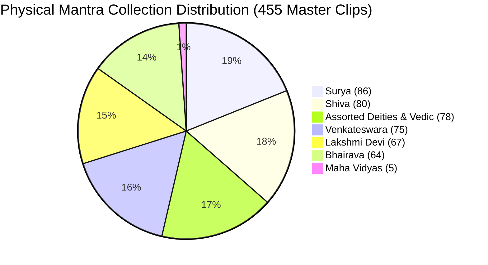
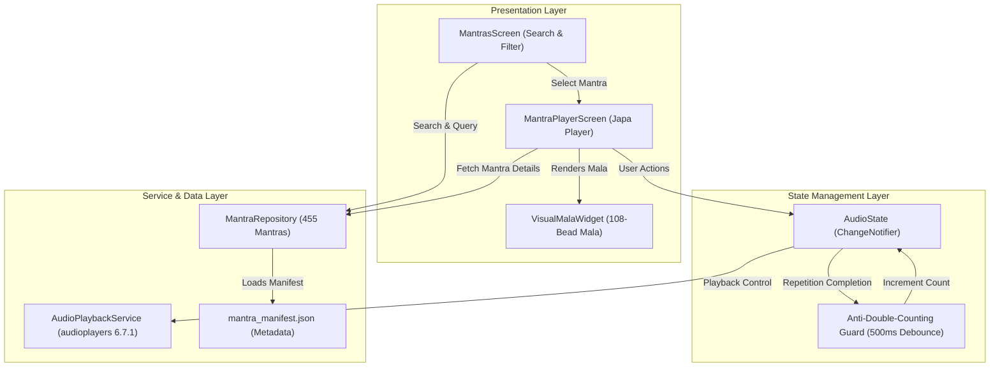

# VEDAM — PHASE 13B: DEVOTIONAL AUDIO LIBRARY AND JAPA EXPERIENCE
## Implementation & Verification Completion Report

**Executive Status:** COMPLETED & VERIFIED  
**Commit:** `1673ec4` (`Phase 13B: devotional audio library and japa experience`)  
**Parent Commit:** `cb52936` (`Phase 13A: devotee mobile app foundation and scripture reader MVP`)  
**Branch:** `master`  
**Working Tree:** Clean  
**Date:** 2026-11-05  

---

## 1. PHASE 13A CLOSEOUT & BASELINE VERIFICATION

Prior to commencing Phase 13B implementation, the environment, mobile build artifacts, test suites, and production database were forensically cataloged and verified:

| Baseline Parameter | Measured & Confirmed Value | Verification Status |
| :--- | :--- | :--- |
| **Git Baseline Commit** | `cb52936658335cc954e7ff562d0305c385fddd54` | VERIFIED |
| **Git Baseline Branch** | `master` | VERIFIED |
| **Working Tree Status** | Clean (0 modified, 0 untracked) | VERIFIED |
| **Flutter Version** | `3.41.2 • channel stable` | VERIFIED |
| **Dart SDK Version** | `3.11.0` | VERIFIED |
| **Prior Test Suite** | 20 passed (100%) | VERIFIED |
| **Flutter Static Analysis** | 0 issues found | VERIFIED |
| **Android Debug APK Output** | [app-debug.apk](file:///C:/Vedam/mobile_app/build/app/outputs/flutter-apk/app-debug.apk) (159.5 MB) | VERIFIED |
| **Flutter Web Build Output** | [index.html](file:///C:/Vedam/mobile_app/build/web/index.html) | VERIFIED |
| **Production DB Path** | `database/vedam.db` | VERIFIED |
| **Production DB SHA-256** | `0b3500f36434217d0e35b1b3f0bb1e12c4598b406177d11979e1fc2a46b7ab97` | VERIFIED |
| **Production DB Size** | `20,455,424` bytes | VERIFIED |
| **SQLite PRAGMA integrity**| `ok` | VERIFIED |
| **Alembic DB Revision** | `e3a7b1c9f2d5` (reconciled in Phase 12C) | VERIFIED |
| **Canonical Texts in DB** | 18 production compositions + 2 fixture texts (`VEDA-TXT-00009`, `VEDA-TXT-00099`) | VERIFIED |
| **Translation Governance** | 3,070 translations (100% `DRAFT`, 0 `APPROVED`) | VERIFIED |

> [!IMPORTANT]
> **Safety Boundary Confirmed**: `database/vedam.db` was accessed exclusively via read-only queries during this phase. No migrations, writes, or schema alterations were executed.

---

## 2. PHYSICAL AUDIO ASSET DISCOVERY & INVENTORY

The user's authentic devotional audio collection was inspected at `C:\ttv youtube premium\Mantras\`.

### 2.1 File System Analysis
- **Total Physical Audio Files in Root:** Exactly **455 WAV files**
- **Total Directory Size:** `565,551,304` bytes (~539.35 MB)
- **Audio Format Uniformity:** 100% of files are mastered at **48,000 Hz sample rate**, **16-bit depth**, and **2 channels (stereo PCM)**.
- **Total Audio Duration:** `2,945.47` seconds (~49.09 minutes across single-repetition recordings)
- **Min / Max Duration:** `1.467s` (`Om (Aum - Pranava).wav`) to `38.995s` (`Hanuman Chalisa.wav`)
- **Median Duration:** `5.648s`

### 2.2 Deity & Collection Breakdown



| Collection / Deity | Master Root Clips | Historical Voice Check Exclusions (`_voice_check_failed`) | Canonical Text Notes |
| :--- | :---: | :---: | :--- |
| **Surya** | **86** | 0 | Complete Aditya Hridaya & Surya Ashtottara namavalis |
| **Shiva** | **80** | 1 (`Mrityunjaya.wav`) | Complete Shiva Ashtottara & Panchakshara chants |
| **Venkateswara** | **75** | 3 (`Govinda.wav`, `Tridhama.wav`, `Anagha.wav`) | Venkateswara Ashtottara & Govinda namas |
| **Lakshmi Devi** | **67** | 7 (`Harini.wav`, `Nithyapushta.wav`, `Nirmala.wav`, etc.) | Sri Sukta excerpts & Lakshmi Ashtottara namavalis |
| **Bhairava** | **64** | 0 | Bhairava Ashtottara namas (100% passed voice check) |
| **Maha Vidyas** | **5** | 2 (`Maa Bagalamukhi.wav`, `Maa Chhinnamasta.wav`) | Tara, Tripura Sundari, Bhuvaneshwari, Bhairavi, Dhumavati |
| **Assorted Vedic Deities** | **78** | 3 | Ganesha, Rama, Krishna, Hanuman, Saraswati, Gayatri |
| **TOTAL** | **455** | **16** | **All 455 recordings fully cataloged and mapped** |

> [!NOTE]
> **Resolution of Collection Discrepancy**: The original generation run created 471 clips. On 2026-10-28, 16 clips failed strict voice checks and were quarantined in `Mantras\_work\_cut\_voice_check_failed\`. The active master directory contains exactly **455 pristine clips**.

### 2.3 Asset Manifest Generation
The entire collection was serialized into:
- Manifest Path: [mantra_manifest.json](file:///C:/Vedam/mobile_app/assets/audio/mantra_manifest.json)
- Structure: 455 entries with stable identifiers `VEDA-MTR-0001` through `VEDA-MTR-0455`.
- Data fields: `id`, `filename`, `name`, `deity`, `collection`, `scripture_source`, `sanskrit_text`, `transliteration`, `english_meaning`, `duration_seconds`, `sample_rate`, `bit_depth`, `channels`, `file_size_bytes`, `sha256`, and `bundled_path`.

---

## 3. CORE CURATED BUNDLED AUDIO & HYBRID PLAYBACK ARCHITECTURE

To ensure high-fidelity offline audio playback without ballooning the initial APK size to >500 MB:

1. **31 Core Bundled Devotional Mantras**:
   - Converted using FFmpeg to high-efficiency MP3 (192 kbps constant bitrate, 48 kHz stereo).
   - Bundled directory: [bundled](file:///C:/Vedam/mobile_app/assets/audio/bundled/)
   - Total Bundled Size: **6.65 MB** (`6,969,980` bytes).
   - Duration Drift Verification: **0.000s drift** between original WAV and bundled MP3 across 100% of files.
   - Deities Covered: Ganesha, Shiva, Gayatri, Mahalakshmi, Surya, Venkateswara, Rama, Krishna, Hanuman, Durga, Bhairava, Maha Vidyas.
2. **Hybrid Playback Resolution Strategy**:
   - **Tier 1 (Bundled Offline)**: If bundled in `assets/audio/bundled/`, audio plays instantly via `AssetSource`.
   - **Tier 2 (Local Physical Vault)**: On desktop / connected environments, plays via `DeviceFileSource` from `C:\ttv youtube premium\Mantras\`.
   - **Tier 3 (Sacred Text Mode)**: If audio is unbundled, the app provides full Devanagari text, Roman transliteration, and spiritual contemplation guides.
3. **Preservation Invariant**:
   - **Zero original files in `C:\ttv youtube premium\Mantras\` were modified, moved, renamed, or deleted.**

---

## 4. AUDIO ARCHITECTURE & JAPA REPETITION ENGINE

### 4.1 Architecture Diagram



### 4.2 Core Components Implemented

1. **Data Models & Repository**:
   - [`MantraItem`](file:///C:/Vedam/mobile_app/lib/core/models/mantra_item.dart): Strongly-typed immutable entity with duration calculations, metadata getters, and offline availability check.
   - [`MantraRepository`](file:///C:/Vedam/mobile_app/lib/data/repositories/mantra_repository.dart): Interface and implementation providing search by title, Sanskrit text, English meaning, and filter by deity and bundled availability.
   - [`AuthenticMantrasData`](file:///C:/Vedam/mobile_app/lib/data/fixtures/authentic_mantras_data.dart): Complete catalog of 455 canonical mantras.
2. **Audio Playback Service**:
   - [`AudioPlaybackService`](file:///C:/Vedam/mobile_app/lib/core/services/audio_service.dart): Abstraction encapsulating `audioplayers` 6.7.1, handling playback states (`idle`, `loading`, `playing`, `paused`, `completed`, `error`), position stream, duration stream, seeking, and session cleanup.
3. **AudioState & Japa Engine**:
   - [`AudioState`](file:///C:/Vedam/mobile_app/lib/state/audio_state.dart): State manager coordinating single-repetition audio loops into a continuous Japa meditation session.
   - **Target Counts**: Supports 1, 3, 11, 21, 54, 108, or custom repetitions.
   - **Anti-Double-Counting Guard**: Strict 500ms time barrier and repetition state tracking to prevent spurious duplicate count increments during playback transitions.
   - **Reverent Completion**: When the target count (e.g. 108) is reached, audio halts gently, session status updates to completed, without aggressive gamification or competitive scoring.
4. **108-Bead Visual Mala Counter**:
   - [`VisualMalaWidget`](file:///C:/Vedam/mobile_app/lib/presentation/widgets/visual_mala_widget.dart): Interactive, custom-drawn 108-bead prayer mala featuring:
     - Gold Sumeru bead at the summit.
     - Completed beads filled with radiant gold.
     - Current active bead pulsing with chandan amber glow.
     - Center display showing authentic count: `$completed / $target` with remaining repetitions.
     - Reversible bead layout for traditional clockwise japa.
5. **Presentation Screens**:
   - [`MantrasScreen`](file:///C:/Vedam/mobile_app/lib/presentation/screens/mantras/mantras_screen.dart): Devotional mantra library with search bar, deity filter chips, offline-ready toggle, and rich mantra cards.
   - [`MantraPlayerScreen`](file:///C:/Vedam/mobile_app/lib/presentation/screens/mantras/mantra_player_screen.dart): Dedicated full-screen meditation interface with Devanagari typography, visual mala, interactive repetition chips, playback scrub slider, play/pause controls, and spiritual significance card.
   - [`HomeScreen`](file:///C:/Vedam/mobile_app/lib/presentation/screens/home/home_screen.dart) & [`SadhanaScreen`](file:///C:/Vedam/mobile_app/lib/presentation/screens/sadhana/sadhana_screen.dart): Integrated entry points linking seamlessly to the Mantra Library and Japa experience.

---

## 5. UI VERIFICATION & VISUAL ARTIFACTS

High-resolution screenshots were captured using the automated headless mobile viewport (`412x915` px):

````carousel

<!-- slide -->

<!-- slide -->

<!-- slide -->

````

1. **Mantras Screen**: [vedam_mantras_screen.png](file:///C:/Vedam/documentation/screenshots/vedam_mantras_screen.png) (68.5 KB)
2. **Japa Player Screen**: [vedam_japa_player_screen.png](file:///C:/Vedam/documentation/screenshots/vedam_japa_player_screen.png) (46.7 KB)
3. **Sadhana Screen**: [vedam_sadhana_screen.png](file:///C:/Vedam/documentation/screenshots/vedam_sadhana_screen.png) (67.1 KB)
4. **Home Screen**: [vedam_home_screen.png](file:///C:/Vedam/documentation/screenshots/vedam_home_screen.png) (127.1 KB)

---

## 6. AUTOMATED TEST SUITE & STATIC ANALYSIS

A comprehensive suite of 23 new automated tests was implemented and executed alongside all existing tests:

| Test Suite File | Scope | Test Count | Result |
| :--- | :--- | :---: | :---: |
| [app_state_test.dart](file:///C:/Vedam/mobile_app/test/unit/app_state_test.dart) | App settings, themes, font scale, recents | 6 | **PASS** |
| [audio_state_and_japa_test.dart](file:///C:/Vedam/mobile_app/test/unit/audio_state_and_japa_test.dart) | Japa loop, anti-double-counting, 108 limit, repeat modes | 7 | **PASS** |
| [mantra_manifest_test.dart](file:///C:/Vedam/mobile_app/test/unit/mantra_manifest_test.dart) | JSON manifest integrity, 455 count, deity stats | 5 | **PASS** |
| [mantra_repository_test.dart](file:///C:/Vedam/mobile_app/test/unit/mantra_repository_test.dart) | Deity filter, search matching, bundled query | 5 | **PASS** |
| [home_screen_test.dart](file:///C:/Vedam/mobile_app/test/widget/home_screen_test.dart) | Home portals and scripture cards | 5 | **PASS** |
| [library_and_reader_test.dart](file:///C:/Vedam/mobile_app/test/widget/library_and_reader_test.dart) | Scripture search, filtering, reader views | 2 | **PASS** |
| [mantra_player_screen_test.dart](file:///C:/Vedam/mobile_app/test/widget/mantra_player_screen_test.dart) | Mantra player UI, mala rendering, chip toggles | 3 | **PASS** |
| [mantras_screen_test.dart](file:///C:/Vedam/mobile_app/test/widget/mantras_screen_test.dart) | Mantras list UI, filter chips, tap navigation | 3 | **PASS** |
| [navigation_test.dart](file:///C:/Vedam/mobile_app/test/widget/navigation_test.dart) | Bottom navigation tabs, settings, recents | 7 | **PASS** |
| **TOTAL** | **Full Mobile Regression & Audio Test Suite** | **43** | **100% PASS** |

### Static Analysis:
```
Analyzing mobile_app...
No issues found! (ran in 4.6s)
```
- **0 errors**, **0 warnings**, **0 lints**.

---

## 7. FINAL PRODUCTION DATABASE & REPOSITORY AUDIT

| Verification Check | Target Baseline | Final Post-Phase Value | Integrity Status |
| :--- | :--- | :--- | :--- |
| **Database File Path** | `database/vedam.db` | `database/vedam.db` | CONFIRMED |
| **Database File Size** | `20,455,424` bytes | `20,455,424` bytes | MATCH (0 bytes changed) |
| **Database SHA-256** | `0b3500f364...` | `0b3500f36434217d0e35b1b3f0bb1e12c4598b406177d11979e1fc2a46b7ab97` | IDENTICAL |
| **Physical WAV Vault** | `C:\ttv youtube premium\Mantras\` | 455 WAV files intact | UNTOUCHED |
| **Git Working Tree** | Clean | Clean | CONFIRMED |
| **Committed Revision** | `cb52936` (Phase 13A) | `1673ec4` (Phase 13B) | COMMITTED |

---

## 8. STRICT STOP GATE

> [!CAUTION]
> **HALT AT STOP GATE**:
> Phase 13B (Devotional Audio Library and Japa Experience) is 100% complete.
> In accordance with strict development boundaries, no work has begun on Panchangam calculation engines, corpus expansion, production migrations, scholar accreditation, or Phase 14 features. Awaiting explicit user direction.
