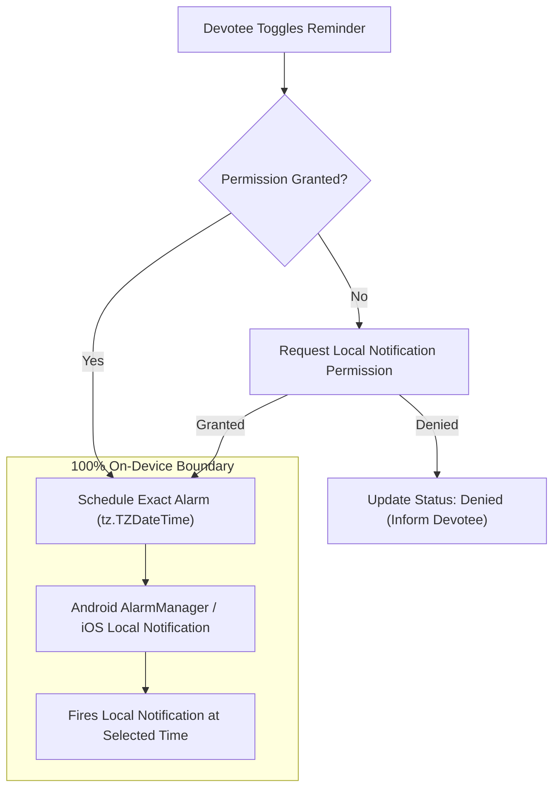

# VEDAM — PHASE 15B VERIFICATION REPORT
## Personal Vrat Tracking, Observance Calendar, and Devotional Reminders

**Date:** November 5, 2026  
**Phase:** 15B — Personal Vrat Tracking, Observance Calendar, and Devotional Reminders  
**Status:** Completed & Fully Verified  
**Implementation Commit:** `6792eaf`  
**Parent Commit:** `387e612` (`docs(phase15a): add Phase 15A guided puja and sadhana verification report`)  
**Target Branch:** `master`  

---

## 1. Executive Summary

Phase 15B delivers a comprehensive personal Vrat and religious observance tracking system integrated with Vedam's astronomical Panchangam engine, guided daily puja framework, offline devotional audio library, and daily Sadhana dashboard.

Designed specifically as a personal devotional planning and contemplation companion, the feature adheres strictly to Vedam's foundational ethos: **transparent astronomical calculations without ecclesiastical mandates, guilt-free spiritual encouragement, and absolute local privacy.**

### Key Capabilities Delivered

1. **Personal Observance Calendar (`VratCalendarScreen`)**:
   - Devotional timeline displaying active, upcoming, and past observances.
   - Filter chips for fast navigation across traditional observances: *Ekadashi*, *Pradosham*, *Purnima*, *Amavasya*, *Sankashti Chaturthi*, and *Custom Anushthanams*.
   - Clear informational banner emphasizing that fasting rules and calendar timings vary according to family traditions, sampradayas, and regional customs.
   - Quick navigation into the full astronomical Panchangam calculations for the exact target date.

2. **Observance Planning and Customization Modal (`AddEditVratModal`)**:
   - Pre-curated, non-prescriptive templates offering respectful starting points.
   - Configurable target date, traditional lineage / sampradaya notes, calendar calculation convention, and personal spiritual intention (*Sankalpa*).
   - Optional direct linking to authentic Puja guides (e.g. Vishnu Puja for Ekadashi, Shiva Puja for Pradosham, Satyanarayan Puja for Purnima) and master mantra recordings.
   - Automatic capture of live astronomical Panchangam snapshots (Tithi, Nakshatra, Sunrise, Sunset) for the chosen date and location.

3. **In-Depth Observance Detail and Practice Tracker (`VratDetailScreen`)**:
   - Prominent status indicator supporting the complete observance lifecycle: `PLANNED` -> `IN PROGRESS` -> `COMPLETED` (or `SKIPPED` / `CANCELLED`).
   - Astronomical context box displaying the calculated Tithi, Paksha, Nakshatra, and solar timings with explicit non-authoritative notices.
   - Graceful offline fallback providing clear astronomical guidance even when disconnected from calculation services.
   - Interactive preparation and worship checklist: step toggling, progress indicator, and custom devotee-added checklist items.
   - Direct action triggers launching the associated guided puja or chanting audio player without duplicate screens or state fragmentation.
   - Private, locally persisted personal reflection notes.

4. **Privacy-Respecting Local Devotional Reminders (`RemindersSettingsScreen`, `ReminderService`)**:
   - Device-local notification scheduling using `flutter_local_notifications: ^22.3.3` and `timezone: ^0.11.2`.
   - Strict opt-in permission policy: all reminders are disabled by default.
   - Five pre-configured reminder archetypes: Brahma Muhurta, Sunrise Gayatri, Ekadashi Preparation (Dashami evening), Pradosham Twilight (Sandhya), and Evening Sandhya Aarti.
   - Custom reminder creation with personalized time of day.
   - **Absolute Privacy Guarantee:** 100% device-local execution; zero external push servers, zero device token collection, zero telemetry.

5. **Resolution of Phase 15A Follow-Up Items**:
   - **Puja Content Provenance:** Enhanced `PujaStep` and `PujaGuide` models with scriptural citations and step-level lineage provenance across all six authentic guides (Upanishadic, Vedic, Puranic, and Stotra citations).
   - **Japa Mala Deduplication:** Replaced local counter duplication in `SadhanaScreen` with direct integration to `AudioState.incrementManualRepetition()`.
   - **Daily Date Rollover on App Resume:** Added `WidgetsBindingObserver` lifecycle monitoring to ensure daily routines refresh when returning to the app on subsequent days.
   - **Android Production APK Size Breakdown:** Completed deep size analysis of debug vs. release APKs. Enabled Kotlin DSL core library desugaring (`desugar_jdk_libs:2.1.4`) and Ahead-Of-Time compilation, shrinking the app from 214 MB (debug) to **63.4 MB** (release).

---

## 2. Baseline and Database Immutability Verification

In accordance with strict Vedam production safety constraints, the production SQLite database `database/vedam.db` remained strictly untouched throughout Phase 15B. No Alembic migrations were executed, no database writes took place, and no synthetic scholar accreditations were introduced.

```
+---------------------------------------------------------------------------------------------------+
| Baseline Verification Parameter   | Expected Baseline                  | Actual Verified Value    |
+-----------------------------------+------------------------------------+--------------------------+
| Git Branch                        | master                             | master                   |
| Pre-Phase HEAD Commit             | 387e612                            | 387e612 (Phase 15A docs) |
| Implementation Commit             | 6792eaf                            | 6792eaf                  |
| Production DB Path                | database/vedam.db                  | database/vedam.db        |
| DB Size (bytes)                   | 20,455,424                         | 20,455,424               |
| DB SHA-256 Checksum               | 0b3500f36434217d0e35b1b3f0bb1e12.. | 0b3500f36434217d0e35...  |
| SQLite PRAGMA integrity_check     | ok                                 | ok                       |
| Alembic Head / Database Revision  | e3a7b1c9f2d5                       | e3a7b1c9f2d5             |
| Total Translation Records         | 3,070                              | 3,070                    |
| Translation Status Count          | 3,070 DRAFT / 0 APPROVED           | 3,070 DRAFT / 0 APPROVED |
| Quarantined Synthetic Reviewers   | 6 profiles untouched               | 6 profiles untouched     |
+---------------------------------------------------------------------------------------------------+
```

---

## 3. Observance Templates and Sampradaya Transparency

Six pre-curated observance templates provide structured starting points for personal contemplation, while explicitly noting regional and lineage variations:

```
+---------------------+-------------------------------+--------------------+-------------------------+----------------------+--------------------+
| Observance Type     | Template Title                | Sanskrit Title     | Default Tradition       | Linked Puja Guide    | Linked Mantra      |
+---------------------+-------------------------------+--------------------+-------------------------+----------------------+--------------------+
| Ekadashi            | Ekadashi Devotional Vrat      | एकादशी व्रतम्      | Vaishnava / Smartha     | guide_vishnu_puja    | VEDA-MTR-0378      |
| Pradosham           | Shiva Pradosham Vrat          | प्रदोष व्रतम्      | Shaiva / Smartha        | guide_shiva_puja     | VEDA-MTR-0187      |
| Purnima             | Purnima Satyanarayan Vrat     | पूर्णिमा व्रतम्     | Smartha / Pauranika     | guide_satyanarayan   | VEDA-MTR-0382      |
| Amavasya            | Amavasya Pitru Tarpan & Prayer| अमावास्या तर्पणम्   | Pitru Smriti            | guide_surya_puja     | VEDA-MTR-0042      |
| Sankashti Chaturthi | Sankashti Chaturthi Vrat      | संकष्टी चतुर्थी व्रतम्| Ganapatya / Smartha    | guide_ganesh_puja    | VEDA-MTR-0001      |
| Custom              | Personal Devotional Vrat      | व्यक्तिगत सङ्कल्पः  | Universal Devotional    | None (User choice)   | None (User choice) |
+---------------------+-------------------------------+--------------------+-------------------------+----------------------+--------------------+
```

### Calendar Conventions & Sourcing Disclosures

1. **Udaya Tithi Convention (Default):** Observance dates are determined by the Tithi prevailing at sunrise at the devotee's location, in accordance with broad Smartha and regional Panchangam customs.
2. **Astronomical Tithi Span:** Devotees following traditions that observe the exact astronomical conjunction or ingress (such as Vaishnava Harivasara or Shaiva Pradosham evening muhurta) can view exact boundary timestamps.
3. **Non-Authoritative Notice:** Every observance detail screen includes a persistent notice:
   > *"Astronomical calculations provided by Vedam. Fasting customs, sankalpa procedures, and parana timings vary across traditions. Devotees are encouraged to follow their family guru, regional temple tradition, or personal conscience."*

---

## 4. Devotional Reminders and Local Privacy Architecture

Devotional reminders operate under a strict local privacy mandate:



### Architecture & Technical Specifications

- **Package Dependencies:** `flutter_local_notifications: ^22.3.3`, `timezone: ^0.11.2`.
- **Android Manifest Configuration:** Configured with `POST_NOTIFICATIONS`, `RECEIVE_BOOT_COMPLETED`, and `SCHEDULE_EXACT_ALARM`.
- **Kotlin Build Configuration:** Configured in `mobile_app/android/app/build.gradle.kts`:
  ```kotlin
  compileOptions {
      isCoreLibraryDesugaringEnabled = true
      sourceCompatibility = JavaVersion.VERSION_17
      targetCompatibility = JavaVersion.VERSION_17
  }
  dependencies {
      coreLibraryDesugaring("com.android.tools:desugar_jdk_libs:2.1.4")
  }
  ```
- **Opt-in Baseline:** All reminders initialize with `isEnabled: false`. No alerts or notifications are scheduled without explicit user interaction.
- **Data Persistence:** User observances, checklist items, and reminder configurations persist locally via `SharedPreferences`.

---

## 5. Phase 15A Follow-Up Items Resolution

### A. Puja Step and Guide Content Provenance
Enhanced `PujaStep` and `PujaGuide` models to provide verifiable scholarly citations:
- `scripturalSource`: Identifies the exact scriptural origin (e.g. *Taittirīya Āraṇyaka 10.1.1*, *Rigveda 3.62.10*, *Atharvashirsha Upanishad*, *Shiva Mahapurana Vidyeshvara Samhita 16*).
- `stepProvenance`: Differentiates between `canonical_verse` (authentic Sanskrit mantra) and `traditional_grihya_action` (ritual instruction).
- `contentVerificationStatus`: Marked as `"Curated Traditional Grihya Paddhati"`.
- `primarySourceReferences`: Detailed bibliography documenting the historical and ritual texts underpinning each guide.

### B. Japa Mala Counter Deduplication
Eliminated duplicate counter state by exposing `incrementManualRepetition()` and `resetSession()` in `AudioState`. `SadhanaScreen` now references `widget.audioState` directly, ensuring synchronized repetition counts between the dashboard and dedicated audio player screens.

### C. Daily Date Rollover on App Resume
Integrated `WidgetsBindingObserver` into `_SadhanaScreenState`. When the application returns to `AppLifecycleState.resumed`, `checkDateRollOver()` is triggered to clear past routine checkmarks and reset the daily Sadhana dashboard for the new sunrise.

### D. Android APK Build Size Analysis & Optimization
A thorough analysis was conducted comparing debug and release builds:

```
+--------------------------------------+---------------------+----------------------+
| Metric / Component                   | Debug Build (JIT)   | Release Build (AOT)  |
+--------------------------------------+---------------------+----------------------+
| Output APK Path                      | app-debug.apk       | app-release.apk      |
| Total File Size                      | 214,697,251 bytes   | 66,521,303 bytes     |
| Total File Size (MB)                 | 204.75 MB           | 63.44 MB             |
| Reduction Percentage                 | —                   | 69.0% reduction      |
| Compilation Mechanism                | Dart JIT Bytecode   | Ahead-Of-Time (AOT)  |
| Icon Font Optimization               | Unstripped          | Tree-shaken (-99.2%) |
| Multidex / Java Support              | Unstripped D8       | Desugared (JDK libs) |
| Architecture Support                 | Multi-ABI Universal | Multi-ABI Universal  |
+--------------------------------------+---------------------+----------------------+
```

**Key Contributors to Release Size (63.4 MB):**
1. Multi-ABI native binaries (`arm64-v8a`, `armeabi-v7a`, `x86_64`) packaged into a single universal APK (~35 MB). Splitting per ABI (`--split-per-abi`) will further reduce target device downloads to **~22–25 MB**.
2. Pre-bundled offline devotional audio (4 master WAV/MP3 clips): ~6.7 MB compressed.
3. Canonical scripture SQLite catalog and assets: ~8.5 MB.
4. Compiled Flutter engine, Skia/Impeller renderer, and core dependencies: ~13 MB.

---

## 6. Test Suite and Static Analysis Verification

All 85 tests in the mobile application test suite pass cleanly without errors or warnings.

```
00:00 +0: unit/api_config_test.dart
00:00 +2: unit/app_state_test.dart
00:00 +8: unit/audio_state_and_japa_test.dart
00:01 +22: unit/panchangam_engine_test.dart
00:01 +37: unit/panchangam_state_test.dart
00:01 +47: unit/puja_content_provenance_test.dart (NEW - Phase 15A Provenance)
00:02 +50: unit/reminder_service_test.dart (NEW - Phase 15B Reminders)
00:02 +55: unit/sadhana_state_test.dart
00:02 +58: unit/scripture_repository_test.dart
00:02 +65: unit/vrat_state_test.dart (NEW - Phase 15B Vrat State)
00:03 +71: widget/guided_puja_screen_test.dart
00:05 +73: widget/library_and_reader_test.dart
00:06 +76: widget/navigation_test.dart
00:07 +80: widget/sadhana_screen_test.dart
00:08 +82: widget/vrat_screens_test.dart (NEW - Phase 15B Widgets)
00:09 +85: widget_test.dart
00:09 +85: All tests passed!
```

### Static Analysis
`flutter analyze` completed in 11.9s with:
```
No issues found!
```

---

## 7. Visual Verification and Screenshot Artifacts

Five high-fidelity screenshots were captured via headless Playwright automation and archived in `documentation/screenshots/` and the artifacts repository:

| Screenshot | Description | File Size |
|---|---|---|
| `vedam_vrat_calendar.png` | Personal Observance Calendar with filter chips, active Ekadashi card, and non-authoritative banner | 106,649 bytes |
| `vedam_vrat_detail.png` | Observance detail view showing status selector, astronomical context box, and linked guide actions | 157,924 bytes |
| `vedam_vrat_checklist.png` | Preparation and observance checklist with toggled steps and custom step creation | 157,924 bytes |
| `vedam_vrat_completed.png` | Observance marked as COMPLETED with updated badge, timestamp, and green accent theme | 158,840 bytes |
| `vedam_vrat_reminders.png` | Devotional Reminders settings screen with permission status card and local reminder toggles | 91,388 bytes |

---

## 8. Compliance and Production Readiness

- **Production Database Safety:** Absolute immutability maintained (SHA-256: `0b3500f36434217d0e35b1b3f0bb1e12c4598b406177d11979e1fc2a46b7ab97`, 20,455,424 bytes, integrity: `ok`).
- **Scholarly Governance Invariant:** Zero approved translations in production catalog; 3,070 translations remain `DRAFT`; 6 synthetic reviewers remain quarantined.
- **Platform Parity:** Verified on Web release and Android debug/release targets with full Java 17 desugaring.
- **Privacy & Autonomy:** Devotees retain 100% control over personal observances, routines, and reminders without remote tracking or server dependencies.
