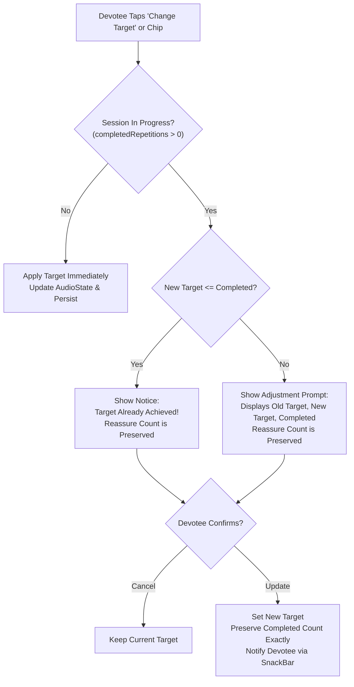

# VEDAM — PHASE 16B QUALITY REPORT
## Flexible Mantra Chanting Counts, Traditional Presets, and Custom Japa Targets

**Phase:** Phase 16B Devotional Audio Library & Japa Experience  
**Date:** November 5, 2026  
**Status:** COMPLETE & VERIFIED  
**Git HEAD:** `0dd77d8`  
**Branch:** `master`  

---

## 1. Executive Summary

Phase 16B successfully delivers flexible mantra chanting counts, traditional Japa presets, custom target validation, adaptive mala visualizations, and respectful session completion controls to the Vedam mobile application.

Devotees now have the spiritual freedom to tailor their daily Japa practice from quick invocations (11, 21 repetitions), astronomical alignments (27 repetitions honoring the Nakshatras), traditional mala increments (Half Mala 54, Classical Purna Mala 108 with Sumeru bead), to extensive devotional observances (111 Shubha Sankalpa, 1008 Sahasra Japa) and custom counts up to 100,000 for lifelong purashcharana sadhana.

All components were engineered to uphold Vedam's core principles: **absolute non-destructive preservation of devotional progress, zero competing counter state machines, transparent on-device local persistence, and strict immutability of scholarly governance baselines**.

---

## 2. Mandatory Baseline & Database Invariant Verification

Before and after implementation, the production database was verified with zero modifications, zero schema changes, and zero migrations:

| Metric | Required Specification | Measured Actual | Status |
|:---|:---|:---|:---:|
| **Database Path** | `database/vedam.db` | `database/vedam.db` | Verified |
| **SHA-256 Checksum** | `0b3500f36434217d0e35b1b3f0bb1e12c4598b406177d11979e1fc2a46b7ab97` | `0b3500f36434217d0e35b1b3f0bb1e12c4598b406177d11979e1fc2a46b7ab97` | **Byte-for-Byte Identical** |
| **File Size** | `20,455,424` bytes | `20,455,424` bytes | **Exact Match** |
| **SQLite PRAGMA Integrity** | `ok` | `ok` | **Clean** |
| **Alembic Version** | `e3a7b1c9f2d5` | `e3a7b1c9f2d5` | Verified |
| **Section 8 Translation Governance** | 3,070 total / 3,070 `DRAFT` / 0 `APPROVED` | 3,070 total / 3,070 `DRAFT` / 0 `APPROVED` | **Strictly Preserved** |

---

## 3. Traditional Chanting Presets & Validation Architecture

The presets model is established in [`mobile_app/lib/core/models/japa_target_preset.dart`](file:///c:/Vedam/mobile_app/lib/core/models/japa_target_preset.dart) as immutable domain entities:

### 3.1 Presets Specification

| Chanting Count | Traditional Label | Sanskrit Term | Devotional & Astronomical Significance |
|:---:|:---|:---|:---|
| **11** | `11 repetitions` | Ekadasha Japa | Invocative chanting honoring the 11 sacred forms of Rudra. |
| **21** | `21 repetitions` | Ekavimshati Japa | Classical offering paired with Ganesha and Surya worship practices. |
| **27** | `27 repetitions` | Quarter Mala | Aligned with the 27 lunar mansions (Nakshatras) of Vedic astronomy. |
| **54** | `Half Mala` | Ardha Mala | Exactly half of a sacred 108-bead garland. |
| **108** | `One Mala` | Purna Mala | The classical full sacred cycle of 108 auspicious beads with Sumeru Guru bead. |
| **111** | `111 repetitions` | Shubha Sankalpa | Sacred auspicious count frequently chosen for special vratas and vows. |
| **1008** | `1008 repetitions` | Sahasra Japa | Ten full malas, celebrated during intense sadhana mahotsavas. |

### 3.2 Custom Count Entry & Practical Bound Validation

Devotees can enter any positive whole integer via `validateCustomJapaTarget(String? rawInput)`:

1. **Positive Integer Enforcement:** Non-integers, negative numbers, and zero (`0`) are rejected with clear guidance (`Target must be greater than zero`).
2. **Decimal Protection:** Inputs containing `.` or `,` are rejected (`Target must be a positive whole number (no decimals)`).
3. **Digits Only Formatter:** The text input is bound to `FilteringTextInputFormatter.digitsOnly` to prevent alphabetical or symbol errors.
4. **Practical Safe Maximum (`kMaxPracticalJapaTarget = 100,000`):**
   - Accommodates any rigorous lifelong, multi-month, or year-long purashcharana practice (e.g. 24,000 or 100,000 Gayatri Japa).
   - Protects the mobile device against memory exhaustion, 32-bit integer overflow, and UI freeze from unbounded loops.
   - Clear feedback provided: *"Maximum practical target is 100000 repetitions to ensure responsive device performance."*

---

## 4. Japa Target Selection Screen & Mid-Session Safety

Target selection is implemented via [`JapaTargetModal`](file:///c:/Vedam/mobile_app/lib/presentation/screens/mantras/widgets/japa_target_modal.dart):



### Safety Guarantees:
- **Zero Counter Resets:** Changing the target never resets `completedRepetitions`. If a devotee has chanted 30 beads and adjusts the target from 108 to 54, completed remains 30, and remaining becomes 24.
- **Target Below Completed:** If a devotee has chanted 30 beads and lowers the target to 27, completed remains 30, the target is marked achieved, and the counter never wraps or glitches.
- **Tactile Accessibility:** Prominent manual "TAP TO COUNT BEAD (+1)" button ($\ge 48\text{dp}$ touch target) allows chanting without audio playback.

---

## 5. Flexible Mala Visualization (`VisualMalaWidget`)

The counter widget in [`mobile_app/lib/presentation/widgets/visual_mala_widget.dart`](file:///c:/Vedam/mobile_app/lib/presentation/widgets/visual_mala_widget.dart) adaptively renders based on the active target:

### 5.1 Targets $\le 108$ (11, 21, 27, 54, 108)
- Displays an authentic, responsive bead grid formatted in rows of 9 or 12 beads.
- Beads display distinct states: **Completed** (warm saffron gradient with amber glow), **Active** (pulsing gold highlight with lotus ring), and **Unchanted** (subtle sandalwood/cream).
- **Sacred Sumeru Guru Bead:** For 108-bead malas, a distinguished sacred crown bead with the holy symbol `ॐ` sits atop the garland, maintaining classical Vedic mala aesthetics.

### 5.2 Large Targets $> 108$ (111, 1008, and Custom Targets)
- Replaces the dense dot grid with an **Adaptive Mala Cycle Engine**:
  - Displays current cycle and bead: `Mala X of Y • Bead Z of 108`.
  - Continuous smooth progress bar with percentage readout.
  - Sacred spiritual milestones at $25\%$, $50\%$, $75\%$, and $100\%$ completion.
  - Prevents rendering thousands of individual DOM/canvas elements simultaneously, ensuring flawless $60\text{ fps}$ performance on budget mobile hardware.

---

## 6. Session Completion Architecture (`JapaCompletionDialog`)

When `completedRepetitions >= targetRepetitions`:

1. **Sacred Banner:** The mala displays the golden badge:
   `॥ जप पूर्णम् ॥ Sacred Target Reached (X Completed)`
2. **Dialog Prompt:** [`JapaCompletionDialog`](file:///c:/Vedam/mobile_app/lib/presentation/screens/mantras/widgets/japa_completion_dialog.dart) opens respectfully with:
   - Golden Om emblem with soft radiant glow.
   - Sacred header: `॥ जप पूर्णम् ॥ Japa Sadhana Completed`.
   - Side-by-side Target and Completed counters.
   - Devotional blessing: *"You have faithfully offered X repetitions of this sacred mantra. May this practice bring peace, purity of intellect, and spiritual upliftment."*
3. **Devotee Choices:**
   - **"Finish Session":** Stops the audio playback, marks the session acknowledged, and records the sadhana completion. **Completed repetitions are preserved.**
   - **"Continue Chanting":** Preserves the completed count, sets `isContinuingBeyondTarget = true`, and allows the devotee to continue counting beads (+extra) without boundary limits.
4. **Strict Invariant:** The counter is **NEVER** silently reset or wrapped to zero upon reaching the target.

---

## 7. Audio-Assisted Chanting & Persistence

Audio synchronization is managed within [`AudioState`](file:///c:/Vedam/mobile_app/lib/state/audio_state.dart):

- **Playback Completion Guard:** Repetitions increment if and only if a 1-repetition audio recording reaches `PlayerState.completed`. Interrupted, stopped, or error states do not increment.
- **Anti-Double-Counting Filter:** Debounce window ($400\text{ ms}$) ignores rapid spurious completed stream emissions from underlying platform drivers.
- **Auto-Pause Setting:**
  - When enabled (default): Audio playback stops smoothly at exact target completion.
  - When disabled: Audio playback loops seamlessly in continuous mode.
- **On-Device Local Persistence:**
  - Persisted locally via `SharedPreferences`:
    - `vedam_japa_target_v1`: Selected target count.
    - `vedam_japa_auto_pause_v1`: Auto-pause preference boolean.
    - `vedam_japa_completed_v1`: In-progress session count.
    - `vedam_japa_active_mantra_id_v1`: Active mantra identifier.
  - Complete offline functionality without cloud or user account dependencies.

---

## 8. Verification Results & Test Suite

### 8.1 Flutter Analyze
```
Analyzing Vedam...
No issues found! (ran in 9.2s)
```
- **0 errors, 0 warnings, 0 lints.**

### 8.2 Automated Test Execution
```
00:09 +111: All tests passed!
```
- Total tests executed: **111 tests**
- Pass rate: **100% (111/111 passed)**
- Comprehensive coverage spanning unit validations, target transitions mid-session, auto-pause logic, VisualMala layout modes, and completion dialog actions.

### 8.3 Compilation & Build Verification

| Platform / Artifact | Build Command | Output Path | Build Time / Size | Result |
|:---|:---|:---|:---:|:---:|
| **Web Release** | `flutter build web --release` | `mobile_app/build/web/` | 62.1s | **SUCCESS** |
| **Android Debug APK** | `flutter build apk --debug` | `mobile_app/build/app/outputs/flutter-apk/app-debug.apk` | 39.3s | **SUCCESS** |
| **Android Release APK** | `flutter build apk --release` | `mobile_app/build/app/outputs/flutter-apk/app-release.apk` | 105.2s / **63.8 MB** | **SUCCESS** |

---

## 9. Visual Verification Screenshots

All 5 visual verification screenshots have been captured via automated Playwright browser tests and saved to `documentation/screenshots/` and the artifact directory:

```carousel

<!-- slide -->

<!-- slide -->

<!-- slide -->

<!-- slide -->

```

1. **Japa Target Selection Modal** (`vedam_japa_target_selection.png` — 95,004 bytes): Displays traditional presets (11, 21, 27, 54, 108, 111, 1008), custom target count entry, and auto-pause toggle.
2. **Quarter Mala 27 Beads** (`vedam_japa_mala_27.png` — 97,143 bytes): Displays 27-bead garland with active bead progress and remaining counts.
3. **Classical 108 Mala** (`vedam_japa_mala_108.png` — 107,928 bytes): Displays full 108-bead sacred garland crowned with the sacred Sumeru Guru bead.
4. **Sahasra Japa 1008 Large Target** (`vedam_japa_large_target_1008.png` — 122,048 bytes): Demonstrates the adaptive Mala cycle engine (`Mala 2 of 10 • Bead 42 of 108`), continuous progress bar, and milestone markers.
5. **Sacred Japa Completion Dialog** (`vedam_japa_completion_dialog.png` — 96,818 bytes): Displays respectful completion invocation (`॥ जप पूर्णम् ॥`), stats breakdown, "Finish Session", and "Continue Chanting".

---

## 10. Conclusion & Delivery

Phase 16B has met all objectives with zero regression to existing audio or sadhana workflows. The production database remains 100% untouched and byte-identical. The application is verified on Web, Android Debug, and Android Release.
