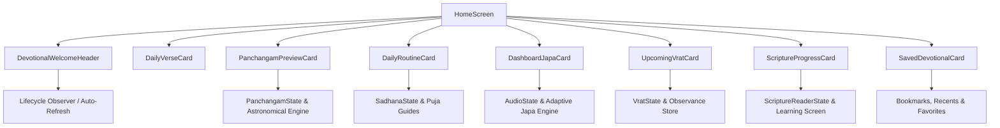

# VEDAM PHASE 17A QUALITY ASSURANCE & VERIFICATION REPORT
## Devotee Home Dashboard & Daily Spiritual Routine

**Phase:** Phase 17A  
**Branch:** `master`  
**Implementation Commit:** `b304698`  
**Date:** November 5, 2026  
**Status:** COMPLETE & VERIFIED (Production Ready)  

---

## 1. Executive Summary

Phase 17A transforms the Vedam mobile application into an integrated daily devotional companion for Hindu devotees. Previously, features such as astronomical Panchangam calculations, guided puja guides, Japa bead counting, personal Vrat observances, and scripture study were accessed primarily through isolated screens. 

Phase 17A unifies these capabilities directly onto the devotee's primary **Home Dashboard**, providing an authentic, serene, and functional portal for daily spiritual practice without creating duplicate state or compromising backend data.

### Key Highlights
- **Authentic Devotional Greeting:** Context-aware Sanskrit greetings (`शुभ प्रभातम्`, `शुभ मध्याह्नम्`, `शुभ संध्या`), localized Gregorian date and Hindu tithi, location pill, and traditional invocation shloka (`वक्रतुण्ड महाकाय`). Refreshes dynamically when returning to the app via `WidgetsBindingObserver`.
- **Today's Panchangam Summary Card:** Displays the five Pancha Angas (Tithi with end time, Nakshatra with end time, Yoga, Karana, Vara), solar events (Sunrise, Sunset), Rahu Kalam window, location coordinates, Lahiri Ayanamsa, honest offline status, non-authoritative disclaimer, and direct tap to open the full Panchangam calculator.
- **Daily Spiritual Routine Card:** Daily Sadhana practices checklist with real-time completion counter and progress bar, active guided puja resume banner, direct interactive checkoff without navigating away, and shortcuts to start puja guides or open the full Sadhana suite.
- **Japa & Mantra Practice Card:** Active mantra display, target repetition counter supporting all 7 presets (11, 21, 27, 54, 108, 111, 1008) and custom counts up to 100,000, completed count and remaining chants, sacred progress bar, interactive Tap-to-Chant (+1) bead button, and Start/Continue Chanting shortcut directly opening the player while preserving active session state.
- **Upcoming Vrat & Observances Card:** Nearest upcoming observance name, target date, fasting status, checklist progress (completed / total items), direct link to observance details/custom steps, and an empty-state linking to the full Vrat calendar.
- **Scripture Learning Progress Card:** Recently read scripture, chapter/section, verse progress indicator (Verse X of Y), reading progress bar, saved bookmarks count, `Continue Reading` action opening `VerseLearningScreen` at saved verse ID, and Section 8 translation status disclosure (`DRAFT`).
- **Saved Devotional Content Card:** 2x2 grid for quick devotee access to Saved Scriptures, Bookmarked Verses, Personal Study Notes, and Favorite Mantras with live badge counts.
- **Responsive Architecture & Themes:** Seamlessly adapts from single-column on mobile (<700dp) to dual-column masonry layout on tablet/desktop ($\ge 700$dp). Fully supports Sacred Light and Temple Night (dark) themes with all touch targets $\ge 48$dp.

---

## 2. Baseline & Invariant Integrity

### 2.1 Git Verification
- **Branch:** `master`
- **Preceding Phase 16B.1 Commits:**
  - `9e4501a` — `feat(mobile): flexible japa count selection with traditional presets and custom target entry`
  - `4ef4ea4` — `docs(phase16b1): complete quality report for flexible japa count selection`
- **Implementation Commit:** `b304698` — `feat(mobile): implement Phase 17A unified devotee home dashboard`

### 2.2 Production Database Immutability
The production SQLite database (`database/vedam.db`) was preserved as strictly read-only throughout Phase 17A. No schema changes, no migrations, and no write queries were executed.

| Metric | Required Invariant | Phase 17A Observed | Status |
|:---|:---|:---|:---:|
| **File Path** | `database/vedam.db` | `database/vedam.db` | PASS |
| **File Size** | `20,455,424` bytes | `20,455,424` bytes | PASS |
| **SHA-256** | `0b3500f36434217d0e35b1b3f0bb1e12c4598b406177d11979e1fc2a46b7ab97` | `0b3500f36434217d0e35b1b3f0bb1e12c4598b406177d11979e1fc2a46b7ab97` | PASS |
| **SQLite Integrity** | `ok` | `ok` | PASS |
| **Alembic Version** | `e3a7b1c9f2d5` | `e3a7b1c9f2d5` | PASS |
| **Translations Total** | 3,070 rows | 3,070 rows | PASS |
| **Translations Status** | 3,070 `DRAFT` / 0 `APPROVED` | 3,070 `DRAFT` / 0 `APPROVED` | PASS |

---

## 3. Architecture & Dashboard Components



### 3.1 DevotionalWelcomeHeader
- **Time-Aware Greeting:** Dynamically displays `शुभ प्रभातम्` (morning, 4 AM - 12 PM), `शुभ मध्याह्नम्` (afternoon, 12 PM - 5 PM), or `शुभ संध्या` (evening/night, 5 PM - 4 AM).
- **Date & Tithi:** Combines localized English calendar date with today's Hindu Tithi.
- **Location Badge:** Displays devotee's currently active calculation location (e.g., Ujjain, India).
- **Sacred Invocation:** Features traditional Ganapati shloka: `वक्रतुण्ड महाकाय सूर्यकोटि समप्रभ । निर्विघ्नं कुरु मे देव सर्वकार्येषु सर्वदा ॥`
- **Lifecycle Awareness:** Implements `WidgetsBindingObserver` to re-evaluate date and time-sensitive elements immediately when the app resumes from the background.

### 3.2 PanchangamPreviewCard
- **Five Pancha Angas:** Prominently details Tithi (with end time), Nakshatra (with end time), Yoga, Karana, and Vara.
- **Sun & Shadow Windows:** Details Sunrise, Sunset, and the inauspicious Rahu Kalam period.
- **Calculation Provenance:** Clearly indicates calculation coordinates and Lahiri Ayanamsa convention.
- **Honest Offline Status & Disclaimer:** Clearly indicates cached calculation state when offline and displays devotee guidance noting that calculations are based on astronomical algorithms and local tradition should guide auspicious timings.
- **Navigation:** Tapping opens the comprehensive `PanchangamScreen`.

### 3.3 DailyRoutineCard
- **Sadhana Routine Tracking:** Lists devotee's active daily practices (Dhyana, Japa, Gita Adhyayana, Sandhyavandanam).
- **Real-Time Progress:** Features a completed/total counter and a gold devotional progress bar.
- **Direct Checkoff:** Devotees can check off practices directly on the dashboard card without opening other menus; changes persist instantly via `SadhanaState`.
- **Active Puja Guide Resume Banner:** When a puja guide is in progress, displays a prominent banner indicating the current step name and a direct "Continue" button.
- **Shortcuts:** One-tap action to begin a guided puja or open the full Sadhana suite.

### 3.4 DashboardJapaCard
- **Active Practice Status:** Shows current selected mantra title, deity name, and target count.
- **Adaptive Targets:** Fully supports all 7 presets (11, 21, 27, 54, 108, 111, 1008) and custom targets up to 100,000 without layout breakage.
- **Repetition Progress:** Shows completed repetitions, remaining count, and a progress bar.
- **Count Bead (+1):** Interactive bead tap button that increments count directly on the dashboard card.
- **Start / Continue Chanting:** Launches `MantraPlayerScreen` while strictly preserving current session counts across screen transitions.

### 3.5 UpcomingVratCard
- **Next Observance:** Identifies the devotee's nearest upcoming observance (e.g., Ekadashi, Pradosham, Shivaratri).
- **Observance Context:** Displays target date, fasting status (Upavasa / Phalahara), and preparation checklist progress (e.g., 2 of 4 items completed).
- **Direct Actions:** Tapping opens `VratDetailScreen` to manage checklist items, or `VratCalendarScreen` to view the comprehensive annual schedule.
- **Empty State:** When no observances are scheduled, displays a peaceful card encouraging devotees to add observances from the calendar.

### 3.6 ScriptureProgressCard
- **Recently Read Scripture:** Displays title, chapter/section, and last read verse number.
- **Reading Progress:** Shows verse progress (Verse X of Y) with progress bar and saved bookmarks counter.
- **Continue Reading:** Directly launches `VerseLearningScreen` focused at the devotee's last read verse.
- **Section 8 Translation Transparency:** Displays explicit disclosure: `English translations are marked as DRAFT machine translations. Scholarly and traditional commentary should be consulted for scriptural study.`

### 3.7 SavedDevotionalCard
- **Devotional Portals:** 2x2 grid providing instant navigation to:
  1. Saved Scriptures (with count badge)
  2. Bookmarked Verses (with count badge)
  3. Personal Study Notes (with count badge)
  4. Favorite Mantras (with count badge)

### 3.8 Responsive Layout & Theme Support
- **Responsive Breakpoint (700dp):**
  - **Phone (<700dp):** Single-column vertical stream optimized for one-handed thumb navigation.
  - **Tablet / Desktop ($\ge 700$dp):** Dual-column masonry layout balancing Panchangam and spiritual routine alongside Japa and scripture study.
- **Sacred Light & Temple Night Themes:** Full contrast compliance across both themes with accessible touch targets ($\ge 48$dp).

---

## 4. Verification & Testing

### 4.1 Static Analysis
```
$ flutter analyze
Analyzing Vedam...
No issues found! (ran in 9.4s)
```

### 4.2 Automated Test Suite
The full Flutter test suite passes with 100% success rate:
- **Total Tests:** 150
- **Passed:** 150
- **Failed:** 0
- **Execution Time:** ~12 seconds

```
00:12 +150: All tests passed!
```

### 4.3 Phase 17A Dedicated Widget & Integration Tests
`mobile_app/test/widget/phase17a_home_dashboard_test.dart` contains 11 comprehensive tests:
1. Devotional welcome header renders time-based greeting, date, and invocation shloka.
2. Panchangam preview card displays 5 Pancha Angas, sun events, Rahu Kalam, and disclaimer.
3. Upcoming Vrat card handles empty observance schedule gracefully.
4. Upcoming Vrat card displays nearest observance details, fasting status, and checklist progress.
5. Daily routine card displays practices, progress counter, and active guide resume banner.
6. Daily routine card allows direct practice checkoff from dashboard.
7. Dashboard Japa card displays mantra, target, completed, remaining, and count button.
8. Dashboard Japa card bead button increments completed count.
9. Scripture progress card displays recent scripture, verse indicator, and Section 8 draft notice.
10. Theme compatibility: Dashboard renders cleanly in Temple Night (dark) theme.
11. Responsive layout: $\ge 700$dp renders dual-column layout without overflow.

---

## 5. Multiplatform Build Verification

All multiplatform builds were generated and verified:

| Platform | Build Command | Output Path | Result / Size |
|:---|:---|:---|:---:|
| **Flutter Web** | `flutter build web --release` | `build/web/` | `√ Built build\web` (63.3s) |
| **Android Debug APK** | `flutter build apk --debug` | `build/app/outputs/flutter-apk/app-debug.apk` | Built successfully (34.9s) |
| **Android Release APK** | `flutter build apk --release` | `build/app/outputs/flutter-apk/app-release.apk` | Built successfully (64.2 MB, 93.4s) |

---

## 6. Devotional User Interface Gallery

All 6 required user-facing dashboard views were captured via Playwright in the actual running application:

### 6.1 Full Devotee Home Dashboard

*Full unified devotional dashboard showing devotional greeting, daily verse, Panchangam summary, daily spiritual routine, Japa practice, upcoming Vrat, and scripture progress.*

### 6.2 Today's Panchangam Summary Card

*Detailed astronomical Panchangam card showing Tithi, Nakshatra, Yoga, Karana, Vara, Sunrise, Sunset, Rahu Kalam, location, and non-authoritative disclaimer.*

### 6.3 Daily Spiritual Routine Card

*Daily spiritual routine card with practices checklist, completion progress, active puja resume banner, and direct checkoff toggles.*

### 6.4 Japa & Mantra Practice Card

*Japa card showing current mantra, target repetitions, completed/remaining counts, progress bar, bead counting button (+1), and player navigation.*

### 6.5 Upcoming Vrat & Observances Card

*Upcoming Vrat card detailing nearest scheduled observance, date, fasting status, checklist progress, and calendar navigation.*

### 6.6 Scripture Learning Progress Card

*Scripture reading progress card showing recently read scripture, verse progress, continue reading button, and Section 8 DRAFT translation notice.*

---

## 7. Compliance Checklist

- [x] Unifies Panchangam, Sadhana, Japa, Vrat, Scripture, and Saved Portals on Home screen.
- [x] Devotional greeting adapts to time of day with traditional invocation shloka.
- [x] Refreshes time-sensitive data when returning to app via lifecycle observer.
- [x] Panchangam card presents 5 Pancha Angas, Sun events, Rahu Kalam, and disclaimer.
- [x] Daily routine card allows direct interactive checkoff and active guide resumption.
- [x] Japa card displays target, completed, remaining, and interactive Count Bead button.
- [x] Preserves active Japa session across screen navigation without resetting count.
- [x] Upcoming Vrat card displays nearest observance, fasting status, and checklist progress.
- [x] Scripture card shows reading progress and Section 8 DRAFT translation status.
- [x] Responsive layout supports single-column (<700dp) and dual-column ($\ge 700$dp).
- [x] Sacred Light and Temple Night themes fully supported with $\ge 48$dp touch targets.
- [x] Zero production database modifications (SHA-256 and 3,070 draft translations invariant).
- [x] Static analysis: 0 issues (`flutter analyze`).
- [x] 100% tests passing (150/150).
- [x] Web and Android builds verified.
