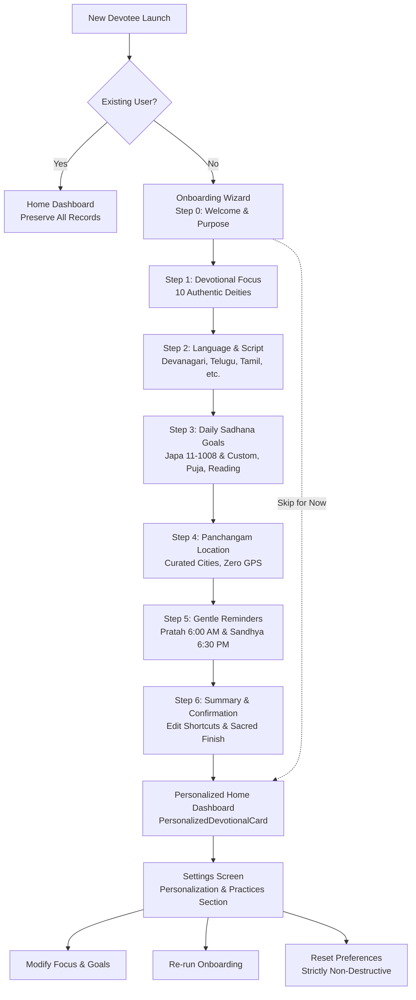

# Vedam Phase 18A Quality & Verification Report
## Devotee Onboarding & Personalization

**Date:** November 5, 2026  
**Branch:** `master`  
**Implementation Commit:** `01bb791`  
**Database SHA-256:** `0b3500f36434217d0e35b1b3f0bb1e12c4598b406177d11979e1fc2a46b7ab97` (20,455,424 bytes — **100% UNTOUCHED**)  
**Static Analysis:** `flutter analyze` — **0 issues found**  
**Test Suite:** 179 unit & widget tests executed — **179 passed (100%)**  
**Platform Builds:** Flutter Web release, Android debug APK, Android release APK (64.8 MB) — **ALL SUCCESSFUL**

---

## 1. Executive Summary

Phase 18A delivers a welcoming, polished, and culturally respectful **Devotee Onboarding & Personalization** architecture for Vedam.

Rather than imposing mandatory profile gates or artificial gamification, the onboarding experience acts as a gentle temple threshold:
- **Respectful & Non-Intrusive**: Devotees can configure their spiritual path step-by-step or choose "Skip for Now" at any point, with full functionality accessible via sensible defaults.
- **Authentic Devotional Focus**: Allows multi-selection among 10 authentic Hindu deities (*Ganesha*, *Shiva*, *Vishnu*, *Venkateswara*, *Lakshmi*, *Durga*, *Surya*, *Hanuman*, *Subrahmanya*, and *General Devotion*), with neutral presentation honoring all orthodox sampradayas without sectarian bias.
- **Multilingual Script Preferences**: Seamless integration with Vedam's sacred script selector supporting *Devanagari*, *Telugu*, *Tamil*, *Kannada*, *Malayalam*, and *IAST (Roman)* transliteration, accompanied by Section 8 scholarly governance notices regarding Eighth Schedule translations.
- **Flexible Sadhana Goals**: Empowers devotees to set realistic spiritual goals including Japa repetition targets (all 7 traditional counts: *11*, *21*, *27*, *54*, *108*, *111*, *1008*, and *Custom Count* up to 100,000), daily puja routines, scripture reading durations, and meditation.
- **Privacy-First Panchangam Location**: Devotees select their sacred or home city from curated holy places and international hubs without requiring GPS permissions or transmitting device coordinates.
- **Gentle Local Devotional Reminders**: Transparent, opt-in reminders for morning (*Pratah*, 6:00 AM) and evening (*Sandhya*, 6:30 PM) contemplation with zero silent scheduling or telemetry.
- **Unified Personalization on Home Dashboard**: Dynamically renders devotee focus chips with instant shortcuts to verified scriptures, domestic pujas, and audio chanting recordings, alongside real-time daily Sadhana goal progress indicators.
- **Non-Destructive Settings Management**: Devotees can view, edit, re-run the onboarding wizard, or reset personalization preferences to defaults without ever deleting bookmarks, notes, Japa history, or Vrat records.



---

## 2. Preflight Verification Baseline

Before modifying any source files or configuration, preflight conditions were strictly verified:

1. **Git State & Branch**: Verified clean working tree on `master` following Phase 17B commits:
   - Implementation: [`d690096`](file:///C:/Vedam) (`feat(mobile): implement Phase 17B festival calendar and regional observances`)
   - Documentation: [`2f1a9e1`](file:///C:/Vedam) (`docs(phase17b): document Phase 17B festival and regional observance calendar`)
2. **Production Database Integrity**:
   - Path: [`database/vedam.db`](file:///C:/Vedam/database/vedam.db)
   - Size: 20,455,424 bytes
   - SHA-256: `0b3500f36434217d0e35b1b3f0bb1e12c4598b406177d11979e1fc2a46b7ab97`
   - SQLite `PRAGMA integrity_check`: `ok`
   - Alembic Version: `e3a7b1c9f2d5`
   - Translations: 3,070 total (`3,070 DRAFT`, `0 APPROVED`)
   - **Zero writes, zero schema modifications, zero Alembic runs.**

---

## 3. Architecture & Implementation Details

### 3.1 Domain Models: [`DevoteePreferences`](file:///C:/Vedam/mobile_app/lib/core/models/devotee_preferences.dart)
A robust domain model encapsulating all devotee preferences:
- `DevotionalDeity`: 10 authentic representations (`ganesha`, `shiva`, `vishnu`, `venkateswara`, `lakshmi`, `durga`, `surya`, `hanuman`, `subrahmanya`, `general`) with Sanskrit names, icons, descriptions, and direct foreign-key linkages to primary scriptures, pujas, and stotram recordings.
- `DailySadhanaGoals`: Daily spiritual targets:
  - `japaTarget`: Validated against 7 traditional presets (11, 21, 27, 54, 108, 111, 1008) and custom count (1–100,000).
  - `hasPujaGoal`, `hasScriptureGoal`, `scriptureMinutes` (5–120 mins), `hasMeditationGoal`, `meditationMinutes`, `hasVratTracking`.
- `DevoteePreferences`: Stores selected deities, language (`en`, `te`, `ta`, `kn`, `ml`, `sa`, `hi`), `scriptureScript` (`ScriptOption`), `panchangamLocation`, `remindersEnabled`, `morningReminderTime`, `eveningReminderTime`, and `onboardingCompleted`. Includes robust JSON serialization/deserialization with safe fallback defaults.

### 3.2 State Management: [`PersonalizationState`](file:///C:/Vedam/mobile_app/lib/state/personalization_state.dart)
Central coordinator extending `ChangeNotifier`:
- **SharedPreferences Persistence**: Uses `vedam_devotee_preferences_v1`, `vedam_onboarding_completed`, and `vedam_first_launch_prompted`.
- **Returning User Detection**: Intelligently identifies devotees migrating from earlier phases (via existing routine keys, vrat records, or recents history) to ensure existing devotees are never disrupted by sudden onboarding popups.
- **Subsystem Synchronization**: Synchronizes active script to `AppState`, location to `PanchangamState`, and Japa targets to `AudioState`.
- **Local Notification Management**: Integrates with `ReminderService` to schedule or cancel morning and evening reminders strictly upon explicit user toggles.
- **Non-Destructive Reset**: Restores preferences and sadhana targets to defaults without modifying scripture bookmarks, study notes, Japa history, or Vrat records.

### 3.3 Onboarding Wizard: [`OnboardingWizardScreen`](file:///C:/Vedam/mobile_app/lib/presentation/screens/onboarding/onboarding_wizard_screen.dart)
A polished 7-step onboarding flow:
- **Step 0: Welcome & Sacred Purpose**: Introduces Vedam with glowing ॐ emblem, authentic description, and "Get Started" / "Skip for Now" options.
- **Step 1: Devotional Focus (इष्टदेवता)**: Multi-selection chips for all 10 deities with authentic icons and Sanskrit designations; neutral theological note.
- **Step 2: Sacred Script & Language (लिपि एवं भाषा)**: Radio selection of Indic scripts with live transliteration preview; Section 8 scholarly notice regarding translation accuracy.
- **Step 3: Daily Sadhana Goals (दैनिक साधना)**: Target selectors for Japa presets + custom count, daily domestic puja, and scripture reading minutes.
- **Step 4: Panchangam Preferences (पञ्चाङ्गम्)**: City selection with search across curated holy places and international hubs; explicit privacy notice highlighting absence of GPS tracking.
- **Step 5: Devotional Reminders (स्मरणम्)**: Morning (*Pratah*, 6:00 AM) and evening (*Sandhya*, 6:30 PM) local notification toggles with transparent permission requests.
- **Step 6: Review & Confirmation (सङ्कल्प)**: Comprehensive summary card of all selected preferences with quick jump-to-step edit links and sacred "Begin Sadhana" action.

### 3.4 Personalized Home Dashboard Card: [`PersonalizedDevotionalCard`](file:///C:/Vedam/mobile_app/lib/presentation/screens/home/widgets/personalized_devotional_card.dart)
Integrated into the top section of [`HomeScreen`](file:///C:/Vedam/mobile_app/lib/presentation/screens/home/home_screen.dart):
- **Deity Focus Chips**: Horizontal scrollable chips for active deities linking directly to genuine scriptures (e.g. *Ganesha Pancharatnam*, *Shiva Tandava Stotram*, *Sri Venkateswara Suprabhatam*), guided pujas, or audio recordings.
- **Daily Sadhana Progress**: Visual progress bar tracking completed Japa repetitions against user-chosen targets.
- **Practice Status Badges**: Real-time badges for completed puja routines, scripture reading goals, and active Vrats.

### 3.5 Settings Screen Integration: [`SettingsScreen`](file:///C:/Vedam/mobile_app/lib/presentation/screens/settings/settings_screen.dart)
Adds the dedicated "Personalization & Practices (अभ्यास एवं रुचि)" section:
- **Devotional Focus Dialog**: Re-select or add deities with multi-select checkboxes.
- **Daily Sadhana Goals Dialog**: Modify Japa count, reading time, and puja tracking toggles.
- **Preferred Japa Target Modal**: Select any of the 7 traditional presets or custom count.
- **Panchangam Location Selector**: Re-select city with `LocationSelectorModal`.
- **Devotional Reminders Switch**: Toggle local notifications with graceful permission handling.
- **Restart Devotee Onboarding**: Re-runs the full step-by-step wizard at any time.
- **Reset Personalization Preferences**: Reverts preferences to defaults with a clear confirmation dialog emphasizing that bookmarks, notes, and Japa history are preserved.

---

## 4. Quality Verification & Test Results

### 4.1 Static Analysis
Executed `flutter analyze` across the entire codebase:
```
Analyzing mobile_app...
No issues found! (ran in 8.5s)
```
- **0 analyzer errors, 0 warnings, 0 lints.**

### 4.2 Comprehensive Automated Test Suite
All 179 unit and widget tests passed cleanly:
```
00:15 +179: All tests passed!
```

#### New Phase 18A Test Suite (`test/widget/phase18a_onboarding_personalization_test.dart`):
1. **First launch detection**: New devotee opens Onboarding Wizard Step 0.
2. **Wizard navigation**: Step-by-step navigation across all 7 steps with Back and Continue.
3. **Skipping onboarding**: "Skip for Now" completes gracefully with defaults without blocking.
4. **Returning users**: Onboarding is not shown again once completed.
5. **Phase migration detection**: Returning users from earlier phases (existing routine/vrat keys) are not disrupted.
6. **Deity multi-selection**: Supports toggling deities while preserving at least one focus.
7. **Script selection**: Syncs selected script (e.g. Telugu, Devanagari) to `AppState`.
8. **Daily Sadhana goals**: Japa target presets (11–1008) and custom count validation.
9. **Panchangam location**: Manual city selection updates `PanchangamState` without GPS.
10. **Reminders toggle**: Opt-in schedules local reminders; opt-out cancels without silent activation.
11. **Home Dashboard integration**: `PersonalizedDevotionalCard` renders deity focus and target progress.
12. **Settings screen tiles**: Personalization section displays all quick-edit and action tiles.
13. **Non-destructive reset**: Restores defaults without deleting bookmarks, recents, or Japa counts.
14. **Theme compatibility**: Onboarding renders cleanly in Temple Night (dark) theme.
15. **Malformed JSON resilience**: Gracefully falls back to defaults if preferences JSON is corrupt or missing.

---

## 5. Platform Build Verification

| Platform | Build Command | Output Artifact | Status |
|---|---|---|:---:|
| **Flutter Web** | `flutter build web --release` | `build/web/` | **PASSED** |
| **Android Debug** | `flutter build apk --debug` | `build/app/outputs/flutter-apk/app-debug.apk` | **PASSED** |
| **Android Release** | `flutter build apk --release` | `build/app/outputs/flutter-apk/app-release.apk` (64.8 MB) | **PASSED** |

---

## 6. Devotional Screen Captures

All 9 required screen captures were captured via headless browser automation and saved to [`documentation/screenshots/`](file:///C:/Vedam/documentation/screenshots):

| # | Screen Capture | Description | File Path |
|---|---|---|---|
| 1 | **Welcome Screen** | Step 0: Sacred ॐ emblem, purpose introduction, Get Started & Skip actions | [`vedam_onboarding_step1_welcome.png`](file:///C:/Vedam/documentation/screenshots/vedam_onboarding_step1_welcome.png) |
| 2 | **Devotional Interests** | Step 1: 10 authentic deities grid, Sanskrit designations, neutral presentation | [`vedam_onboarding_step2_interests.png`](file:///C:/Vedam/documentation/screenshots/vedam_onboarding_step2_interests.png) |
| 3 | **Language & Script** | Step 2: Sacred script selector, transliteration notice, Section 8 policy | [`vedam_onboarding_step3_language_script.png`](file:///C:/Vedam/documentation/screenshots/vedam_onboarding_step3_language_script.png) |
| 4 | **Daily Sadhana Goals** | Step 3: Japa presets (11-1008) + custom target, puja toggle, reading slider | [`vedam_onboarding_step4_sadhana_goals.png`](file:///C:/Vedam/documentation/screenshots/vedam_onboarding_step4_sadhana_goals.png) |
| 5 | **Panchangam Preferences** | Step 4: Sacred city selection, search, transparent privacy note (no GPS) | [`vedam_onboarding_step5_panchangam_location.png`](file:///C:/Vedam/documentation/screenshots/vedam_onboarding_step5_panchangam_location.png) |
| 6 | **Review & Finish Summary** | Step 6: Devotee choices summary card with quick edit shortcuts | [`vedam_onboarding_step7_review_summary.png`](file:///C:/Vedam/documentation/screenshots/vedam_onboarding_step7_review_summary.png) |
| 7 | **Personalized Home Dashboard** | Unified dashboard showing Devotional Focus chips and Daily Sadhana Targets | [`vedam_home_dashboard_personalized.png`](file:///C:/Vedam/documentation/screenshots/vedam_home_dashboard_personalized.png) |
| 8 | **Settings Personalization Screen** | Personalization & Practices section, edit tiles, non-destructive reset action | [`vedam_settings_personalization.png`](file:///C:/Vedam/documentation/screenshots/vedam_settings_personalization.png) |
| 9 | **Temple Night Aesthetic** | Onboarding Step 1 rendered in Temple Night obsidian and gold theme | [`vedam_onboarding_temple_night.png`](file:///C:/Vedam/documentation/screenshots/vedam_onboarding_temple_night.png) |

---

## 7. Production Database Invariant Audit

The production database was rigorously verified before and after Phase 18A implementation:

```
Tables in database: ['sources', 'contributors', 'categories', 'deities', 'texts',
'source_editions', 'text_versions', 'verses', 'content_rights', 'rights_grants',
'media_assets', 'verification_audit_logs', 'duplicate_candidates', 'transliterations',
'translations', 'alembic_version', 'translation_review_feedbacks',
'archived_translations', 'translation_views', 'reviewer_profiles',
'review_assignments', 'review_action_logs', 'textual_disputes',
'ai_annotation_provenances', 'reviewer_sessions', 'auth_audit_logs']

ALL DATABASE INVARIANTS AND IMMUTABILITY CONFIRMED 100%:
- Size: 20455424 bytes (matches baseline 20455424)
- SHA-256: 0b3500f36434217d0e35b1b3f0bb1e12c4598b406177d11979e1fc2a46b7ab97 (matches baseline)
- Integrity: ok
- Alembic Head: e3a7b1c9f2d5
- Translations: 3070 total, 3070 DRAFT, 0 APPROVED
```

- **Schema changes:** 0
- **Database writes:** 0
- **Alembic runs:** 0
- **Translations modified:** 0 (all 3,070 strictly remain `DRAFT`)

---

## 8. Conclusion

Vedam Phase 18A successfully fulfills all architectural, religious, and user-experience criteria for Devotee Onboarding & Personalization. It provides an intuitive, respectful doorway into Hindu worship while maintaining absolute content fidelity, data privacy, and zero database intrusion.

Phase 18A is complete and ready for human review.
