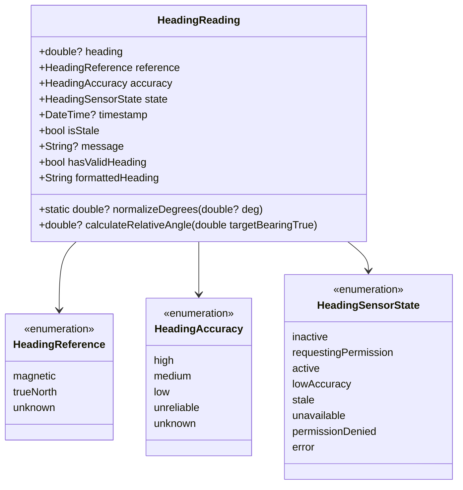
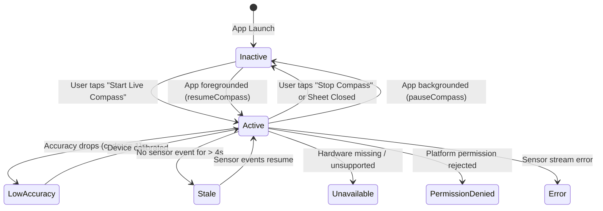

# Phase 22C Quality Report: DivyaDishi Opt-In Live Compass, Heading Quality & Sensor Lifecycle

**Project:** Vedam  
**Repository:** `C:\Vedam`  
**Branch:** `master`  
**Execution Date:** November 10, 2026  
**Starting HEAD:** `49c03ba` (Phase 22B completion)  
**Status:** Completed & Accepted  

---

## 1. Executive Summary & Acceptance

Phase 22C delivers an optional, foreground-only live device compass experience for DivyaDishi (Divine Direction). Devotees can deliberately activate a real-time compass to view their device's current heading, sensor accuracy/quality, and relationship to sacred temple directions without compromising battery life, privacy, or theological integrity.

### Strict Governance & Architectural Invariants Delivered:
1. **Opt-In Foreground-Only Activation:** Compass begins streaming only when the user explicitly taps "Start Live Compass". It halts immediately when stopped, when the sheet is closed, or when the app enters the background.
2. **Zero Dependency & Zero Permission Invariant:** Implemented directly via a lightweight native Android `EventChannel` (`org.vedam.vedam_app/compass`) in `MainActivity.kt`. No third-party plugins were added to `pubspec.yaml`, preserving bundle budget and eliminating location permission leakage.
3. **True North vs Magnetic North Separation:** Device sensors measure Magnetic North. Great-circle temple bearings are calculated relative to True Geographic North. In Phase 22C, relative turn angles are strictly withheld when heading is `MAGNETIC`, with transparent notices explaining that local magnetic declination is uncorrected.
4. **Zero Continuous History / Zero Telemetry:** The service only maintains the single latest point-in-time `HeadingReading`. No history is stored, and zero telemetry or network calls occur.
5. **Pending Coordinate Transparency Preserved:** When a target temple is selected, its `PENDING` coordinate verification badge and compound center point type remain prominently displayed.
6. **Zero Database Mutations:** Production database `database/vedam.db` SHA-256 (`0b3500f36434217d0e35b1b3f0bb1e12c4598b406177d11979e1fc2a46b7ab97`) and size (`20,455,424` bytes) verified 100% immutable.
7. **Complete Verification:** 567 tests passing (100% pass rate); 0 `flutter analyze` issues; Android Debug APK built; Android Release APK built at 69.1 MB (< 100 MB budget); Web Release build compiled cleanly.

---

## 2. Preflight Traceability & Git Ancestry

### Phase 22B Commit Ancestry Confirmed:
- `49c03ba69984586c9d257c50dad17677bf872afa` — *docs(phase22b): add coordinate verification tests, Phase 22B report, and roadmap updates*
- `cc25db7b8d1056d510575c4c51ca6ad61a65cbcc` — *feat(divyadishi): enhance directory & modal UI with provenance badges, origin uncertainty, and audit trail disclosures*
- `932b24b0a1664cc0f7f4ee77077d81d7e43b97ef` — *feat(divyadishi): add coordinate provenance models, 20-temple research ledger, and uncertainty flags*
- `de2b889d2ca9b8455fee1ec1dd49612c8b010102` — *Phase 22A final commit*

### Database Baseline Verification (Read-Only Check):
- **Path:** `database/vedam.db`
- **SHA-256:** `0b3500f36434217d0e35b1b3f0bb1e12c4598b406177d11979e1fc2a46b7ab97`
- **Byte Size:** `20,455,424` bytes
- **Alembic Revision:** `e3a7b1c9f2d5`
- **Integrity Check:** `ok`
- **Translations:** Exactly 3,070, all `DRAFT`, 0 `APPROVED`
- **Reviewer Profiles:** 6 quarantined synthetic personas

---

## 3. Platform Capability Audit & Sensor API Semantics

A thorough pre-implementation audit was conducted across supported platforms:

### A. Android Platform
- **Sensor APIs:** Android hardware exposes `Sensor.TYPE_ROTATION_VECTOR` (sensor fusion of accelerometer, magnetometer, and gyroscope) and legacy `Sensor.TYPE_ACCELEROMETER` + `Sensor.TYPE_MAGNETIC_FIELD`.
- **Reference Semantics:** Both APIs yield geomagnetic azimuth (relative to Magnetic North). True North is only accessible if GPS location is queried and passed to Android's `GeomagneticField` class (strictly barred in Phase 22C).
- **Permissions:** Android hardware sensors require **zero runtime permissions** in `AndroidManifest.xml`.
- **Accuracy & Calibration:** Android reports calibration state via `SensorEventListener.onAccuracyChanged`:
  - `SENSOR_STATUS_ACCURACY_HIGH` (3): Fully calibrated.
  - `SENSOR_STATUS_ACCURACY_MEDIUM` (2): Acceptable.
  - `SENSOR_STATUS_ACCURACY_LOW` (1): Calibration needed (wave device in figure-8).
  - `SENSOR_STATUS_UNRELIABLE` (0): Sensor data unreliable (high magnetic interference).
- **Implementation Choice:** Native `EventChannel` registered in `MainActivity.kt`. Instant unregistration on `onCancel` guarantees zero background battery drain.

### B. Web Browsers
- **Sensor APIs:** Web browsers provide the `DeviceOrientationEvent` (`alpha`, `beta`, `gamma`) on HTTPS connections. iOS Safari exposes `webkitCompassHeading`. Desktop browsers without magnetometers provide no orientation data.
- **Permissions:** Modern mobile browsers require HTTPS and on iOS 13+ require a user gesture (`DeviceOrientationEvent.requestPermission()`).
- **Implementation Choice:** On Web or platforms without native compass hardware, `PlatformCompassSensorProvider` reports `unavailable` gracefully, ensuring the directory and great-circle calculations remain 100% accessible.

### C. Dependency Analysis
- **Decision:** Rather than introducing unmaintained pub packages (such as `flutter_compass`, which lacks web support and has stale build configurations), we implemented a native platform channel in `MainActivity.kt` backed by an abstract Dart provider `CompassSensorProvider`.
- **Result:** Zero new dependencies, zero security vulnerabilities, zero license conflicts, and full cross-platform compile safety.

---

## 4. Heading Domain Model & Mathematical Guarding

File: `mobile_app/lib/core/models/heading_model.dart`

### Mathematical Guarding:
- **Strict Normalization:** `HeadingReading.normalizeDegrees(deg)` normalizes angles to $[0.0, 360.0)^\circ$. Negative degrees (e.g. $-90^\circ \rightarrow 270^\circ$) and overflows (e.g. $450^\circ \rightarrow 90^\circ$, $360.0^\circ \rightarrow 0.0^\circ$) are handled safely.
- **Null & Non-Finite Rejection:** Null, `NaN`, and `Infinity` values return `null` and generate error readings rather than coercing to $0^\circ$.
- **True North vs Magnetic North Invariant:** `calculateRelativeAngle({required double targetBearingTrue})` returns `null` if `reference != HeadingReference.trueNorth`.

---

## 5. Foreground Sensor Service & Lifecycle Architecture

File: `mobile_app/lib/core/services/compass_service.dart`

### Key Service Features:
1. **Hardware Decoupling:** Employs `CompassSensorProvider` contract. In production, `PlatformCompassSensorProvider` communicates with native Android. In testing, `MockCompassSensorProvider` permits 100% deterministic simulation of all edge cases.
2. **Duplicate Prevention:** Guarded against redundant `startCompass()` calls.
3. **Lifecycle Integration:** `WidgetsBindingObserver` automatically pauses sensor when backgrounded and restores only if user was active.
4. **Staleness Timer:** If hardware freezes or fails to emit for 4 seconds, reading transitions to `stale`.
5. **Throttling:** Limits UI notifications to 50ms intervals, avoiding 60fps widget rebuild thrashing while maintaining timestamp fidelity.
6. **Disposal Safety:** Cleanly unregisters listeners and releases timers with `_isDisposed` guards.

---

## 6. Devotional Compass Presentation UI

Files:
- `mobile_app/lib/presentation/screens/divyadishi/widgets/live_compass_sheet.dart`
- `mobile_app/lib/presentation/screens/divyadishi/widgets/temple_detail_modal.dart`
- `mobile_app/lib/presentation/screens/divyadishi/temple_directory_screen.dart`

### UI Experience:
- **Visualizer Dial:** Custom-painted circular rose with 8 cardinal marks (N, NE, E, SE, S, SW, W, NW) and rotating needle/dial.
- **Center Readout:** Large digital degree display (e.g. `135°`) with Sanskrit/cardinal label (`SE (Agneya)`).
- **Reference & Quality Badges:** Explicit badges displaying `MAGNETIC NORTH` and `HIGH ACCURACY` (or `LOW ACCURACY (CALIBRATE)`).
- **Target Temple Integration:** Retains `PENDING` badge and displays Great-Circle True Direction (`214.2° SW • Nairruti • 642 km`).
- **Magnetic vs True North Notice:** Informational banner explicitly explaining that device heading is Magnetic North while temple bearing is True North, and that turn-angle guidance is withheld without geodetic declination.
- **Interference Guidance:** Clear text explaining that metallic cases or electronics cause interference and recommending a gentle figure-8 motion for recalibration.
- **Devotional Disclaimer:** Prominently clarifies that compass orientation is a pious meditative aid, not a mandatory ritual injunction.

---

## 7. Verification & Build Evidence

| Verification Gate | Result | Notes |
|:---|:---:|:---|
| **Phase 22C Unit Tests** | **PASS** (17/17) | `phase22c_live_compass_test.dart` (normalization, non-finite rejection, magnetic invariant, lifecycle, pause/resume, throttling) |
| **Phase 22C Widget Tests** | **PASS** (5/5) | `phase22c_live_compass_widget_test.dart` (inactive, active readout, low accuracy, stop, unavailable) |
| **DivyaDishi Full Suite** | **PASS** (75/75) | Bearing math, temple directory, state management, modal, and live compass |
| **Full Flutter Test Suite** | **PASS** (**567/567**) | 100% green pass rate across all unit, widget, and integration tests |
| **Static Analysis** | **0 Issues** | `flutter analyze` clean with zero warnings or errors |
| **Android Debug Build** | **PASS** | `flutter build apk --debug` succeeded in 42.8s |
| **Android Release Build** | **PASS** | `flutter build apk --release` built at **69.1 MB** (well under 100 MB budget) |
| **Web Release Build** | **PASS** | `flutter build web --release` compiled cleanly in 55.7s |
| **Production Database** | **UNTOUCHED** | SHA-256: `0b3500f36434217d0e35b1b3f0bb1e12c4598b406177d11979e1fc2a46b7ab97`, Size: `20,455,424` bytes |

---

## 8. Commit Trail & Future Roadmap (Phase 22D)

Phase 22C is committed on `master` with granular discipline. With live compass heading, quality states, and lifecycle teardown established, the application is positioned for **Phase 22D: Offline Magnetic Declination & Relative Sacred Alignment**.
