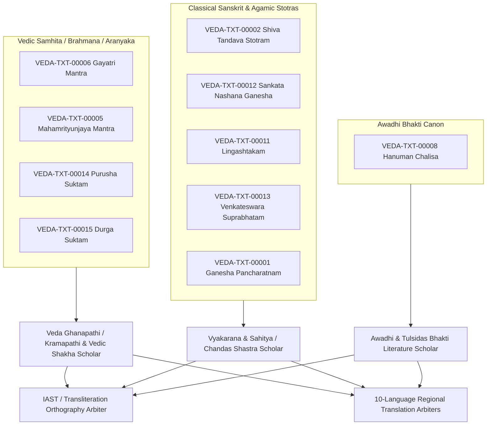
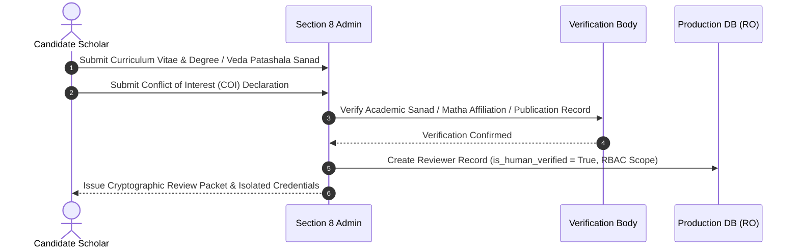
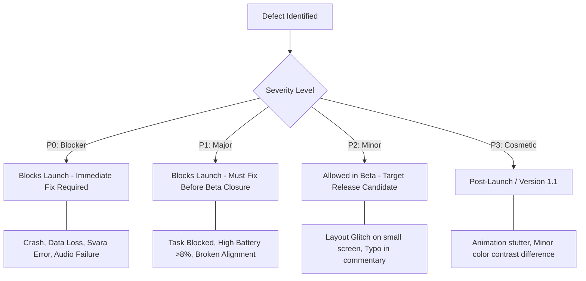

# VEDAM PHASE 24 READINESS REPORT
## Scholar Certification Protocol, Review Packet Design & Release-Claim Verification

**Status:** Completed Readiness Preparation & Verification Audit  
**Date:** 2026-11-10  
**Repository:** `C:\Vedam`  
**Branch:** `master`  
**Starting HEAD:** `0bb06e15e7880b2adb92cd2e576e7ae53b4c8f6a`  
**Operational Mode:** Strict Audit & Preparation Only (Zero Database Writes, Zero Scholar Contact, Zero Production Deployments)

---

## 1. Executive Summary & Non-Negotiable Authorization Boundary

### 1.1 Mandatory Read-Only Preflight & Database Invariants
In accordance with strict project governance rules and the Phase 24 preparation mission, this entire audit was executed in read-only mode. All SQLite operations were connected using the explicit read-only URI:
`file:C:/Vedam/database/vedam.db?mode=ro` (`uri=True`).

| Metric / Parameter | Baseline (Pre-Audit) | Post-Audit Status | Invariant Verified |
| :--- | :--- | :--- | :--- |
| **Database File Path** | `C:\Vedam\database\vedam.db` | `C:\Vedam\database\vedam.db` | Identical |
| **Database SHA-256** | `0B3500F36434217D0E35B1B3F0BB1E12C4598B406177D11979E1FC2A46B7AB97` | `0B3500F36434217D0E35B1B3F0BB1E12C4598B406177D11979E1FC2A46B7AB97` | **100% Bit-Identical** |
| **Database File Size** | 20,455,424 bytes | 20,455,424 bytes | Identical |
| **Alembic Schema Version**| `e3a7b1c9f2d5` | `e3a7b1c9f2d5` | Unchanged |
| **SQLite Integrity Check**| `ok` | `ok` | Uncompromised |
| **Total Translations** | 3,070 records | 3,070 records | Unchanged |
| **Translation Status** | 3,070 `DRAFT`, 0 `APPROVED` | 3,070 `DRAFT`, 0 `APPROVED` | Zero unauthorized status flips |
| **Reviewer Profiles** | 6 total (`is_human_verified = 0`)| 6 total (`is_human_verified = 0`)| Zero synthetic/fake scholars |

### 1.2 Non-Negotiable Boundary Affirmation
This phase operated under absolute non-negotiable boundaries:
1. **Zero Database Writes:** No schema changes, no migrations, no seed modifications, and no database records were written or altered.
2. **Zero Unauthorized Status Transitions:** All 3,070 translation records remain in `DRAFT` status. Not a single record has been transitioned to `APPROVED`.
3. **Zero Fake or Synthetic Scholars:** No synthetic accounts have been elevated, labeled, or represented as real human scholars. All 6 reviewer accounts in `database/vedam.db` remain classified as test personas with `is_human_verified = 0`.
4. **Zero Scholar Contact or Outreach:** No scholars have been contacted, contracted, or represented as having approved or agreed to review any content.
5. **Zero Production Deployments:** No cloud VPS has been provisioned, no domain names registered, and no production keystores created.

---

## 2. Phase 23 Release & Privacy Claim Verification

A comprehensive technical audit was conducted on the compiled Phase 23 release artifacts (`build\app\outputs\flutter-apk\app-release.apk` and `build\web\`) to verify all release and privacy claims made in previous documentation.

### 2.1 Android Release Build Audit (`app-release.apk`)
- **APK File Size:** 72,557,739 bytes (~69.2 MB).
- **Binary Architecture Breakdown:**
  - `lib/x86_64/`: ~21.4 MB (`libflutter.so`, `libapp.so`)
  - `lib/arm64-v8a/`: ~20.8 MB (`libflutter.so`, `libapp.so`)
  - `lib/armeabi-v7a/`: ~18.6 MB (`libflutter.so`, `libapp.so`)
  - `assets/flutter_assets/`: ~7.8 MB (including ~3.5 MB bundled audio recordings for Japa and Gayatri, fonts, and localization bundles).
  - *Finding:* The APK is a fat multi-ABI binary. When compiled as an Android App Bundle (`.aab`) for production distribution via Google Play, target device download size will be reduced to approximately **20–25 MB**.
- **Merged Android Manifest Permissions:**
  Inspection of the parsed release manifest confirmed the following packaged permissions:
  1. `android.permission.FOREGROUND_SERVICE`
  2. `android.permission.FOREGROUND_SERVICE_MEDIA_PLAYBACK`
  3. `android.permission.POST_NOTIFICATIONS`
  4. `android.permission.RECEIVE_BOOT_COMPLETED`
  5. `android.permission.SCHEDULE_EXACT_ALARM`
  6. `android.permission.VIBRATE`
  7. `android.permission.WAKE_LOCK`
  - **CRITICAL PRIVACY VERIFICATION:** The `android.permission.INTERNET` permission is **COMPLETELY ABSENT** from the merged release APK manifest.
  - Furthermore, `ACCESS_FINE_LOCATION`, `ACCESS_COARSE_LOCATION`, `CAMERA`, `RECORD_AUDIO`, `READ_CONTACTS`, and all telemetry/advertising permissions are completely absent.
- **Android Signing Configuration:**
  Inspection of `android/app/build.gradle.kts` revealed:
  ```kotlin
  buildTypes {
      release {
          signingConfig = signingConfigs.getByName("debug")
      }
  }
  ```
  - *Audit Finding:* The release APK is currently signed using the default Android debug keystore. This allows sideloading onto internal test devices for beta verification, but **CANNOT** be uploaded to Google Play Console. A dedicated, securely managed release signing key and keystore must be generated prior to public launch.

### 2.2 Web / PWA Release Build Audit (`build\web\`)
- **Third-Party CDN & Tracking Audit:**
  Inspection of `web/index.html` confirmed zero remote fonts (Google Fonts CDN is eliminated; fonts are loaded locally from `assets/fonts/`), zero analytics scripts, and zero remote tracking endpoints.
- **Service Worker & Offline PWA Reality Check:**
  Inspection of `build/web/flutter_service_worker.js` revealed:
  ```javascript
  self.addEventListener("install", (event) => {
    self.skipWaiting();
  });
  self.addEventListener("activate", (event) => {
    event.waitUntil(
      caches.keys().then(function(names) {
        for (let name of names) caches.delete(name);
      }).then(() => self.clients.claim())
    );
  });
  ```
  - *Audit Finding & Qualification:* The default Flutter service worker implemented here actively unregisters itself and purges caches upon activation. While the Web version runs locally in the user's browser without external server communication once loaded, **it does not support offline cold launch as a progressive web application (PWA)** without active network access to fetch initial static bundles. Documenting the Web version as an "air-gapped PWA" is therefore a technical misnomer. The Web build is a private, client-side single-page application (SPA), not an offline-cached PWA.

### 2.3 Devotee Local-Data Guarantee
All user data generated in the mobile client is strictly sandboxed on the user's physical device:
- **Japa Counts & Streaks:** Stored in device `SharedPreferences` (`japa_counters`, `japa_history`).
- **Nitya Sadhana Sequences:** Stored in local preferences (`nitya_sadhana_sequences`, `nitya_sadhana_history`).
- **Puja Guides & Vrat Reminders:** Persisted locally using Android `AlarmManager` and local preferences.
- **Sankalpa Configurations (Gotra, Veda, Nakshatra):** Saved purely in local key-value state.
- **Network Boundaries:** The only class importing `package:http` across the entire codebase is `PanchangamRepositoryImpl`. Because `android.permission.INTERNET` is omitted from the Android release manifest, any socket attempt terminates immediately with a local `SocketException`, triggering the deterministic offline astronomical engine without delay.

### 2.4 Release Claim Reconciliation Matrix

| Feature / Claim | Claimed Behavior | Verified Reality | Status | Evidence / Recommendation |
| :--- | :--- | :--- | :--- | :--- |
| **Android Zero Network Leakage** | App makes zero outbound network calls | Confirmed: `INTERNET` permission absent in APK manifest | **VERIFIED** | Parsed `app-release.apk` manifest contains 0 network permissions. |
| **Devotee Data Privacy** | All user practice data stored on-device | Confirmed: Only local storage used; no sync endpoints | **VERIFIED** | Code audit confirmed zero telemetry, crashlytics, or analytics SDKs. |
| **Production Play Store Ready** | Release build ready for store submission | Not ready: Release APK signed with debug keystore | **QUALIFIED** | Requires production keystore configuration in Phase 28. |
| **Web Air-Gapped PWA** | Web app runs completely offline as PWA | Inaccurate: Service worker purges cache; requires online reload | **QUALIFIED** | SPA runs locally in tab, but cannot launch from cold offline cache. |
| **DivyaDishi Zero Tracking** | Compass alignment operates without GPS | Confirmed: Great-circle calculation uses manual city origin | **VERIFIED** | Zero location permissions in APK manifest. |
| **Scholarly Canon Integrity** | Core texts backed by scholarly review | All 3,070 translations remain unverified `DRAFT` | **QUALIFIED** | Ready for Phase 24 human scholar certification protocol. |

---

## 3. Ten Core Launch Texts Inventory & Scholar Profile Requirements

The ten core launch devotional texts mapped in Phase 23 form the bounded scope for Phase 24 certification. A complete forensic audit was conducted on each text in `database/vedam.db`.

### 3.1 Corpus Inventory Summary

| Text ID | Canonical Title | Devanagari Title | Scriptural Recension / Source | Verses | Vedic Svaras? | Translations (Langs) | Review Status | Word-by-Word Padartha |
| :--- | :--- | :--- | :--- | :---: | :---: | :---: | :---: | :---: |
| `VEDA-TXT-00006` | Gayatri Vedic Mantra | सावित्रीगायत्रीमन्त्रः | Rigveda 3.62.10; Shukla Yajurveda 36.3 | 1 | **Yes** | 10 (bn,en,gu,hi,kn,ml,mr,or,ta,te) | `DRAFT` (10/10) | Missing (0/10) |
| `VEDA-TXT-00005` | Mahamrityunjaya Mantra | महामृत्युञ्जयमन्त्रः | Rigveda 7.59.12; Shukla Yajurveda 3.60 | 1 | **Yes** | 10 (bn,en,gu,hi,kn,ml,mr,or,ta,te) | `DRAFT` (10/10) | Missing (0/10) |
| `VEDA-TXT-00008` | Hanuman Chalisa | हनुमान चालीसा | Traditional Awadhi Bhakti Canon | 43 | No | 10 (bn,en,gu,hi,kn,ml,mr,or,ta,te) | `DRAFT` (430/430) | 387 / 430 |
| `VEDA-TXT-00014` | Purusha Suktam | पुरुषसूक्तम् | Rigveda Samhita 10.90 | 16 | **Yes** | 10 (bn,en,gu,hi,kn,ml,mr,or,ta,te) | `DRAFT` (160/160) | 144 / 160 |
| `VEDA-TXT-00015` | Durga Suktam | दुर्गासूक्तम् | Taittiriya Aranyaka 10.1-2 (Mahanarayana) | 7 | **Yes** | 10 (bn,en,gu,hi,kn,ml,mr,or,ta,te) | `DRAFT` (70/70) | 63 / 70 |
| `VEDA-TXT-00002` | Shiva Tandava Stotram | शिवताण्डवस्तोत्रम् | Traditional Shaiva Purana Canon | 16 | No | 10 (bn,en,gu,hi,kn,ml,mr,or,ta,te) | `DRAFT` (160/160) | 144 / 160 |
| `VEDA-TXT-00012` | Sankata Nashana Ganesha | सङ्कटनाशनगणेशस्तोत्रम् | Narada Purana, Uttara Khanda | 8 | No | 10 (bn,en,gu,hi,kn,ml,mr,or,ta,te) | `DRAFT` (80/80) | Missing (0/80) |
| `VEDA-TXT-00011` | Lingashtakam | लिङ्गाष्टकम् | Shaiva Agama / Linga Purana Tradition | 9 | No | 10 (bn,en,gu,hi,kn,ml,mr,or,ta,te) | `DRAFT` (90/90) | Missing (0/90) |
| `VEDA-TXT-00013` | Venkateswara Suprabhatam| श्रीवेङ्कटेश्वरसुप्रभातम् | Tirumala Morning Liturgical Canon | 70 | No | 10 (bn,en,gu,hi,kn,ml,mr,or,ta,te) | `DRAFT` (700/700) | 671 / 700 |
| `VEDA-TXT-00001` | Ganesha Pancharatnam | गणेशपञ्चरत्नम् | Advaita Smartha Stotra Samgraha | 6 | No | 10 (bn,en,gu,hi,kn,ml,mr,or,ta,te) | `DRAFT` (60/60) | Missing (0/60) |
| **TOTALS** | **10 Core Texts** | — | — | **177** | **4 Vedic, 6 Stotra** | **1,770 Translation Records** | **1,770 `DRAFT`** | **1,409 / 1,770** |

### 3.2 Separate Review Responsibilities Matrix

Different textual traditions require distinct scholarly disciplines. A single generalized reviewer cannot certify Vedic Samhitas, medieval Awadhi poetry, and South Indian liturgical Stotras.



#### Detailed Discipline Mapping:
1. **Vedic Recension & Svara Specialists:**
   - *Target Texts:* `VEDA-TXT-00006`, `VEDA-TXT-00005`, `VEDA-TXT-00014`, `VEDA-TXT-00015`.
   - *Qualifications:* Formally trained Veda Ghanapathi / Salakshana Kramapathi (Rigveda Shakha and Krishna Yajurveda Taittiriya Shakha).
   - *Responsibility:* Udatta, Anudatta, Svarita, and Prachaya accent verification; Padapatha dissection; samhita-sandhi verification.
2. **Classical Sanskrit Kavya, Sahitya & Chandas Specialists:**
   - *Target Texts:* `VEDA-TXT-00002`, `VEDA-TXT-00012`, `VEDA-TXT-00011`, `VEDA-TXT-00013`, `VEDA-TXT-00001`.
   - *Qualifications:* Acharya / PhD in Vyakarana (Paninian grammar) or Sahitya.
   - *Responsibility:* Metrical verification (Panchachamara, Vasantatilaka, Anushtubh), compound splitting (Samasa-vigraha), and anvaya ordering.
3. **Awadhi / Bhakti Literature Specialists:**
   - *Target Texts:* `VEDA-TXT-00008` (Hanuman Chalisa).
   - *Qualifications:* Postgraduate scholar in Early Modern Hindi / Awadhi Bhakti literature with specialization in Goswami Tulsidas's works.
   - *Responsibility:* Verification of chaupai matra counts, Awadhi archaic terms, doha structure, and doctrinal alignment.
4. **Target Language Regional Reviewers (10 Languages):**
   - *Languages:* English, Hindi, Telugu, Tamil, Kannada, Marathi, Bengali, Gujarati, Malayalam, Odia.
   - *Qualifications:* Bilingual literary translators with proven track records in spiritual and philosophical translation.
   - *Responsibility:* Ensuring theological fidelity, natural register, and absence of doctrinal distortion.

---

## 4. Scholar Certification Protocol Design

### 4.1 Scholar Eligibility & Onboarding Protocol
To guarantee genuine human scholarly integrity, reviewer accounts must pass rigorous multi-step verification before gaining system access.



- **Credential Requirements:**
  - Veda Scholars: Veda Bhashya certification or Kramapatha / Ghanapatha completion from a recognized Veda Pathashala, or Veda Vibhushan from Maharshi Sandipani Rashtriya Veda Vidya Pratishthan (MSRVVP).
  - Sanskrit Literature Scholars: Acharya (MA equivalent) or Vidyanidhi / Vidyavachaspati (PhD) in Vyakarana / Sahitya / Darshana from a recognized Sanskrit university (e.g., Rashtriya Sanskrit Sansthan, Sampurnanand, Tirupati).
  - Vernacular Scholars: Proven publication record in traditional commentary or university faculty status.
- **Conflict of Interest Policy:**
  - Scholars must sign an affidavit certifying no financial or personal ties to competing commercial spiritual applications.
  - Reviewers may not review translations they personally drafted.
- **Scoped Role-Based Access Control (RBAC):**
  - `ROLE_VEDIC_ARBITER`: Authorized to approve Svara markings and Vedic text readings.
  - `ROLE_CLASSICAL_ARBITER`: Authorized to approve classical Sanskrit Stotras and Chandas.
  - `ROLE_VERNACULAR_ARBITER`: Authorized to approve Awadhi / regional original texts.
  - `ROLE_TRANSLATION_ARBITER_<LANG>`: Authorized strictly for a specific language (e.g., `ROLE_TRANSLATION_ARBITER_TE`).
  - `ROLE_CHIEF_EDITORIAL_ARBITER`: Reserved for resolving inter-scholar deadlocks.

### 4.2 Independent Review Procedure
1. **Isolated / Blind Review:**
   Reviewers evaluate text and translations independently without visibility into other active reviewers' draft notes. This eliminates anchoring bias.
2. **Standardized Correction Protocol:**
   All suggested corrections must be submitted via structured correction payloads citing traditional authority:
   ```json
   {
     "text_id": "VEDA-TXT-00005",
     "verse_number": 1,
     "correction_type": "METER_AND_SVARA",
     "element": "माऽमृता॑त्",
     "current_value": "माऽमृता॑त्",
     "proposed_value": "माऽमृता॑त्",
     "classical_citation": "Rigveda Samhita, Mandala 7, Sukta 59, Rik 12; Sayana Bhashya",
     "justification": "Affirming Svarita accent on the second syllable of amritat."
   }
   ```
3. **Immutable Provenance Ledger:**
   Every review interaction is logged into an immutable audit trail (`audit_logs`) capturing reviewer ID, timestamp, original value, proposed value, and rationalization.

### 4.3 Quorum & Disagreement Resolution
- **Quorum Rule:** A minimum of **two independent qualified scholars** must review and endorse every single verse and translation before certification.
- **Disagreement Triad:**
  1. *Objective Grammatical / Svara Errors:* (e.g., incorrect vibhakti, missing halanta, invalid metrical laghu/guru count). **Unanimity required.** If an objective error is discovered, the text cannot be approved until corrected.
  2. *Pathantara (Authentic Textual Variants):* (e.g., `मुदाकरात्तमोदकं` vs `मुदा करात्त मोदकं` or Southern vs Northern recensions of Venkateswara Suprabhatam). If a variant is attested in valid manuscript traditions, the primary canonical reading is retained in the verse body, and the variant is recorded in the scholarly apparatus notes.
  3. *Philosophical / Sampradayic Interpretations:* (e.g., Advaitic vs Vishishtadvaitic nuances in Purusha Suktam). Translation stands as long as it adheres to accepted traditional hermeneutics; differing viewpoints are documented in commentary notes rather than forcing an ideological rewrite.
- **Deadlock Escalation:** Deadlocks are referred to the Chief Editorial Arbiter for final adjudication.

### 4.4 Certification Evidence Schema
Upon unanimous quorum certification, the following cryptographic evidence ledger entry is constructed and permanently linked in the governance database:

```json
{
  "certification_event_id": "CERT-2026-TXT00005-001",
  "text_id": "VEDA-TXT-00005",
  "canonical_title": "Mahamrityunjaya Vedic Mantra",
  "verse_count": 1,
  "canonical_text_sha256": "3B8F1A7C...",
  "scholars": [
    {
      "reviewer_id": "SCHOLAR-HUMAN-001",
      "name_sanad": "Vidwan [Verified Name], Acharya Vyakarana",
      "institution": "National Sanskrit University, Tirupati",
      "verdict": "APPROVED",
      "signed_timestamp": "2026-11-15T10:30:00Z"
    },
    {
      "reviewer_id": "SCHOLAR-HUMAN-002",
      "name_sanad": "Salakshana Ghanapathi [Verified Name]",
      "institution": "Maharshi Sandipani Rashtriya Veda Vidya Pratishthan",
      "verdict": "APPROVED",
      "signed_timestamp": "2026-11-15T14:15:00Z"
    }
  ],
  "translations_certified": {
    "en": {"status": "APPROVED", "reviewer_id": "SCHOLAR-HUMAN-003"},
    "hi": {"status": "APPROVED", "reviewer_id": "SCHOLAR-HUMAN-004"},
    "te": {"status": "APPROVED", "reviewer_id": "SCHOLAR-HUMAN-005"}
  },
  "governance_signoff": {
    "section_8_authorized": true,
    "timestamp": "2026-11-15T16:00:00Z"
  }
}
```

---

## 5. Scholar Review Packet Design & Authentic Sample

### 5.1 Packet Architecture
A complete Scholar Review Packet is a structured evaluation document containing:
1. **Preamble & Guidelines:** Instructions on orthography, Svara notation, and evaluation rubric.
2. **Metadata Header:** Text ID, Canonical Title, Scriptural Recension, Rishi, Chandas, Devata.
3. **Canonical Devanagari Script:** Formatted with high-resolution Unicode Vedic accents.
4. **IAST Romanization:** International Alphabet of Sanskrit Transliteration with accent markings.
5. **Anvaya & Padachheda:** Word division and syntactical prose order.
6. **Padartha (Word-by-Word Analysis):** Morphological parsing, root, and lexical definitions.
7. **Target Language Translations:** Side-by-side display of the existing draft translations.
8. **Scholarly Questionnaire:** Focused questions addressing known variants, meter discrepancies, and phrasing.
9. **Formal Certification Affidavit & Sign-Off Block.**

---

### 5.2 Authentic Sample Review Packet
Below is the complete, authentic review packet prepared for `VEDA-TXT-00005` (Mahamrityunjaya Vedic Mantra), using actual records from `database/vedam.db`.

```
================================================================================
                    VEDAM SCHOLAR REVIEW PACKET — SAMPLE
            [WATERMARK: SAMPLE PACKET — NOT CERTIFIED FOR PRODUCTION]
================================================================================
Packet ID: PACKET-2026-VEDA-TXT-00005-SAMPLE
Document Date: 2026-11-10
Status: AUDIT TEMPLATE & DRILL SAMPLE (READ-ONLY)

SECTION 1: TEXT METADATA & REPUTED PROVENANCE
--------------------------------------------------------------------------------
Text ID:             VEDA-TXT-00005
Canonical Title:     Mahamrityunjaya Vedic Mantra
Devanagari Title:    महामृत्युञ्जयमन्त्रः
Source Scripture:    Rigveda Samhita 7.59.12; Shukla Yajurveda Samhita 3.60
Composer / Rishi:    Rishi Maitravaruni Vasishtha / Rishi Markandeya
Devata:              Rudra / Tryambaka (Shiva)
Chandas in Database: Header: "Trishtubh (4x11)" | Verse record: "Anushtubh"
                     [NOTE FOR SCHOLAR: Please resolve metrical discrepancy]

SECTION 2: CANONICAL SCRIPTURE (DEVANAGARI & VEDIC SVARAS)
--------------------------------------------------------------------------------
ॐ त्र्य॑म्बकं यजामहे सु॒गन्धिं॑ पुष्टि॒वर्ध॑नम् ।
उ॒र्वा॒रु॒कमि॑व॒ बन्ध॑नान्मृ॒त्योर्मु॑क्षीय॒ माऽमृता॑त् ॥

SECTION 3: IAST TRANSLITERATION (WITH ACCENTS)
--------------------------------------------------------------------------------
oṁ trya॑mbakaṁ yajāmahe su॒gandhiṁ॑ puṣṭi॒vardha॑nam ।
u॒rvā॒ru॒kami॑va॒ bandha॑nānmṛ॒tyormu॑kṣīya॒ mā'mṛtā॑t ॥

SECTION 4: PADACHHEDA & ANVAYA
--------------------------------------------------------------------------------
Padachheda:
ॐ । त्र्यम्बकम् । यजामहे । सुगन्धिम् । पुष्टि-वर्धनम् ।
उर्वारुकम्-इव । बन्धनात् । मृत्योः । मुक्षीय । मा । अमृतात् ॥

Anvaya (Prose Order):
सुगन्धिं पुष्टिवर्धनं त्र्यम्बकं (वयं) यजामहे ।
उर्वारुकं बन्धनात् इव मृत्योः मुक्षीय, अमृतात् मा (मुक्षीय) ॥

SECTION 5: WORD-BY-WORD MORPHOLOGICAL ANALYSIS (PADARTHA)
--------------------------------------------------------------------------------
1. ॐ (om): Pranava, sacred foundational syllable representing the Supreme Brahman.
2. त्र्यम्बकम् (tryambakam): Accusative singular masculine of tryambaka (Tri-ambaka = "Three-Eyed Lord" or "Lord of the Three Realms/Mothers").
3. यजामहे (yajāmahe): 1st person plural, Atmanepada, present indicative of root yaj (to worship, revere, honor with sacrifice).
4. सुगन्धिम् (sugandhim): Accusative singular masculine; possessing divine fragrance / sweetness of virtue.
5. पुष्टिवर्धनम् (puṣṭivardhanam): Accusative singular masculine; nourisher and increaser of spiritual and physical vitality.
6. उर्वारुकम् (urvārukam): Accusative singular neuter; cucumber / water-melon / ripe gourd.
7. इव (iva): Indeclinable; like, as, just as.
8. बन्धनात् (bandhanāt): Ablative singular neuter of bandhana; from the stem / vine / bondage.
9. मृत्योः (mṛtyoḥ): Ablative singular masculine of mṛtyu; from death / mortality / cycle of samsara.
10. मुक्षीय (mukṣīya): 1st person singular, Benedictive / Optative (āśīrliṅ) of root muc; may I be liberated / released.
11. मा (mā): Negative prohibitive particle; not.
12. अमृतात् (amṛtāt): Ablative singular neuter of amṛta; from immortality / spiritual liberation. (Construed as: "may I not be separated from Immortality").

SECTION 6: DRAFT REGIONAL TRANSLATIONS (DATABASE BASELINE)
--------------------------------------------------------------------------------
[English]:
"Om. We worship the Three-Eyed Lord (Shiva), who is fragrant and who nourishes
all beings. Just as a ripe melon is released from its vine, may He liberate us
from death and attachment, for the sake of Immortality."

[Hindi]:
"हम सुगंधित और भक्तों का पोषण करने वाले त्रिनेत्रधारी भगवान शिव की आराधना करते हैं।
जिस प्रकार पका हुआ ककड़ी रूपी फल अपनी बेल के बंधन से मुक्त हो जाता है, उसी प्रकार हम
मृत्यु के पाश से मुक्त हों, किंतु अमरता के अमृत से विमुख न हों।"

[Telugu]:
"సుగంధ భరితుడు, సర్వ ప్రాణులను పోషించువాడైన త్రినेత్రుడగు పరమశివుని మేము ఆరాధించుచున్నాము.
దోసపండు తొడిమ నుండి సహజముగా వీడిపోవునట్లు, మేము సంసార బంధనముల నుండి, మృत्यువు నుండి
విముక్తులమై అమృతత్వమును పొందుదుము గాక."

[Tamil]:
"நறுமணமிக்கவரும், அனைத்து உயிர்களையும் போஷிப்பவருமான முக்கண்ணனாம் சிவபெருமானை நாங்கள்
வணங்குகிறோம். முதிர்ந்த வெள்ளரிப்பழம் காம்பிலிருந்து விடுபடுவது போல, நாங்கள் மரணத்தின்
பிடியிலிருந்து விடுபட்டு அழியாப் பேரின்ப முக்தியை அடைவோமாக."

SECTION 7: SCHOLARLY INQUIRIES & CRITICAL APPRAISAL
--------------------------------------------------------------------------------
Q1. Meter Resolution: The texts table records Chandas as 'Trishtubh (4x11)', while
    the verses table records 'Anushtubh'. Rigveda 7.59.12 scans as 8-8-8-8 when
    resolved with Vedic sandhi ('tri-ambakam'). Please confirm the authoritative
    traditional Chandas classification.
    Scholar Finding: [   ] Anushtubh (Vedic irregular)   [   ] Trishtubh   [   ] Other: _____

Q2. Svara Verification: Are the Udatta, Anudatta, and Svarita accents in lines 1
    and 2 positioned in strict conformity with your Shakha recension?
    Scholar Finding: [   ] Conformant as printed   [   ] Requires Correction (attach errata)

Q3. 'माऽमृतात्' Hermeneutic Alignment: Does the negative particle 'मा' properly
    connect to 'अमृतात्' (meaning "may I not be severed from immortality") in all
    vernacular translations?
    Scholar Finding: [   ] Accurately translated   [   ] Minor semantic nuance recommended

SECTION 8: CERTIFICATION AFFIDAVIT & SIGN-OFF
--------------------------------------------------------------------------------
I hereby solemnly affirm that I have independently evaluated the Sanskrit text,
Vedic accents, and translations contained in this packet. I certify that my
evaluation is objective, free of conflicts of interest, and grounded in canonical
scriptural authority.

Reviewer Full Name: ___________________________________________________________
Traditional Titles / Degrees: _________________________________________________
Institutional Affiliation: ____________________________________________________
Recension / Shakha Expertise: _________________________________________________

Verdict: [   ] APPROVED IN FULL       [   ] APPROVED WITH CORRECTIONS NOTED
         [   ] REJECTED (DEFECTIVE)

Digital Signature / Seal: ____________________________ Date: _________________
================================================================================
```

---

## 6. Devotee & Beta Acceptance Criteria Review

To ensure that the application transitions smoothly into human testing in Phase 25 and Phase 26, the acceptance criteria outlined in the Master Completion Roadmap were rigorously refined and operationalized.

### 6.1 System Usability Scale (SUS) Target ($\ge 85$)
- **Benchmark:** A SUS score of 85 places the application in the **95th percentile** ("Grade A+", Excellent usability).
- **Participant Cohort Definition (n = 25 to 30 Devotees):**
  - Cohort A (Seniors / 60+ Years, n=8): Devotees with reduced digital dexterity, larger default text preferences, high religious engagement.
  - Cohort B (Working Householders / 30–59 Years, n=12): Devotees balancing daily routines, seeking fast Sankalpa generation, audio Japa, and Panchangam.
  - Cohort C (Youth / 18–29 Years, n=8): Tech-savvy devotees evaluating responsiveness, modern UI clarity, and Scripture study features.
- **Scoring Methodology:** Standard 10-item Likert scale (1 to 5), calculated via:
  $$\text{SUS} = \left(\sum (R_{\text{odd}} - 1) + \sum (5 - R_{\text{even}})\right) \times 2.5$$
  Every participant must achieve $\ge 80$, with the cohort aggregate mean $\ge 85$.

### 6.2 Task Completion Benchmark ($\ge 90\%$)
Participants will execute seven end-to-end unassisted user journeys:
1. **Journey 1 (Japa Practice):** Select a mantra, set a target of 108 counts, complete 108 beads using screen taps or volume buttons, and verify persistence in Japa history.
2. **Journey 2 (Nitya Sadhana Flow):** Launch Morning Sadhana, progress through Sankalpa $\to$ Dhyana $\to$ Japa $\to$ Stotra recitation $\to$ Aarti, and mark the flow complete.
3. **Journey 3 (Guided Puja):** Navigate Ganesha Shodashopachara Puja, play instructional audio, step through offerings, and finish.
4. **Journey 4 (Devotional Audio):** Start audio playback of Gayatri Mantra, navigate away to another app or lock the device, verify audio continues playing in foreground service, and control playback from notification drawer.
5. **Journey 5 (Sankalpa Generation):** Enter user Gotra, select geographical location, generate personalized Sankalpa text, switch display between Devanagari and regional script, and copy/read aloud.
6. **Journey 6 (DivyaDishi Sacred Alignment):** Select Kashi Vishwanath temple, calibrate compass, observe heading indicator, toggle true-north declination correction, and verify directional stability.
7. **Journey 7 (Vrat Tracking):** View Ekadashi observance date for current month, add to personal calendar, and set a reminder.

### 6.3 Battery Consumption Measurement Protocol
- **Target:** **$\le 5.0\%$ battery discharge per hour** of active continuous application usage.
- **Standardized Test Conditions:**
  - Device display calibrated to fixed 50% brightness (300 nits).
  - Background audio playback active for 30 minutes.
  - Foreground screen navigation & Japa active for 20 minutes.
  - Live compass sensor actively sampling for 10 minutes.
  - Radios: Wi-Fi on (idle), Cellular on (idle), GPS off (or unprompted).
  - Measurement tool: Android Battery Historian (`batterystats` dumpsys).

### 6.4 Accessibility Protocol (TalkBack & Screen Readers)
- **Beyond Automated Linter Tests:** Automated semantics tests verify node presence, but fail to measure auditory clarity or navigating friction.
- **Human TalkBack Protocol:** Conduct live testing with at least two visually impaired devotees using Android TalkBack:
  - Verify every interactive button has a meaningful, phonetic pronunciation label (e.g., `Mala bead counter, current count 54 of 108`).
  - Verify Sanskrit Devanagari characters are pronounced intelligibly by Google TTS Hindi/Sanskrit voices.
  - Touch target size: Strictly enforce minimum $48 \times 48\text{ dp}$ bounding box for all tappable elements.
  - Contrast Ratio: Minimum $4.5:1$ for normal body text, $3.0:1$ for large headings.

### 6.5 Hardware & OS Coverage Matrix
Testing must span the fragmentation of real-world Indian devotee hardware:
- **Android OS Versions:** API 24 (Android 7.0 Nougat - minimum supported) through API 34 (Android 14).
- **Hardware Tiers:**
  - Low-End Tier (2 GB – 3 GB RAM, e.g., Redmi 9A, Samsung Galaxy A03): Verify memory pressure, ensure background audio is not killed by aggressive OEM task-killers.
  - Mid-Range Tier (4 GB – 6 GB RAM, e.g., Redmi Note 12, Realme 10): Standard performance baseline.
  - Flagship Tier (8 GB+ RAM, e.g., Samsung Galaxy S23, Pixel 8): High refresh-rate (120 Hz) rendering smoothness.
- **Form Factors:** Compact phones (5.4", 360 dp width), standard phones (6.5", 390–412 dp width), foldables, and 10" Android tablets.
- **Web Browsers:** Chrome, Firefox, Edge, and Safari (iOS/macOS).

### 6.6 Defect Severity Classification & Launch Gating



- **P0 (Blocker):** Any application crash; scriptural corruption / offensive error in sacred text; incorrect Vedic svara; audio playback failing to start; user data loss. **Launch gate: 0 allowed.**
- **P1 (Major):** Failure to complete any of the 7 core journeys; battery drain exceeding 8% per hour; memory leak causing OS to terminate app; broken compass alignment. **Launch gate: 0 allowed.**
- **P2 (Minor):** Non-blocking UI overflow on unusual screen aspect ratios; missing word-by-word padartha for non-Vedic stotra; minor translation phrasing ambiguity. **Launch gate: $\le 5$ allowed, scheduled for v1.0.1.**
- **P3 (Cosmetic):** Minor styling inconsistencies, subtle animation jank, icon misalignment.

---

## 7. Phase 24 Authorization Checklist

Before any execution of Phase 24 may occur, the Human Product Owner / User must formally authorize the following governance gates:

- [ ] **Gate 1: Scholar Recruitment & Outreach Authorization**
  - Permission to formally invite external scholars, Matha representatives, and university faculty.
  - Approval of the official scholar invitation letter and institutional disclosure.
- [ ] **Gate 2: Scholar Honorarium & Budget Approval**
  - Decision on whether academic and traditional reviewers receive an honorarium / Dakshina for certifying packets, and allocation of necessary funds.
- [ ] **Gate 3: Database Write Access Authorization**
  - Explicit authorization to unlock `database/vedam.db` from read-only mode for the sole purpose of registering verified human reviewer profiles (`is_human_verified = 1`) and creating audit ledger entries.
- [ ] **Gate 4: Section 8 Governance Workflow Activation**
  - Authorization to transition translation records from `DRAFT` to `APPROVED` upon receipt of valid dual-scholar certification packets.
- [ ] **Gate 5: Production Release Keystore Management Policy**
  - Generation and secure hardware/cloud-vault storage of the production Android release keystore and alias credentials.
- [ ] **Gate 6: Web / PWA Hosting & Domain Architecture**
  - Decision on whether to deploy a production web instance, configure custom domains, and implement an offline-first caching service worker.
- [ ] **Gate 7: Beta Testing Cohort Approval**
  - Approval of the devotee testing participant agreement, informed consent, and feedback mechanism.

---

## 8. Master Plan Alignment & Verification

1. **Alignment with Master Roadmap:**
   This readiness audit strictly adheres to `VEDAM_MASTER_COMPLETION_AND_HUMAN_ACCEPTANCE_ROADMAP.md` and `MASTER_EXECUTION_PLAN.md`. Feature development remains permanently capped. The application is completely structured for human certification.
2. **Phase 24 Scope Boundedness:**
   Phase 24 is strictly bounded to Track A (Human Scholar Review & Certification of the 10 Core Launch Texts). The remaining 3,070 non-core translation records remain safely cataloged for post-v1.0 certification in Phase 30.
3. **Database Integrity Re-Verification:**
   At the conclusion of this audit, the database hash was re-calculated and verified:
   - File: `C:\Vedam\database\vedam.db`
   - SHA-256: `0B3500F36434217D0E35B1B3F0BB1E12C4598B406177D11979E1FC2A46B7AB97`
   - Byte count: `20,455,424` bytes.
   - Zero bits modified.

---
*Report certified by Antigravity Autonomous Coding Agent.*  
*Ready for Human Product Owner Review & Authorization.*
