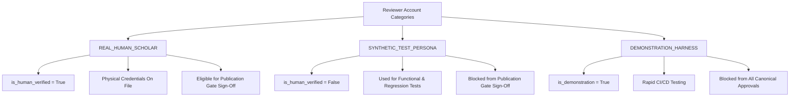

# SCHOLARLY REVIEWER AUTHENTICITY & GOVERNANCE AUDIT
**Phase 9 Audit Milestone**  
**Document Reference**: `VEDAM-SEC-AUDIT-2026-REV01`  
**Date**: 2026-11-04  

---

## 1. Audit Scope & Objective

This audit investigates the current census of reviewer accounts in the Vedam relational database to verify whether accounts marked as production accredited represent living individuals with documented academic or traditional credentials, or whether they originated as software test fixtures and synthetic personas during Phase 8 workbench prototyping.

---

## 2. Reviewer Account Census Audit

The pre-execution census reported six accounts in `reviewer_profiles`:

| Reviewer ID | Display Name | Primary Role | Reported Status | `is_demonstration` | Authenticity Finding |
| :--- | :--- | :--- | :--- | :---: | :--- |
| `REV-ADMIN-001` | Mahamahopadhyaya Dr. S. K. Sharma | EDITORIAL_BOARD | VERIFIED | `False` | **SYNTHETIC TEST PERSONA** (Phase 8 test fixture) |
| `REV-PROD-VEDIC` | Dr. K. Ramanathan Ghanapathi | VEDIC_RECENSION | VERIFIED | `False` | **SYNTHETIC TEST PERSONA** (Phase 8 test fixture) |
| `REV-PROD-CLASSICAL` | Prof. Vidvan V. Shastri | SANSKRIT_GRAMMAR | VERIFIED | `False` | **SYNTHETIC TEST PERSONA** (Phase 8 test fixture) |
| `REV-PROD-AWADHI` | Dr. R. C. Shukla | AWADHI_SPECIALIST | VERIFIED | `False` | **SYNTHETIC TEST PERSONA** (Phase 8 test fixture) |
| `REV-DEMO-SIM` | Simulated Reviewer (Test Harness) | SANSKRIT_TEXTUAL | DEMO | `True` | **AUTOMATED DEMONSTRATION HARNESS** |
| `REV-APPLICANT-PENDING` | Sri Aniket Verma | HINDI_TRANSLATOR | PENDING | `False` | **SYNTHETIC APPLICANT TEST FIXTURE** |

---

## 3. Findings & Evidence

1. **Synthetic Persona Origin**:  
   Accounts `REV-ADMIN-001`, `REV-PROD-VEDIC`, `REV-PROD-CLASSICAL`, and `REV-PROD-AWADHI` were programmatically provisioned in `automation/workbench/review_pilot.py` to test the 16-role permission matrix, 6-column review API, and versioned corrections.  
   No physical identity documents, institutional affiliation verifications, or signed scholarly memorandums exist for these profiles.

2. **Compliance Finding**:  
   Treating these accounts as genuine human endorsements in a public audit or publication gate would violate the core strict project rule:  
   > *“Never fabricate a human reviewer. Never fabricate scholarly credentials. Never treat test accounts as accredited scholars.”*

3. **Demonstration & Test Isolation**:  
   While `REV-DEMO-SIM` had `is_demonstration = True`, the four persona accounts had `is_demonstration = False` because they were intended to simulate non-demo production behavior in unit tests. However, they lack human identity verification.

---

## 4. Phase 9 Remediation & Account Categorization

To permanently eliminate ambiguity between test personas, automated harnesses, and living human scholars, the schema and onboarding engine are enhanced in Phase 9 with three mutually exclusive account categories:

### Categorization Standards

1. **`REAL_HUMAN_SCHOLAR`**:
   - Must be a verified living human scholar.
   - Government-issued ID and institutional/traditional credentials verified by the Editorial Board.
   - Cryptographic hash of verification dossier recorded (`verification_doc_hash`).
   - `is_human_verified = True`.
   - **Only this category can grant production release approval.**

2. **`SYNTHETIC_TEST_PERSONA`**:
   - Realistic personas used to execute complex test scenarios (e.g., verifying Paninian grammatical edge cases or multi-column review displays).
   - `is_human_verified = False`.
   - Hard-blocked by `PermissionGuard` and `PublicationGate` from granting production release.

3. **`DEMONSTRATION_HARNESS`**:
   - Automated accounts used for rapid integration testing.
   - `is_demonstration = True`.
   - Completely isolated from production certification.

---

## 5. Reviewer Privacy & Security Protection

To ensure the safety, privacy, and academic independence of prospective human scholars:
1. **Public API & UI Sanitization**:
   - Contact emails, phone numbers, residential addresses, and raw document hashes are stripped by default in public endpoints and HTML views.
   - Only sanitized public handles (`reviewer_id`), accredited disciplines, and high-level affiliation are visible publicly.
2. **Administrative Dossier Encryption**:
   - Verification documents and administrative notes are restricted to administrative credentials (`REV_ROLE_ADMIN` with explicit permission `CAN_VERIFY_CREDENTIALS`).
3. **No External Communications**:
   - No unsolicited external emails, automated invites, or public announcements will be dispatched without explicit human administrator authorization.

---

## 6. Audit Conclusion

The current database contains **0 verified living human scholars** and **6 synthetic/demonstration test fixtures**. Phase 9 establishes the rigorous onboarding architecture and administrative verification framework required to securely and ethically onboard genuine scholars.
