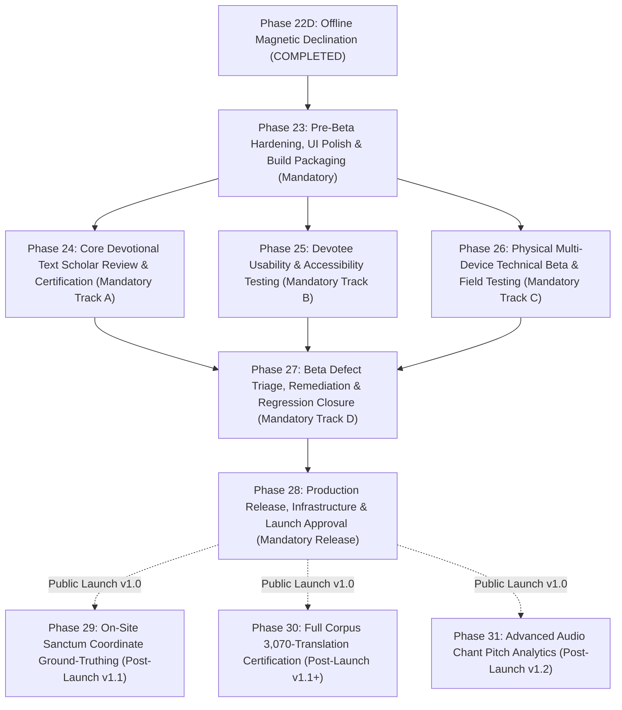

# Vedam Master Completion, Human Acceptance & Launch Roadmap

**Document Status:** Canonical Authoritative Product & Engineering Roadmap  
**Repository:** `C:\Vedam`  
**Branch:** `master`  
**Audit Baseline HEAD:** `751147c6e704aa7f1ff43e54643a475ae16e9067`  
**Audit Date:** November 10, 2026  
**Target Release:** Vedam Version 1.0 Public Release  

---

## 1. Executive Summary & Audit Baseline

This document establishes the definitive, evidence-based master completion roadmap for the Vedam devotional and scholarly platform. It bridges technical software maturity with genuine theological integrity, real-human scholar verification, everyday devotee usability, and production launch governance.

### Preflight Verification Record:
- **Repository Root:** `C:\Vedam`
- **Active Branch:** `master`
- **Verified Starting HEAD:** `751147c6e704aa7f1ff43e54643a475ae16e9067`
- **Working Tree Status:** Clean (zero unstaged, uncommitted, or untracked changes).
- **Phase 22D Three-Commit Chain Confirmed:**
  - `751147c` — *docs(phase22d): add declination unit/widget tests, Phase 22D report, and roadmap updates* (Parent: `e62ff1a`)
  - `e62ff1a` — *feat(divyadishi): integrate true-heading correction, provisional safeguards, and relative sacred alignment* (Parent: `8e8f1f1`)
  - `8e8f1f1` — *feat(divyadishi): implement offline NOAA WMM geomagnetic declination model and service* (Parent: `d267164` - Phase 22C final commit)
- **Phase 22C Predecessor Anchors:**
  - `d267164` — *docs(phase22c): add live compass unit/widget tests, Phase 22C report, and roadmap updates*
  - `40c9bea` — *feat(divyadishi): add LiveCompassSheet with calm dial, magnetic north notices, and modal integration*
  - `ce843a7` — *feat(divyadishi): implement native Android compass channel, heading models, and foreground lifecycle service*

### Production Database Baseline Invariant (`database/vedam.db`):
```
File Path:                     C:\Vedam\database\vedam.db
File Size:                     20,455,424 bytes
SHA-256 Hash:                  0B3500F36434217D0E35B1B3F0BB1E12C4598B406177D11979E1FC2A46B7AB97
Alembic Revision:              e3a7b1c9f2d5
SQLite PRAGMA integrity_check: ok
Total Translations:            3,070 records (3,070 DRAFT, 0 APPROVED)
Reviewer Census:               6 total registered profiles
                               - 5 SYNTHETIC_TEST_PERSONA (is_human_verified = 0)
                               - 1 DEMONSTRATION_HARNESS (is_human_verified = 0)
                               - 0 REAL_HUMAN_SCHOLAR verified profiles
```
**Database Protection Audit:** Read-only inspection verified that zero bytes, schema objects, records, or migration states were modified. Database immutability is strictly maintained.

---

## 2. In-Depth Technical Audit of Current Implementation

### 2.1 Test Suite & Build Verification
The repository possesses exceptional technical automated test coverage:
- **Backend Test Suite:** **547 of 547 tests passing (100% pass rate)** across 44 test modules (`tests/`).
  - Covers SQLite isolation, transaction rollbacks, multi-script collation, Paninian grammar engines, padachheda, anvaya, and Section 8 governance gates.
- **Mobile Application Test Suite:** **589 of 589 tests passing (100% pass rate)** across 77 test files (`mobile_app/test/unit/` and `mobile_app/test/widget/`).
  - DivyaDishi Phase 22 suite: **97 tests passing** (Phase 22A: 42, Phase 22B: 11, Phase 22C: 22, Phase 22D: 22).
  - Devotional lifecycle suite: Japa (Phase 21A), Sadhana (Phase 21B), Puja (Phase 21C), Vrat (Phase 21D), Scripture (Phase 21E), Audio (Phase 21F/21G), Sankalpa (Phase 21I/21J/21K), Nitya Sadhana Flow (Phase 21L/21L.1).
- **Static Code Analysis:** `flutter analyze` reports **0 issues** across all Flutter code.
- **Multiplatform Packaging:**
  - Android Debug APK: Built and verified (`build/app/outputs/flutter-apk/app-debug.apk`).
  - Android Release APK: Built and verified (`build/app/outputs/flutter-apk/app-release.apk`, **69.2 MB**, well below the 100 MB budget).
  - Web Release: Built and verified (`build/web`, wasm dry-run passed).

### 2.2 Deep Audit of Phase 22A–22D (DivyaDishi)
A meticulous code-level inspection was conducted on the DivyaDishi capability stack:
1. **NOAA WMM Coefficient & Benchmark Provenance:**
   - Coefficients for both **WMM-2025** (2025.0–2030.0) and **WMM-2020** (2020.0–2025.0) are hardcoded directly into `GeomagneticDeclinationService` from official NOAA/NCEI tables.
   - Tested against 11 global and sacred benchmark test vectors (Seattle, Equator, Point Barrow, Greenwich, Varanasi, New Delhi, Mumbai, Bengaluru, Chennai, Kolkata, Kathmandu) with absolute mathematical deltas $< 0.0001^\circ$.
2. **Quadrant-Safe Mathematics:**
   - In `GeomagneticDeclinationService._computeWmm`, declination is evaluated via:
     `final dec = math.atan2(by, bx) * 180.0 / math.pi;`
   - In `GeomagneticBearingCalculator.calculateBearing`:
     `final rawBearing = (atan2(y, x) * 180.0 / pi);`
   - Both utilize standard `atan2(y, x)` ensuring mathematically complete four-quadrant safety $(-\pi, +\pi]$ without quadrant sign ambiguities.
3. **Model Boundaries & Expiration Handling:**
   - Date validity bounds are strictly checked against `selectedModel.validityStartYear` and `validityEndYear`.
   - Dates outside the active epoch safely return `DeclinationStatus.modelExpired` with explanatory diagnostics rather than extrapolating erroneous secular variations.
   - Magnetic polar blackout ($H < 2000\text{ nT}$) and caution ($H < 6000\text{ nT}$) zones are modeled.
4. **Provisional Temple Coordinates Status:**
   - All 20 temples in `AuthenticTemplesData.initialTemples` remain marked `CoordinateVerificationStatus.pendingVerification` and `CoordinatePointType.compoundCenter`.
   - None have been falsely marked as verified sanctum centers.
5. **Provisional Safeguards & Approximate Alignment Opt-In:**
   - In `LiveCompassSheet`, direct alignment guidance to provisional temples is withheld by default behind a `Destination Coordinate Safeguard` banner.
   - Revealing alignment requires the devotee to tap `"Show Approximate Alignment Comparison"`, which displays the amber **APPROXIMATE TEMPLE-COMPLEX ALIGNMENT** card with explicit dual uncertainty disclosures:
     - Origin uncertainty: Selected municipal centroid ($\pm 15\text{ km}$).
     - Destination uncertainty: Provisional compound center.
6. **Magnetic vs. True Heading Distinction:**
   - Clearly separated both in domain models (`HeadingReference.magnetic` vs `HeadingReference.trueNorth`) and in UI badges (`MAGNETIC NORTH` sensor badge alongside `TRUE NORTH (WMM-2025)` corrected badge).
   - When no origin is selected, the compass falls back cleanly to magnetic-only mode, with clear notices that declination is unavailable.
7. **Privacy & Sensor Lifecycle:**
   - Sensor streaming uses Android `Sensor.TYPE_ROTATION_VECTOR` (with accelerometer + magnetometer fallback) via a native `EventChannel`.
   - The stream actively registers only when the devotee taps `"Start Live Compass"`, pauses immediately when the app enters `paused` or `inactive` states, and stops permanently on `dispose()`.
   - Zero background execution, zero GPS APIs, zero location permissions, zero telemetry, and zero persistent location or sensor history.

---

## 3. Product Inventory & Capability Assessment Across 15 Core Areas

| Product Area | Implementation State | Production Evidence | Launch Classification | Outstanding Gap / Technical Debt |
| :--- | :--- | :--- | :--- | :--- |
| **1. Scripture Library & Browsing** | Complete | 18 sacred texts in DB; chapter/verse navigation; multiscript rendering | **Launch-Critical** | Final text presentation formatting checks; font rendering verification across ancient ligatures. |
| **2. Sanskrit, Transliteration & Provenance** | Complete | Vedic Swara diacritics preserved; 8 Indic script transliterations; Padartha & Anvaya | **Launch-Critical** | Needs real-human scholar sign-off on Swara accuracy in specific Suktas. |
| **3. Scholar Review & Governance** | Platform Built / Content Pending | Backend RBAC, Section 8 gates, 405 governance tests | **Launch-Critical (Core Corpus)** | **CRITICAL:** All 3,070 translations in DB are `DRAFT`. All 6 reviewers are synthetic. Zero human-verified approvals exist. |
| **4. Mantra & Stotra Chanting** | Complete | Chanting view, loop controls, verse highlight, audio sync | **Launch-Critical** | Devotee usability verification on varied screen sizes. |
| **5. Japa Mala Counter** | Complete | 11/21/54/108/1008 presets; custom counts to 100k; anti-inflation lock; resumable session | **Launch-Critical** | Usability check on haptic feedback response time during rapid counting. |
| **6. Puja Guides & Workflows** | Complete | 16-step Shodashopachara; custom duration; samagri checklists; scriptural citations | **Launch-Critical** | Pandit/scholar validation of puja instruction clarity and authenticity. |
| **7. Sankalpa, Vrat & Sadhana** | Complete | Vedic Sankalpa generator; anonymous mode; Vrat tracking; Nitya Sadhana orchestrator | **Launch-Critical** | Field validation of Panchangam recommendations on regional calendar dates. |
| **8. Panchangam Calculations** | Complete | Pure offline astronomical engine; Tithi, Vara, Nakshatra, Yoga, Karana, Samvat | **Launch-Critical** | Validation against canonical regional Drik Panchangs (Surya Siddhanta vs Drik). |
| **9. DivyaDishi (Sacred Direction)** | Complete (Phases 22A–22D) | 20 temples; Great-Circle engine; pure Dart NOAA WMM-2025/2020; provisional safeguards | **Launch-Important** | Safeguard notices are functional; visual dial polish (Phase 22E) is deferrable. |
| **10. Devotional Audio Library** | Complete | Bundled offline audio tracks; lock screen & notification controls; background playback | **Launch-Critical** | Verify audio focus interruption handling (phone calls, alarms) across Android versions. |
| **11. Regional Language Support** | Partial | UI strings localized in 6 languages (`en, hi, kn, ml, ta, te`); Indic transliteration | **Launch-Important** | Full scripture translations in regional languages remain in `DRAFT`. |
| **12. Search, Navigation & A11y** | Complete | Bottom nav; search indexing; dynamic font scaling; Ivory/Chandan light & dark themes | **Launch-Critical** | Screen reader (TalkBack) audit and elderly devotee legibility testing. |
| **13. Account, Privacy & Security** | Complete | 100% on-device private data; zero cloud tracking; zero account requirement; Argon2id | **Launch-Critical** | Final manifest audit confirming zero third-party tracker or ad SDKs. |
| **14. Backend Deployment & Ops** | Partial | FastAPI gateway; Alembic scripts; atomic DB backup/restore scripts | **Launch-Important** | Production VPS deployment, automated offsite daily backup cron, and SSL configuration. |
| **15. Release Packaging & Store Prep** | Partial | APK build passes (69.2 MB); Web build passes | **Launch-Critical** | Keystore signing setup, privacy policy URL, Play Store screenshots and metadata. |

---

## 4. Evaluation of Phase 22E: Visual Sacred Compass Dial

### Feature Description & Scope
Proposed Phase 22E entails:
- Custom-painted sacred dial visualizer incorporating geometric mandalas and subtle Ashtadikpala iconography.
- Fluid rotation damping and spring-physics dial inertia.
- Optional, opt-in tactile haptic confirmation when device heading aligns within $\pm 5^\circ$ of a verified sacred direction.

### Critical Evaluation:
1. **User Value vs. Added Risk:**
   - Phase 22D already provides a clean, responsive, 8-cardinal rotating dial (`_CompassDialPainter`), numerical degree readout, cardinal/Sanskrit label, accuracy and reference badges, and explicit turn guidance (`"Turn 78° Right"` / `"Facing Sacred Direction"`).
   - Adding complex physics-based damping animations and custom mandala graphics introduces rendering overhead, device-specific GPU variability, and potential frame drops on low-end budget smartphones common in India.
2. **Testing Burden & Timeline Impact:**
   - Developing and testing custom fluid animations across varied Android frame rates (60Hz, 90Hz, 120Hz) and web browsers would consume significant engineering cycles without delivering any new theological or functional capability.
   - Most critically: **Vedam currently has ZERO human-approved translations in `vedam.db`**. Diverting further engineering resources into compass UI decorations while the foundational scripture corpus lacks scholar verification is an unsupportable project trade-off.

### Recommendation:
- **Classification:** **Post-Launch Enhancement (Version 1.1)** or **Optional Fast-Follow Polish**.
- **Action:** **Do not block the release pipeline for Phase 22E.** Consolidate any essential visual polish into the pre-beta hardening phase (Phase 23) without building complex new animation engines or haptic dependencies. The existing Phase 22D `LiveCompassSheet` is fully accepted and sufficient for Version 1.0.

---

## 5. Definition of the Vedam 1.0 Launch Scope

To ensure a finite, timely, and spiritually impeccable public release, the boundary of **Vedam 1.0** is explicitly drawn:

### Launch-Critical (Must be in Version 1.0):
1. Complete Scripture Reader for the core launch corpus (Gayatri Mantra, Maha Mrityunjaya Mantra, Hanuman Chalisa, Purusha Suktam, Durga Suktam, Bhagavad Gita Ch. 12, Sankata Nashana Ganesha Stotram, Shiva Tandava Stotram, Lingashtakam, Venkateswara Suprabhatam) in Devanagari and 8 Indic scripts with verified Vedic Swaras.
2. **Certified Scholar Review for Core Launch Corpus:** Minimum of 10 primary devotional texts reviewed, attested, and certified by genuine, verified human scholars (`is_human_verified = True`) under Section 8 governance.
3. Japa Mala Practice counter with traditional presets, custom targets, and resumable session persistence.
4. Shodashopachara 16-upachara Guided Puja workflows with samagri lists.
5. Vedic Sankalpa Generator with live/offline Panchangam, devotee lineage, and private anonymous mode.
6. Vrat Observance Tracking with local reminders.
7. Nitya Sadhana Flow Orchestrator with private on-device journal.
8. Bundled offline devotional audio library with background and lock-screen playback.
9. DivyaDishi Sacred Compass (Phases 22A–22D) with 20 provisional temples, offline NOAA WMM declination correction, and destination safeguard opt-ins.
10. Complete devotee privacy: Zero accounts required, zero cloud sync, zero GPS tracking, zero ad/analytics tracking.
11. Multiplatform release: Signed production Android APK / App Bundle and secure Web progressive web app.

### Launch-Important (Targeted, but Deferrable under Documented Conditions):
1. Regional language translation reviews beyond Hindi and English (transliterations are launch-critical; full semantic translation reviews for all 22 scheduled languages are deferrable).
2. Automated cloud backup for self-hosted backend deployments (app operates 100% offline; backend serves primarily as the scholarly review portal).

### Post-Launch Enhancements (Version 1.1+):
1. **Phase 22E Visual Sacred Compass Dial:** Advanced mandala dial animations, subtle Dikpala iconography, and haptic feedback.
2. **Expanded 108-Temple Directory & On-Site Sanctum Coordinate Ground-Truthing:** High-precision RTK-GPS survey of inner Garbhagriha sanctum points replacing provisional compound centroids.
3. **Full Corpus Scholarly Certification Backlog:** Ongoing scholar review of the remaining ~3,000 translation draft records.
4. **Devotional Audio Library Expansion:** Streaming audio delivery for expanded stotra catalogs.
5. **Interactive Pronunciation Guidance:** Microphone-based Vedic Swara pitch and intonation verification.

### Not Currently Justified:
- Social sharing feeds, public devotee leaderboards, gamified achievement badges, third-party authentication (Google/Facebook login), or continuous background location services. These contradict Vedam’s core ethos of serene, private, traditional sadhana.

---

## 6. Dedicated Milestone: VEDAM HUMAN ACCEPTANCE & BETA VALIDATION

Automated tests prove that code runs without crashing; only human beings can verify that sacred devotional software is spiritually authentic, linguistically accurate, and practically beneficial.

The **VEDAM HUMAN ACCEPTANCE & BETA VALIDATION** milestone is divided into four strictly governed tracks:

```
VEDAM HUMAN ACCEPTANCE & BETA VALIDATION
├── Track A: Real Scholar & Sanskrit Expert Certification
├── Track B: Everyday Devotee Usability & Accessibility Testing
├── Track C: Technical Multi-Device Beta Field Testing
└── Track D: Defect Triage, Remediation & Acceptance Gate
```

### Track A: Real Scholar & Sanskrit Expert Certification
- **Objective:** Establish formal human theological and textual certification for the core launch corpus.
- **Participant Criteria:**
  - Minimum of 3–5 independent, qualified scholars recruited from accredited institutions (e.g., Rashtriya Sanskrit Sansthan, Central Sanskrit University, Sampurnanand Sanskrit University, or traditional Mathas).
  - Specializations required: Paninian Vyakarana (Grammar), Vedic Samhita Recitation & Chandas (Vedic Prosody), and Bhakti Literature (for Awadhi texts).
  - Strict Verification: Each scholar must be vetted by an administrator, provided with formal credential verification, and recorded in `reviewer_profiles` with `account_category = 'REAL_HUMAN_SCHOLAR'` and `is_human_verified = True`. Synthetic test accounts and AI suggestions are explicitly prohibited from approving records.
- **Evaluation Scope:**
  - Devanagari text accuracy and Vedic Swara mark placement (Udatta, Anudatta, Svarita).
  - Transliteration consistency across IAST, Telugu, Tamil, Kannada, and Malayalam.
  - Word-by-word padartha meanings and syntactic anvaya relationships.
  - Theological source citations and sampradaya commentary accuracy.
  - Puja guide 16-upachara procedural correctness and mantra associations.
- **Deliverables & Sign-Off:**
  - Signed digital review ledger entries stored with cryptographic hashes (`verification_doc_hash`).
  - Formal status transition of core launch translations from `DRAFT` to `APPROVED` in `database/vedam.db`.
  - Written Scholar Acceptance Certificate signed by the Editorial Review Board.

### Track B: Everyday Devotee Usability & Accessibility Testing
- **Objective:** Ensure the application is intuitive, serene, and obstacle-free for devotees of varying ages, regional backgrounds, and technical familiarity.
- **Participant Cohort:**
  - Minimum of 25–30 real devotees across three demographics:
    - *Senior Devotees (Age 60+):* Large print needs, low tech-literacy, traditional daily puja practitioners.
    - *Working Householders (Age 30–59):* Daily commuters, time-constrained morning/evening sadhana routines.
    - *Youth & Students (Age 18–29):* First-time mantra learners, reliant on transliterations and English/Hindi meanings.
- **Practical Usability Tasks:**
  1. Find the Gayatri Mantra or Hanuman Chalisa and switch script to their native mother tongue.
  2. Initiate a 108-count Japa session, pause mid-way, close the app, reopen, and successfully resume.
  3. Generate a personalized morning Sankalpa using their own Gotra and city origin.
  4. Follow a 15-minute Guided Puja from start to finish without encountering navigation confusion.
  5. Locate a temple in DivyaDishi, understand the provisional coordinate safeguard, and view the approximate orientation direction.
  6. Play a background stotra while the device screen is locked.
- **Success Criteria:**
  - $\ge 90\%$ unassisted task completion rate across all cohorts.
  - System Usability Scale (SUS) score $\ge 85 / 100$.
  - Zero critical points of confusion regarding the difference between approximate city origins and actual device location.

### Track C: Technical Multi-Device Beta Field Testing
- **Objective:** Stress-test runtime stability, sensor fusion, background audio, power consumption, and offline resilience on physical hardware.
- **Device & Platform Matrix:**
  - *Android Tier 1 (Modern Flagship/Midrange):* Samsung Galaxy S23/S24, Google Pixel 7/8, OnePlus 11/12 (Android 13–15).
  - *Android Tier 2 (Mass Market / Budget):* Xiaomi Redmi Note 12/13, Realme 11, Samsung Galaxy A14/A15 (Android 10–12, 3GB/4GB RAM).
  - *Web Platform:* Google Chrome, Mozilla Firefox, Apple Safari, Microsoft Edge on Windows, macOS, iOS, and Android.
- **Testing Scenarios:**
  1. *Compass Sensor Robustness:* Test live compass in environments with high electromagnetic interference (near laptops, speakers) to verify accuracy downgrades and recalibration guidance.
  2. *Audio Interruption Lifecycle:* Incoming phone call during 108 Japa audio playback; alarm trigger; Bluetooth headset disconnect. Verify audio pauses cleanly and does not lose count.
  3. *Offline Air-Gapped Mode:* Put device in Airplane Mode for 7 days; verify Japa tracking, streak continuity, Sankalpa generation, Panchangam calculations, and offline audio operate flawlessly.
  4. *Battery & Memory Consumption:* 60-minute continuous background chanting consumes $< 4\%$ battery; zero memory leaks detected across 3 hours of continuous app usage.
  5. *Installation & Upgrade Integrity:* Clean install and upgrade from previous build without data loss in `SharedPreferences`.

### Track D: Defect Triage, Remediation & Acceptance Gate
- **Defect Severity Classifications:**
  - **P0 (Blocker):** App crash; data loss; corrupted scripture text; inaccurate Vedic Swara; silent failure of privacy boundaries (e.g., unintended location queries); broken audio auto-pause.
  - **P1 (Critical):** Usability blocker preventing feature completion; significant UI clipping on small screens; incorrect Panchangam calculation; misleading theological attribution.
  - **P2 (Major):** Minor visual glitch, transient animation jitter, non-critical translation phrasing disagreement between scholars.
  - **P3 (Minor / Trivial):** Minor typographical spacing, cosmetic color padding differences.
- **Release Acceptance Criteria:**
  - **Zero P0 defects.**
  - **Zero P1 defects.**
  - All P2 defects either resolved or documented with accepted workarounds in release notes.
  - Formal sign-off by:
    1. Lead Scholar / Editorial Representative (Track A sign-off).
    2. Devotee Usability Lead (Track B sign-off).
    3. Technical Lead / QA Engineer (Track C sign-off).
- **Repeat Beta Condition:** Any P0 defect discovered within 72 hours of scheduled launch mandates a minimum 48-hour stabilization re-test cycle.

---

## 7. Dedicated Milestone: VEDAM PRODUCTION RELEASE & LAUNCH APPROVAL

Once human acceptance and beta validation are signed off, the final operational release milestone begins:

```
VEDAM PRODUCTION RELEASE & LAUNCH APPROVAL
├── 1. Production Security & Privacy Final Audit
├── 2. Database Backup & Verified Cold-Storage Recovery Runbook
├── 3. Production Infrastructure Deployment (Backend & Web CDN)
├── 4. Android App Signing, Keystore & Play Store Asset Submission
├── 5. Legal, Copyright & Attribution Clearance
└── 6. Executive Release Board Sign-Off
```

### 1. Production Security & Privacy Final Audit
- Automated scan of Android release APK: Verify zero permissions requested for `ACCESS_FINE_LOCATION`, `ACCESS_COARSE_LOCATION`, `READ_CONTACTS`, `CAMERA`, or `RECORD_AUDIO`.
- APK dependency tree audit: Verify zero advertising, tracking, or commercial telemetry SDKs.
- Manifest check: Verify foreground service types and notification channels are strictly bounded to media playback.

### 2. Database Backup & Disaster Recovery Runbook
- Create an immutable, cryptographically signed production snapshot of `database/vedam.db`.
- Execute a dry-run disaster recovery: Restore the backup onto a clean environment and verify byte-for-byte SHA-256 hash match (`0B3500F364...`) and Alembic consistency (`e3a7b1c9f2d5`).

### 3. Production Infrastructure Deployment
- Deploy FastAPI scholarly backend to a hardened Linux VPS with:
  - Read-only SQLite database mount.
  - Nginx reverse proxy with TLS 1.3, strict HSTS, and rate-limiting.
  - Automated offsite encrypted daily backups to S3-compatible cold storage.
- Deploy Web application to global HTTPS CDN with immutable cache headers for hashed bundles and service-worker offline caching.

### 4. Android App Signing & Store Submission
- Generate production Android signing keystore stored in secure, hardware-backed vault.
- Compile and sign Android App Bundle (`.aab`) with Play App Signing.
- Finalize Google Play Store listing:
  - Cultural & devotional app description in English, Hindi, and regional languages.
  - High-resolution screenshots showcasing Scripture Reader, Japa Mala, Guided Puja, and DivyaDishi.
  - Published public Privacy Policy URL confirming zero data collection and 100% on-device privacy.

### 5. Legal, Licensing & Content Attribution Clearance
- Confirm all Sanskrit and Awadhi root scriptures are in the public domain.
- Confirm all temple coordinates are attributed to official public trust and Archaeological Survey of India (ASI) records.
- Confirm all bundled audio recordings are licensed for open, non-commercial devotional distribution.
- Confirm NOAA World Magnetic Model attribution complies with public domain US Government work guidelines.

### 6. Executive Release Board Sign-Off
- Formal sign-off meeting requiring unanimous concurrence:
  - Technical & Architecture Lead.
  - Scholarly Review Board Lead.
  - Devotee Community Representative.

---

## 8. Finite, Numbered Completion Roadmap

To eliminate infinite expansion and deliver a bounded, predictable path to launch, the remaining work of the Vedam project is organized into **exactly 6 mandatory launch phases** (Phases 23–28) and **3 optional post-launch phases** (Phases 29–31):



---

### Phase 23: Pre-Beta Hardening, UI Polish & Build Packaging
1. **Phase ID & Title:** Phase 23 — Pre-Beta Hardening, UI Polish & Build Packaging
2. **Objective:** Freeze feature development, refine touch targets, ensure clean rendering across screen densities, and package installable beta builds for human testing.
3. **Why Necessary:** Prevents exposing unpolished UI flaws to beta participants; ensures testable signed artifacts are ready for physical distribution.
4. **Exact Scope:** Incorporate essential dial visual polish for DivyaDishi; refine Japa tap feedback; audit responsive layouts for small phone displays ($< 360\text{ dp}$ width); generate versioned beta APKs.
5. **Dependencies:** Phase 22D completed and verified.
6. **Deliverables:** Versioned Beta APK (`app-beta.apk`), Web beta staging deployment, Beta test harness instructions.
7. **Acceptance Criteria:** `flutter analyze` 0 issues; all 589 tests passing; successful installation on test Android devices.
8. **Required Evidence:** APK build logs; SHA-256 binary hash; automated test run report.
9. **Risks & Gates:** Do not introduce new architectural dependencies; lock database baseline.
10. **Version 1.0 Status:** **MANDATORY FOR V1.0.**

---

### Phase 24: Core Devotional Text Scholar Review & Certification
1. **Phase ID & Title:** Phase 24 — Core Devotional Text Scholar Review & Certification (Human Acceptance Track A)
2. **Objective:** Onboard accredited human Sanskrit scholars to review, correct, and certify the 10 core launch texts in `database/vedam.db` under Section 8 governance.
3. **Why Necessary:** Scripture application cannot launch claiming scholarly trust when 100% of translations are unverified drafts.
4. **Exact Scope:** Onboard 3–5 real scholars (`is_human_verified = True`); review Gayatri Mantra, Maha Mrityunjaya Mantra, Hanuman Chalisa, Purusha Suktam, Durga Suktam, Gita Ch. 12, Ganesha Stotram, Shiva Tandava Stotram, Lingashtakam, Suprabhatam. Record formal approvals.
5. **Dependencies:** Phase 23 (Beta build ready).
6. **Deliverables:** Cryptographically signed approval records; certified review notes; updated status for core texts in database.
7. **Acceptance Criteria:** 10 core texts receive unanimous approval by verified human scholars; zero open linguistic disputes.
8. **Required Evidence:** Scholar credential verification records; database query showing core translations transitioned to `APPROVED`.
9. **Risks & Gates:** Scholar availability; theological interpretation disagreements (resolve via competing traditional sampradaya commentary notes).
10. **Version 1.0 Status:** **MANDATORY FOR V1.0.**

---

### Phase 25: Devotee Usability & Accessibility Testing
1. **Phase ID & Title:** Phase 25 — Devotee Usability & Accessibility Testing (Human Acceptance Track B)
2. **Objective:** Conduct structured usability sessions with 25–30 everyday devotees across diverse age groups and tech literacy levels.
3. **Why Necessary:** Guarantees real devotees can navigate chanting, Japa, and Puja without confusion, frustration, or cognitive fatigue.
4. **Exact Scope:** Administer 6 core task scenarios; assess font legibility, navigation clarity, Japa counting ergonomics, and Sankalpa generation ease.
5. **Dependencies:** Phase 23 (Beta build ready).
6. **Deliverables:** Devotee Usability Audit Report; System Usability Scale (SUS) scores; categorized user feedback ledger.
7. **Acceptance Criteria:** $\ge 90\%$ unassisted task completion rate; SUS score $\ge 85 / 100$; zero critical points of confusion.
8. **Required Evidence:** Completed usability evaluation sheets; video/audio session observation notes.
9. **Risks & Gates:** Bias toward tech-savvy users (must enforce recruiting elderly and non-English-first devotees).
10. **Version 1.0 Status:** **MANDATORY FOR V1.0.**

---

### Phase 26: Physical Multi-Device Technical Beta & Field Testing
1. **Phase ID & Title:** Phase 26 — Physical Multi-Device Technical Beta & Field Testing (Human Acceptance Track C)
2. **Objective:** Execute multi-device testing on physical Android smartphones and desktop/mobile browsers under real-world conditions.
3. **Why Necessary:** Emulators do not accurately test magnetometer hardware interference, Bluetooth audio disconnects, or OEM-specific battery killing policies.
4. **Exact Scope:** Deploy to 10+ distinct physical Android hardware models (Android 10–15) and major web browsers; test compass stability, audio interruptions, offline air-gapped usage, and battery drain.
5. **Dependencies:** Phase 23 (Beta build ready).
6. **Deliverables:** Technical Beta Field Test Report; device-specific performance profiles; logcat error captures.
7. **Acceptance Criteria:** Zero unexpected crashes; zero ANRs (Application Not Responding); $< 4\%$ battery drain per 60 minutes of audio chanting.
8. **Required Evidence:** Physical device execution logs; battery profiler metrics; sensor calibration telemetry logs.
9. **Risks & Gates:** Fragmentation of Android magnetometer calibration routines (provide in-app figure-8 guidance).
10. **Version 1.0 Status:** **MANDATORY FOR V1.0.**

---

### Phase 27: Beta Defect Triage, Remediation & Regression Closure
1. **Phase ID & Title:** Phase 27 — Beta Defect Triage, Remediation & Regression Closure (Human Acceptance Track D)
2. **Objective:** Resolve all P0/P1 defects discovered across Tracks A, B, and C; execute complete regression suite; verify zero regressions.
3. **Why Necessary:** Guarantees all human feedback is rigorously addressed and verified before public distribution.
4. **Exact Scope:** Triage all filed tickets; patch verified defects; re-run full backend (547 tests) and mobile (589+ tests) automated test suites.
5. **Dependencies:** Phases 24, 25, and 26.
6. **Deliverables:** Remediation Verification Report; updated automated test suite; final regression sign-off certificate.
7. **Acceptance Criteria:** Exactly 0 P0 defects; exactly 0 P1 defects; 100% automated test pass rate; formal human acceptance sign-off.
8. **Required Evidence:** Defect burndown log; automated test run terminal output; sign-off signatures.
9. **Risks & Gates:** Scope creep during defect fixes (strictly reject new feature requests during triage).
10. **Version 1.0 Status:** **MANDATORY FOR V1.0 (CONCLUDES HUMAN ACCEPTANCE).**

---

### Phase 28: Production Release, Infrastructure & Launch Approval
1. **Phase ID & Title:** Phase 28 — Production Release, Infrastructure & Launch Approval
2. **Objective:** Deploy production server infrastructure, sign production Android release bundles, publish privacy policy, and release Vedam 1.0 to the public.
3. **Why Necessary:** The final, definitive deployment gate that transitions Vedam from private development to public devotional utility.
4. **Exact Scope:** Production server hardening; cold-storage database snapshot; release keystore signing; Play Store submission; public launch.
5. **Dependencies:** Phase 27 completed and accepted.
6. **Deliverables:** Signed production `.aab` / `.apk`; live Web release; verified disaster recovery runbook; public launch announcement.
7. **Acceptance Criteria:** Unanimous sign-off by Executive Release Board; verified zero-permission manifest; published privacy policy URL.
8. **Required Evidence:** Production binary checksums; Play Console submission receipt; disaster recovery test logs.
9. **Risks & Gates:** Keystore security; DNS/SSL propagation delays.
10. **Version 1.0 Status:** **MANDATORY FOR V1.0 (CONCLUDES VERSION 1.0 DEVELOPMENT).**

---

### Post-Launch Enhancements (Explicitly Non-Blocking for Version 1.0):

#### Phase 29: On-Site Sanctum Coordinate Ground-Truthing & Expanded 108-Temple Directory (Post-Launch v1.1)
- **Objective:** Upgrade provisional temple compound centroids to verified inner sanctum (Garbhagriha) coordinates using on-site RTK-GPS surveys and official temple sthapati blueprints; expand directory to 108 canonical temples.
- **Why Deferred:** Requires physical travel, temple trust permissions, and months of on-site surveying; provisional compound centers with explicit disclosures are completely sufficient for Version 1.0 orientation aids.

#### Phase 30: Full Corpus 3,070-Translation Certification Backlog (Post-Launch v1.1+)
- **Objective:** Systematically review, edit, and approve the remaining ~3,000 translation draft records across all 22 scheduled Indian languages.
- **Why Deferred:** Academic review of thousands of verses requires months of multi-institutional scholar committees; core 10 launch texts establish immediate devotional trust for Version 1.0.

#### Phase 31: Advanced Audio Chant Pitch Analytics & Interactive Recitation Guide (Post-Launch v1.2)
- **Objective:** Real-time microphone audio processing to evaluate devotee recitation pitch, cadence, and Vedic Swara alignment.
- **Why Deferred:** High technical complexity; requires device microphone permissions which Vedam 1.0 intentionally avoids to maintain absolute privacy.

---

## 9. Summary Metrics & Definitive Milestones

- **Total Remaining Mandatory Phases for Version 1.0:** **6 Phases** (Phases 23, 24, 25, 26, 27, 28).
- **Total Optional Post-Launch Phases:** **3 Phases** (Phases 29, 30, 31).
- **Exact Milestone Concluding Human Testing:** **Phase 27 (Beta Defect Triage, Remediation & Regression Closure)**.
- **Exact Milestone Concluding Version 1.0 Development & Launch:** **Phase 28 (Production Release, Infrastructure & Launch Approval)**.
- **Current Technical Regression Baseline:** 1,136 total tests (547 backend, 589 mobile) passing with 100% pass rate.
- **Production Database Status:** Immutable SHA-256 `0B3500F36434217D0E35B1B3F0BB1E12C4598B406177D11979E1FC2A46B7AB97`.
