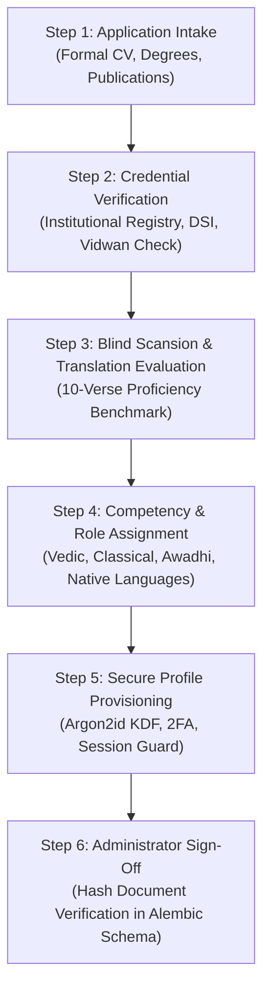

# Authentic Scholar Onboarding & Accreditation Checklist (Phase 10)
**Document Version:** 1.0.0  
**Target:** Senior Administrator / Institutional Review Committee  
**Current Census Status:** **Zero Verified Living Human Scholars Onboarded**  
**Mandate:** Zero fabrication of human credentials; zero external emails/invitations dispatched without user approval.  

---

## 1. Governance Boundary & Census Affirmation

As established in the Phase 9 Authenticity Audit, all existing reviewer accounts in the database are classified as either `SYNTHETIC_TEST_PERSONA` or `DEMONSTRATION_HARNESS`.
- No living human scholar has yet been formally onboarded.
- Non-human accounts are programmatically barred by `PermissionGuard.require_human_scholar` from granting binding production approval (`is_human_verified = False`).
- All 10 newly generated pilot translation views (and all 3,070 translations) remain strictly in `DRAFT` status pending authentic human sign-off.

This checklist provides the operational verification protocol for onboarding the **first living human scholar**.

---

## 2. Administrator-Facing Onboarding Protocol

---

## 3. Mandatory 6-Step Verification Checklist

### Step 1: Institutional Credential Verification
- [ ] **Physical / Digital Degree Verification:** Verified doctoral (Ph.D./Vidyavaridhi) or traditional Acharya degree from a recognized institution (e.g. Rashtriya Sanskrit Sansthan, Sampurnanand Sanskrit Vishwavidyalaya, Oxford, SOAS, BHU, Tirupati).
- [ ] **Academic Registry Cross-Check:** Verified scholar's profile in national/international academic databases (e.g. Indian Vidwan database, ORCID, Google Scholar, university faculty roster).
- [ ] **Traditional Lineage / Sampradaya Adhyayana (Where Applicable):** For Vedic recensionists, documented Gurukula training under accredited Veda Pathashalas with verified oral certification (*Veda Bhashya Pravina* or *Ghanapathi*).

### Step 2: Competency-to-Role Mapping Matrix
The scholar must be assigned only to roles matching documented specializations:

| Specialization Category | Approved Roles | Required Qualification Baseline |
| :--- | :--- | :--- |
| **Vedic Recension** | `VEDIC_RECENSION`, `TRADITIONAL_COMMENTARY` | Documented Taittiriya/Rigvedic Swara training; minimum 5 years studying Sayana or Bhatta Bhaskara Bhashya. |
| **Classical Sanskrit** | `SANSKRIT_TEXTUAL`, `SANSKRIT_GRAMMAR` | Advanced Paninian Vyakarana proficiency (*Ashtadhyayi* / *Siddhanta Kaumudi*); publication in peer-reviewed Indological journals. |
| **Awadhi Literature** | `AWADHI_SPECIALIST` | Documented expertise in medieval Eastern Hindi / Awadhi manuscripts (Tulsidas tradition, *Ramcharitmanas*). |
| **Regional Language Review** | `{LANG}_TRANSLATOR` | Native-speaker fluency; literary translation record in target language; demonstrated mastery of Sanskrit devotional vocabulary. |

### Step 3: Blind Scansion & Alignment Evaluation
Before account activation, the applicant must complete an offline blind evaluation:
- [ ] Accurately scan Padachheda on 5 compound classical verses.
- [ ] Correctly identify Chandas (syllabic meter: Laghu/Guru markings) on 3 verses.
- [ ] Align Taittiriya / Rigvedic Swaras (Udatta, Anudatta, Svarita) on 2 Vedic verses.
- [ ] Identify and contextualize a theological variant (Advaita vs Vishishtadvaita) without sectarian bias.

### Step 4: Administrator Cryptographic Attestation
When registering the scholar in the system:
1. Compute SHA-256 hash of verified credential dossier: `verification_doc_hash = sha256(cv_and_degrees.pdf)`.
2. Set `account_category = 'REAL_HUMAN_SCHOLAR'`.
3. Set `is_human_verified = True`.
4. Record `verification_authority = 'Chief Indological Administrator (Manual Audit)'`.
5. Apply Argon2id memory-hard password generation.

### Step 5: Privacy & Identity Protection
- [ ] Scholar's personal email, phone number, and physical address stored strictly in offline administrative files.
- [ ] Public API schemas expose only `public_pseudonym`, academic title, institutional affiliation, and specialization roles.

### Step 6: External Communication Quarantine
- [ ] **Strict Constraint:** No external emails, invitations, or API calls dispatched to external recipients without explicit written authorization from the Project Director.
