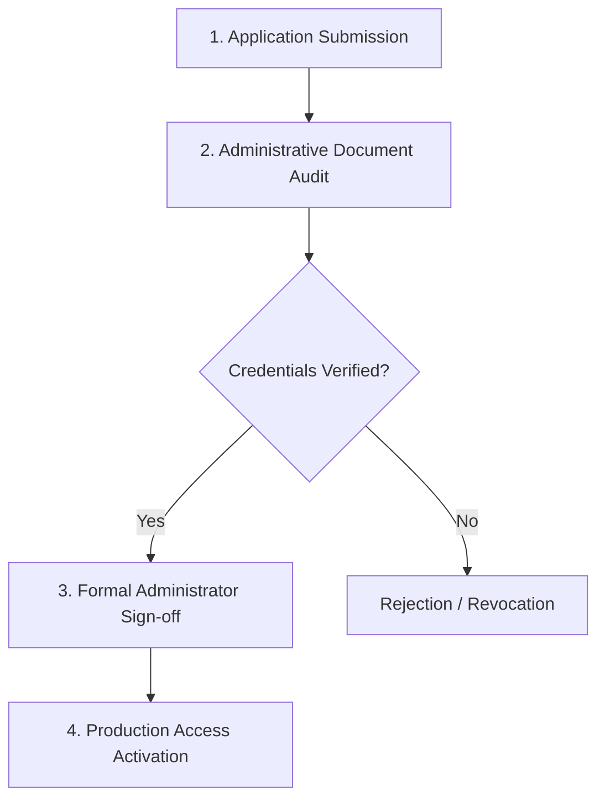

# Vedic Heritage Platform — Scholarly Reviewer Onboarding Guide
**Governance, Credential Verification & Ethical Code for Accredited Sanskrit & Vernacular Scholars**

**Version:** 2.0 (Phase 8 Production Release)  
**Governance Council:** Vedam Editorial Board & Archival Council  

---

## 1. Introduction & Ethical Mandate

The Vedic Heritage Platform maintains an uncompromising commitment to **textual authenticity, traditional recension fidelity, and philological rigor**. Automated linguistic models (AI) exist solely as computational assistants; **all published canonical texts, word-by-word breakdowns, and multilingual translations must be authenticated by qualified human scholars**.

Reviewers are entrusted with preserving sacred literature. Every approval, correction, or textual dispute resolution is immutably logged with the scholar's credential signature.

> [!IMPORTANT]
> **Strict Demonstration Barrier:** Demonstration accounts (`is_demonstration = True`) exist solely for software integration testing and cannot issue production approvals. Real scholarly reviewers must undergo formal credential verification by an authorized administrator before approval permissions are activated.

---

## 2. Reviewer Specialization Roles & Competency Criteria

Candidates may apply for one primary role and multiple secondary specializations:

| Reviewer Role | Target Canonical Texts | Minimum Qualification | Required Scholarly Competencies |
| :--- | :--- | :--- | :--- |
| **`VEDIC_RECENSION`** | Rigveda (*Gayatri, Mahamrityunjaya, Sri Suktam*), Suktams | Acharya in Veda or MA/PhD in Vedic Studies; traditional Veda Adhyayana | Oral recitation mastery; certified Swara accent markings (Udatta, Anudatta, Svarita); Shakha recension awareness; Sayana/Bhatta Bhaskara familiarity. |
| **`SANSKRIT_TEXTUAL`** | Classical Stotras, Epics, Suktams | Acharya / MA in Sanskrit Textual Criticism or Philology | Critical manuscript collation; variant apparatus analysis; classical Chandas scansion; orthographic and sandhi normalization. |
| **`SANSKRIT_GRAMMAR`** | All Sanskrit Compositions | Acharya / PhD in Paninian Vyakarana | Ashtadhyayi Sutra citation mastery; Mahabhashya/Kashika familiarity; Padachheda dissection; Subanta/Tinganta morphological analysis. |
| **`AWADHI_SPECIALIST`** | *Hanuman Chalisa*, Tulsidas Literature | MA/PhD in Early Modern Hindi / Awadhi Bhakti Literature | Vernacular Awadhi morphology, phonology, and archaic lexemes; Tulsidas manuscript traditions; Chaupai (16 matras) and Doha (13+11 matras) prosody. |
| **`REGIONAL_TRANSLATOR`** *(te, ta, kn, mr, bn, gu, ml, or, hi)* | Regional Language Workflows | MA in Target Language or Accredited Literary Translator | Native target language proficiency; devotional and liturgical idiom fluency; syntactic accuracy preserving Sanskrit semantic nuance. |
| **`TRADITIONAL_COMMENTARY`** | Philosophical Tatparya Views | Traditional Matha initiation or recognized Acharya title | Bhashya citation accuracy (Advaita, Vishishtadvaita, Dvaita); doctrinal fidelity; distinguishing original bhashya from modern interpretive glosses. |
| **`EDITORIAL_BOARD`** | Canonical Release Gate | Senior Professor / Acharya with 10+ years experience | Multi-tradition dispute adjudication; consensus drafting; holistic oversight of text, translation, and copyright integrity. |

---

## 3. Four-Stage Onboarding & Verification Workflow

### Stage 1: Application Submission
- Applicant submits the formal [Reviewer Application Form](file:///c:/Vedam/documentation/review/REVIEWER_APPLICATION_FORM.md).
- Account is provisioned in **`PENDING_VERIFICATION`** status with `is_credentials_verified = False`.
- Password is encrypted using PBKDF2-HMAC-SHA256 (100,000 iterations).

### Stage 2: Administrative Document Audit
- Administrator with `CAN_VERIFY_CREDENTIALS` audits submitted institutional degrees, Matha certificates, and published translation works.
- Minimum publication and academic requirements are cross-checked against university or traditional Matha rosters.

### Stage 3: Formal Administrator Sign-off
- The verifying administrator records:
  - Administrator Reviewer ID (`verified_by_admin`)
  - Formal Verification Method (`verification_method`, e.g., `UNIVERSITY_FACULTY_APPOINTMENT`)
  - Verification Notes (`verification_notes`)
  - Timestamp (`verification_date`)
- Status transitions to **`VERIFIED`**, activating `APPROVE_TRANSLATION` permissions.

### Stage 4: Access Revocation & Deactivation
- In the event of ethical breaches or inactive engagement, administrators may deactivate profiles.
- Deactivation immediately terminates all active cryptographic sessions (`ReviewerSession.is_revoked = True`).

---

## 4. Platform Security & Privacy Protections

- **Password Standards:** Minimum 8 characters with required complexity; hashed with 16-byte cryptographically secure random salt.
- **Account Lockout:** Automatically enforced after 5 consecutive failed login attempts to prevent brute-force attacks.
- **Rate Limiting:** Sliding-window rate limiting on all authentication and review submission endpoints.
- **CSRF Protection:** State-changing operations require session-bound HMAC-SHA256 CSRF tokens.
- **Public Profile Sanitization:** Public platform views hide email addresses, phone numbers, password hashes, and internal permission flags.

---

## 5. Reviewer Code of Conduct & Scholarly Integrity

1. **Source Verse Immutability:** Reviewers must NEVER alter or overwrite canonical Sanskrit or Awadhi source verses.
2. **Competing Traditions Preservation:** Competing traditional readings (e.g. Advaita vs Vishishtadvaita) must be registered in the dispute ledger (`TextualDispute`) without overwriting or erasing the rival reading.
3. **AI Suggestion Disclaimer:** AI-generated annotations are suggestions only. Scholars must critically verify all Sandhi splits, Anvaya word orders, and grammatical citations.
4. **Citations Standard:** Commentary references must identify the specific work, volume, and section/verse (e.g., *Sayana RV Bhashya 3.62.10, VSM Vol. II, p. 385*). Broad unsourced commentator names are forbidden.
