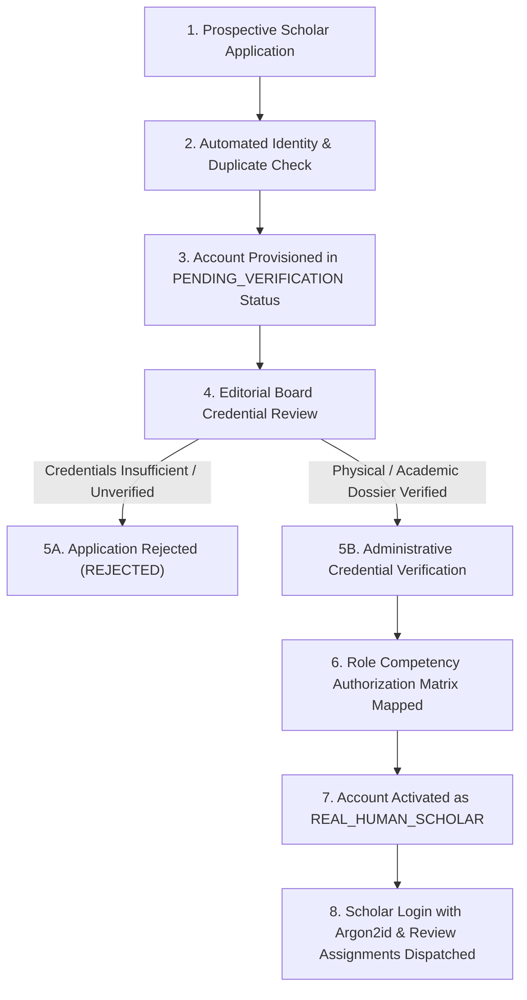

# AUTHENTIC HUMAN SCHOLAR ONBOARDING WORKFLOW & GOVERNANCE
**Phase**: Phase 9 Authentic Human Review Architecture  
**Document Reference**: `VEDAM-REV-WORKFLOW-2026-V1`  
**Date**: 2026-11-04  

---

## 1. Purpose & Core Principles

This document establishes the official procedure for onboarding living human scholars, traditional Acharyas, and accredited native-language translators to the Vedam Vedic Knowledge Platform.

### Strict Governance Invariants
1. **Never fabricate human identities or qualifications**.
2. **Never count demonstration accounts or automated test harnesses as scholars**.
3. **Never send unsolicited external emails or invitations without explicit Director approval**.
4. **Enforce discipline-specific authorizations**: Verification in one discipline (e.g. Classical Grammar) does not grant review authority in unrelated traditions (e.g. Rigvedic recensions or regional translations).
5. **Protect Scholar Privacy**: Personal contact details (phone numbers, private emails, residential addresses, document scans) are stored in encrypted administrative records and never exposed in public APIs or web displays.

---

## 2. Onboarding Workflow Stages



### Stage 1: Application Intake
Prospective scholars submit credentials through the official application form ([`REVIEWER_APPLICATION_FORM.md`](file:///c:/Vedam/documentation/review/REVIEWER_APPLICATION_FORM.md)). The application captures:
- Full legal name and preferred academic citation handle.
- Primary and secondary review disciplines.
- Highest traditional titles (e.g., *Ghanapathi*, *Salakshana*, *Vidwan*, *Acharya*) or university degrees (MA, MPhil, PhD).
- Formal institutional affiliation or traditional Gurukula/Matha lineage.
- Documented publication history (critical editions, peer-reviewed monographs, translation credits).
- Target language mother-tongue proficiency and literary dialect competence.

### Stage 2: Intake & Status Quorum
Upon registration via `ReviewerOnboardingService.register_applicant()`:
- Reviewer ID is generated: `REV-SCHOLAR-XXXX`.
- Account category is marked: `PENDING_VERIFICATION`.
- Default permissions: Restricted to read-only sandbox. **No approval authority is granted.**

### Stage 3: Administrative Credential Verification
Two members of the Editorial Board review submitted documentation against the [ADMINISTRATIVE_VERIFICATION_CHECKLIST.md](file:///c:/Vedam/documentation/review/ADMINISTRATIVE_VERIFICATION_CHECKLIST.md).
- Verification methods include:
  - `INSTITUTIONAL_FACULTY_DIRECTORY`: Verification against accredited university or Sanskrit institute staff directory.
  - `TRADITIONAL_MATHA_COMMENDATION`: Written recommendation from recognized Shakha Peetham or Matha.
  - `PEER_REVIEWED_BIBLIOGRAPHY`: Cross-reference of published books with ISBN/Library of Congress/WorldCat records.
- Verification record includes:
  - Verifying administrator ID (`verified_by_admin`).
  - Cryptographic SHA-256 hash of credential documents (`verification_doc_hash`).
  - Verification authority and timestamp.
  - Set `is_human_verified = True` and `account_category = 'REAL_HUMAN_SCHOLAR'`.

### Stage 4: Discipline Competency Authorization
Review privileges are partitioned according to verified disciplines:
- **Vedic Recension (`VEDIC_RECENSION`)**: Authorized to audit Samhita/Khila readings, Padapatha, and Vedic Swaras.
- **Sanskrit Grammar (`SANSKRIT_GRAMMAR`)**: Authorized to audit Paninian Sandhi, Padachheda, and morphological parsing.
- **Awadhi Specialist (`AWADHI_SPECIALIST`)**: Authorized to audit early modern vernacular metrics (Chaupai/Doha) and Tulsidas manuscript traditions.
- **Regional Translators (`*_TRANSLATOR`)**: Authorized to audit target-language fidelity in their specific language only.

---

## 3. Account Segregation Standards

```
Reviewer Profiles
├── REAL_HUMAN_SCHOLAR      (is_human_verified = True, eligible for publication gate)
├── SYNTHETIC_TEST_PERSONA  (is_human_verified = False, unit test simulation only)
└── DEMONSTRATION_HARNESS   (is_demonstration = True, automated CI/CD test runner only)
```

Any attempt by a synthetic test persona or demonstration harness to issue production approvals is blocked by `PermissionGuard.require_human_scholar()`.
