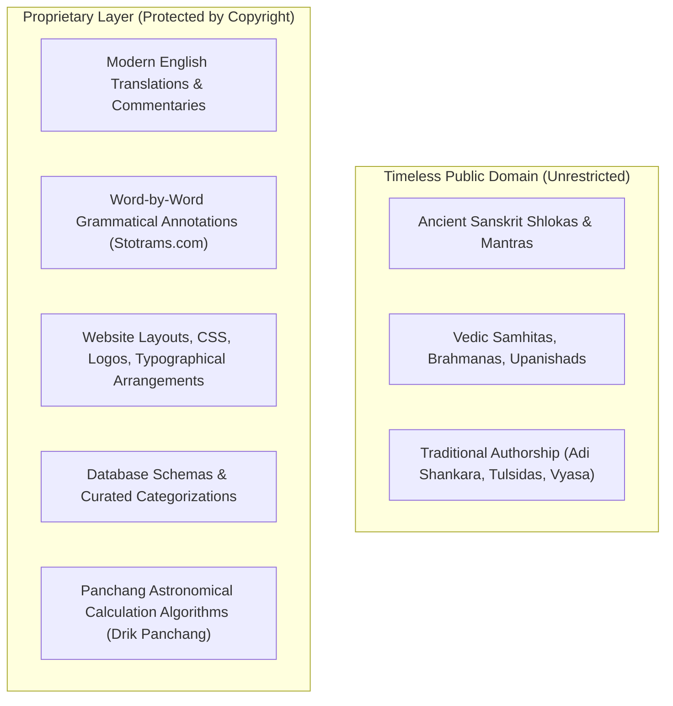

# Consolidated Source Comparison & Technical Research Report
**Phase 1 — Steps 1 to 4 Deliverable**  
**Audit Date:** 2026-11-04  
**Scope:** In-depth comparative assessment of `SRC-001`, `SRC-002`, `SRC-003`, and `SRC-004`

---

## 1. Executive Comparative Matrix

| Metric / Dimension | SRC-001: Vaidika Vignanam | SRC-002: Drik Panchang | SRC-003: Stotrams.com | SRC-004: Temples.bio |
| :--- | :--- | :--- | :--- | :--- |
| **Primary Domain** | `vignanam.org` | `drikpanchang.com` | `stotrams.com` | `temples.bio` |
| **Entity / Maintainer** | Srinivas Vadrevu (Non-profit community) | Adarsh Mobile Applications LLP (Commercial) | Independent Scholarly Team | Commercial Puja/Tour Agency |
| **Tech Stack** | S3 + CloudFront (Static pre-rendered) | Custom Server + Google Edge (Dynamic/Cookies) | Astro + Cloudflare Pages (Jamstack SSG) | Apache + PHP + MySQL (Dynamic CMS) |
| **Content Scope** | Stotras, Suktams, Mantras, Sahasranamas, Keerthanas | Vedic Mantras, Samhitas, Suktams, Panchang, Muhurta | Stotras, Sahasranamas, Chalisas, Aartis, Suktams | ~20 Popular Chalisas & Stotras (Lead Gen) |
| **Estimated Volume** | ~800–1,200 unique texts (rendered in 14+ scripts) | ~28 deity mantra categories + 2,828 calendar URLs | 31,355 indexed pages across 10 scripts & forms | ~18–25 devotional texts in ~1,924 total travel URLs |
| **Scripts Supported** | 18 scripts (Devanagari, Telugu, Tamil, Kannada, etc.) | Devanagari, English IAST, Hindi | 10 scripts (Lossless Indic transliteration) | Devanagari, Telugu, English |
| **Vedic Accents** | Yes (Unicode Anudatta U+0952, Svarita U+0951) | Yes (Rigorous Vedic Swaras) | Partial (Focus on classical Stotras) | No |
| **Word-by-Word Analysis** | No (Chanting lyrics focused) | Partial (Significance notes) | **Exceptional** (Padachheda & grammatical breakdowns) | Minimal |
| **Translations** | Minimal (Primarily lyrics) | English & Hindi summaries | Verse-by-verse English meanings | Basic English |
| **robots.txt Policy** | `Allow: /`, `Crawl-delay: 10`, blocks AI crawlers | Disallows `/ajax/`, `/dp-api/`, blocks AI bots | Open (`Allow: /`), welcomes discoverability | `Allow: /`, protects admin/config/storage |
| **Terms of Service** | Forbids app copying/translation/derivatives | Strictly proprietary (`All Rights Reserved`) | Explicitly acknowledges Sanskrit as Public Domain | Commercial terms; forbids copying or derivatives |
| **Permission Status** | **AMBER** | **RED** | **AMBER** | **RED** |
| **Recommended Strategy** | Written collaboration / Manual cross-check | Manual reference benchmark only | Formal partnership request for word-by-word data | Exclude from scraping pipeline |

---

## 2. Technical Architecture & Ingestion Viability

### 2.1 Scraping & Crawler Feasibility
1. **`SRC-001` (Vaidika Vignanam):**
   - High structural consistency with clean URL routing (`/<script>/<slug>.html`).
   - However, CloudFront and AWS S3 trigger automated blocks (e.g. HTTP 403) on unauthenticated or high-frequency requests.
   - The required `Crawl-delay: 10` means crawling 1,000 texts across 14 scripts would require $14,000 \times 10 = 140,000\text{ seconds}$ (~39 hours of continuous fragile requests).
   - *Verdict:* Automated scraping without permission is technically fragile and legally questionable.

2. **`SRC-002` (Drik Panchang):**
   - Heavy anti-bot defenses, dynamic session tokens (`_DRIK_SESSION_ID`), cookie persistence across 20+ preference parameters, and encrypted client-side payloads.
   - Core API endpoints (`/ajax/`, `/dp-api/`) are firewalled.
   - *Verdict:* Scraping will trigger immediate IP bans and violates Adarsh Mobile Applications LLP's copyright.

3. **`SRC-003` (Stotrams.com):**
   - Architecturally the cleanest: static pre-rendered HTML from Astro. Fast response times, clean DOM semantic markers.
   - However, the maintainers explicitly state in their Terms of Use: *"Automated bulk downloading of the site, or reproducing the collection as a whole, isn't on... ask us first."*
   - *Verdict:* Do not scrape unilaterally. Instead, approach them for scholarly collaboration.

4. **`SRC-004` (Temples.bio):**
   - Traditional PHP application with minimal content (~20 texts).
   - *Verdict:* Scraping is forbidden by their terms and technically unnecessary due to low content volume.

---

## 3. Copyright, Legal & Public Domain Demarcation

### Key Legal Findings:
1. **The Sanskrit Text Itself:** No entity owns the Vedic hymns, Adi Shankaracharya's stotras, or the Valmiki Ramayana. They are part of the universal public heritage.
2. **Modern Editorial Additions:** English commentaries, philosophical explanations, and word-by-word glossaries created by contemporary authors are protected intellectual property.
3. **Database Rights:** In many jurisdictions, assembling, curating, and indexing a collection into a comprehensive digital database creates a sui generis database right or compilation copyright that prohibits wholesale copying.

---

## 4. Content Taxonomy & Indic Script Analysis

### 4.1 Taxonomy Hierarchy
Across all four sources, the devotional corpus organizes naturally along these axes:
- **Primary Category:**
  - *Veda & Suktam:* Rigvedic / Yajurvedic hymns (Purusha Suktam, Sri Suktam, Rudram).
  - *Mantra:* Deity Moola Mantras, Gayatri variations, Bija mantras.
  - *Stotra & Stuti:* Praise verses, Mahatmyam recitations.
  - *Ashtakam:* 8-verse compositions (Lingashtakam, Madhurashtakam, Bilvashtakam).
  - *Sahasranama:* 1,000-name litanies (Vishnu, Lalita, Shiva, Ganesha).
  - *Ashtottara Shatanamavali:* 108 names chanted with *Namah*.
  - *Kavacham:* Protective armor hymns (Aditya Kavacham, Durga Kavacham).
  - *Chalisa & Aarti:* 40-verse regional hymns (Hanuman Chalisa, Shiv Chalisa) and concluding adoration songs.
  - *Puja Vidhi:* Panchopachara and Shodashopachara ritual procedures.
- **Deity Axis:**
  - Shiva, Vishnu, Devi (Durga, Lakshmi, Saraswati, Lalita), Ganesha, Hanuman, Subrahmanya, Rama, Krishna, Surya & Navagrahas.

### 4.2 Indic Script Coverage
- **`SRC-001` (Vignanam):** Exceptional script depth covering 18 scripts (Devanagari, Telugu, Tamil, Kannada, Malayalam, Bengali, Gujarati, Odia, Assamese, Punjabi, Sinhala, Grantha, etc.).
- **`SRC-003` (Stotrams):** 10 major scripts with accurate phonetic transliteration.
- **Conclusion for Our Platform:** By integrating open-source Indic transliteration engines (such as `indic-transliteration` / Aksharamukha algorithms), our platform can store **one canonical UTF-8 Sanskrit source text** and render it losslessly in all 22 Eighth Schedule Indian scripts on the fly, eliminating the need to scrape duplicate script copies!

---

## 5. Strategic Recommendations & Alternative Repositories

Rather than unauthorized scraping of commercial or community websites, our platform should adopt an **authoritative public-domain ingestion strategy**:

1. **Leverage Established Open Public-Domain Academic Repositories:**
   - **GRETIL (Göttingen Register of Electronic Texts in Indian Languages):** Completely open, peer-reviewed public domain digital library of classical Sanskrit texts.
   - **Sanskrit Documents (sanskritdocuments.org):** 25+ year-old volunteer public-domain archive of stotras, mantras, and suktas with transparent licensing.
   - **Muktabodha Indological Research Institute:** Authoritative manuscript repository for Tantric, Agamic, and Vedic texts.
2. **Form Official Partnerships:**
   - Write to Srinivas Vadrevu (`contact@vignanam.org`) and Stotrams.com (`stotrams.com/contact`) to explore authorized, attributed integration for academic and digital preservation.
3. **Internal Transliteration Engine:**
   - Do not scrape 14 different language pages for the same stotra. Ingest the verified Devanagari Sanskrit text once, and use our Python `indic-transliteration` pipeline to project it cleanly into Telugu, Tamil, Kannada, Malayalam, Bengali, etc.

---

## 6. Identified Risks & Open Questions

| Risk / Question | Severity | Mitigation Strategy |
| :--- | :---: | :--- |
| **Legal Infringement on Database Rights** | High | Never scrape websites wholesale. Use open academic public-domain sources (GRETIL, SanskritDocuments) and seek formal permission from community sites. |
| **IP Ban / Rate Limit Lockout** | Medium | Vignanam enforces a 10s delay; Drik Panchang bans bots. Automated scrapers must remain disabled until explicit authorization is obtained. |
| **Textual Corruption in Digitized Copies** | High | Many internet copies have OCR errors, missing anusvaras, or altered sandhi. Implement multi-source cross-referencing and compare against printed Critical Editions (Gita Press, Ramakrishna Math). |
| **Loss of Vedic Accents (Swaras)** | High | When transliterating Vedic suktas into regional scripts, accents (Anudatta / Svarita) are often lost. Design our database schema with Unicode combining character support. |

---

## 7. Recommended First Pilot Collection (Phase 1, Step 9)

To test our end-to-end Python database, validation, and export pipelines without legal ambiguity, we recommend starting with a pilot of **7 universally celebrated, undisputed public-domain compositions**:

1. **Ganesha Pancharatnam** (*Composed by Adi Shankaracharya*) — 5 verses + Phalasruti.
2. **Shiva Tandava Stotram** (*Attributed to Ravana*) — 15 verses.
3. **Aditya Hrudayam** (*Valmiki Ramayana, Yuddha Kanda, Sarga 105*) — 31 verses.
4. **Madhurashtakam** (*Composed by Vallabhacharya*) — 8 verses.
5. **Mahamrityunjaya Mantra & Gayatri Mantra** (*Rigveda / Yajurveda Samhitas*) — Core Vedic mantras with accents.
6. **Hanuman Chalisa** (*Composed by Goswami Tulsidas*) — 40 chaupais + 2 dohas (Awadhi/Hindi).
7. **Sri Suktam** (*Rigvedic Khila Sukta*) — 15 verses + Phalasruti with Vedic accents.

### Pilot Execution Protocol:
- Assemble each text from undisputed public-domain scholarly editions.
- Store raw Sanskrit text in Devanagari with standard Unicode combining accents.
- Cross-verify verse counts, meter, and variants against `SRC-001` (Vignanam) and `SRC-003` (Stotrams.com) manually as benchmarks.
- Test our automated transliteration engine to generate Telugu, Tamil, and Kannada scripts.
- Test automated Word (.docx) and Excel (.xlsx) exports.
